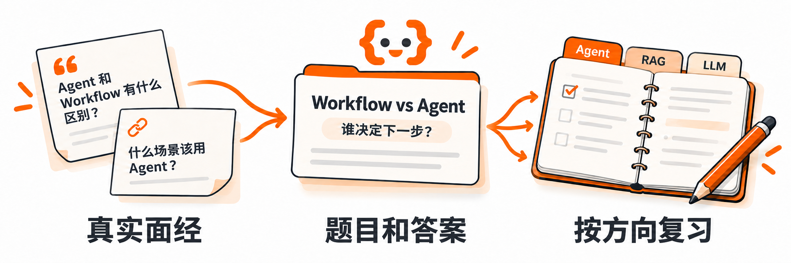

<div align="center">

# 面栈 MianStack

### 面试之前，先来面栈

**你的 AI Agents 面试宝藏库**

真面经、真问题、成体系，帮你把零散知识变成面试时说得清的答案。

<p>
  <a href="INDEX.md"></a>
  <a href="indexes/interviews.md"></a>
  <a href="https://mianstack.com/company/"></a>
  <a href="#知识目录"></a>
</p>

**[开始复习](https://mianstack.com/must-review/)** · [按公司找面经](https://mianstack.com/company/) · [浏览题库](INDEX.md) · [参与贡献](#参与贡献)

</div>

[](https://mianstack.com/)

面栈是一个面向求职者的开源面试题库和答案库，重点覆盖 **AI Agent、LLM 应用、RAG、模型训练与 AI 工程**，同时保留这些岗位经常考查的软件工程、算法和项目问题。

你可以在 [mianstack.com](https://mianstack.com/) 找题、筛选面经、记下复习情况，也可以直接在 GitHub 阅读题目和补充答案。具体有多少题、多少篇面经，见[题库总索引](INDEX.md)。

## 从这里开始

- **面试快到了**：[先看「面前必看」](https://mianstack.com/must-review/)，把答不好的题标出来，集中练习。
- **准备某家公司**：[按公司找面经](https://mianstack.com/company/)，选你要投的岗位，看看一面、二面都问过什么。
- **想补技术知识**：打开[知识目录](#知识目录)，按 Agent、RAG、模型训练等方向找题，复习自己不熟悉的部分。
- **继续上次复习**：[打开「我的复习」](https://mianstack.com/study/)，接着上次看，或者回看标为「待复习」的题。

## 怎么用面栈准备面试

### 按公司和岗位找面经

公司页面把已收录的面经和题目放在一起，你可以按岗位、招聘类型和面试轮次筛选。看到某个问题，点开对应面经，就能查看当时还问了什么。

例如，介绍 RAG 项目时，面试官除了问流程，还可能继续问：为什么不用向量检索？文档切得太细有什么问题？怎么检查检索效果？[看看这篇面经里的实际提问](https://mianstack.com/interview/mj-nc-2026-0559/?view=questions)。

### 同一个问题，不用反复翻面经

不同面经可能在问同一个问题，只是说法不一样。面栈把这些问法放在同一道题下，方便你一起看常见问法和参考答案。

想了解某次面试的前后提问，点回对应面经即可。你既能按知识点复习，也能看到不同公司具体怎么问。

### 先自己回答，再对照答案

参考答案先回答问题，再解释原因、做法和常见追问。涉及不同方案时，会说明各自的优缺点和适用条件。

你可以先试着讲一遍，再对照答案看看漏了什么。最后用自己的项目举例，练习回答为什么这样设计、遇到问题怎么解决。

### 记下不会的题，下次接着复习

在网站里，你可以收藏题目、面经和公司，把题目标为「待复习」或「已掌握」。下次打开「我的复习」，就能找到这些记录，也能接着上次读的位置继续看。

复习记录保存在当前浏览器。

## 以 Workflow 和 Agent 的区别为例

下面两篇面经都问到了这个问题：

- [恒生电子 · AI 开发工程师](interviews/MJ-NC-2026-0586.md)：“Agent 和 Workflow 的区别，分别适合什么场景？”
- [阿里巴巴 · AI 应用研发工程师](interviews/MJ-NC-2026-0579.md)：“Workflow和自治Agent的区别是什么？什么场景更适合Workflow”

在面栈里，这两种问法放在 **[Workflow 和 Agent 有什么区别？](questions/Q-0140.md)** 这道题下面。

> **回答要点**：最大的区别是下一步由谁决定。Workflow 的步骤和分支先由代码规定；Agent 根据任务目标和执行结果，决定下一步怎么做。

参考答案还解释了两者各适合什么情况，以及怎样一起使用。在网站上，这道题下面还列着相关面经和其他题目，可以继续查看。

**[在网站看这道题](https://mianstack.com/question/q-0140/)** · [在 GitHub 看答案](questions/Q-0140.md)

也可以看看：

- [RAG 从知识入库到在线问答的完整流程是什么？](questions/Q-0047.md)
- [如何保证模型提供正确参数并可靠地调用工具？](questions/Q-0050.md)

## 知识目录

除了 AI 技术，面试还会问数据库、算法和你做过的项目。下面把这些内容分开整理，方便你按需要复习。

| 方向                                           | 重点内容                                                                |
| ---------------------------------------------- | ----------------------------------------------------------------------- |
| [模型基础与推理](indexes/llm.md)               | Transformer、Attention、解码、KV Cache、多模态与模型选型                |
| [RAG 与知识系统](indexes/rag.md)               | 文档切分、混合检索、重排、知识更新、GraphRAG、Text-to-SQL 与评测        |
| [Agent 原理与系统](indexes/agent.md)           | Agent Loop、规划、上下文、记忆、工具调用、MCP、Skills、工作流与多 Agent |
| [AI 应用工程与治理](indexes/ai-engineering.md) | Prompt、评测、问题排查、日志与监控、安全、成本、性能与 AI 辅助编程      |
| [模型训练与对齐](indexes/training.md)          | 预训练、SFT、LoRA、偏好对齐、强化学习与分布式训练                       |
| [软件工程基础](indexes/software.md)            | 语言与框架、网络、数据库、缓存、并发与分布式系统                        |
| [算法与编程题](indexes/coding.md)              | 数据结构、经典算法、SQL、手写代码与逻辑推理                             |
| [项目与综合面试](indexes/career.md)            | 项目介绍、你负责了什么、为什么这样设计、实习经历、团队协作与反问面试官  |

其他入口：[全部题目](INDEX.md) · [真实面经](indexes/interviews.md) · [公开题集](indexes/collections.md) · [简历、自我介绍与面试准备](https://mianstack.com/prepare/)

## 参与贡献

欢迎一起完善面栈：

- **[完善现有题目](https://github.com/didilili/mianstack/issues/new?template=question-improvement.yml)**：纠正题目、分类和答案中的错误，补充或改进参考答案。
- **[新增面经](https://github.com/didilili/mianstack/issues/new?template=interview-submission.yml)**：分享公开面经的链接，或提交整理好的面经内容。

可以直接提交 Pull Request，也可以在 Issue 里提建议或分享面经。具体方式见[贡献指南](CONTRIBUTING.md)。

<details>
<summary><strong>仓库里有哪些文件</strong></summary>

```text
mianstack/
├── questions/       # 面试题、考点与参考答案
├── interviews/      # 面经出处、公司岗位与原帖内容
├── collections/     # 公开题集里的题目与出处
├── indexes/         # 自动生成的题库目录
├── schema/          # 字段与引用规则
├── examples/        # 题目、面经与关系文件示例
├── categories.json  # 知识方向与专题
├── aliases.json     # 旧题号对应的新题号
└── publishers.json  # 公开题集发布者
```

题号固定，不会重新排序或重复使用。面经和公开题集分别统计；题目的出现次数来自已收录的面经，不代表实际面试中的出题概率。

[字段说明](schema/README.md) · [维护与发布](MAINTAINING.md)

</details>

## 许可证

面栈自己编写和整理的题目、参考答案、文档与代码采用 [MIT License](LICENSE)。

---

如果面栈对你的备考有帮助，欢迎 **Star 收藏**，也欢迎分享给正在准备面试的朋友。
