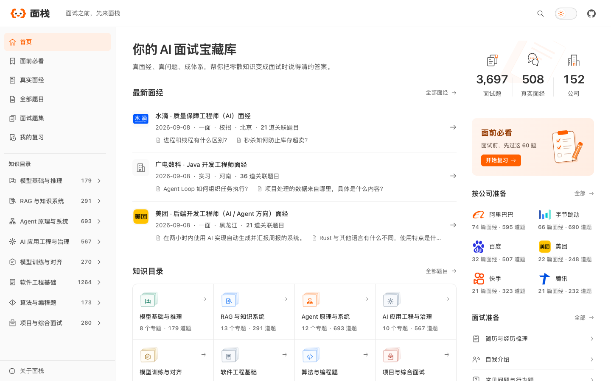

<div align="center">

# 面栈 MianStack

### 面试之前，先来面栈

**你的 AI 面试宝藏库**

真面经、真问题、成体系，帮你把零散知识变成面试时说得清的答案。

<p>
  <a href="INDEX.md"></a>
  <a href="indexes/interviews.md"></a>
  <a href="https://mianstack.com/company/"></a>
  <a href="LICENSE"></a>
</p>

**[开始复习](https://mianstack.com/must-review/)** · [浏览真实面经](https://mianstack.com/interview/) · [查看全部题目](https://mianstack.com/question/) · [参与贡献](CONTRIBUTING.md)

</div>

[](https://mianstack.com/)

## 为 AI 时代的技术面试而整理

面栈是一个面向求职者的开源面试题库和答案库，重点覆盖 **AI Agent、LLM 应用、RAG、模型训练与 AI 工程**，同时保留这些岗位经常考查的软件工程、算法和项目问题。

你可以在这里：

- 从真实面经出发，看看不同公司和岗位到底怎么问；
- 按知识方向系统复习，把零散题目串成完整知识体系；
- 阅读经过整理的参考答案，练习把答案讲清楚；
- 回到原始出处，核对题目的岗位、轮次和提问语境。

当前仓库收录：

| 整理后的面试题 | 真实面经 | 面经中的实际提问 | 知识方向 |
| -------------: | -------: | ---------------: | -------: |
|         3,700+ |     500+ |           7,800+ |        8 |

精确数量由[题库总索引](INDEX.md)根据仓库内容生成。

## 真面经、真问题、成体系

### 每道题，都能看到从哪里来

题目来自真实面经和公开题集。公司、岗位、面试轮次和原始链接会保留下来，让你知道一道题为什么值得准备，又是在什么语境下出现的。

### 同一个知识点，不用重复背十遍

同一个知识点，面试官可能换着方式提问。面栈会把意思相同的问题合并成一道更适合复习的题，同时保留面经里的具体问法和追问方式。

### 不只告诉你考什么，也帮你想清楚怎么答

参考答案先回答结论，再解释关键原理、方案取舍、常见追问，以及如何结合项目经历继续回答。没有写完或尚未校对的内容会明确标出，不会拿草稿充当成品。

### 从 Agent 到工程基础，一起准备

题库以 AI Agent 与大模型应用岗位为核心，也覆盖模型基础、RAG、训练、软件工程、算法题、项目追问和行为面试。

## 按你的目标开始

| 你的目标                   | 推荐入口                                                                              |
| -------------------------- | ------------------------------------------------------------------------------------- |
| 面试临近，先过核心题       | [面前必看](indexes/priority.md)                                                       |
| 准备 Agent 开发岗位        | [Agent 原理与系统](indexes/agent.md) · [AI 应用工程与治理](indexes/ai-engineering.md) |
| 准备 RAG 或知识库岗位      | [RAG 与知识系统](indexes/rag.md)                                                      |
| 准备大模型算法或训练岗位   | [模型基础与推理](indexes/llm.md) · [模型训练与对齐](indexes/training.md)              |
| 想看不同公司实际怎么问     | [真实面经](indexes/interviews.md)                                                     |
| 想搜索、筛选并记录复习进度 | [mianstack.com](https://mianstack.com/)                                               |

## 看一道题，怎么从面经走到答案

以 [Workflow 和 Agent 有什么区别？](questions/Q-0140.md) 为例：

> **核心回答：**两者最主要的区别，是谁来决定下一步执行什么。Workflow 的步骤和分支由代码预先定义；Agent 则根据目标和执行反馈，动态选择下一步动作。

这道题在 10 篇面经中出现过，面试官的实际问法包括：

- “9.Agent和workflow的区别”
- “Agent 和 工作流（Workflow）的本质区别是什么？什么场景该用Agent，什么场景该用工作流？”
- “固定的‘感知-推理-校验’流程和动态多 Agent 最大区别是什么。”

面栈会把这些问法整理到同一道题下，保留原始出处，并为题目整理参考答案和常见追问。你不用重复复习，也不会丢掉真实面试里的表达差异。

## 8 个方向，从模型到工程

各方向的精确题目数由索引自动生成，以下只说明内容边界：

| 方向                                           | 主要内容                                                |
| ---------------------------------------------- | ------------------------------------------------------- |
| [模型基础与推理](indexes/llm.md)               | Transformer、推理、解码、多模态与模型能力边界           |
| [RAG 与知识系统](indexes/rag.md)               | 文档处理、检索、重排、知识更新、GraphRAG 与 Text-to-SQL |
| [Agent 原理与系统](indexes/agent.md)           | Agent Loop、规划、记忆、工具调用、工作流与多 Agent      |
| [AI 应用工程与治理](indexes/ai-engineering.md) | Prompt、评测、安全、可观测性、性能、成本与交付          |
| [模型训练与对齐](indexes/training.md)          | 预训练、微调、偏好对齐、强化学习与分布式训练            |
| [软件工程基础](indexes/software.md)            | 语言、框架、网络、存储、并发、分布式系统与工程实践      |
| [算法与编程题](indexes/coding.md)              | 数据结构、算法、SQL、工程编码与逻辑推理                 |
| [项目与综合面试](indexes/career.md)            | 项目表达、个人贡献、协作、行为面与候选人反问            |

## 把知识变成面试时说得清的答案

面栈已经建立答案库，目前先从“面前必看”和跨岗位常见问题开始完善。只有写完并达到公开阅读标准的内容才会标为“已有答案”。

你可以先查看：

- [RAG 从知识入库到在线问答的完整流程是什么？](questions/Q-0047.md)
- [如何保证模型提供正确参数并可靠地调用工具？](questions/Q-0050.md)
- [Workflow 和 Agent 有什么区别？](questions/Q-0140.md)

## 内容是怎么整理的

```text
真实面经 / 公开题集
        ↓
保留实际提问与出处
        ↓
合并意思相同的问题
        ↓
整理题目、答案与常见追问
        ↓
持续校对和更新
```

公开题集用于补充覆盖范围，真实面经出现次数单独统计。题目、面经和题集都有固定编号，已经使用的编号不会重新排序或重复使用。

## 一起把面栈补得更好

欢迎一起补充答案、核对技术事实、修正题目、提供公开面经线索或改进分类。

- [阅读贡献指南](CONTRIBUTING.md)
- [查看维护与发布说明](MAINTAINING.md)
- [提交内容纠错](https://github.com/didilili/mianstack/issues/new?template=content-correction.yml)
- [提出答案建议](https://github.com/didilili/mianstack/issues/new?template=answer-suggestion.yml)
- [反馈署名、来源或移除请求](https://github.com/didilili/mianstack/issues/new?template=rights-request.yml)

小的错字、链接和答案修正可以直接提交 Pull Request；新增大批内容、调整分类或改变字段前，请先创建 Issue 说明范围。

<details>
<summary><strong>查看仓库结构</strong></summary>

```text
mianstack-corpus/
├── questions/       # 面试题、主要考点与参考答案
├── interviews/      # 面经来源信息与可公开展示的来源材料
├── collections/     # 其他公开题集收录的题目
├── indexes/         # 自动生成的 GitHub 阅读索引
├── schema/          # 唯一机器规则与字段语义说明
├── examples/        # 题目、面经和关系文件示例
├── LICENSES/        # 仓库与第三方内容许可入口
├── categories.json  # 知识方向与专题
├── aliases.json     # 已合并稳定题号指向现用题号
└── publishers.json  # 公开题集发布者
```

</details>

## 许可证

MianStack 采用 [MIT License](LICENSE)，面栈创作和整理的题目、答案、文档与代码均按 MIT License 开放。

---

**面试之前，先来面栈。**

如果这个项目帮你少走了一些弯路，欢迎点一个 Star；如果你熟悉某个问题，也欢迎把答案补进来，让下一位求职者准备得更从容。
