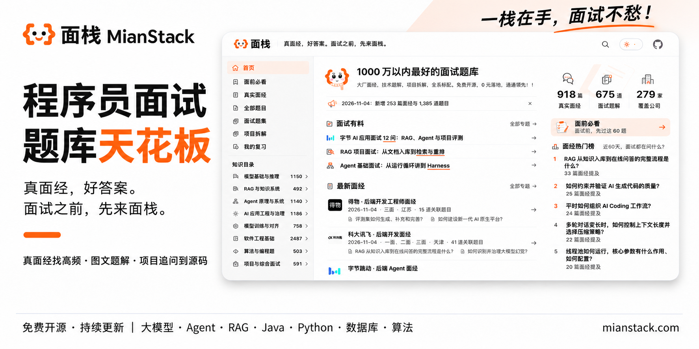

<div align="center">

# 🎯 面栈 MianStack｜免费开源的 AI 面试题库与真实面经

### 真面经，好答案。面试之前，先来面栈。

**你的 AI Agents 面试宝藏库：真面经、真问题、成体系，帮你把零散知识变成面试时说得清的答案。**

聚焦 **AI Agent、LLM 应用、RAG、模型训练与 AI 工程**。

<p>
  <a href="INDEX.md"></a>
  <a href="indexes/interviews.md"></a>
  <a href="INDEX.md#current-content"></a>
  <a href="https://mianstack.com/company/"></a>
  <a href="#knowledge-directions"></a>
</p>

**[开始复习](https://mianstack.com/must-review/)** · [按公司找面经](https://mianstack.com/company/) · [浏览题库](INDEX.md) · [简历与面试准备](https://mianstack.com/prepare/) · [配套实战教程](#project-learning) · [一起完善面栈](#contributing)

</div>

准备 AI 面试，最关心的就是：**目标岗位会问什么、先复习哪些题、项目被追问时怎么答。** 面栈从公开面经中整理真实提问，把分散在不同公司、岗位和轮次里的问题放进知识目录，让你有重点地复习。

在 [mianstack.com](https://mianstack.com/)，你可以查真实面经、读题目和参考答案、标记复习进度，也可以准备简历、自我介绍和项目表达。**网站免费使用，题库内容、数据格式与维护工具在本仓库开源。**

[](https://mianstack.com/)

## 🚀 从这里开始

- **面试快到了**：[先过「面前必看」](https://mianstack.com/must-review/)，把各方向的核心题练一遍。
- **想先练收录最多的题**：[打开网站题库](https://mianstack.com/question/)，默认按关联面经数量排序，先看反复出现在已收录面经中的问题。
- **已经有目标公司**：[按公司找面经](https://mianstack.com/company/)，筛选岗位和面试轮次，看看同类岗位实际问过什么。
- **想补某一块知识**：打开[知识目录](#knowledge-directions)，找到对应专题，集中补自己不熟悉的内容。
- **简历和开场还没准备好**：[梳理简历与经历](https://mianstack.com/prepare/resume-and-experience/)，再[练习自我介绍](https://mianstack.com/prepare/self-introduction/)。
- **继续上次复习**：[打开「我的复习」](https://mianstack.com/study/)，接着上次看，或者回看标为「待复习」的题。

## ✨ 面栈有什么不同

- 🧾 **从真实面经整理题目，不靠 AI 凑题**：题库以牛客、小红书等公开面经中的真实提问为基础，保留面试官原本怎么问，再按知识点整理成题目；也补充有明确出处的公开题集。你能回到原始材料核对，知道问题从哪里来、是在什么情况下问的。

- 🧭 **8 个知识方向，按专题快速查漏补缺**：模型、RAG、Agent、AI 工程、训练、软件工程、算法和综合面试分开整理，每个方向再按专题细分。想补检索、工具调用、模型微调或数据库，直接找到对应目录，顺着同一专题把相关题目练一遍。

- 🔥 **默认按收录面经数排序，先练反复出现的题**：关联面经越多的题，默认排得越靠前，方便先准备有更多真实提问记录的知识点。备考时间紧，直接从「面前必看」开始；核心题过一遍，再回到专题补薄弱项。

- 🏷️ **按专题、题型和难度筛题，还能回看原始问法**：题目按知识专题、题目类型和技术难度组织，方便按需要筛选。同一个问题在不同面经里怎么问，会放在同一道题下；题目旁能找到相关面经，点回去就能查看同场面试的前后提问。

- 🏢 **面经保留作者和原帖，按公司、岗位直接找**：每篇面经保留作者与原始链接，并记录发布时间、公司、岗位、面试阶段和归档编号等信息。按公司、岗位、招聘类型和轮次筛选，既能看整理后的问题，也能顺着原帖核对完整经历。

- 💼 **从项目介绍到技术追问，项目题也能系统练**：题库覆盖项目背景、架构选择、个人贡献、难点排查和效果评估等问题。为什么这样设计、你具体做了什么、效果怎么验证，都有对应的练习方向。后续会继续补充围绕实际项目的面试题、参考答案和可运行源码，让项目题有代码可看、有过程可讲。

- 📚 **配套 ai-agents-from-zero，学完项目就练面试**：与 [AI 智能体实战教程](https://github.com/didilili/ai-agents-from-zero)一起使用：跟着教程学 RAG、Agent、LangChain、LangGraph，跑案例、做项目，再回面栈练对应知识点和项目追问。参考答案会结合教程内容和项目实践，讲清实现步骤、方案选择和常见追问。

- 📝 **简历、自我介绍、行为题和反问，一起准备**：除了刷技术题，还提供[简历与经历梳理、自我介绍、行为面试和反问指南](https://mianstack.com/prepare/)。项目经历怎么写进简历，开场的一分钟怎么介绍自己，遇到协作、困难和复盘类问题怎么回答，都有具体结构和示例可以跟着练。

- 📌 **收藏和复习标记，把时间花在没掌握的题上**：题目、面经和公司都能收藏，题目可以标为「待复习」或「已掌握」。打开「我的复习」，集中练还没掌握的题，回看收藏，或接着上次的位置继续读。收藏和复习记录保存在当前浏览器。

## 🔗 一道题怎样连接多篇真实面经

以「Workflow 和 Agent 有什么区别」为例，下面两篇真实面经都问到了：

- [恒生电子 · AI 开发工程师](interviews/MJ-NC-2026-0586.md)：“Agent 和 Workflow 的区别，分别适合什么场景？”
- [阿里巴巴 · AI 应用研发工程师](interviews/MJ-NC-2026-0579.md)：“Workflow和自治Agent的区别是什么？什么场景更适合Workflow”

打开 **[Workflow 和 Agent 有什么区别？](questions/Q-0140.md)**，这两种原始问法和对应面经可以一起看，再对照参考答案准备：

> **回答要点**：最大的区别是下一步由谁决定。Workflow 的步骤和分支先由代码规定；Agent 根据任务目标和执行结果，决定下一步怎么做。

**[在网站看这道题](https://mianstack.com/question/q-0140/)** · [在 GitHub 看答案](questions/Q-0140.md)

<a id="knowledge-directions"></a>

## 🧭 按知识方向复习

除了 AI 技术，面试还会问数据库、算法和你做过的项目。下面把这些内容分开整理，方便你按需要复习。

| 方向                                           | 重点内容                                                                |
| ---------------------------------------------- | ----------------------------------------------------------------------- |
| [模型基础与推理](indexes/llm.md)               | Transformer、Attention、解码、KV Cache、多模态与模型选型                |
| [RAG 与知识系统](indexes/rag.md)               | 文档切分、混合检索、重排、知识更新、GraphRAG、Text-to-SQL 与评测        |
| [Agent 原理与系统](indexes/agent.md)           | Agent Loop、规划、上下文、记忆、工具调用、MCP、Skills、工作流与多 Agent |
| [AI 应用工程与治理](indexes/ai-engineering.md) | Prompt、评测、问题排查、日志与监控、安全、成本、性能与 AI 辅助编程      |
| [模型训练与对齐](indexes/training.md)          | 预训练、SFT、LoRA、偏好对齐、强化学习与分布式训练                       |
| [软件工程基础](indexes/software.md)            | 语言与框架、网络、数据库、缓存、并发与分布式系统                        |
| [算法与编程题](indexes/coding.md)              | 数据结构、经典算法、SQL、手写代码与逻辑推理                             |
| [项目与综合面试](indexes/career.md)            | 项目介绍、你负责了什么、为什么这样设计、实习经历、团队协作与反问面试官  |

其他入口：[全部题目](INDEX.md) · [真实面经](indexes/interviews.md) · [公开题集](indexes/collections.md) · [简历、自我介绍与面试准备](https://mianstack.com/prepare/)

<a id="project-learning"></a>

## 📚 配套教程与实战项目

[ai-agents-from-zero](https://github.com/didilili/ai-agents-from-zero) 提供系统教程、可运行案例和实战项目。跟着教程把项目跑起来，再用面栈里的题检查自己是否理解了其中的原理和设计。

可以从这两个实战项目开始：

- **[电商问数](https://github.com/didilili/shopkeeper-agent)**：NL2SQL + LangGraph 实战，结合数据查询、流程设计、异常处理和方案选择练习项目面试。
- **[深度研搜](https://github.com/didilili/deepsearch-agents)**：DeepAgents 多智能体实战，结合任务拆分、信息检索、工具调用和协作机制练习项目追问。

练项目题时，重点讲清楚：**为什么这样选、自己负责了什么、效果怎么验证、遇到问题怎么解决。**

<a id="contributing"></a>

## 🤝 一起完善面栈

欢迎一起完善面栈：

- **[完善现有题目](https://github.com/didilili/mianstack/issues/new?template=question-improvement.yml)**：纠正题目、分类和答案中的错误，补充或改进参考答案。
- **[新增面经](https://github.com/didilili/mianstack/issues/new?template=interview-submission.yml)**：分享自己的面试经历，或提供牛客、小红书等公开面经链接。

通过 Issue 提建议或分享面经即可，维护者会核对、整理并检查网站展示。具体方式见[贡献指南](CONTRIBUTING.md)。

<details>
<summary><strong>仓库里有哪些文件</strong></summary>

```text
mianstack/
├── questions/       # 面试题、考点与参考答案
├── assets/questions/ # 按题号保存的答案配图
├── interviews/      # 面经出处、公司岗位与原帖内容
├── collections/     # 公开题集里的题目与出处
├── indexes/         # 自动生成的题库目录
├── schema/          # 字段与引用规则
├── examples/        # 题目、面经与关系文件示例
├── scripts/         # 内容检查与目录生成
├── tests/           # 内容检查脚本的测试
├── categories.json  # 知识方向与专题
├── aliases.json     # 旧题号对应的新题号
└── publishers.json  # 公开题集发布者
```

题号固定，不会重新排序或重复使用。公开题集单独整理，也能按知识点一起复习。最新收录数量见[当前内容](INDEX.md#current-content)。

使用这些数据开发检索、复习工具或阅读网站，见[数据使用说明](USAGE.md)。字段与维护方式见[字段说明](schema/README.md)、[维护说明](MAINTAINING.md)和[变更记录](CHANGELOG.md)。

</details>

## 📄 许可证

面栈自己编写和整理的题目、参考答案、文档与代码采用 [MIT License](LICENSE)。

第三方面经、引用和题集不会因为被收录就改用 MIT 许可；来源、署名及相关反馈见[贡献指南](CONTRIBUTING.md#sources-and-attribution)。

---

**免费、开源、持续更新，陪你把下一场 AI 面试准备好。** 如果面栈对你有帮助，欢迎 **Star 收藏**，也欢迎分享给正在找工作的朋友。
