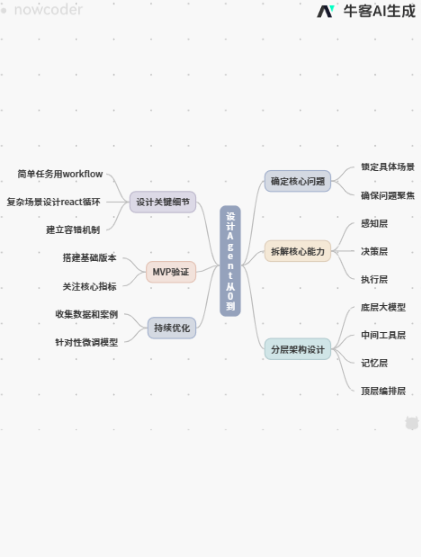

---
{
  "id": "MJ-NC-2026-0386",
  "title": "阿里巴巴（淘宝）｜Agent 应用开发工程师（内容推测）｜方法分享",
  "originalTitle": "淘宝Agent一面：如何从0到1设计Agent",
  "company": "阿里巴巴",
  "business": "淘宝",
  "role": "Agent 应用开发工程师",
  "roleFamilies": [
    "AI 应用与智能体开发"
  ],
  "contexts": [
    {
      "company": "阿里巴巴",
      "business": "淘宝",
      "department": "",
      "roleFamily": "AI 应用与智能体开发",
      "role": "Agent 应用开发工程师",
      "roleMethod": "面试内容推测",
      "roleInferred": true,
      "roleConfidence": "低",
      "technicalDirections": [
        "Agent"
      ],
      "jobNature": "",
      "recruitment": "",
      "batches": [],
      "rounds": [],
      "stages": [],
      "base": ""
    }
  ],
  "jobNature": "",
  "recruitment": "",
  "batches": [],
  "rounds": [],
  "base": "",
  "publishedAt": "2026-07-08 09:55:28",
  "publicationRegion": "广东",
  "author": "爱吃肉的棒男孩1",
  "url": "https://www.nowcoder.com/feed/main/detail/89c49aed475f49cb8a60e2185216abe5?sourceSSR=search",
  "contentType": "方法分享",
  "result": "",
  "sourceStatus": "完整可用",
  "statusReason": "原文不足",
  "curationStatus": "已完成",
  "curationNote": "全文和评论审读。仅建议、赞许与广告；没有从答案或 AI 配图生成面试题。 本轮公开页面可读，仍保留历史候选身份，不据此认定独立面试场次。",
  "updatedAt": "2026-09-13"
}
---
## 原帖正文

> 第一步明确核心问题：不直接做全能助手，而是锁定具体场景如自动处理客服工单或生成周报，确保问题聚焦避免设计跑偏  
>
> 第二步拆解核心能力：按感知-决策-执行闭环思考。感知层确定是纯文本还是多模态能力；决策层选择reactor模式或规划师；执行层明确可调用工具（搜索/API/数据库），三者缺一不可  
>
> 第三步分层架构设计：底层是大模型作为核心大脑；中间是工具层实现外部交互；记忆层分短期（上下文）和长期（向量数据库）；顶层是编排层把控任务流程，确保各层职责清晰便于迭代  
>
> 第四步设计关键细节：简单任务用workflow，复杂场景设计react循环；工具需标准化入参出参；建立容错机制，设置重试和人工接入点应对异常  
>
> 第五步MVP验证：先搭建基础版本跑通真实数据，重点关注任务完成率、平均轮次、工具调用准确率等核心指标，据此迭代优化  
>
> 第六步持续优化：上线后持续收集数据、分析失败案例、整理用户反馈，针对性微调模型、调整提示词、扩充工具集，形成数据驱动的长期迭代闭环  
>
> #牛客AI配图神器##我的求职进度条##发面经攒人品##找不到好工作选择GAP真的丢人吗##找工作八股要背到什么程度？##AI求职记录##agent 开发#

## 图片

[查看牛客原图](https://uploadfiles.nowcoder.com/images/20260708/116086861_1783475672321/D2B5CA33BD970F64A6301FA75AE2EB22)

[查看牛客原图](https://uploadfiles.nowcoder.com/images/20220815/318889480_1660553763434/7A0C3C39D0D8037360A2B600921D52C5)

带“牛客 AI 生成”标记的思维导图仅作原帖附件保存，不据此另编面试提问。

## 有价值评论

**可见评论 1 · offer快找我**

> 同学拼多多27届校招提前批机会考虑吗？团队氛围好，工作内容挑战性强，薪资待遇极具竞争力。可一对一帮查进度，解答过程问题。

**可见评论 2 · 哈哈哈，你是老六**

> 写的真的不错呀

**可见评论 3 · 哈哈哈，你是老六**

> 可以的，写的很好呢

**可见评论 4 · Thund3r**

> 任务完成率指标能救场

**可见评论 5 · 网络社牛现实见面尴尬症**

> 从客服工单切进去还挺好讲

**可见评论 6 · F4ll**

> 淘宝Agent设计题比八股难多了

**可见评论 7 · datalinkx**

> 从0到1设计agent 说起来简单做起来全是坑
