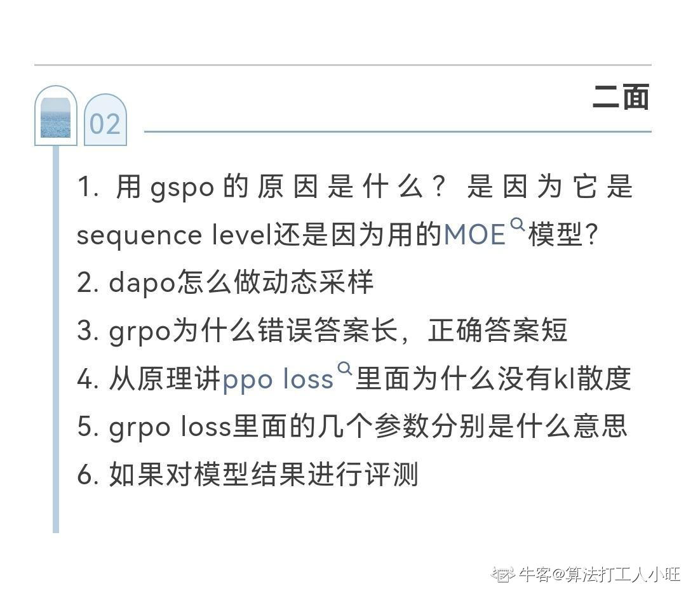

---
{
  "id": "MJ-NC-2026-0398",
  "title": "阿里巴巴（千问）｜Agent 算法工程师｜二面",
  "originalTitle": "阿里千问agent算法岗二面面经",
  "company": "阿里巴巴",
  "business": "千问",
  "role": "Agent 算法工程师",
  "roleFamilies": [
    "算法研发"
  ],
  "contexts": [
    {
      "company": "阿里巴巴",
      "business": "千问",
      "department": "",
      "roleFamily": "算法研发",
      "role": "Agent 算法工程师",
      "roleMethod": "原文明示",
      "roleInferred": false,
      "roleConfidence": "",
      "technicalDirections": [
        "Agent"
      ],
      "jobNature": "",
      "recruitment": "",
      "batches": [],
      "rounds": [
        "二面"
      ],
      "stages": [],
      "base": ""
    }
  ],
  "jobNature": "",
  "recruitment": "",
  "batches": [],
  "rounds": [
    "二面"
  ],
  "base": "",
  "publishedAt": "2026-06-23 23:19:21",
  "publicationRegion": "山东",
  "author": "算法打工人小旺",
  "url": "https://www.nowcoder.com/feed/main/detail/c6e7ac5292444dbbbe1076c4908483b4?sourceSSR=search",
  "contentType": "面经",
  "result": "",
  "sourceStatus": "部分可用",
  "statusReason": "",
  "curationStatus": "部分整理",
  "curationNote": "正文仅图片，已人工审读二面6条，5条完整提问及1条评测主题；无正文和评论补充。",
  "updatedAt": "2026-09-13"
}
---
## 原帖正文

> 原帖正文由图片组成，页面没有可单独提取的正文文本。题目依据下方本地存档图片逐条转写。

## 图片

- 

