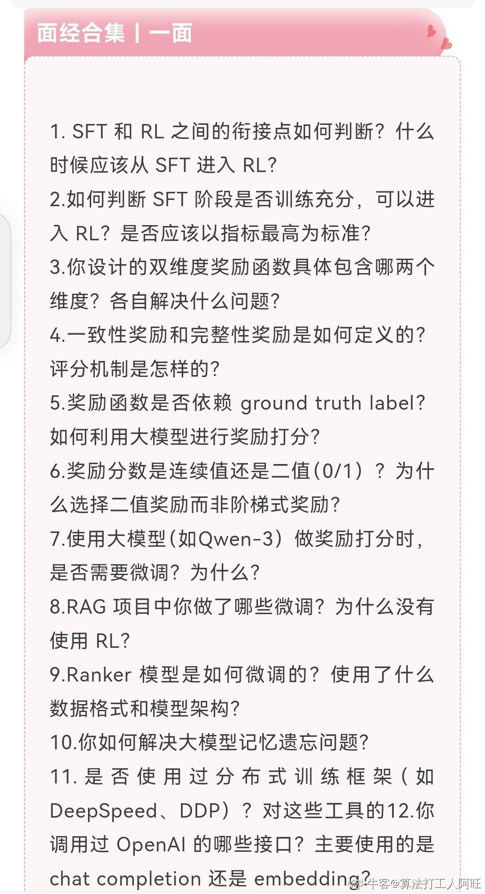
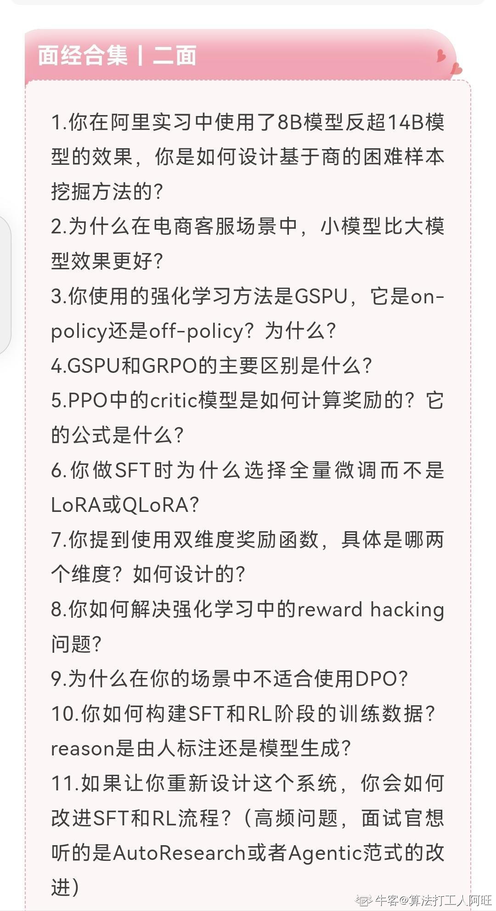

---
{
  "id": "MJ-NC-2026-0453",
  "title": "阿里巴巴（淘天）｜Agent 算法工程师（内容推测）｜一面、二面",
  "originalTitle": "淘天Agent优化一二三面面经",
  "company": "阿里巴巴",
  "business": "淘天",
  "role": "Agent 算法工程师",
  "roleFamilies": [
    "算法研发"
  ],
  "contexts": [
    {
      "company": "阿里巴巴",
      "business": "淘天",
      "department": "",
      "roleFamily": "算法研发",
      "role": "Agent 算法工程师",
      "roleMethod": "面试内容推测",
      "roleInferred": true,
      "roleConfidence": "高",
      "technicalDirections": [
        "Agent"
      ],
      "jobNature": "",
      "recruitment": "",
      "batches": [],
      "rounds": [
        "一面",
        "二面"
      ],
      "stages": [],
      "base": ""
    }
  ],
  "jobNature": "",
  "recruitment": "",
  "batches": [],
  "rounds": [
    "一面",
    "二面"
  ],
  "base": "",
  "publishedAt": "2026-05-16 22:45:57",
  "publicationRegion": "山东",
  "author": "算法打工人阿旺",
  "url": "https://www.nowcoder.com/feed/main/detail/d0344822ef434abaa20005d9632cb6d0?sourceSSR=search",
  "contentType": "面经",
  "result": "",
  "sourceStatus": "部分可用",
  "statusReason": "",
  "curationStatus": "部分整理",
  "curationNote": "两张图片逐条人工审读，一面/二面均提取；GSPU术语不明和一面11残句保留未制题，第三面图片缺失，广告与作者作答建议不计题。",
  "updatedAt": "2026-09-13"
}
---
## 原帖正文

> 📳对于想求职算法岗的同学，如果想参加高质量项目辅导，提升面试能力，欢迎后台联系。

## 图片

- 
- 

