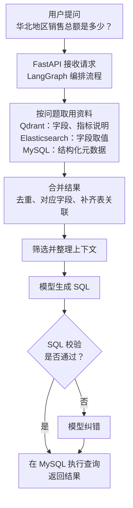

---
{
  "id": "Q-0002",
  "title": "请介绍一个你做过的项目，包括背景、架构与个人职责。",
  "category": "career",
  "topic": "项目背景、架构与职责",
  "type": "项目深挖",
  "level": "基础",
  "priority": "优先准备",
  "focus": "从业务背景到系统主线说明项目，保留各来源的上下游和岗位语境。",
  "contextTags": ["项目语境"],
  "answerStatus": "ready",
  "updatedAt": "2026-10-16"
}
---

## 回答思路

先说明项目用途，紧接着讲技术栈及各自分工，再讲处理流程、个人职责和一个具体难点。这样面试官能先了解系统全貌，再追问你负责的部分。

## 核心回答示例

下面是以电商智能问数为背景的项目介绍示例，职责与实现细节可结合个人项目调整。

> 我做过一个电商智能问数项目，面向业务人员提供自然语言查询能力，将销售数据问题转换为 SQL 并返回查询结果。
>
> 技术栈方面，Python 和 FastAPI 提供后端接口，LangGraph 编排处理流程；MySQL 保存业务数据和结构化元数据，Qdrant 检索字段与指标说明，Elasticsearch 检索字段取值。
>
> 整体流程是元数据检索、上下文构建、SQL 生成与校验，以及数据库查询。我主要负责检索结果合并模块：接收字段、指标和取值三路结果，去掉重复字段、补齐指标所需字段、把取值归到对应字段，再补齐表关联字段，输出按表组织的资料供后续步骤使用。
>
> 例如查询“华北地区的销售总额”，金额和地区名称可能来自不同表，合并时需要补齐连接字段。验证时，我会对照中间资料和生成的 SQL，核对地区筛选、金额计算及表关联是否一致。

这段介绍给出了项目用途、技术分工和个人模块的输入、处理与输出；下面进一步展开检索结果为什么需要合并。

## 沿着“华北地区销售总额”讲架构

模型需要知道表名、字段含义、“销售总额”的计算方式，以及“华北”存在哪个字段里。这些描述数据库的信息统称为**元数据**。查找元数据，是为了让模型有依据地生成 SQL。

下面是一次请求的简化流程。重点看检索结果怎样经过整理，成为 SQL 生成的输入；关键词抽取和补充上下文等细节未单独展开。

图中 MySQL 出现两处，是因为它既保存用于解释数据库的元数据，也承载查询所用的业务数据。Qdrant 的字段检索、指标检索在实现中是两路，加上 Elasticsearch 的取值检索，共有三路结果需要合并。

**为什么分开检索？** “销售总额”和指标名称可能说法不同，语义检索用来找意思接近的字段和指标；“华北”则需要对应到数据库中实际存在的取值。最后还要把它们放回具体的表和字段中，模型才知道金额从哪里取、地区条件加在哪里。

图中的纠错分支对应当前实现：纠错后直接执行，未再次经过校验。它是否足以用于实际业务，以及如何改进，见后面的追问。

## 用一个模块讲清个人贡献

“负责上下文整理”还只是模块名称。可以继续讲清这个模块接收什么、怎样处理、输出什么：

- **输入：** 三路检索得到的字段、指标和取值。
- **处理：** 按字段 ID 合并重复项；根据指标定义补齐依赖字段；将取值挂到对应字段；按表归组，并补上关联需要的主外键。
- **输出：** 按表组织的字段信息，以及相关指标定义，供后续筛选和 SQL 生成使用。

讲清输入、处理和输出后，再用同一次查询的中间结果说明怎样验证这个模块：

将同一次请求的问题、三路检索结果、合并后的资料、生成的 SQL 和对照查询结果放在一起，就能追踪某条条件是在哪一步丢失的。

例如 SQL 缺少“华北”筛选，就检查取值是否被召回、是否关联到正确字段、是否进入模型输入。接着说明问题出在哪一步、怎样调整逻辑，以及如何用原问题和同类问题验证。相关题目：[Agent 效果不达预期时，如何分析 Bad Case 并确定优化方向？](/question/q-0059/)。

介绍项目效果时，可以用功能演示说明查询怎样完成，用测试结果说明正确率或响应时间的变化。讲测试结果时，带上样本范围、比较方法和测试环境，面试官就更容易理解改动的价值。

## 面试官继续问时

**“为什么不把所有表结构直接交给模型？”**

如果只有几张小表，直接提供完整表结构可以作为起点。表很多时，问题可能只涉及订单和地区两张表，把用户、库存等无关表也塞进去，会增加输入长度，也让模型更难选对字段。本项目先按问题找候选，再补齐候选之间的关联，是为了给 SQL 生成提供够用的资料。

这样做也有代价：检索漏掉关键表或指标，后面就可能生成错误 SQL。因此不能只比较提示词变短了多少，还要用同一批问题检查表字段是否找全、查询结果是否正确。这是设计取舍，不能仅凭用了向量数据库就说方案更好。

**“校验过的 SQL 就一定正确吗？”**

不一定。即使 SQL 能被数据库解析并生成执行计划，也可能选错金额口径、漏掉地区条件。需要把 SQL 与用户问题、业务定义和对照查询结果一起核对。

这个示例所依据的代码还有一个具体边界：首次校验失败会进入纠错，纠错后直接执行，没有再次校验。若要扩展到实际使用，可以考虑纠错后再校验，并限制数据库权限、执行时间和返回量。这些是改进建议，不是当前代码已经具备的功能。

## 对应教程

- [电商问数第 2 章：项目整体架构与智能体流程](https://didilili.github.io/ai-agents-from-zero/#/实战项目-电商问数/2-项目整体架构与智能体流程)：技术分工与请求流程；MySQL 在教学环境中模拟数仓。
- [电商问数第 12 章：召回信息合并与上下文构建](https://didilili.github.io/ai-agents-from-zero/#/实战项目-电商问数/12-召回信息合并与上下文构建)：字段去重、指标依赖、取值关联与关键字段补全，含实现代码。
- [电商问数第 14 章：SQL 生成与执行闭环](https://didilili.github.io/ai-agents-from-zero/#/实战项目-电商问数/14-SQL生成与执行闭环)：SQL 校验与纠错分支，包含纠错后直接执行的实现边界。
- [电商问数第 15 章：API 接口基础与 FastAPI 入门](https://didilili.github.io/ai-agents-from-zero/#/实战项目-电商问数/15-API接口基础与FastAPI入门)：Python 后端与查询接口的职责。

## 参考资料

- [JavaGuide：后端项目面试怎么讲？](https://javaguide.cn/interview-preparation/backend-project-interview-guide.html)：参考用一次请求讲架构、用具体实现说明职责，以及如何准备技术选型追问。
- [JavaGuide：项目经验指南](https://javaguide.cn/interview-preparation/project-experience-guide.html)：参考项目选取、实现细节与个人贡献的组织方式。
- [JavaGuide：如何高效准备 Java 面试？](https://javaguide.cn/interview-preparation/teach-you-how-to-prepare-for-the-interview-hand-in-hand.html)：参考突出岗位相关技能、说明技术用途，记住要点而非整段背稿。
- [MIT CAPD：用 STAR 方法组织经历](https://capd.mit.edu/resources/the-star-method-for-behavioral-interviews/)：参考把重点放在本人行动和结果；用于展开项目难点，不强套整段技术介绍。
- [Harvard MCS：Interviewing](https://careerservices.fas.harvard.edu/resources/interviewing/)：参考用具体情境解释个人贡献，练习清楚表达，并根据问题调整详略。

资料核对：2026-10-15～16。
