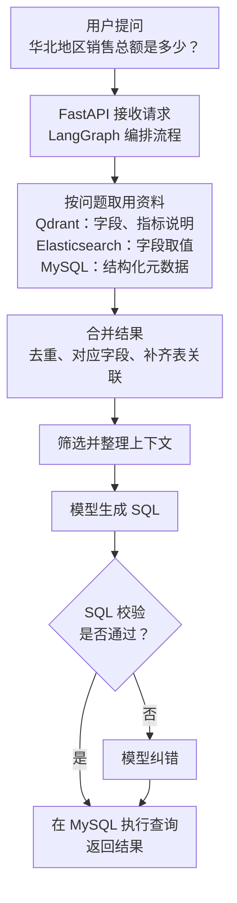

---
{
  "id": "Q-0002",
  "title": "请介绍一个你做过的项目，包括背景、架构与个人职责。",
  "category": "career",
  "topic": "项目背景、架构与职责",
  "type": "项目深挖",
  "level": "基础",
  "priority": "优先准备",
  "focus": "项目全貌与个人职责。一句话讲项目用途，交代技术栈分工，用一条请求串起架构，再展开自己负责模块的输入、处理和输出。",
  "contextTags": ["项目语境"],
  "answerStatus": "ready",
  "updatedAt": "2026-10-22"
}
---

> 在面栈阅读：[请介绍一个你做过的项目，包括背景、架构与个人职责。](https://mianstack.com/question/q-0002)

## 回答思路

先说明项目用途，紧接着讲技术栈及各自分工，再讲处理流程、个人职责和一个具体难点。这样面试官能先了解系统全貌，再追问你负责的部分。

以下是四个假设的行业二开案例。通用链路按现有开源代码介绍，行业增量按拟议方案展开，可结合实际完成的模块组织自己的回答。

经营问数与研究报告分别对应两条 `Python` 路线；设备售后提供 `Java` 服务开发和 `RAGFlow` 平台集成两种答法，可按自己的业务与技术分工选择。

## 门店经营分析助手（Python）

### 核心回答示例

> 这个项目面向区域经理和门店运营，让他们用自然语言查询销售数据。技术底座采用电商问数项目，把经营问题转换为 `SQL` 并返回查询结果。
>
> 技术栈方面，`Python` 和 `FastAPI` 提供后端接口，`LangGraph` 编排处理流程；`MySQL` 保存业务数据和结构化元数据，`Qdrant` 检索字段与指标说明，`Elasticsearch` 检索字段取值。
>
> 一次提问先召回相关字段、指标和取值，合并成上下文，再生成、校验和执行 `SQL`，过程通过 `SSE` 返回前端。
>
> 我负责门店指标与上下文适配的设计，把净销售额、退款归属和门店别名对应到指标定义与字段依赖，接入已有处理链，输出 `SQL` 生成所需的字段与指标资料。允许查询哪些门店，另由业务身份和执行层约束。
>
> 难点是 `SQL` 能执行，却可能算错业务口径。例如本例的“本月净销售额”按本期实收减本期实际退款计算，退款按发生时间归属。验证用跨月退款、部分退款和不同门店的数据，对照人工 `SQL`，检查指标定义是否真正进入了筛选与计算。

### 沿着“华北地区销售总额”讲架构

模型需要知道表名、字段含义、“销售总额”的计算方式，以及“华北”存在哪个字段里。这些描述数据库的信息统称为**元数据**。查找元数据，是为了让模型有依据地生成 `SQL`。

下面是一次请求的简化流程。重点看检索结果怎样经过整理，成为 `SQL` 生成的输入；关键词抽取和补充上下文等细节未单独展开。

图中 `MySQL` 出现两处，是因为它既保存用于解释数据库的元数据，也承载查询所用的业务数据。`Qdrant` 的字段检索、指标检索在实现中是两路，加上 `Elasticsearch` 的取值检索，共有三路结果需要合并。

**为什么分开检索？** “销售总额”和指标名称可能说法不同，语义检索用来找意思接近的字段和指标；“华北”则需要对应到数据库中实际存在的取值。最后还要把它们放回具体的表和字段中，模型才知道金额从哪里取、地区条件加在哪里。

图中的纠错分支对应当前实现：纠错后直接执行，未再次经过校验。它是否足以用于实际业务，以及如何改进，见后面的追问。

### 用业务适配讲清个人贡献

底座的合并节点已经负责字段去重、指标依赖补齐、取值关联、按表归组及主外键补齐。门店案例的设计重点，是把具体业务定义接入这条链路：

- **输入：** 净销售额与退款归属等指标定义、门店别名和字段映射，以及三路召回结果。
- **处理：** 将业务说法对应到指标与字段，补充计算所需的元数据和依赖；复用底座整理上下文。门店查询范围由业务身份与执行层约束落实。
- **输出：** 供 `SQL` 生成使用的字段与指标资料，以及可与业务定义核对的查询条件和结果。

例如“本月净销售额”需要退款金额和退款发生时间，只有支付金额与支付日期就不足以表达本例口径。先检查指标定义与依赖字段，再看这些信息是否经过召回、合并进入模型输入，可以把业务适配落到具体配置与中间产物。

将同一次请求的问题、三路召回结果、合并后的资料、生成的 `SQL` 和对照结果放在一起，就能追踪某条条件是在哪一步丢失的。

例如 `SQL` 缺少“华北”筛选，就检查取值是否被召回、是否关联到正确字段、是否进入模型输入。接着说明问题出在哪一步、怎样调整逻辑，以及如何用原问题和同类问题验证。相关题目：[Agent 效果不达预期时，如何分析 Bad Case 并确定优化方向？](/question/q-0059/)。

介绍项目效果时，可以用功能演示说明查询怎样完成，用测试结果说明正确率或响应时间的变化。讲测试结果时，带上样本范围、比较方法和测试环境，面试官就更容易理解改动的价值。

### 面试官继续问时

**“为什么不把所有表结构直接交给模型？”**

如果只有几张小表，直接提供完整表结构可以作为起点。表很多时，问题可能只涉及订单和地区两张表，把用户、库存等无关表也塞进去，会增加输入长度，也让模型更难选对字段。本项目先按问题找候选，再补齐候选之间的关联，是为了给 `SQL` 生成提供够用的资料。

这样做也有代价：检索漏掉关键表或指标，后面就可能生成错误 `SQL`。因此不能只比较提示词变短了多少，还要用同一批问题检查表字段是否找全、查询结果是否正确。这是设计取舍，不能仅凭用了向量数据库就说方案更好。

**“校验过的 `SQL` 就一定正确吗？”**

不一定。即使 `SQL` 能被数据库解析并生成执行计划，也可能选错金额口径、漏掉地区条件。需要把 `SQL` 与用户问题、业务定义和对照查询结果一起核对。

这个示例所依据的代码还有一个具体边界：首次校验失败会进入纠错，纠错后直接执行，没有再次校验。若要扩展到实际使用，可以考虑纠错后再校验，并限制数据库权限、执行时间和返回量。这些是改进建议，不是当前代码已经具备的功能。

## 设备售后知识助手（Java）

### 核心回答示例

> 这个项目帮助售后工程师根据设备型号、版本和故障现象查找适用的维修资料，重点解决相近型号手册混用的问题。
>
> 技术上基于 `Ragent`：`Java` 和 `Spring Boot` 承担后端服务，`MySQL` 保存业务与知识库记录，`Milvus` 支撑向量检索，模型服务负责生成回答。文档入库、多路检索、融合重排和引用由底座提供，案例采用固定的知识问答流程。
>
> 一次提问先核对设备信息，确定适用手册，再检索故障片段并生成带出处的建议。我负责设备与手册匹配及检索适配的设计：根据型号、版本与手册生效范围输出允许文档，接入各召回通道；条件缺失时补问，版本冲突时保留原因。
>
> 难点是主路限定了手册，补充检索仍可能混入不适用的资料。验证用同故障不同型号、同型号不同版本和无适用资料的问题，逐路检查候选文档，再核对最终引用，判断范围限制是否贯穿了整条检索链。

### 用设备与手册匹配讲清职责

这里的关键是先判断资料是否适用，再比较内容是否相关。例如两种设备都出现“启动后报警”，语义相似并不代表维修步骤可以通用。

拟议匹配模块分三步：

1. 根据设备档案统一型号别名，核对硬件或固件版本；缺少会改变处理方式的信息时，返回具体补问项。
2. 根据手册生效范围形成允许检索的文档集合，再接入底座的检索链路。所有召回通道及补充检索都要遵守这个集合，避免过滤后又从其他通道混入旧手册。
3. 把引用片段的文档与版本带到回答中，找不到适用资料时说明缺口，保留转人工处理的入口。

`Ragent` 已有通用检索作用域和后处理机制，设备适配需要接入这些机制；不能只在提示词中写“注意型号”。如果现有接口不能表达文档级限制，再考虑扩展检索入口。通用检索引擎与业务匹配代码的职责由此可以分别讲清。本案例采用固定知识问答流程，底座另有基于 `AgentScope` 的 Agent 链路。

### 难点与验证

重点准备三组对照：故障相同但设备不同、设备相同但版本不同、设备信息完整但没有适用资料。每组保留输入条件、匹配出的手册、召回片段和最终引用。若引用了错误版本，沿着匹配、召回、重排和上下文组装逐步定位，确认错误首次出现在哪一层。

若面试官问“为什么不直接把手册都放进一个知识库”，可以回答：统一入库便于管理，但设备适用范围仍要由结构化业务条件限定；语义相似度和重排解决相关性，不能替代设备版本规则。

## 产业情报研读平台（Python）

### 核心回答示例

> 这个项目面向产业研究人员，围绕企业、产品或产业链主题收集材料，形成能回看出处的研究初稿。
>
> 技术底座采用深度研搜项目。`Python` 和 `FastAPI` 提供任务接口，`DeepAgents` 基于 `LangGraph` 组织主智能体与专家助手；`Tavily` 获取公开网络资料，`MySQL` 提供结构化查询，`RAGFlow` 查询知识库，文件工具处理上传材料并生成 `Markdown` 或 `PDF`。执行进度通过 `WebSocket` 推给前端。
>
> 用户提交任务后，主智能体拆分子问题，按需要委派来源助手，再汇总资料生成报告。我负责来源适配与证据组织的设计：先让工具输出来源内容、原文位置和日期，再统一企业与产品名称、核对事件和时间，将支持或冲突的证据关联到结论与报告段落。
>
> 难点是同一篇消息被多处转载，或者两份资料说的是不同时间的数据。验证时用这些材料检查是否把转载当成独立佐证、是否混淆事实时间，并让每个结论能回到原文；新增一份材料后，再检查能否定位需要复核的结论与段落。

### 从一次研究任务展开架构与分工

例如研究“某类工业设备的产品进展”，主智能体先区分产品发布、交付和产能等子问题。网络助手搜索公开材料，数据库助手查询已有结构化记录，知识库助手检索收录文档；上传附件由主智能体的文件工具读取。它们各自获取信息，主智能体负责整合与交付。

拟议证据模块放在来源产物与报告生成之间：统一企业和产品名称，保留材料发布日期及事实发生时间，把重复转载归为同一来源线索，再将支持、冲突或缺失的证据关联到结论。比如“发布样机”和“开始交付”属于不同事实，不能因为都出现同一产品名就合成一个进展结论。

新增材料后，可以根据结论与段落的关联标出待复核位置，进一步设计局部更新；这项能力需要单独开发，底座已有的多智能体调度和 `PDF` 导出负责的是其他环节。

### 难点与验证

保留同一任务的子问题、各来源产物、证据关联和报告，检查是否漏掉关键子问题、引用是否支持结论、时间范围是否一致。再替换一份材料或加入一条冲突消息，检查哪些结论需要重审，以及不受影响的段落是否能保留。

长任务还要区分“文件已保存”和“执行状态可恢复”。当前底座使用 `InMemorySaver` 保存进程内的会话检查点；生成文件落盘不代表检查点已持久化，进程重启后的恢复需要另行设计。若介绍任务连续性，应分别验证网络断连、任务取消和服务重启的行为。

## 设备售后知识助手（RAGFlow 集成）

### 核心回答示例

> 这个项目面向设备售后工程师，根据型号、版本和故障现象查询适用手册。技术上采用 `RAGFlow` 作为知识平台，复用文档入库、切分、索引、检索与来源信息；外部 `Python` 和 `FastAPI` 服务负责设备档案、资料范围匹配与查询适配。
>
> 一次请求先确定适用手册，再调用平台检索片段，核对来源后组织答复。我负责外部设备资料适配服务的设计：把型号和版本映射到平台的知识库与文档，构造受限检索请求，再输出核对后的片段及出处，或需要补充的信息。
>
> 难点是“没有适用手册”和“有手册但没找到故障证据”需要分别处理：前者停在业务服务，不请求平台；后者保留原检索范围并返回证据缺口。验证用不同型号、版本冲突和空匹配的问题，对照设备映射、平台请求与最终引用，检查这两种情况是否被正确区分。

### 平台与业务服务怎样分工

本例按 `RAGFlow` `v0.27.2` 的接口约定设计。该版本的片段检索接口支持指定知识库与文档范围，返回内容带有来源文档和位置等信息。设备资料适配模块维护“设备型号与版本—适用手册—平台文档”的对应关系，将匹配结果用于检索请求，再核对响应是否仍在允许范围内。

型号缺失时，模块输出具体补问项；版本存在冲突时，保留冲突资料并暂停给出确定维修步骤；没有适用手册时，直接返回资料缺口。尤其要处理空范围：匹配不到文档时，不传空文档列表继续检索全库。

这条路线以业务服务代理受限检索，生成环节只接收核对后的片段。若改用平台现成聊天入口，需要核对它自己的知识库绑定和检索约束；可以按设备系列与兼容版本组织知识库，但会增加共享资料复制及更新维护。片段检索接口的参数不能直接当作聊天接口的同一契约。

### 难点与验证

保留一条请求中的设备档案、资料映射、检索请求、返回片段和引用。若同一问题换一个型号，允许文档应随之变化；若没有适用资料，流程应停在业务服务；若平台返回的片段没有足够依据，答复应保留缺口。将资料范围是否正确和答案是否有依据分开检查，才能判断问题出在业务适配、平台检索还是生成环节。

## 对应教程

- [电商问数第 2 章：项目整体架构与智能体流程](https://didilili.github.io/ai-agents-from-zero/#/实战项目-电商问数/2-项目整体架构与智能体流程)：技术分工与请求流程；MySQL 在教学环境中模拟数仓。
- [电商问数第 12 章：召回信息合并与上下文构建](https://didilili.github.io/ai-agents-from-zero/#/实战项目-电商问数/12-召回信息合并与上下文构建)：字段去重、指标依赖、取值关联与关键字段补全，含实现代码。
- [电商问数第 14 章：SQL 生成与执行闭环](https://didilili.github.io/ai-agents-from-zero/#/实战项目-电商问数/14-SQL生成与执行闭环)：SQL 校验与纠错分支，包含纠错后直接执行的实现边界。
- [电商问数第 15 章：API 接口基础与 FastAPI 入门](https://didilili.github.io/ai-agents-from-zero/#/实战项目-电商问数/15-API接口基础与FastAPI入门)：Python 后端与查询接口的职责。
- [深度研搜第 8 章：项目总览与工程初始化](https://didilili.github.io/ai-agents-from-zero/#/实战项目-深度研搜/8-项目总览与工程初始化)：主智能体、来源助手与文件工具的分工。
- [深度研搜第 13 章：主智能体搭建与异步执行](https://didilili.github.io/ai-agents-from-zero/#/实战项目-深度研搜/13-主智能体搭建与异步执行)：任务目录、助手调度和产物生成。
- [深度研搜第 14 章：FastAPI 接口与项目闭环](https://didilili.github.io/ai-agents-from-zero/#/实战项目-深度研搜/14-FastAPI接口与项目闭环)：任务接口、WebSocket 进度及文件交付。

## 参考资料

- 国内：[JavaGuide：后端项目面试怎么讲？](https://javaguide.cn/interview-preparation/backend-project-interview-guide.html)：参考以一次请求串起架构的讲法，说明组件如何协作，再用实现细节展开个人职责与技术选型。
- 国内：[JavaGuide：项目经验指南](https://javaguide.cn/interview-preparation/project-experience-guide.html)：参考项目选取和实现细节的建议，筛选面试中值得展开的工作与个人贡献。
- 国内：[JavaGuide：如何高效准备 Java 面试？](https://javaguide.cn/interview-preparation/teach-you-how-to-prepare-for-the-interview-hand-in-hand.html)：结合面试准备建议，选择岗位相关技能，讲清技术在项目中的用途，准备要点而非逐字背稿。
- 国内：[Ragent：项目模块介绍](https://nageoffer.com/ragent/project-introduction/)：参考通用基础设施、模型接入与问答业务的职责划分；当前案例的模块位置与 AgentScope 选型见[固定版本源码](https://github.com/nageoffer/ragent/tree/ff93871ab88fff24a5dac7feee7ea342359a3439)。
- 国内：[JavaGuide：Agent 项目面试怎么讲？](https://javaguide.cn/ai/interview-questions/agent-project-interview-guide.html)：参考沿请求解释业务边界的方式，将设备资料匹配、检索证据与生成结果分别说明和验证。
- 地区未明确：[RAGFlow v0.27.2：HTTP API Reference](https://github.com/infiniflow/ragflow/blob/v0.27.2/docs/references/http_api_reference.md)：依据片段检索的知识库、文档范围与来源响应，设计外部业务服务的检索代理；平台能力另对照[同版本 README](https://github.com/infiniflow/ragflow/blob/v0.27.2/README.md)。
- 国外：[MIT CAPD：用 STAR 方法组织经历](https://capd.mit.edu/resources/the-star-method-for-behavioral-interviews/)：采用 STAR 展开项目中的一个难点，重点交代个人行动与结果；整体技术介绍仍按项目主线组织。
- 国外：[Harvard MCS：Interviewing](https://careerservices.fas.harvard.edu/resources/interviewing/)：参考行为面试的表达建议，用具体情境说明个人贡献，并按问题调整详略。
- 国外：[LangChain：LangGraph Persistence](https://docs.langchain.com/oss/python/langgraph/persistence)：据检查点存储说明，区分研搜项目的进程内会话状态与服务重启后的持久恢复。
