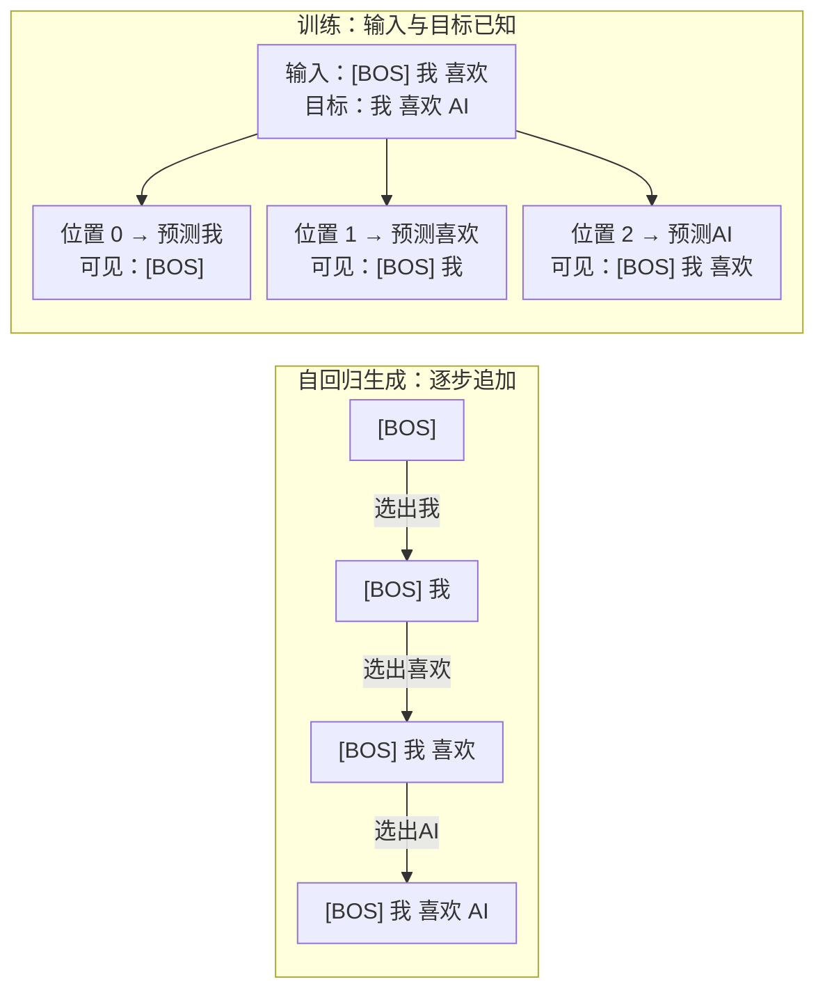

---
{
  "id": "Q-0036",
  "title": "Transformer 中的 Attention 如何计算？",
  "category": "llm",
  "topic": "Transformer 与注意力",
  "type": "原理机制",
  "level": "进阶",
  "priority": "按岗位选读",
  "focus": "注意力分数与加权聚合。把输入投影成 Q、K、V，用 QKᵀ/√dₖ 得到分数，加入需要的 mask 后做 softmax，再对 V 加权求和。",
  "answerStatus": "ready",
  "updatedAt": "2026-10-17"
}
---

## 核心回答

**Transformer 常用缩放点积注意力：先计算当前位置与各位置的匹配分数，再转成权重，对相应位置的信息加权求和，得到当前位置的新表示。** 单个注意力头的计算分五步：

1. **生成 Q、K、V**：输入分别乘以三组可学习的投影矩阵。Query（Q）表示当前位置的查询，Key（K）提供各位置用于匹配的特征，Value（V）提供各位置被汇总的内容。
2. **计算并缩放分数**：用每个 Q 和所有 K 做点积，再除以 √d_k；d_k 是这个头中 Q、K 向量的维度。
3. **加入可见范围约束**：按任务需要加入 mask。例如自回归生成时，遮住未来位置，使当前位置只能读取自身及此前的信息。
4. **归一化得到权重**：对每个 Q 的分数沿 Key 位置做 softmax，得到它对各可见位置的权重，权重之和为 1。
5. **加权汇总 V**：用这些权重对相应的 Value 加权求和，得到这个头的输出。

公式为 `Attention(Q,K,V) = softmax(QKᵀ/√d_k + M)V`。这里 M 是加性 mask，可见位置为 0，被遮挡位置为负无穷。Self-Attention 的 Q、K、V 来自同一段输入；多头注意力使用不同的投影并行完成上述计算，再拼接各头输出、投影回模型需要的维度。

## Q、K、V 为什么分开

把每个 token 看成一份带内容的记录：Q 是当前位置发出的查找条件，K 是每份记录用来参与匹配的特征，V 是记录能提供的信息。这只是理解分工的类比；它们实际都是模型学出来的向量，不是人手写的关键词。

一次注意力计算要解决两件事：“该看哪里”和“从那里拿什么”。前者由 Q、K 决定，后者由 V 提供，所以匹配用的表示与被汇总的内容可以不同。即使它们来自同一输入，三组投影也通常不同，Q、K、V 不会因此自动相等。得到的新向量继续交给后续网络，并不直接等于最终生成的词。

## 用两个 token 走一遍计算

先用两个 token 的小例子走一遍。下面的数值已经经过投影，只用来说明计算，不代表某两个词的真实向量：

```text
Q = K = [[1, 0], [0, 1]]    V = [[2, 0], [0, 4]]
d_k = 2

不加 mask：
A ≈ [[0.6698, 0.3302], [0.3302, 0.6698]]
O ≈ [[1.3395, 1.3210], [0.6605, 2.6790]]

加因果 mask：第一行 A 变成 [1, 0]，第一行 O 变成 [2, 0]。
```

只跟踪第一个 Query，打分、权重与 Value 的关系如下：

[](/answer-diagrams/q-0036-848591d302fb.svg)

图示参考 [Attention 原论文 Figure 2](https://arxiv.org/html/1706.03762v7)的计算结构，按上述数值重绘。Q、K 决定权重，V 只在最后参与加权汇总。

看第一行，也就是计算第一个位置的新表示：

- `q₁=[1,0]` 与两个 Key 的点积分别为 1、0，除以 √2 后约为 0.7071、0。
- softmax 得到 `exp(0.7071)/(exp(0.7071)+exp(0)) ≈ 0.6698`，另一个权重约为 0.3302。
- 汇总两份 Value：`0.6698 × [2,0] + 0.3302 × [0,4] ≈ [1.3395,1.3210]`。最终数值按未舍入权重计算。

第二个位置的匹配分数虽然较低，信息仍参与了输出。注意力通常是不同程度地读取多个位置，并非只挑分数最高的那个。

如果是从左到右生成，第一个位置还不能看第二个位置。把第二个打分遮住后，权重就是 `[1, 0]`，输出只剩自己的 Value `[2, 0]`。这就是因果 mask 起作用的位置。

## 把公式和维度说清楚

先看单头 Self-Attention，省略 batch、偏置和 dropout。设输入有 n 个 token，每个 token 的表示维度为 d_model：

```text
X   : [n, d_model]
W_Q : [d_model, d_k]    Q = X W_Q : [n, d_k]
W_K : [d_model, d_k]    K = X W_K : [n, d_k]
W_V : [d_model, d_v]    V = X W_V : [n, d_v]

S = Q Kᵀ / √d_k + M              : [n, n]
A = softmax(S, axis=最后一维)      : [n, n]
O = A V                           : [n, d_v]
```

S 的第 i 行、第 j 列表示第 i 个 Query 对第 j 个 Key 的打分。**softmax 沿 Key 位置计算**，所以每个 Query 对所有可见 Key 的权重之和为 1，不是在特征维度上归一化。

M 是这里采用的加性 mask：允许关注的位置为 0，禁止的位置为负无穷。softmax 后，被遮住的位置权重为 0。因果 Self-Attention 中，j > i 的位置被遮住；padding mask 则遮住填充位置。普通编码器 Self-Attention 不需要因果 mask。

## 常见追问

**为什么要除以 √d_k，不直接 softmax？**

维度越多，点积的波动通常越大。很大的分数差会让 softmax 权重接近 0 或 1，梯度变小，训练更难。若假设 Q、K 的各分量相互独立、均值为 0、方差为 1，点积方差是 d_k，除以 √d_k 后回到 1。这是缩放的动机，不是对实际数据分布的严格保证。

**多头为什么不是把同一份结果复制几遍？**

各头使用不同的可学习投影，因此可以形成不同的匹配方式。h 个头各输出 `[n, d_v]`，拼接成 `[n, h·d_v]`，再乘输出矩阵映射回 `[n, d_model]`。常用 `d_k = d_v = d_model/h`，但并非公式的硬性要求；也不能规定某个头一定学会语法、另一个一定学会语义。

**如果 Q 和 K、V 来自不同序列呢？**

这就是 Cross-Attention。例如解码器当前表示作为 Q，编码器输出作为 K、V，让生成端按需要读取输入内容。打分矩阵变成 `[n_query, n_key]`，仍对每个 Query 的全部可见 Key 做 softmax。

**有因果 mask，为什么训练仍能并行计算？**

标准的下一 token 预测训练已经拿到了完整训练序列，可以一次计算各位置的 Q、K、V，再用因果 mask 限制每个位置读取的信息。各位置并行计算，不代表它们能看到未来内容。自回归生成时，下一个 token 还没产生，要先选出它，才能继续生成后面的 token；这是训练与逐步生成的区别。

下图用“我喜欢 AI”的示意序列对照这两种过程。训练部分的三个位置可以一起计算，但每个位置只读取自身和此前的输入；生成部分则要先选出下一个 token，再把它追加到输入中。



因果约束限制的是每个位置能读取什么，训练时多个位置仍可在一次前向中并行计算。图中词元划分仅作示意；示例借鉴 [WeThinkIn 的因果掩码图](https://github.com/WeThinkIn/AIGC-Interview-Book/blob/275fdf1eeb65e3b233081d3b8e74ff5d8eeb2e03/%E5%A4%A7%E6%A8%A1%E5%9E%8B%E5%9F%BA%E7%A1%80/imgs/02-5.png)的训练与生成对照方式，按本题重新绘制。

**实现时最容易错在哪里？**

先检查 softmax 是否沿 Key 轴、mask 是否在 softmax 之前加入。这里用的是加性 mask；框架的布尔 mask 约定可能不同，例如 PyTorch 的 `scaled_dot_product_attention` 用 True 表示允许参与注意力，而 `MultiheadAttention` 的 `key_padding_mask` 用 True 表示遮挡。为避免指数溢出，softmax 通常先减每行最大值；手写实现还要处理整行都被遮住的情况，不能让负无穷相减产生 NaN。位置顺序则由位置编码等机制提供，Q/K/V 投影本身不等于位置编码。

## 对应教程

- [第 1-1 章：大模型认知与工程概览](https://didilili.github.io/ai-agents-from-zero/#/1-1-大模型认知与工程概览) §1.2.4：回看从顺序传递信息到直接关注关键位置的变化；本文进一步展开 Q/K/V 计算、矩阵维度和数值示例。

## 参考资料

- 国内：[WeThinkIn：模型架构与工作原理](https://github.com/WeThinkIn/AIGC-Interview-Book/blob/275fdf1eeb65e3b233081d3b8e74ff5d8eeb2e03/%E5%A4%A7%E6%A8%A1%E5%9E%8B%E5%9F%BA%E7%A1%80/02_%E6%A8%A1%E5%9E%8B%E6%9E%B6%E6%9E%84%E4%B8%8E%E5%B7%A5%E4%BD%9C%E5%8E%9F%E7%90%86.md#architecture-section-8-question-02) §8.2——参考因果掩码、并行训练与自回归生成的区别。
- 国内：[Datawhale：第二章 Transformer 架构](https://github.com/datawhalechina/happy-llm/blob/main/docs/chapter2/第二章%20Transformer架构.md) §2.1——参考从匹配到加权汇总的讲解，以及 mask 和多头的衔接。
- 国内：[puppylpg：从 Attention 到 KV Cache](https://puppylpg.github.io/posts/2026/06/12/transformer-inference-01-attention-kv-cache/)中 Attention 与 Q/K/V 部分——理解匹配特征与汇总内容为什么分开，以及输出为何是多个 Value 的加权混合。
- 国外：[Vaswani 等：Attention Is All You Need](https://arxiv.org/html/1706.03762v7) §3.2、§3.5——核对缩放点积、多头投影、因果 mask 与位置信息的分工。
- 国外：[PyTorch：scaled_dot_product_attention](https://docs.pytorch.org/docs/2.14/generated/torch.nn.functional.scaled_dot_product_attention.html)——核对逐行 softmax、输入输出形状及布尔 mask 的接口约定。
