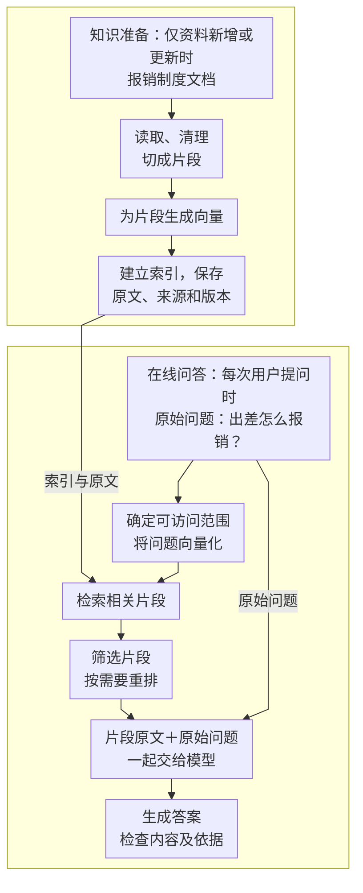

---
{
  "id": "Q-0047",
  "title": "RAG 从知识入库到在线问答的完整流程是什么？",
  "category": "rag",
  "topic": "RAG 架构与生成链路",
  "type": "系统设计",
  "level": "进阶",
  "priority": "优先准备",
  "focus": "离线入库与在线检索生成。离线解析、切分、向量化并建索引；在线将问题检索出相关片段，整理上下文交给模型生成并附证据。",
  "aliases": ["检索增强生成", "Retrieval Augmented Generation"],
  "answerStatus": "ready",
  "updatedAt": "2026-10-16"
}
---

> 在面栈阅读：[RAG 从知识入库到在线问答的完整流程是什么？](https://mianstack.com/question/q-0047)

## 核心回答

**RAG（检索增强生成）通过检索外部知识，为大模型提供相关上下文，辅助生成有依据的回答。** 以向量检索为例，完整流程分为两个阶段：

1. **索引阶段（离线）**：加载、清洗文档，切分为适合检索的片段，通过 Embedding 模型进行向量化，建立索引，并关联保存片段原文、来源等元数据。
2. **检索生成阶段（在线）**：将用户问题向量化，检索 `Top-K` 相关片段，按需过滤和重排，再将片段原文、原始问题和回答要求组织成 Prompt，由大模型生成答案。

例如，员工问“出差怎么报销”，系统先检索报销流程、凭证要求等制度条款，再据此组织回答。**向量用于查找资料，片段原文才是模型生成答案的主要依据。**

评估时，需要分别检查检索的相关性与覆盖度，以及答案的正确性和忠实性。其中，忠实性关注结论是否得到所用资料支持。资料不足时说明缺口，知识发生变化后同步更新索引及关联内容。

## 两个阶段怎样接起来？

下面用公司报销问答的假设场景说明。建库在资料新增或变化时进行，在线问答复用已经建立的索引。图中展示向量检索这条常见路径。



**建库先保证资料能被正确读取和切分。** 原始资料可能是 `Word`、`PDF` 或内部网页，加载后需要检查标题、正文和表格是否完整。切块时应尽量保留一个条款的适用条件和具体要求。比如把“哪些费用可以报销”和“必须提供什么凭证”拆得太散，后面可能只查到一半；把整本员工手册当成一块，又容易带入大量无关内容。块大小和重叠长度要根据文档结构及实际检索结果调整，没有通用的最佳值。

**然后把片段变成可检索的数据。** 向量检索需要为每块正文生成向量，同时保存可取回的原文，以及文件名、章节、版本等元数据。向量用于匹配，原文供模型阅读，元数据用于查来源和限制检索范围。这些数据可以放在同一存储中，也可以通过片段 ID 关联，关键是检索结果能准确回到原文。查询与文档必须使用兼容的向量空间；常见做法是使用同一套 Embedding 模型，并遵守它对查询和文档的输入要求。

**在线问答先找齐需要的证据。** 收到“出差回来怎么报销”后，先确定可访问的制度范围，再检索相关条款。口语表达通常适合语义检索；如果问题中包含制度编号、产品型号等精确词，可以结合关键词检索。查询改写、混合检索和重排都是按需要加入的手段，不是每次问答都必须执行。重排能把候选中更相关的内容往前放，但候选里没有报销凭证要求，它也不能补出这条证据。

多轮提问还要先弄清楚省略了什么。例如上一轮在聊出差报销，用户接着问“那需要什么材料？”，可以结合历史把检索问题补成“出差报销需要哪些凭证材料”。这里补的是已经明确的上下文；如果前面既聊过差旅报销又聊过采购报销，就先确认用户问哪一种，再改写检索问题，让检索条件与用户的实际需求一致。

**最后把证据整理成上下文，再生成回答。** 去掉重复和无关片段，保留回答需要的条件、步骤与来源，控制输入长度。提示词要求模型依据材料回答，缺少依据时说明缺口。输出后还要核对：有没有漏掉必要条件、引用是否真正支持结论。附上文档链接不等于答案已经可靠，仍可能出现“引用了正确文件，却总结错了条款”的情况。

## 放到代码里，检索结果怎样交给模型？

教程中的运维知识库用错误码文档演示了这条链路：`Docx2txtLoader` 读取 `alibaba-java.docx`，`CharacterTextSplitter` 切块，`DashScopeEmbeddings` 向量化，`Redis.from_documents(...)` 将切好的片段入库。在线部分是：

```python
rag_chain = {"context": retriever, "question": RunnablePassthrough()} | prompt | llm
```

同一个问题分成两路：检索器根据问题取出材料，放进 `context`；`RunnablePassthrough()` 原样保留问题，放进 `question`。提示词模板汇合两路输入，再交给聊天模型。

例子问“00000 和 A0001 分别是什么意思”，检索器设置 `k=2`，表示最多取前两条结果，**不代表两个错误码各命中一条**。一个片段可能同时包含两者，也可能取回的内容只覆盖其中一个。判断能否回答，要看片段正文是否包含两个编码及其说明。

这段代码展示了最小流程：它直接把检索结果传给模板，没有独立实现片段去重、来源格式化、权限过滤或引用校验。实际应用中还需要增加这些处理。

## 文档更新后怎么办？

在线问答通常复用已有索引，新增、修改或删除文档时再更新相关内容。比如公司发布了新版报销制度，就要更新受影响片段，并移除或排除已经失效的旧版本，避免同一个问题同时查到两套规定。更换不兼容的 Embedding 模型时，也需要重新生成文档向量，不能拿新模型的查询向量直接比较旧向量。

更新后，用一批固定问题复查：需要的条款有没有召回，答案有没有漏条件，引用能不能支持结论。如果答案错了，先看取回的材料是否正确、完整，再判断是检索问题还是生成问题。相关题目：[如何设计 RAG 评估方案和指标？](/question/q-0543/)。

## 常见追问

**答案漏了“需要发票”，先改提示词吗？** 先沿着材料检查：制度原文有没有这条要求，切块后有没有保留，检索是否取回，整理上下文时有没有被删掉。如果材料根本没进入模型输入，只改回答提示词很难解决；材料已经完整给到模型，它仍漏答，才重点检查生成和答案校验。

**为什么不直接把整份文档交给模型？** 少量、较短且需要通读的资料可以这样做。知识库很大或频繁更新时，按需检索便于控制输入量；是否采用 RAG，还要比较准确性、延迟和成本。两种方式都需要由系统执行权限检查。

**每次都必须先检索一次吗？** 上面的固定管道是这样。Agentic RAG 可以让模型决定何时检索、是否继续补查，但也增加了调用次数和停止条件的管理，参见[Workflow 和 Agent 有什么区别？](/question/q-0140/)。

## 对应教程

配套教程讲解 RAG 主流程；本文以公司制度问答为例，进一步说明文档更新和应用层检查。

- [第 19 章：RAG 检索增强生成](https://didilili.github.io/ai-agents-from-zero/#/19-RAG检索增强生成) §1.3、§3.3：回看索引与在线问答的分工，以及错误码文档的完整链路；该章 §3.3 已展示配套完整代码，可核对数据流与 `k=2` 的设置。
- [第 18 章：向量数据库与 Embedding 实战](https://didilili.github.io/ai-agents-from-zero/#/18-向量数据库与Embedding实战) §4.1～4.2：理解文档向量化、查询向量化与聊天模型的分工。

## 参考资料

- 国内：[小林面试笔记：什么是 RAG？完整 RAG 系统的工作流程](https://xiaolinnote.com/ai/rag/1_whatisrag.html)：借鉴离线索引与在线问答的两阶段结构，讲清文档切分、检索和重排如何衔接。
- 国内：[JavaGuide：RAG 基础概念——检索、生成与工程取舍](https://javaguide.cn/ai/rag/rag-basis.html)：参考上下文组织与工程取舍的讨论，补充引用错配、权限控制，以及 RAG 与长上下文方案的选择。
- 国内：[阿里云百炼：RAG 核心概念](https://help.aliyun.com/zh/model-studio/rag/concepts)：依据官方概念说明，解释文档解析、切片、索引、检索和重排各自负责什么。
- 国外：[LangChain：Retrieval](https://docs.langchain.com/oss/python/deepagents/retrieval)：参考固定检索与 Agentic RAG 的方案对比，说明正文中模型决定何时检索、是否补查时增加的调用和停止条件管理。
- 国外：[LlamaIndex：Introduction to RAG](https://developers.llamaindex.ai/python/framework/understanding/rag/)：参考索引、检索后处理与生成的职责，说明正文中已有索引复用、证据整理和更新后持续评估的衔接。
