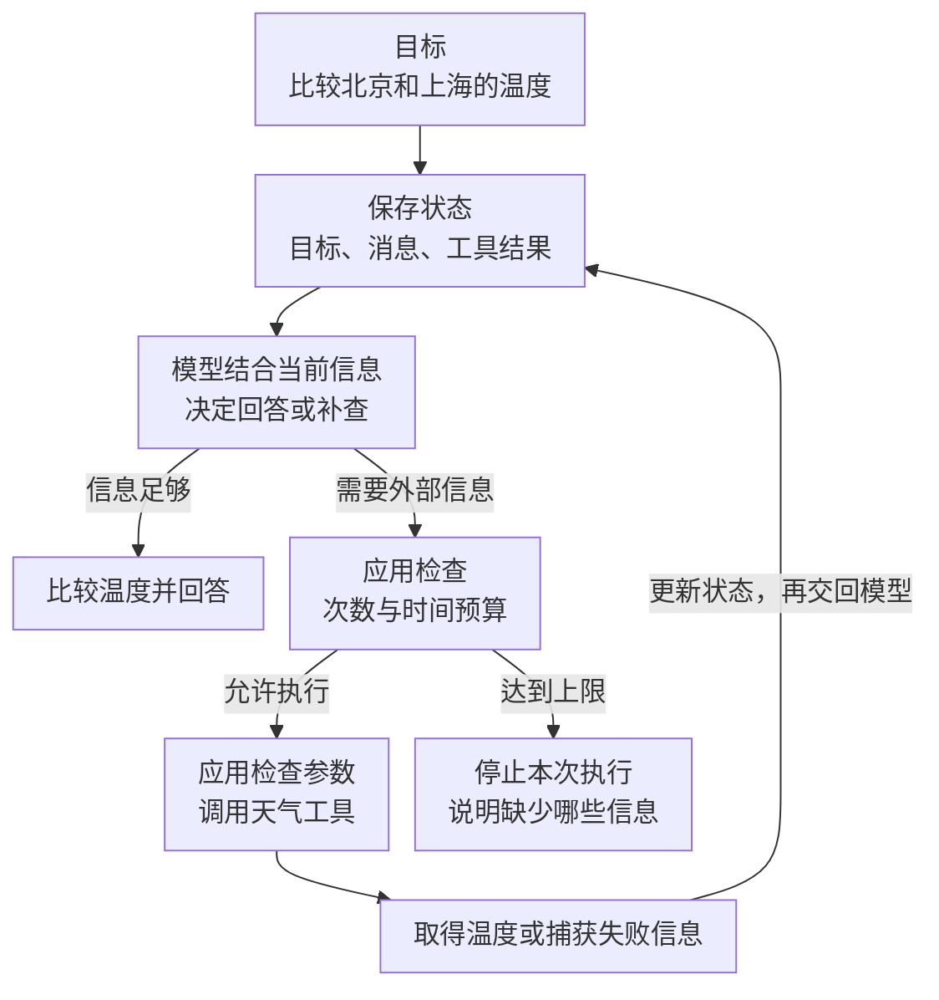

---
{
  "id": "Q-0058",
  "title": "Agent 是什么，由哪些核心能力和组件组成？",
  "category": "agent",
  "topic": "Agent 基础与运行循环",
  "type": "概念解释",
  "level": "基础",
  "priority": "进阶补充",
  "focus": "目标、动作与反馈循环。Agent 由模型根据目标和环境反馈选择动作，通过工具执行，再观察结果决定继续或结束；记忆与状态支持多步任务。",
  "answerStatus": "ready",
  "updatedAt": "2026-11-04"
}
---

> 在面栈阅读：[Agent 是什么，由哪些核心能力和组件组成？](https://mianstack.com/question/q-0058)

## 核心回答

**在大模型应用中，AI Agent（智能体）是以模型为决策核心，围绕任务目标调用工具，并依据执行反馈持续调整行动的软件系统。** 核心能力包括理解目标与环境信息、行动规划、工具使用和反馈调整。

从基本运行过程看，可以用四部分来理解：

**Agent = 模型 + 工具集 + 运行循环 + 当前状态**

- **模型（Model）**：理解目标，结合当前信息选择工具和下一步行动。
- **工具集（Tools）**：执行外部操作，例如检索文档、查询数据库或调用业务接口；实际执行由应用程序完成。
- **运行循环（Loop）**：组织模型决策、工具执行和结果反馈，持续推进任务，并在任务完成或达到执行限制时停止。
- **当前状态（State）**：保存任务目标、对话、工具结果和中间进展，为后续决策提供依据。

例如比较北京和上海的实时温度，模型选择天气工具，应用执行查询并记录结果，运行循环再把结果交回模型进行比较；若缺少其中一地的数据，可根据反馈决定是否补查。

## 一次查询失败后，Agent 怎样继续？

以比较北京和上海的温度为例。假设北京返回 26℃，上海查询超时，程序需要把这两项结果都保存下来，再交给模型。模型才知道下一步缺的是上海温度，而不是重新开始整个任务。

下图重点看工具结果返回模型的那条线，以及“完成”和“达到限制”两个出口。这段反复判断、执行、回传的过程由运行循环协调，次数和时间上限由应用控制。

如果允许补查上海，且补查得到 29℃，就可以回答上海高 3℃。如果始终没有上海数据，就只能说明无法可靠比较。**达到执行上限是停止运行，不等于完成了任务。** 这里的温度和失败分支均为示例。

这也解释了四部分各自的作用：模型提出调用请求，程序执行工具，状态保存进展，运行循环让反馈进入下一次判断。**模型说“查一下上海”，并不表示已经查到了上海温度。**

`ReAct` 是组织这类过程的一种常见方法，让判断、行动和观察交替进行；它不要求把模型完整的内部思考展示给用户。

## 追问

**记忆、规划、反思分别起什么作用？**

记忆帮助保留已有信息。当前任务的消息、工具结果属于短期状态；跨会话保留用户偏好才涉及长期记忆。规划帮助拆分目标、安排步骤，简单任务可以边执行边决定，长任务可以单独记录计划和完成情况。反思则是在拿到反馈后检查哪里有问题、是否需要调整，例如查询失败后检查城市参数，再决定重试。它们是能力上的划分，不意味着必须各建一个服务，更不意味着每个 Agent 都需要向量数据库或多个模型。

**为什么有的资料写“LLM + Planning + Memory + Tools”？**

这是另一种常见划分，突出模型、规划、记忆和工具；这里的四元组重点解释一次任务怎样运行。规划可以由模型结合状态决定下一步来实现，也可以单独维护计划；记忆既可能支持当前会话，也可能跨会话保存信息。如果用“感知、规划、行动、记忆”描述能力，感知就是接收用户输入和工具结果，行动就是执行工具。这些是不同的观察角度，不是名称一一对应的固定组件标准。

**程序保存了状态，模型就能自动记住吗？**

还需要把相关信息组织进本轮模型输入。**状态是程序保存的信息，上下文是这次调用实际交给模型的信息，两者不必完全相同。** 例如保留了北京 26℃的结果，补查上海后却没把北京温度传回模型，模型仍缺少比较依据。长任务可以筛选或摘要历史，但要保留目标、关键结果和未完成事项；只存进数据库而不读取、回传，也不会自动变成模型的记忆。

**系统提示词和运行时放在哪一部分？**

系统提示词规定角色、任务要求和输出方式，工具定义告诉模型有哪些能力、各自需要什么参数，它们一起参与构建模型的输入。运行时负责驱动循环、管理状态、执行工具及处理错误，常被称为 Harness（运行支撑环境）；它的范围通常比一个循环更广。例如提示词可以要求“先查到两地温度再比较”，程序仍要实际执行查询、处理超时和控制执行次数。

**工具调用失败，就让模型一直重试吗？**

不会。先区分失败原因：查询天气临时超时，可以在次数和总时长上限内重试；城市参数写错，应先修正参数；没有访问权限，重复请求也解决不了。应用要把明确的失败信息交给模型，而不是空返回，让它误以为已经查完。有副作用的工具在重试时，还要避免重复操作。

**固定查询两地天气再比较，也算 Agent 吗？**

按这里采用的工程划分，固定查询、固定比较更接近工作流；由模型结合当前信息决定查什么、还缺什么、下一步做什么，才体现 Agent 的动态决策。固定流程也能写重试分支，不能只凭“会重试”判断它是 Agent。实际应用经常将两者结合，参见 [Workflow 与 Agent 的区别](/question/q-0140/)。

## 对应教程

- [Agent 智能体：1.1～1.3 定义、ReAct 与工具的关系，2.2 运行时](https://didilili.github.io/ai-agents-from-zero/#/21-Agent智能体)：直接覆盖模型、工具、状态和运行循环的主线，回看各部分如何配合。
- [Tools 工具调用：2.2～2.4 工具定义、执行与结果消息](https://didilili.github.io/ai-agents-from-zero/#/17-Tools工具调用)：区分模型提出调用与应用执行、回传结果。

## 参考资料

- 国内：[小林面试笔记：Agent 的基本架构由哪些核心组件构成？](https://xiaolinnote.com/ai/agent/2_components.html)：参考系统提示词与工具定义的职责，解释模型根据哪些输入选择行动。
- 国内：[JavaGuide：AI Agent 核心概念](https://javaguide.cn/ai/agent/agent-basis.html)：借鉴能力模块与 Agent Loop 的划分，解释两种组件概括为何可以同时成立。
- 国内：[王二讲 Agent：一个 AI Agent 有哪些核心组件？](https://javabetter.cn/ai/video/agent-core-components.html)：参考 Harness 串联模型、工具与记忆的解释，补充运行时比循环更广的职责。
- 国内：[阿里云：Function Calling](https://help.aliyun.com/zh/model-studio/qwen-function-calling)：依据模型提出调用、应用执行并回传结果的交互过程，说明调用请求与执行结果的区别。
- 国内：[AgentScope：创建 ReAct 智能体](https://doc.agentscope.io/zh_CN/tutorial/quickstart_agent.html)：结合短期记忆、长期记忆、计划和迭代上限的独立配置，说明能力划分不要求各建一个服务。
- 国外：[Anthropic：Building effective agents](https://www.anthropic.com/research/building-effective-agents)：依据动态决策、环境反馈和停止条件解释 Agent 的运行过程，并与预先定义步骤的工作流区分。
- 国外：[LangChain：Context engineering in agents](https://docs.langchain.com/oss/python/langchain/context-engineering)：依据单次模型输入与保存状态的区别，解释为什么保存了信息，还要把相关内容交给模型。
