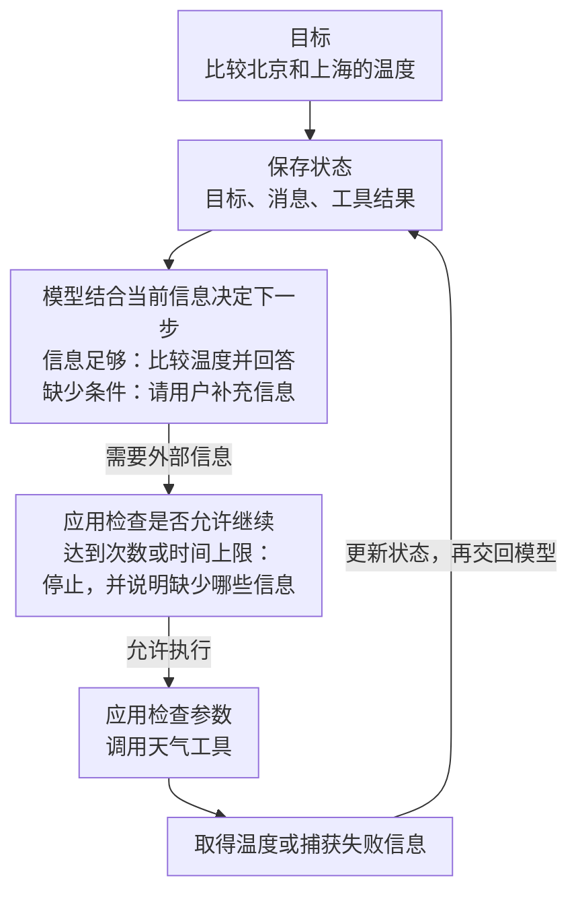

---
{
  "id": "Q-0058",
  "title": "Agent 是什么，由哪些核心能力和组件组成？",
  "category": "agent",
  "topic": "Agent 基础与运行循环",
  "type": "概念解释",
  "level": "基础",
  "priority": "进阶补充",
  "focus": "形成能力与执行过程的主线；来源是开放询问，未逐项点名组件。",
  "answerStatus": "ready",
  "updatedAt": "2026-10-16"
}
---

## 核心回答

**在大模型应用中，AI Agent（智能体）是以模型为决策核心，围绕任务目标调用工具，并依据执行反馈持续调整行动的软件系统。** 核心能力包括目标理解、行动规划、工具使用和反馈调整。

从基本运行过程看，可以用四部分来理解：

**Agent = 模型 + 工具集 + 运行循环 + 当前状态**

- **模型（Model）**：理解目标，结合当前信息选择工具和下一步行动。
- **工具集（Tools）**：执行外部操作，例如检索文档、查询数据库或调用业务接口；实际执行由应用程序完成。
- **运行循环（Loop）**：组织模型决策、工具执行和结果反馈，持续推进任务，并在任务完成或达到执行限制时停止。
- **当前状态（State）**：保存任务目标、对话、工具结果和中间进展，为后续决策提供依据。

例如比较北京和上海的实时温度，模型选择天气工具，应用执行查询并记录结果，运行循环再把结果交回模型进行比较；若缺少其中一地的数据，可根据反馈决定是否补查。

## 一次查询失败后，Agent 怎样继续？

以比较北京和上海的温度为例。假设北京返回 26℃，上海查询超时，程序需要把这两项结果都保存下来，再交给模型。模型才知道下一步缺的是上海温度，而不是重新开始整个任务。

下图重点看工具结果返回模型的那条线。这段反复判断、执行、回传的过程由运行循环协调，次数和时间上限由应用控制。

如果允许补查上海，且补查得到 29℃，就可以回答上海高 3℃。如果始终没有上海数据，就只能说明无法可靠比较。这里的温度和失败分支均为示例。

这也解释了四部分各自的作用：模型提出调用请求，程序执行工具，状态保存进展，运行循环让反馈进入下一次判断。**模型说“查一下上海”，并不表示已经查到了上海温度。**

ReAct 是组织这类过程的一种常见方法，让判断、行动和观察交替进行；它不要求把模型完整的内部思考展示给用户。

## 追问

**记忆、规划、反思分别起什么作用？**

记忆帮助保留已有信息。当前任务的消息、工具结果属于短期状态；跨会话保留用户偏好才涉及长期记忆。规划帮助拆分目标、安排步骤，简单任务可以边执行边决定，长任务可以单独记录计划和完成情况。反思则是在拿到反馈后检查哪里有问题、是否需要调整，例如查询失败后检查城市参数，再决定重试。它们是能力上的划分，不意味着必须各建一个服务，更不意味着每个 Agent 都需要向量数据库或多个模型。

**为什么有的资料写“LLM + Planning + Memory + Tools”？**

这是另一种常见的划分，突出模型、规划、记忆和工具这些能力与模块；这里的“模型、工具集、运行循环、当前状态”，重点解释一次任务怎样运行。比如规划可以由模型结合状态决定下一步来实现，也可以单独维护计划；记忆既可能是当前对话和工具结果，也可能是跨会话保留的信息。Planning 和 Memory 可以在同一套程序里实现，也可以按需要拆分为独立服务。

如果用“感知、规划、行动、记忆”描述能力，感知对应接收用户输入和工具结果，规划对应决定下一步，行动对应执行工具，记忆对应保留有用信息。这些能力需要在运行过程中配合，并不是四个名称一一对应的另一套固定组件。

**工具调用失败，就让模型一直重试吗？**

不会。先区分失败原因：查询天气临时超时，可以在次数和总时长上限内重试；城市参数写错，应先修正参数；没有访问权限，重复请求也解决不了。应用要把明确的失败信息交给模型，而不是空返回，让它误以为已经查完。若工具会创建订单、发送消息，还要先确认上一次是否已经成功，避免重试造成重复操作。具体可结合接口提供的幂等机制处理，参见下方阿里云的请求重试示例。

**固定查询两地天气再比较，也算 Agent 吗？**

按这里采用的工程划分，固定查询、固定比较更接近工作流；由模型结合当前信息决定查什么、还缺什么、下一步做什么，才体现 Agent 的动态决策。固定流程也能写重试分支，不能只凭“会重试”判断它是 Agent。实际应用经常将两者结合，参见 [Workflow 与 Agent 的区别](/question/q-0140/)。

## 对应教程

- [Agent 智能体：1.1～1.3 定义、ReAct 与工具的关系，2.2 运行时](https://didilili.github.io/ai-agents-from-zero/#/21-Agent智能体)：直接覆盖模型、工具、状态和运行循环的主线，回看各部分如何配合。
- [Tools 工具调用：2.2～2.4 工具定义、执行与结果消息](https://didilili.github.io/ai-agents-from-zero/#/17-Tools工具调用)：区分模型提出调用与应用执行、回传结果。

## 参考资料

- 国内：[JavaGuide：AI Agent 核心概念](https://javaguide.cn/ai/agent/agent-basis.html)——参考从中间证据解释 Agent Loop 的中文讲解顺序，以及规划、记忆、工具的常见面试考点。
- 国内：[阿里云：Function Calling](https://help.aliyun.com/zh/model-studio/qwen-function-calling)——核对模型返回调用指令、应用执行工具、回传结果的分工，以及失败处理需要由应用实现。
- 国内：[AgentScope：创建 ReAct 智能体](https://doc.agentscope.io/zh_CN/tutorial/quickstart_agent.html)——对照模型、工具、短期记忆的组合，理解长期记忆、计划模块和迭代上限各自的作用。
- 国外：[Anthropic：Building effective agents](https://www.anthropic.com/engineering/building-effective-agents)——核对动态决策、环境反馈和停止条件，并区分 Agent 与预定义工作流。
- 国外：[LangChain：Quickstart](https://docs.langchain.com/oss/python/langchain/quickstart)——对照基础天气 Agent 的实际组装方式，以及工具能力与任务完成之间的关系。
- 国内：[阿里云：如何保证幂等性](https://help.aliyun.com/zh/ecs/developer-reference/how-to-ensure-idempotence)——用创建资源的实际接口说明超时后重试为何可能重复执行；具体机制取决于工具所调用的接口。
