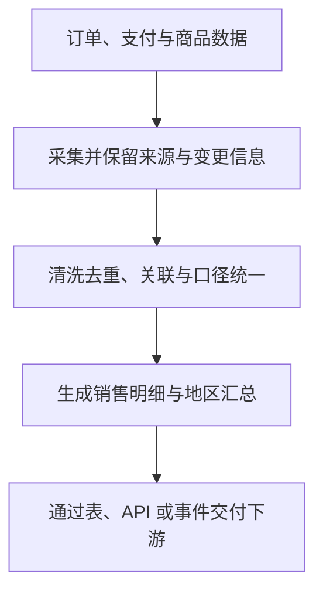

---
{
  "id": "Q-0063",
  "title": "数据平台的数据如何流动、处理并被下游消费？",
  "category": "software",
  "topic": "数据工程与数据处理",
  "type": "系统设计",
  "level": "进阶",
  "priority": "按岗位选读",
  "focus": "数据链路与下游消费。以一条业务事件说明采集、清洗、计算和存储，再追踪它如何进入报表或下游接口，交代延迟与校验位置。",
  "answerStatus": "ready",
  "updatedAt": "2026-10-17"
}
---

> 在面栈阅读：[数据平台的数据如何流动、处理并被下游消费？](https://mianstack.com/question/q-0063)

## 核心回答

数据平台把业务系统中的数据，经过**接入、加工、组织和服务化**，变成下游能直接使用的数据产品。完整链路通常包括五步：

1. **采集接入**：从业务数据库、日志、文件或外部接口取数，根据时效要求选择定时批量同步、增量同步或 CDC（变更数据捕获）。
2. **清洗加工**：统一字段、时间和业务口径，处理重复与异常，关联必要维度，再计算明细或汇总结果。
3. **存储组织**：保留便于追溯的源数据，按分析用途组织事实表、维度表和汇总表；存储和计算引擎随规模及查询要求选择。
4. **交付消费**：通过数据表、SQL、报表、API、文件或事件流，把结果交给分析人员、业务应用、算法任务或问数 Agent。
5. **持续运行**：用调度依赖、质量检查、延迟监控和失败恢复，保证交付的数据口径正确、按时可用。

例如电商销售看板可以接入订单与支付变更，统一成交口径，按日期和地区汇总，再由 BI 展示；补充问数入口后，Agent 可以查询同一套分析数据。讲链路时要把**数据本身怎样流动**和**下游怎样使用它**都说清楚。

## 用一条销售分析链路展开

下面是一个简化设计，重点看每一步把什么输入变成什么输出：

实际链路可以有多个消费分支，也可以直接查询明细，不要求所有业务都先做汇总。

### 先明确业务口径，再设计加工过程

“某地区昨天销售额”还需要确定：按下单时间还是支付时间统计，是否扣退款，地区按收货地还是门店归属。输入字段能否表达这些规则，会直接影响后面的加工和结果解释。

采集后，可以将不同系统的订单标识、金额单位和时间表示统一，再关联商品、地区等维度。去重时要区分重复事件和同一订单的合法状态变更：只按订单号保留第一条，会把后来的支付或退款变化丢掉。应结合业务主键、事件标识或变更版本，决定保留、更新或合并的方式。

数仓常用 ODS 保存贴近来源的数据，DWD 组织清洗后的明细事实，DIM 维护维度，DWS 形成公共汇总，ADS 面向应用输出。分层帮助复用口径和定位问题，但不是所有项目都要完整搭建五层；简单场景可以合并，关键是职责清楚，避免多个报表各算一套“销售额”。

### 批处理与实时处理的差别落在哪里？

每日经营报表可以按业务日期批量加工，重点保证上游数据齐备、任务依赖正确和分区可重跑。库存或异常交易监控若要求更快反馈，可以用增量事件驱动计算。批处理也能按较短周期运行，“使用消息队列”本身并不能证明整条链路实时。

持续处理事件时，要分清事件发生时间与平台处理时间。例如一笔昨晚的支付今天才到，按到达时间统计就可能记入错误日期。Flink 的事件时间与 Watermark 可以帮助推进窗口计算，但 Watermark 并不保证之后绝无迟到数据，还需要约定等待范围、迟到修正或补数方式。

展示端也要知道结果覆盖到什么时间，以及它是中间结果还是已经按约定结算的结果。计算很快但采集积压，用户看到的数据仍然可能过时。

## 下游怎样消费，交付才算完整？

- **分析与 BI**：读取明细、汇总表或语义指标，生成看板和报表；明确指标含义、维度和刷新周期。
- **业务接口**：将查询封装为 API，约定请求条件、返回字段、单位和更新时间，并控制可访问范围及查询资源。
- **算法与事件消费**：交付训练数据、特征、文件或事件流，同时说明数据版本、事件含义和更新方式。
- **问数 Agent**：先利用表、字段和指标元数据定位查询对象，再对分析库执行查询。元数据索引帮助理解数据，真正的业务数值仍来自所查询的数据表。

因此，“结果在页面上展示”只是消费方式之一。若下游需要表或 API，交付时还要让它能稳定找到、理解并读取这份数据，页面有数不代表下游接口已经可用。

## 出错后怎样定位与恢复？

沿链路检查采集位点或批次、输入输出数量、加工日志、质量规则和下游读取版本。比如看板突然为零，要区分源端确实没有成交、同步未完成、过滤条件错误，以及下游还在读取旧分区。

质量检查应结合具体业务，例如关键标识是否为空、主键是否重复、汇总是否与明细对得上、数据是否按时产出。严重错误时可以隔离本次结果或暂缓更新，保留上次有效数据并显示时间；轻微异常则可以告警后继续，按实际影响选择。

恢复时，批任务可以按日期分区重新计算并替换结果；流任务则需要协调可重放输入、计算状态与输出提交。以 Flink 为例，Checkpoint 帮助恢复内部状态；要让外部结果不因恢复而重复生效，还需要相配合的事务或幂等写入，不能仅凭“开了 Checkpoint”就保证整个业务链路恰好执行一次。

## 常见追问

**为什么不让所有下游直接查业务数据库？** 分析可能需要跨系统关联、历史数据和较重扫描。把分析负载及统一口径沉淀到合适的数据层，有利于保护交易请求，也方便重复使用；规模小、负载可控时，同样可以采用更简单的只读查询方案。

**数据已经入库，为什么还会出现两张报表对不上？** 先对齐业务时间、过滤条件、退款处理、维度版本和数据更新时间，再检查各自读取的明细与加工逻辑。入库成功只证明写入完成，不能证明指标定义相同。

## 对应教程

- [电商问数：项目概述与数仓基础](https://github.com/didilili/ai-agents-from-zero/blob/c05fb5979cf0aa3b6b4ed8c29f450f640fb9c18f/实战项目-电商问数/1-项目概述与数仓基础.md)：回看分析库、事实表、维度表和指标口径，理解加工后的数据如何支撑业务分析。
- [电商问数：项目整体架构与智能体流程](https://github.com/didilili/ai-agents-from-zero/blob/c05fb5979cf0aa3b6b4ed8c29f450f640fb9c18f/实战项目-电商问数/2-项目整体架构与智能体流程.md)：重点看元数据构建与在线问数两条链路，理解下游 Agent 如何使用已经准备好的数仓；上游采集、实时加工和补数由本文进一步展开。

## 参考资料

- 国内：[阿里云 DataWorks：数仓分层](https://help.aliyun.com/zh/dataworks/user-guide/data-warehouse-layering/)：依据贴源、明细、维度、汇总与应用层的职责，说明正文中数据分层复用及统一业务口径的原因。
- 国内：[阿里云 DataWorks：数据质量概述](https://help.aliyun.com/zh/dataworks/user-guide/data-quality)：依据质量规则与生产调度的衔接，说明正文中任务执行成功仍需核对数据产出，并按影响告警或暂缓更新。
- 国内：[阿里云 DataWorks：数据服务入门](https://help.aliyun.com/zh/dataworks/user-guide/getting-started-with-dataservice-studio)：参考数据源、查询参数、返回字段与 API 消费的过程，说明正文中下游除了看板还可通过表、接口或事件使用数据。
- 国外：[Apache Flink 2.2：Timely Stream Processing](https://nightlies.apache.org/flink/flink-docs-release-2.2/docs/concepts/time/)：事件时间、Watermark 和迟到数据部分说明窗口按什么时间归属，以及为什么及时出结果与等待迟到事件之间需要取舍。
- 国外：[Apache Flink 2.2：Fault Tolerance](https://nightlies.apache.org/flink/flink-docs-release-2.2/docs/learn-flink/fault_tolerance/)：依据状态快照、输入位点与端到端一致性条件，解释正文中故障恢复还需可重放输入及事务或幂等外部写入的原因。
