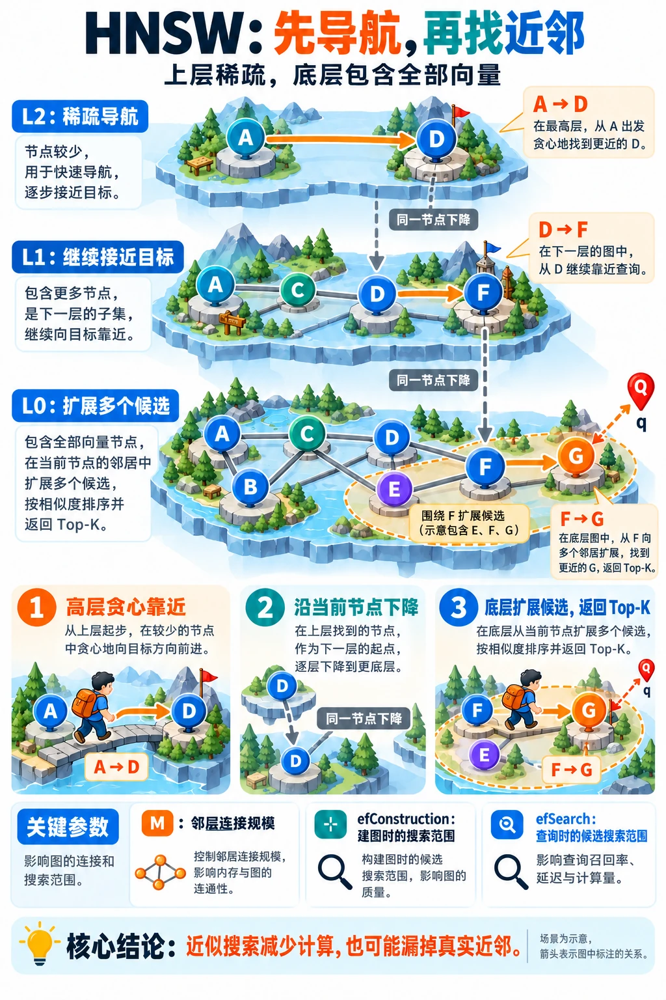

---
{
  "id": "Q-0075",
  "title": "HNSW 如何实现近似向量检索，相比朴素检索有什么优势？",
  "category": "rag",
  "topic": "向量数据库与索引",
  "type": "原理机制",
  "level": "进阶",
  "priority": "按岗位选读",
  "focus": "分层近邻图与召回、延迟权衡。HNSW 在分层近邻图上先粗后细搜索，少算大量距离换取近似结果；提高搜索宽度可增召回但更耗时。",
  "answerStatus": "ready",
  "updatedAt": "2026-10-18"
}
---

> 在面栈阅读：[HNSW 如何实现近似向量检索，相比朴素检索有什么优势？](https://mianstack.com/question/q-0075)

## 核心回答

`HNSW`（分层可导航小世界图）是一种基于图的近似最近邻索引。它把向量组织成多层近邻图：**底层包含全部向量，越高层节点越少，查询先在高层快速靠近目标区域，再逐层下降，在底层扩大候选搜索并返回`Top-K`**。

相比朴素遍历所有向量，`HNSW`利用图的连接关系减少距离计算，通常能在较高召回下显著降低查询延迟。代价是提前建图、保存邻接连接，并接受近似搜索可能漏掉真实近邻。它适合需要较低延迟、能承担索引内存和构建成本的场景；小数据集或少量查询，直接精确搜索也可能更简单合适。

这张图把分层搜索和三个常用参数放在一起：同层沿连接靠近查询，跨层下降时仍落在同一个节点，最后在底层扩展候选并返回 `Top-K`。

## 分层结构为什么有用

一个向量先随机获得最高层级，并出现在从底层到该层的各层中。高层节点较稀疏，可以用较少的跳转接近查询所在区域；低层节点更密，继续在局部细化。这种层级通常按指数衰减的概率生成，不是先把所有向量按业务主题做`K-means`分桶。

下图展示上层稀疏、底层包含全部节点的结构，帮助理解为什么搜索可以先走较大的范围，再向下细化。

图来自配套[向量数据库教程](https://github.com/didilili/ai-agents-from-zero/blob/c05fb5979cf0aa3b6b4ed8c29f450f640fb9c18f/18-%E5%90%91%E9%87%8F%E6%95%B0%E6%8D%AE%E5%BA%93%E4%B8%8EEmbedding%E5%AE%9E%E6%88%98.md)。同一向量可出现在多个层；层间下降是在该向量处继续搜索。图中连线用于说明分层关系，底层查找仍然是近似搜索，并不保证返回真正的最近邻。

## 查询具体怎样进行

1. **从最高层入口开始。** 比较当前节点及其邻居到查询向量的距离，沿更近的方向移动；高层通常采用贪心搜索，直到找不到更近的邻居。
2. **把当前位置作为下一层入口。** 逐层重复这个过程，避免每到一层就重新随机找起点。
3. **在第0层保留更多候选。** 不只沿单一路径走，而是维护待探索候选和目前最好的结果，优先扩展更有希望的节点，直到满足停止条件。
4. **返回候选中的`Top-K`。** 搜索范围由 `efSearch` 一类参数控制；返回的K是结果数量，两者含义不同。

例如要返回10个片段，可以把底层搜索候选规模设得比10更大，给算法更多机会绕开局部不佳的路径。这是参数关系示例，实际范围和约束以所用引擎为准；`efSearch` 也不等于严格执行这么多次距离计算。

## 索引怎样构建

插入新向量时，先随机决定最高层，再从现有入口搜索，在相应层找到邻居并建立连接；已有节点连接过多时，还要按规则裁剪。

连接选择影响可导航性。若只把边全部集中到一个很近的簇内，可能难以走向其他区域，因此原算法提供考虑不同方向的邻居选择启发式。`HNSW`支持逐步插入，并不要求先像`IVF`那样训练聚类中心；但插入顺序、连接规则和参数仍会影响最终图质量。

## 三个参数分别控制什么

- **M**：控制建图的邻居连接规模。增大它通常增加图的连接选择和存储，也会改变构建、搜索成本；各实现对不同层的连接上限可能另有约定，不等于每个节点每层永远恰好有M条边。
- **`efConstruction`**：构建时用于寻找邻居的搜索范围。扩大它通常有助于改善图质量，但会增加建索引时间，收益也可能逐渐减小。
- **`efSearch`**：查询时的候选搜索规模。增大它通常改善召回，同时增加距离计算和延迟；它不能修改已经建好的连接。

这些是职责区别，默认值和字段拼写依实现而变。例如`hnswlib`把查询参数称为 `ef`，`Faiss`使用 `efSearch`。调参应固定数据和度量，记录召回、`P95`延迟、内存及构建时间，不能只追求某个参数越大越好。

## 与朴素检索怎样公平比较

朴素搜索对N个d维向量逐个计算距离，打分开销约为 `O(Nd)`，再选`Top-K`。它不需要图的构建和邻接存储，能给出所选度量下的精确结果，也适合作为近邻召回的基准。

`HNSW`的收益来自少算一部分候选，而不是把距离公式换得更准确。其典型导航表现很好，但不能把 `O(log N)` 当成任意数据、维度、参数和召回要求下都成立的最坏情况保证。

比较时用同一Embedding、度量、数据版本和过滤范围，先取得精确`Top-K`，再计算近似结果与它的重合比例，同时测试延迟分布和并发。需要区分两种“召回”：索引有没有找到数学上的近邻，以及这些近邻是否包含回答问题的证据。前者高，不自动代表RAG答案正确。

## 常见追问

**`HNSW`会压缩向量吗？**

图索引本身主要改变搜索组织方式，并不自动压缩向量；具体产品可以再结合量化或其他存储方案，其误差与资源成本需要另外评估。

**已经建好索引，为什么召回还是低？**

先排查Embedding、度量和过滤范围，再看查询候选规模、图质量与数据分布。增大搜索范围可以帮助判断是否搜索过窄；若连接质量不足，可能还需要调整建图参数并重建。后续Rerank只能重排进入它的候选，补不回始终没找到的片段。

## 对应教程

- [向量数据库与Embedding实战](https://github.com/didilili/ai-agents-from-zero/blob/c05fb5979cf0aa3b6b4ed8c29f450f640fb9c18f/18-%E5%90%91%E9%87%8F%E6%95%B0%E6%8D%AE%E5%BA%93%E4%B8%8EEmbedding%E5%AE%9E%E6%88%98.md)：第5.3节介绍精确与近似检索，并配有分层图；本文进一步展开底层候选扩展、建图参数和公平评估的方法。

## 参考资料

- 国内：[JavaGuide：向量数据库与HNSW](https://github.com/Snailclimb/JavaGuide/blob/50f02a5984c062fe7221629d0a6a40ec15c26fd7/docs/ai/rag/rag-vector-store.md)：借鉴分层导航与三项参数的分工，说明正文中 HNSW 搜索机制及召回、延迟和内存需要联合调优的原因。

- 国内：[zero2Agent：IVF_FLAT与HNSW](https://github.com/ranxi2001/zero2Agent/blob/0c0eb7693105d281b146bb98f3a7f30da6f1ceea/learn-agent-interview/09-rag-retrieval/index.md)：比较分桶扫描与图上搜索，并区分Flat基线、索引构建和在线查询的不同代价。

- 国内：[阿里云：使用与调优基于HNSW的ANN索引](https://help.aliyun.com/zh/selectdb/hnsw)：依据构建和查询阶段候选范围的区别，说明正文中 efConstruction、efSearch 的不同作用和受控参数评估。

- 国外：[Malkov、Yashunin：HNSW原论文v4](https://arxiv.org/pdf/1603.09320v4)：第3～4节给出随机分层、邻居选择和搜索算法，明确高层贪心与底层候选扩展的区别。

- 国外：[hnswlib：算法参数](https://github.com/nmslib/hnswlib/blob/master/ALGO_PARAMS.md)：参数文档解释返回数量与搜索候选规模的区别，以及建图质量、搜索时间和连接存储之间的取舍。
