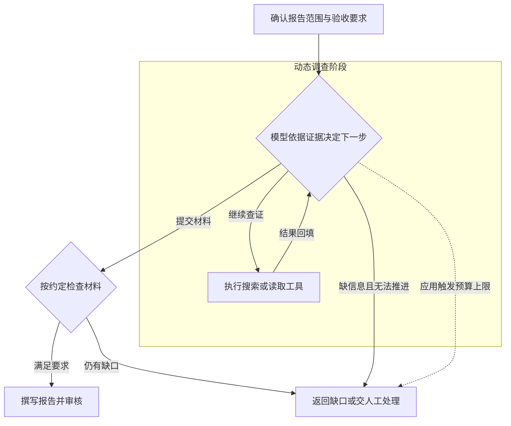

---
{
  "id": "Q-0140",
  "title": "Workflow 和 Agent 有什么区别？",
  "category": "agent",
  "topic": "工作流、状态与执行恢复",
  "type": "比较选型",
  "level": "基础",
  "priority": "优先准备",
  "focus": "预设流程与动态决策。Workflow主要由程序预设执行路径，Agent根据任务状态和反馈选择下一步；固定订单流程可编排，开放故障排查可动态调用工具。",
  "answerStatus": "ready",
  "updatedAt": "2026-11-04"
}
---

> 在面栈阅读：[Workflow 和 Agent 有什么区别？](https://mianstack.com/question/q-0140)

## 核心回答

Workflow 和 Agent 的主要区别是**谁来组织任务的执行过程**。

- **Workflow** 由开发者预先设计主要步骤和转移规则，模型可以在节点里做分类、生成或评价。它也能分支、并行和循环，只是这些处理路径由程序约束。
- **Agent** 由模型结合目标和执行反馈，持续决定使用什么工具、还需要查什么、何时结束。程序仍会限制它的工具、权限和调用预算。

例如写一份市场报告，按预设来源检索、生成、审核，属于工作流；如果需要模型发现资料冲突后，判断应该补查哪个时间段、换什么来源，就适合引入 Agent。前者更容易约束路径和排查问题，后者能处理难以提前列全的调查过程，但也增加了成本和执行的不确定性。

实际项目可以组合使用：工作流控制固定步骤和审核，Agent 处理其中需要根据新证据调整行动的部分。

## 同一份市场报告，可以怎样实现？

以“小米 SU7 市场分析报告”为例，假设要求覆盖产品价格、用户反馈和竞品对比。

**用 Workflow：** 程序规定先检索指定来源，再生成草稿，然后检查三项内容是否齐全；缺哪一项，就按预设规则补查对应材料，最后审核输出。模型可以判断“竞品价格这一项不完整”，但后面进入哪个补查节点、最多执行几轮，由开发者设计的控制结构决定。

**用 Agent：** 给模型报告目标、可用工具和执行边界，由它判断当前最缺什么。假设搜索结果中两份价格资料相互冲突，模型先查发布日期和车型版本；发现材料来自不同时间，就补查同一时点的价格。资料齐了但草稿难读，下一步可能直接重排结构，不再继续搜索。关键在于反馈改变了调查动作。

这两种实现针对同一份报告需求，资料冲突是假设情形。区别在于**开发者是否预先规定了主要处理路径，还是让模型围绕目标持续组织行动**。例如“模型分类后从三条预设路线里选一条”，通常仍算路由工作流；把调查过程交给模型，让它决定接着查证、换工具或结束，才更接近这里讨论的 Agent。实际系统的自主程度可以介于两端。

| 比较项       | Workflow                         | Agent                                |
| ------------ | -------------------------------- | ------------------------------------ |
| 控制方式     | 预先设计步骤与转移规则           | 模型在允许范围内决定动作和继续条件   |
| 更合适的任务 | 输入类别、输出要求、处理路线稳定 | 后续调查依赖中间证据，难以列全路线   |
| 主要代价     | 新情况可能要补节点和规则         | 路径更易变化，可能重复查找或提前结束 |
| 验证重点     | 节点结果、分支、回退及异常出口   | 还要看工具选择、无效循环和任务总成本 |

这里的“路径由程序约束”，不代表每次输出都相同。工作流节点里如果调用模型，生成内容或分类结果仍可能变化；预设的“评价后修改”循环也能根据反馈纠错。因此，输出有变化或会纠错，都不足以单独证明系统是 Agent，仍要看主要行动怎样被选择和组织。

## 固定流程里，怎样放入动态调查？

仍以这份报告为例，可以把**报告要求确认、资料验收、写作和最终审核**固定下来，只把“根据已有证据补查资料”交给 Agent。模型能在调查阶段决定搜索词、来源和补查顺序，但不能因为自己宣布调查完成，就跳过后面的验收。

交接时应返回**已核验的事实、对应来源、数据时间与版本，以及未解决的问题**，而不只是一段“调查已完成”。比如两条价格仍来自不同车型或日期，就不能直接交给写作节点当作同口径数据；能用字段规则检查的先由程序检查，需要判断证据是否支撑结论的再交给评价节点或人工。

这里有两个不同的判断：Agent 决定“是否还要继续查”，外层流程决定“这些材料能否进入下一步”。预算耗尽时带着缺口退出，也属于受控结束，不代表任务通过验收。这样既保留动态调查能力，又能定位问题究竟出在检索、证据整理还是写作阶段。

## 追问

**用了 `LangGraph`，是不是就是 Agent？**

不是。`LangGraph` 的 State 保存资料和草稿，Node 执行检索或写作，Edge 控制去向，它可以承载上述两种实现。框架解决“怎么组织执行”，系统把多少决策权交给模型，才决定它的行为特点。

**模型能拆分子任务，就一定是 Agent 吗？**

不能只看有没有“规划”。例如模型根据主题列出三到五个章节，程序把各章分派给同一种写作节点，全部完成后统一汇总，这仍可以是“规划、分发、汇总”的工作流：章节数量和内容可变，主要执行结构仍由程序规定。若调查者还能根据工具反馈持续改变查证动作，再进一步讨论这一部分的自主程度。面试中应讲清楚**模型具体控制了什么、哪些步骤仍由程序保证**，而不是只凭“有规划”给整个系统贴标签。

**单 Agent、多 Agent 又怎么区分？**

这是另一维度。单 Agent 可以使用多个工具；多 Agent 进一步拆分角色、上下文和调度职责。比如研搜项目由主智能体统筹网络、数据库、知识库三个助手，拿到结果后再判断是否继续查。这样做适合各角色需要独立上下文或不同工具权限的情况，但也增加交接和汇总成本。多个模型固定并行写作再汇总，整体仍可能主要是工作流；只是复用模板、检查清单时，单 Agent 加按需加载的 Skills 就可能够用。

**如果需求既有固定步骤，又经常出现新情况，怎么选？**

先保留固定骨架，把无法穷举的部分开放给 Agent。例如报告格式和发布审核固定，中间调查允许动态选工具。再拿同一组报告任务比较：结论有没有依据、是否漏项、需要多少人工修改、总耗时和费用如何。只有动态部分带来实际收益才扩大范围，并为它设置调用预算和失败出口；耗尽轮数意味着需要退出或接管，不意味着报告合格。

## 对应教程

- [LCEL 与链式调用：4.1](https://didilili.github.io/ai-agents-from-zero/#/15-LCEL与链式调用)：顺序、分支和并行都属于可预先编排的方式。
- [LangGraph 概述：1.2～1.4](https://didilili.github.io/ai-agents-from-zero/#/22-LangGraph概述与快速入门)：报告场景及状态、节点、边。
- [深度研搜项目总览：2.3～3.3](https://didilili.github.io/ai-agents-from-zero/#/实战项目-深度研搜/8-项目总览与工程初始化)：一主三从怎样分工和回收结果。

## 参考资料

- 国内：[小林面试笔记：Workflow、Agent、Tools 的概念与区别](https://xiaolinnote.com/ai/agent/3_workflow_tools.html)：参考三者可相互嵌套的解释，把“固定骨架加动态节点”展开为有明确交接与验收的报告流程；预设路径不等于模型输出完全确定。
- 国内：[JavaGuide：AI Agent 核心概念](https://javaguide.cn/ai/agent/agent-basis.html)：参考读取状态、选择动作、写回结果的运行循环，说明调查动作怎样随新证据改变，以及预算退出与任务完成的区别。
- 国内：[AgentScope：Routing](https://doc.agentscope.io/zh_CN/tutorial/workflow_routing.html)：结合结构化分类和工具调用两种路由实现，说明局部节点的实现方式不能单独决定整个系统属于 Workflow 还是 Agent。
- 国内：[Datawhale：智能体经典范式构建](https://github.com/datawhalechina/hello-agents/blob/36f583c233ea5cee4537ef93455702b55053af18/docs/chapter4/%E7%AC%AC%E5%9B%9B%E7%AB%A0%20%E6%99%BA%E8%83%BD%E4%BD%93%E7%BB%8F%E5%85%B8%E8%8C%83%E5%BC%8F%E6%9E%84%E5%BB%BA.md)：参考 ReAct 的动作、观察和循环上限，解释工具返回必须进入后续决策，而非只完成一次任务拆分。
- 国外：[Anthropic：Building effective agents](https://www.anthropic.com/research/building-effective-agents)：采用预设流程与动态控制的架构区分，以及组合使用、按任务收益增加复杂度的思路；编排者动态拆分子任务的示例也说明“有规划”不足以单独分类。
- 国外：[LangGraph：Workflows and agents](https://docs.langchain.com/oss/python/langgraph/workflows-agents)：结合路由、编排者与工作节点、评价改进循环的实现，对比“任务内容可变”与“主要执行结构预设”，并核对框架可承载两类系统。
