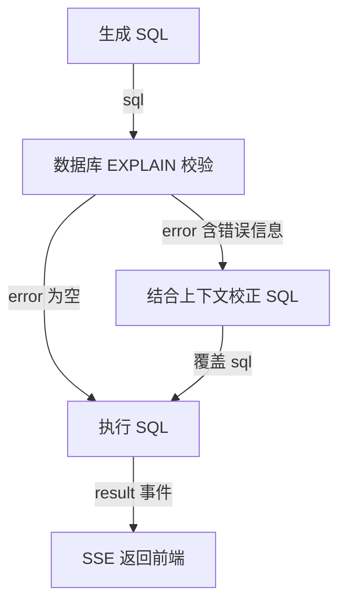

---
{
  "id": "Q-0158",
  "title": "如何说明 Agent 工作流各节点的输入、输出和数据流？",
  "category": "agent",
  "topic": "多 Agent 编排与协作",
  "type": "系统设计",
  "level": "进阶",
  "priority": "进阶补充",
  "focus": "节点状态与数据流转。沿一个请求逐节点讲读取哪些状态字段、写回什么结果、谁决定分支；如问数链路串起召回、上下文、SQL 校验执行。",
  "answerStatus": "ready",
  "updatedAt": "2026-10-27"
}
---

> 在面栈阅读：[如何说明 Agent 工作流各节点的输入、输出和数据流？](https://mianstack.com/question/q-0158)

## 核心回答

我会沿着一个具体请求说明：**每个节点读取哪些字段，完成什么处理，写回什么结果，以及谁根据结果决定下一步**。以电商问数中的“统计华北地区的销售总额”为例，可以这样串起数据流：

1. **接入与初始化**：接口接收问题，查询服务把它写入状态的 `query` 字段；数据库和检索客户端通过运行时上下文注入。
2. **关键词与三路召回**：抽取节点读取问题，输出关键词；字段、指标、字段取值三个召回节点读取问题和关键词，分别返回候选字段、业务口径与“华北”这样的真实取值。
3. **合并、过滤与补充上下文**：合并节点补齐指标依赖字段、关联键和表信息，再过滤无关表与指标，补上当前日期和数据库方言、版本。
4. **生成 `SQL`**：模型读取原问题、候选表字段、指标口径和环境信息，输出 `SQL` 字符串，写入 `sql`。
5. **校验与路由**：校验节点读取 `SQL`，用数据库的 `EXPLAIN` 检查并写入 `error`；条件边读取这个字段，决定直接执行还是先交给校正节点。
6. **执行与响应**：执行节点读取最终 `SQL`，通过数仓仓储查询数据，把结果作为事件发出，由服务层包装成 `SSE` 返回前端。

这里，**Schema 定义数据契约，`State` 保存中间结果，节点产生状态更新，边控制执行顺序和分支，外部工具或服务提供执行反馈**。说明白这些交接关系，才能解释某一步失败后应检查哪份输入、哪次调用和哪个分支。

## 展开说明

### 1. 先把请求、内部状态和运行环境分开

这个例子的外部请求主要是一个问题字符串，进入图后初始化为 `query`。内部的 `DataAgentState` 还声明了 `keywords`、三路召回结果、`table_infos`、`metric_infos`、`date_info`、`db_info`、`sql` 和 `error`。这些字段由相应节点逐步补齐，并不是要求用户一次性提交。

数据库仓储、Embedding 客户端和检索客户端属于执行依赖，放在 `DataAgentContext` 中，由节点通过运行时上下文读取。这样可以区分“这次要处理的数据”和“处理数据所需的服务对象”，也方便替换依赖、定位故障。

这里有两种不同的 Schema：状态 Schema 规定工作流中有哪些字段；数据库 Schema 描述有哪些表、列和关系，是 `SQL` 生成的业务依据。`TypedDict` 主要提供类型声明，严格的请求和节点边界校验仍需由解析器、验证模型或业务代码落实。定义了字段，不等于所有中间结果都会自动通过业务校验。

### 2. 三路召回交付的内容各不相同

`extract_keywords` 读取 `query`，使用关键词抽取方法产生 `keywords`，并保留原问题作为检索入口。随后三路并行：

- `recall_column` 结合问题扩展字段检索词，经 Embedding 和 `Qdrant` 找到候选字段，写入 `retrieved_column_infos`。
- `recall_metric` 检索“销售总额”对应的指标定义及依赖字段，写入 `retrieved_metric_infos`。
- `recall_value` 用 `Elasticsearch` 查找字段的真实取值，写入 `retrieved_value_infos`，帮助把用户说的“华北地区”对应到数据里的值。

三路返回业务实体，不直接把检索服务的原始响应扔给 `SQL` 生成模型。它们写不同字段，避免互相覆盖；汇合后的 `merge_retrieved_info` 读取三份结果，再通过元数据仓储补齐指标依赖字段、主外键和表信息，产出 `table_infos`、`metric_infos`。

接下来的两个过滤节点分别裁剪表字段和指标；`add_extra_context` 再写入日期与数据库信息。对这条请求，交接的重点是让 `SQL` 生成节点同时拿到“金额算什么”“地区存在哪个字段”“表怎样关联”，而不只是拿到几个相似词。

### 3. SQL 节点要把内容生成、数据库反馈和路由分开

`generate_sql` 的输入是原问题以及前面准备好的四类上下文，输出是一条纯 `SQL` 文本。它使用字符串解析器，不要求生成 `JSON`；格式要求应服从下游契约。

`validate_sql` 读取 `sql`，调用数仓仓储的 `validate` 方法。仓储执行 `EXPLAIN`，成功时节点返回 `error=None`，失败时返回错误文字。**校验节点只产出校验结果，条件边再根据 `error` 选择下一跳**。

`correct_sql` 同时读取原问题、上下文、原 `SQL` 和错误信息，输出修正后的 `SQL`，覆盖 `sql` 字段。图只画 `SQL` 后半段，箭头标明交接的数据与条件：

当前参考实现校正一次后直接执行，没有再次回到校验节点。若要加入“校正后重新校验”，应显式增加回边和次数上限。`EXPLAIN` 通过也不等于业务口径正确或权限检查完备，金额字段、过滤条件和关联关系仍需要业务样例核对。

### 4. 节点返回值和前端收到的消息不是一回事

多数中间节点返回一个局部更新，例如 `{"sql": "..."}`，由图运行时合并到 `State`。并行节点若必须更新同一字段，要定义适合的 `reducer` 或先分槽存放，不能依赖最后一次写入。

当前 `run_sql` 的查询结果通过 `runtime.stream_writer` 发成 `result` 事件，**没有写回 `State` 的结果字段**。查询服务消费 `astream(..., stream_mode="custom")`，把这些进度与结果事件包装成 `SSE`；因此前端能收到结果，不代表最终 `State` 里一定有同一份数据。若后续增加解释、绘图或恢复节点，需要把结果或产物引用显式交给它们。

异常也要沿数据流定位：检索结果为空先看关键词和召回；生成了错误列名先看表上下文；数据库报错看 `sql` 与反馈；`SSE` 没有最终结果则检查执行事件和服务层转发。节点异常在当前服务中会转成错误事件，不应只凭 `HTTP` 已开始返回就判断任务成功。

## 常见追问

### 节点是否都对应一个 Agent？

不是。关键词抽取、数据合并和格式转换可以是普通函数；`SQL` 生成节点可以只做一次模型调用。只有某个节点内部需要自主选择工具、根据反馈持续行动时，才可能封装为 Agent。节点是工作流执行单元，Agent 是一种执行方式。

### 为什么不把上一节点的所有输出直接传给下一节点？

可以共享完整状态，但每个节点应只依赖和更新自己负责的字段。否则无关上下文会增加模型输入成本，整份状态回写还可能造成覆盖或重复合并。较大的查询结果可以单独存储，通过稳定的产物引用交接。

### 如何验证数据流符合预期？

对固定样例逐节点检查输入字段是否齐备、输出类型是否符合约定、汇合点是否等到依赖完成，再验证校验成功和失败两条分支。还要确认最终查询结果和前端事件一致，并用真实业务期望核对计算口径；只有“图执行结束”不足以证明答案正确。

## 对应教程

- [LangGraph API：图与状态](https://github.com/didilili/ai-agents-from-zero/blob/c05fb5979cf0aa3b6b4ed8c29f450f640fb9c18f/23-LangGraphAPI%EF%BC%9A%E5%9B%BE%E4%B8%8E%E7%8A%B6%E6%80%81.md)：查看 State Schema、局部更新和 reducer 的职责，区分图内部状态与对外输入输出。
- [LangGraph API：节点、边与进阶](https://github.com/didilili/ai-agents-from-zero/blob/c05fb5979cf0aa3b6b4ed8c29f450f640fb9c18f/24-LangGraphAPI%EF%BC%9A%E8%8A%82%E7%82%B9%E3%80%81%E8%BE%B9%E4%B8%8E%E8%BF%9B%E9%98%B6.md)：查看节点函数、条件边和运行时上下文，理解“产生结果”和“决定下一跳”的区别。
- [电商问数：SQL 生成与执行闭环](https://github.com/didilili/ai-agents-from-zero/blob/c05fb5979cf0aa3b6b4ed8c29f450f640fb9c18f/%E5%AE%9E%E6%88%98%E9%A1%B9%E7%9B%AE-%E7%94%B5%E5%95%86%E9%97%AE%E6%95%B0/14-SQL%E7%94%9F%E6%88%90%E4%B8%8E%E6%89%A7%E8%A1%8C%E9%97%AD%E7%8E%AF.md)：沿具体查询检查 SQL 上下文、校验反馈和校正分支；结果如何进入 SSE 以配套代码为准。
- [电商问数配套源码：图编排](https://github.com/didilili/shopkeeper-agent/blob/0ab141086439e385a9cccf5f5acdf3c42b239e65/app/agent/graph.py)：查看实际注册的节点、两组并行分支和 SQL 校正后的真实走向。

## 参考资料

- 国内：[JavaGuide：Workflow、Graph 和 Loop](https://github.com/Snailclimb/JavaGuide/blob/50f02a5984c062fe7221629d0a6a40ec15c26fd7/docs/ai/agent/workflow-graph-loop.md)：依据节点、边和共享状态的职责，说明正文中节点局部更新如何合并，以及控制流与数据流如何配合。
- 国内：[zero2Agent：并行执行：Fan-out / Fan-in](https://github.com/ranxi2001/zero2Agent/blob/0c0eb7693105d281b146bb98f3a7f30da6f1ceea/learn-langgraph/05-parallel-workflows/index.md)：借鉴并行分析后汇总的案例，说明正文中分支交付和共享字段的合并规则。
- 国内：[WeThinkIn：Agent 设计模式与工作流编排高频考点](https://github.com/WeThinkIn/AIGC-Interview-Book/blob/275fdf1eeb65e3b233081d3b8e74ff5d8eeb2e03/AI%20Agent%E5%9F%BA%E7%A1%80/03_Agent%E8%AE%BE%E8%AE%A1%E6%A8%A1%E5%BC%8F%E4%B8%8E%E5%B7%A5%E4%BD%9C%E6%B5%81%E7%BC%96%E6%8E%92%E9%AB%98%E9%A2%91%E8%80%83%E7%82%B9.md)：依据 State、Node、Edge 与运行时的分工，说明正文中状态数据、执行依赖和业务节点之间的边界。
- 国外：[LangChain：LangGraph Graph API overview](https://docs.langchain.com/oss/python/langgraph/graph-api)：依据状态 Schema、局部更新、条件边和 reducer 的约定，解释正文中的数据契约与控制流，以及类型声明不能代替运行校验的原因。
- 国外：[LangChain：LangGraph Streaming](https://docs.langchain.com/oss/python/langgraph/streaming)：依据状态更新、完整状态与自定义流式事件的区分，解释正文中前端进度消息为何不等于状态已持久保存。

## FastGPT（TypeScript）

### 核心回答

我会以“父工作流调用一个子应用”为例，讲清**父节点选取输入、子应用创建运行状态、内部节点沿边执行、结果再回到父流程**这条链。`FastGPT` 的应用调用节点把子应用当作一个可组合的执行单元，传递的不只是问题字符串，还包括所选历史、文件、变量和交互恢复信息；回传的也不只是回答文本，还有历史、用量和交互状态。

例如父流程已取得用户问题和附件，需要调用一个已有分析子应用：父节点把问题接到 `userChatInput`，把附件接到 `fileUrlList`，再映射子应用需要的变量。子应用内部完成解析与分析后，父流程继续引用它的回答或历史输出。具体流程应以各节点的字段交接说明，不能只列“解析、分析、回答”三个名称。

### 1. 父节点选哪些数据传进去？

`dispatchRunAppNode()` 将节点参数分成问题、历史配置、文件列表、流式开关以及其余子应用变量。

- **问题**：普通调用根据 `userChatInput` 和选定文件构造子查询；交互恢复则沿用当前查询，并传入子流程恢复信息。
- **历史**：`getHistories()` 根据 `history` 选取上下文。传数组表示明确引用这些历史，数字表示按窗口选择，压缩检查点另有保留规则；没有配置时不会直接把父流程全部历史传入。
- **文件**：显式 `fileUrlList` 先转换为运行时文件；未指定时兼容使用当前查询里的文件。随后派生子文件上下文，对当前输入、文件变量和历史文件做去重与数量筛选。子应用拿到的是筛选后的查询和历史，不是父流程所有附件的无条件集合。

因此，文件 URL、持久化文件元数据和文件正文要分开：传入 URL 代表子流程可以继续引用该文件，真正解析正文仍由相应节点完成。

### 2. 子应用怎样变成可执行的图？

节点先加载目标应用、所选版本及其资源上下文，再读取该版本的 `nodes`、`edges`、`chatConfig`。存储节点转换成运行时节点，入口根据普通启动或交互恢复选择；普通边初始化为 `waiting`，恢复时可使用保存的边状态和节点输出。边决定调度关系，节点输入中的变量引用决定实际读取哪些值。

子流程随后创建独立的 `WorkflowVariableState`，按自己的变量配置初始化输入，并加入当前用户、会话、历史和时间等运行时信息。传入父 `variableState` 的一个用途，是让子流程通过运行时文件 URL 找回原始文件元数据；它并不表示父子所有变量共用一个可任意覆盖的字典。准备完成后，`runWorkflow()` 接收运行时图、筛选后的查询与历史，以及子变量状态执行。[父子调用的实际数据映射](https://github.com/labring/FastGPT/blob/6f1f6f074912aaa4eb92841793810c02a9a821ac/packages/service/core/workflow/dispatch/child/runApp.ts#L36-L174)。

### 3. 子流程结束后，哪些结果回到父流程？

包装节点从 `assistantResponses` 提取文本，放入 `data.answerText`；`data.history` 则由筛选后的历史、本次用户输入和子流程回答组成。交互恢复时不重复添加同一条用户输入。后续节点引用这些输出，不需要读取子流程所有内部节点状态。

运行统计走另一条交接：汇总 `flowUsages` 的点数，通过 `usagePush` 记入父节点，并从子流程运行摘要合并输入/输出 Token、引用集合和子响应数量。`runTimes`、反馈与记忆更新也分别返回，不能把界面显示的回答文字当成完整运行结果。

如果子流程停在交互节点，返回的 `workflowInteractiveResponse` 会包装成 `childrenInteractive`，下一次调用再取出 `childrenResponse` 恢复执行。关闭子应用流式输出只影响对外流式内容，子工作流仍会运行，回答文本仍可作为节点数据返回。[输出、用量与交互包装](https://github.com/labring/FastGPT/blob/6f1f6f074912aaa4eb92841793810c02a9a821ac/packages/service/core/workflow/dispatch/child/runApp.ts#L175-L243)。

### 4. 版本、资源和异常怎样影响这条数据流？

`loadChildWorkflowWithResource()` 先取得目标应用，再取得工作流版本，并为子版本创建资源上下文。命中资源快照也会实时读取应用实体；未命中时按运行人成员身份校验读取权限。指定的有效版本 ID 若能匹配目标应用，就读取该版本；无有效匹配时回到正式版本读取逻辑，优先正式版本指针，再取最新发布版本，历史应用另有兼容。因此不能把“配置过版本 ID”直接说成“任何情况下都严格锁定这一版本”。[子应用资源与版本加载](https://github.com/labring/FastGPT/blob/6f1f6f074912aaa4eb92841793810c02a9a821ac/packages/service/core/workflow/resource/service.ts#L341-L379)、[版本选择](https://github.com/labring/FastGPT/blob/6f1f6f074912aaa4eb92841793810c02a9a821ac/packages/service/core/app/version/controller.ts#L373-L393)。

空输入或缺少目标应用 ID 会直接返回节点错误；应用加载、变量初始化和子流程执行等异常由该节点的异常分支转换成错误结果，而不是正常回答。排查时沿四个位置检查就能缩小范围：父节点实际映射的字段、筛选后交给子流程的输入、实际读取的版本与资源，以及回传的是普通结果还是交互/错误状态。

这种封装让同一子应用可以被多个流程复用，但也增加了一层输入映射和结果包装。接口应明确哪些值传入、哪些值回传；需要父流程继续使用的数据，应通过显式输出交接，不能依赖子应用内部状态自动回写。

### 参考资料

- 国内：[FastGPT：工作流与插件](https://doc.fastgpt.cn/zh-CN/guide/build/workflow/intro)：依据节点输入可引用全局变量或前序输出、连线状态控制执行的说明，组织父节点输入与子图调度的解释；子应用具体映射按固定源码展开。
- 国内：[JavaGuide：Workflow、Graph 和 Loop](https://github.com/Snailclimb/JavaGuide/blob/50f02a5984c062fe7221629d0a6a40ec15c26fd7/docs/ai/agent/workflow-graph-loop.md)：采用节点读取和更新数据、边决定执行路径的划分，解释数据交接与控制流的区别。
- 国内：[zero2Agent：并行执行 Fan-out / Fan-in](https://github.com/ranxi2001/zero2Agent/blob/0c0eb7693105d281b146bb98f3a7f30da6f1ceea/learn-langgraph/05-parallel-workflows/index.md)：采用分支结果需要明确汇总规则的解释，支撑原通用答案中并行更新不能默认安全覆盖的说明。
- 国内：[WeThinkIn：Agent 设计模式与工作流编排](https://github.com/WeThinkIn/AIGC-Interview-Book/blob/275fdf1eeb65e3b233081d3b8e74ff5d8eeb2e03/AI%20Agent%E5%9F%BA%E7%A1%80/03_Agent%E8%AE%BE%E8%AE%A1%E6%A8%A1%E5%BC%8F%E4%B8%8E%E5%B7%A5%E4%BD%9C%E6%B5%81%E7%BC%96%E6%8E%92%E9%AB%98%E9%A2%91%E8%80%83%E7%82%B9.md)：采用状态契约、执行节点和运行依赖分别管理的思路，解释子变量状态与真实工具执行的职责。
- 国外：[LangChain：Graph API overview](https://docs.langchain.com/oss/python/langgraph/graph-api)：依据节点局部更新、状态 Schema 与 reducer 的约定，保留通用答案中的状态合并解释；FastGPT 的运行时实现按自身源码说明。
- 国外：[LangChain：Streaming](https://docs.langchain.com/oss/python/langgraph/streaming)：依据完整状态、局部更新和自定义事件的区别，说明通用答案中流式内容为何不等于完整状态或最终结果。
