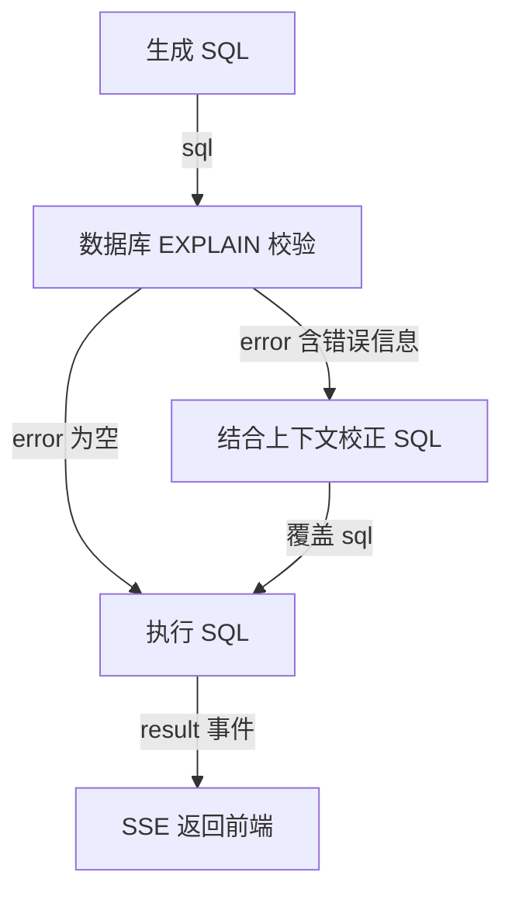

---
{
  "id": "Q-0158",
  "title": "如何说明 Agent 工作流各节点的输入、输出和数据流？",
  "category": "agent",
  "topic": "多 Agent 编排与协作",
  "type": "系统设计",
  "level": "进阶",
  "priority": "进阶补充",
  "focus": "节点状态与数据流转。沿一个请求逐节点讲读取哪些状态字段、写回什么结果、谁决定分支；如问数链路串起召回、上下文、SQL 校验执行。",
  "answerStatus": "ready",
  "updatedAt": "2026-10-17"
}
---

> 在面栈阅读：[如何说明 Agent 工作流各节点的输入、输出和数据流？](https://mianstack.com/question/q-0158)

## 核心回答

我会沿着一个具体请求说明：**每个节点读取哪些字段，完成什么处理，写回什么结果，以及谁根据结果决定下一步**。以电商问数中的“统计华北地区的销售总额”为例，可以这样串起数据流：

1. **接入与初始化**：接口接收问题，查询服务把它写入状态的 `query` 字段；数据库和检索客户端通过运行时上下文注入。
2. **关键词与三路召回**：抽取节点读取问题，输出关键词；字段、指标、字段取值三个召回节点读取问题和关键词，分别返回候选字段、业务口径与“华北”这样的真实取值。
3. **合并、过滤与补充上下文**：合并节点补齐指标依赖字段、关联键和表信息，再过滤无关表与指标，补上当前日期和数据库方言、版本。
4. **生成 SQL**：模型读取原问题、候选表字段、指标口径和环境信息，输出 SQL 字符串，写入 `sql`。
5. **校验与路由**：校验节点读取 SQL，用数据库的 `EXPLAIN` 检查并写入 `error`；条件边读取这个字段，决定直接执行还是先交给校正节点。
6. **执行与响应**：执行节点读取最终 SQL，通过数仓仓储查询数据，把结果作为事件发出，由服务层包装成 SSE 返回前端。

这里，**Schema 定义数据契约，State 保存中间结果，节点产生状态更新，边控制执行顺序和分支，外部工具或服务提供执行反馈**。说明白这些交接关系，才能解释某一步失败后应检查哪份输入、哪次调用和哪个分支。

## 展开说明

### 1. 先把请求、内部状态和运行环境分开

这个例子的外部请求主要是一个问题字符串，进入图后初始化为 `query`。内部的 `DataAgentState` 还声明了 `keywords`、三路召回结果、`table_infos`、`metric_infos`、`date_info`、`db_info`、`sql` 和 `error`。这些字段由相应节点逐步补齐，并不是要求用户一次性提交。

数据库仓储、Embedding 客户端和检索客户端属于执行依赖，放在 `DataAgentContext` 中，由节点通过运行时上下文读取。这样可以区分“这次要处理的数据”和“处理数据所需的服务对象”，也方便替换依赖、定位故障。

这里有两种不同的 Schema：状态 Schema 规定工作流中有哪些字段；数据库 Schema 描述有哪些表、列和关系，是 SQL 生成的业务依据。`TypedDict` 主要提供类型声明，严格的请求和节点边界校验仍需由解析器、验证模型或业务代码落实。定义了字段，不等于所有中间结果都会自动通过业务校验。

### 2. 三路召回交付的内容各不相同

`extract_keywords` 读取 `query`，使用关键词抽取方法产生 `keywords`，并保留原问题作为检索入口。随后三路并行：

- `recall_column` 结合问题扩展字段检索词，经 Embedding 和 Qdrant 找到候选字段，写入 `retrieved_column_infos`。
- `recall_metric` 检索“销售总额”对应的指标定义及依赖字段，写入 `retrieved_metric_infos`。
- `recall_value` 用 Elasticsearch 查找字段的真实取值，写入 `retrieved_value_infos`，帮助把用户说的“华北地区”对应到数据里的值。

三路返回业务实体，不直接把检索服务的原始响应扔给 SQL 生成模型。它们写不同字段，避免互相覆盖；汇合后的 `merge_retrieved_info` 读取三份结果，再通过元数据仓储补齐指标依赖字段、主外键和表信息，产出 `table_infos`、`metric_infos`。

接下来的两个过滤节点分别裁剪表字段和指标；`add_extra_context` 再写入日期与数据库信息。对这条请求，交接的重点是让 SQL 生成节点同时拿到“金额算什么”“地区存在哪个字段”“表怎样关联”，而不只是拿到几个相似词。

### 3. SQL 节点要把内容生成、数据库反馈和路由分开

`generate_sql` 的输入是原问题以及前面准备好的四类上下文，输出是一条纯 SQL 文本。它使用字符串解析器，不要求生成 JSON；格式要求应服从下游契约。

`validate_sql` 读取 `sql`，调用数仓仓储的 `validate` 方法。仓储执行 `EXPLAIN`，成功时节点返回 `error=None`，失败时返回错误文字。**校验节点只产出校验结果，条件边再根据 `error` 选择下一跳**。

`correct_sql` 同时读取原问题、上下文、原 SQL 和错误信息，输出修正后的 SQL，覆盖 `sql` 字段。图只画 SQL 后半段，箭头标明交接的数据与条件：

当前参考实现校正一次后直接执行，没有再次回到校验节点。若要加入“校正后重新校验”，应显式增加回边和次数上限。`EXPLAIN` 通过也不等于业务口径正确或权限检查完备，金额字段、过滤条件和关联关系仍需要业务样例核对。

### 4. 节点返回值和前端收到的消息不是一回事

多数中间节点返回一个局部更新，例如 `{"sql": "..."}`，由图运行时合并到 State。并行节点若必须更新同一字段，要定义适合的 reducer 或先分槽存放，不能依赖最后一次写入。

当前 `run_sql` 的查询结果通过 `runtime.stream_writer` 发成 `result` 事件，**没有写回 State 的结果字段**。查询服务消费 `astream(..., stream_mode="custom")`，把这些进度与结果事件包装成 SSE；因此前端能收到结果，不代表最终 State 里一定有同一份数据。若后续增加解释、绘图或恢复节点，需要把结果或产物引用显式交给它们。

异常也要沿数据流定位：检索结果为空先看关键词和召回；生成了错误列名先看表上下文；数据库报错看 `sql` 与反馈；SSE 没有最终结果则检查执行事件和服务层转发。节点异常在当前服务中会转成错误事件，不应只凭 HTTP 已开始返回就判断任务成功。

## 常见追问

### 节点是否都对应一个 Agent？

不是。关键词抽取、数据合并和格式转换可以是普通函数；SQL 生成节点可以只做一次模型调用。只有某个节点内部需要自主选择工具、根据反馈持续行动时，才可能封装为 Agent。节点是工作流执行单元，Agent 是一种执行方式。

### 为什么不把上一节点的所有输出直接传给下一节点？

可以共享完整状态，但每个节点应只依赖和更新自己负责的字段。否则无关上下文会增加模型输入成本，整份状态回写还可能造成覆盖或重复合并。较大的查询结果可以单独存储，通过稳定的产物引用交接。

### 如何验证数据流符合预期？

对固定样例逐节点检查输入字段是否齐备、输出类型是否符合约定、汇合点是否等到依赖完成，再验证校验成功和失败两条分支。还要确认最终查询结果和前端事件一致，并用真实业务期望核对计算口径；只有“图执行结束”不足以证明答案正确。

## 对应教程

- [LangGraph API：图与状态](https://github.com/didilili/ai-agents-from-zero/blob/c05fb5979cf0aa3b6b4ed8c29f450f640fb9c18f/23-LangGraphAPI%EF%BC%9A%E5%9B%BE%E4%B8%8E%E7%8A%B6%E6%80%81.md)：查看 State Schema、局部更新和 reducer 的职责，区分图内部状态与对外输入输出。
- [LangGraph API：节点、边与进阶](https://github.com/didilili/ai-agents-from-zero/blob/c05fb5979cf0aa3b6b4ed8c29f450f640fb9c18f/24-LangGraphAPI%EF%BC%9A%E8%8A%82%E7%82%B9%E3%80%81%E8%BE%B9%E4%B8%8E%E8%BF%9B%E9%98%B6.md)：查看节点函数、条件边和运行时上下文，理解“产生结果”和“决定下一跳”的区别。
- [电商问数：SQL 生成与执行闭环](https://github.com/didilili/ai-agents-from-zero/blob/c05fb5979cf0aa3b6b4ed8c29f450f640fb9c18f/%E5%AE%9E%E6%88%98%E9%A1%B9%E7%9B%AE-%E7%94%B5%E5%95%86%E9%97%AE%E6%95%B0/14-SQL%E7%94%9F%E6%88%90%E4%B8%8E%E6%89%A7%E8%A1%8C%E9%97%AD%E7%8E%AF.md)：沿具体查询检查 SQL 上下文、校验反馈和校正分支；结果如何进入 SSE 以配套代码为准。
- [电商问数配套源码：图编排](https://github.com/didilili/shopkeeper-agent/blob/0ab141086439e385a9cccf5f5acdf3c42b239e65/app/agent/graph.py)：查看实际注册的节点、两组并行分支和 SQL 校正后的真实走向。

## 参考资料

- 国内：[JavaGuide：Workflow、Graph 和 Loop](https://github.com/Snailclimb/JavaGuide/blob/50f02a5984c062fe7221629d0a6a40ec15c26fd7/docs/ai/agent/workflow-graph-loop.md)：依据节点、边和共享状态的职责，说明正文中节点局部更新如何合并，以及控制流与数据流如何配合。
- 国内：[zero2Agent：并行执行：Fan-out / Fan-in](https://github.com/ranxi2001/zero2Agent/blob/0c0eb7693105d281b146bb98f3a7f30da6f1ceea/learn-langgraph/05-parallel-workflows/index.md)：借鉴并行分析后汇总的案例，说明正文中分支交付和共享字段的合并规则。
- 国内：[WeThinkIn：Agent 设计模式与工作流编排高频考点](https://github.com/WeThinkIn/AIGC-Interview-Book/blob/275fdf1eeb65e3b233081d3b8e74ff5d8eeb2e03/AI%20Agent%E5%9F%BA%E7%A1%80/03_Agent%E8%AE%BE%E8%AE%A1%E6%A8%A1%E5%BC%8F%E4%B8%8E%E5%B7%A5%E4%BD%9C%E6%B5%81%E7%BC%96%E6%8E%92%E9%AB%98%E9%A2%91%E8%80%83%E7%82%B9.md)：依据 State、Node、Edge 与运行时的分工，说明正文中状态数据、执行依赖和业务节点之间的边界。
- 国外：[LangChain：LangGraph Graph API overview](https://docs.langchain.com/oss/python/langgraph/graph-api)：依据状态 Schema、局部更新、条件边和 reducer 的约定，解释正文中的数据契约与控制流，以及类型声明不能代替运行校验的原因。
- 国外：[LangChain：LangGraph Streaming](https://docs.langchain.com/oss/python/langgraph/streaming)：依据状态更新、完整状态与自定义流式事件的区分，解释正文中前端进度消息为何不等于状态已持久保存。
