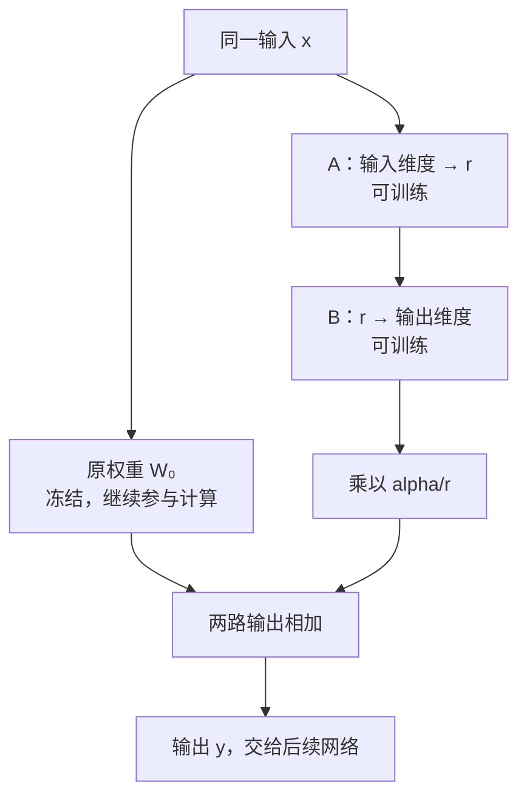

---
{
  "id": "Q-0168",
  "title": "LoRA 的原理、常见超参数与注入模块是什么？",
  "category": "training",
  "topic": "参数高效微调",
  "type": "原理机制",
  "level": "进阶",
  "priority": "按岗位选读",
  "focus": "低秩增量与参数作用。冻结 W，用低秩 BA 学增量；rank 控容量，缩放控制增量强度，target modules 决定注入哪些注意力/前馈投影。",
  "answerStatus": "ready",
  "updatedAt": "2026-10-16"
}
---

## 核心回答

LoRA 是一种**参数高效微调方法：冻结原模型权重 W₀，在选定的线性层中，用两个可训练矩阵 A、B 的乘积表示权重增量**。前向计算时，原权重的输出与低秩增量的输出相加；训练时只更新 LoRA 参数，原模型仍然参与计算。

常见配置分别控制四件事：

- **target modules**：在哪些层注入 LoRA，常见位置是注意力的 Q/K/V/O 投影，也可以覆盖前馈网络的线性层。
- **rank（r）**：A、B 之间的中间维度，决定新增参数量，并限制权重增量的秩。
- **alpha**：标准 LoRA 用 `alpha/r` 缩放增量，再与原路径相加；它不改变矩阵尺寸。
- **dropout**：训练时对 LoRA 分支输入随机置零，用于正则化，推理时关闭。

例如让模型按指定规则抽取关键词，可以保留基座权重，通过训练 LoRA 参数调整关键词选择和输出方式。适配器可以单独保存、按任务切换，普通线性 LoRA 也可以合并进原权重。

## 原权重没变，为什么输出会变？

下图只放大其中一个线性层。重点看同一个输入怎样走两条路径，再把输出相加；图中“可训练”只指新增的 A、B。



A、B 路径的输入和输出尺寸分别与原线性层一致，中间才是 r 维。沿用列向量写法，暂时忽略偏置与 dropout：

```text
x  : [d_in, 1]           W₀ : [d_out, d_in]
A  : [r, d_in]           B  : [d_out, r]

y = W₀x + s·BAx         ΔW = s·BA
经典 LoRA：s = alpha/r   rank(ΔW) ≤ r
```

A 先把输入变成 r 个中间数，B 再变回原层的输出维度，因而两条路径才能相加。假设原路径得到 `[1, 2]`，分支得到 `[0.1, 0.2]`，缩放系数为 2，相加就是 `[1.2, 2.4]`。这些是解释机制的小数字，输出仍是中间表示，不是直接输出了两个关键词。

这里的“低秩”可以理解为：增量必须经过 r 维的中间通道，因此能表达的变化受限。它并不要求 W₀ 本身也是低秩，也不需要先对 W₀ 做 SVD 分解。

## rank 到底省下多少参数？

假设这一层的原矩阵是 **1000×1000**，全参数微调要更新 1,000,000 个参数。LoRA 只更新 A、B，参数量为 `r(d_in + d_out)`：

| rank | A 的尺寸 | B 的尺寸 | 新增可训练参数                |
| ---- | -------- | -------- | ----------------------------- |
| 8    | 8×1000   | 1000×8   | 16,000，是原矩阵参数量的 1.6% |
| 16   | 16×1000  | 1000×16  | 32,000，是原矩阵参数量的 3.2% |

r 越大，中间通道越宽，能够学习的调整更丰富，但参数和相关训练开销也更多。原来的 100 万个参数仍要加载、参与计算；主要省下的是这些冻结参数的梯度和优化器状态，以及每个任务单独保存完整模型的成本。**可训练参数变少，不代表整场训练显存、耗时按同样比例下降**，长序列的中间激活仍可能占很多显存。

## 把四个配置放进同一个例子

关键词抽取示例采用以下 LLaMA-Factory 配置：

```yaml
lora_rank: 8
lora_alpha: 16
lora_dropout: 0
lora_target: all
```

这表示在工具为当前模型识别的适用线性层上添加 LoRA，中间宽度为 8，经典缩放 `alpha/r = 16/8 = 2`，不开启分支输入 dropout。这是一组实验起点，不是通用最优值。

如果只把 rank 改成 16，参数量会增加，但缩放也从 2 变成 1。想比较“分支变宽、缩放不变”，可以同时设 alpha=32，再用同一份验证数据比较关键词遗漏、格式错误和资源开销。保持比例只控制了这一项，不能保证两组训练行为相同。

alpha 与学习率控制的环节也不同：`alpha/r` 决定前向计算时增量加入的大小，学习率决定优化器怎样更新可训练权重。调整 alpha 会影响训练过程，但不能直接把它当成另一个学习率。

dropout 的作用是让训练时分支少依赖某些输入组合。例如设为 0.1，每个分支输入值在训练时有 10% 概率被暂时置零；它不删除 A、B 的权重。若数据与标注没有明显问题，训练表现好、验证表现差，可以比较它能否缓解过拟合。

作用位置也不局限于 Q、V。课程的 Qwen3 配置覆盖注意力的 `q_proj、k_proj、v_proj、o_proj`，以及前馈网络的 `gate_proj、up_proj、down_proj`。前者影响注意力中的映射，后者影响每层后续的特征变换。缩小到只训练 Q、V，可以减少适配器参数，也减少了能调整的位置，效果要做对照。

上面的字段属于 LLaMA-Factory；直接使用 PEFT 时对应的是 `r`、`target_modules` 等字段。更换模型或框架后，应看实际层名与生成的 `adapter_config.json`，不要把 `all` 当作跨框架通用写法。

## 常见追问

**为什么一个矩阵随机初始化，另一个置零？**

让初始 `BA=0`，刚加上 LoRA 时先保持原模型输出；随后训练再逐渐引入变化。若 A、B 同时为零，常规梯度更新下两边梯度也都为零，分支就学不起来。原论文采用 A 高斯初始化、B 为零；教程使用的 PEFT 0.18.1 中，普通线性 LoRA 默认采用 A 的 Kaiming-uniform 初始化、B 为零。两者都让初始增量为零，但随机分布不同。

**r 越大，效果一定越好吗？**

不一定。如果训练集和验证集都表现不足，在输入、标注和加载流程正常的前提下，可以怀疑分支容量不够；如果训练集已经很好而验证集变差，再增大 r 可能只是加重过拟合。要比较同一组任务样本，不能只看可训练参数变多。

**冻结基座，是不是就不会遗忘旧能力？**

不能保证。基座权重虽然不改，分支会改变实际输出，所以仍要回归检查需要保留的旧任务。

**推理时能去掉这条分支吗？**

普通 LoRA 可以把 `s·BA` 加到 W₀ 中，得到同形状的新权重，合并后不必另算分支；也可以保留独立 Adapter，方便切换任务。仅保存 Adapter 不等于保存了完整模型，仍需要匹配的基座。量化模型和特殊变体能否合并，要按框架支持判断。

## 对应教程

- [第 30 章：模型训练原理与高效微调](https://didilili.github.io/ai-agents-from-zero/#/30-模型训练原理与高效微调) §6.1–6.6：直接覆盖两条路径、1000 维参数算例、rank、alpha、target 和 dropout。
- [第 31 章：LLaMA-Factory 环境搭建与微调实战](https://didilili.github.io/ai-agents-from-zero/#/31-LLaMA-Factory环境搭建与微调实战) §7.4：对照 8/16/0/all 的配置落地及实际预览。
- [第 32 章：微调效果评估与模型部署](https://didilili.github.io/ai-agents-from-zero/#/32-微调效果评估与模型部署) §5：回看 Adapter 与基座的关系，以及合并导出。

## 参考资料

- 国内：[LLaMA-Factory：SFT 训练](https://llamafactory.readthedocs.io/zh-cn/latest/getting_started/sft.html)——用训练配置把 LoRA 的注入位置与秩对应到 `lora_target`、`lora_rank` 等字段，并说明模型、数据和模板应怎样配合。
- 国内：[Datawhale：第六章大模型训练流程实践](https://github.com/datawhalechina/happy-llm/blob/main/docs/chapter6/第六章%20大模型训练流程实践.md) §6.3——借鉴冻结基座和两路计算的讲解，解释 LoRA 分支如何参与前向计算，以及如何按层名选择注入位置。
- 国外：[Hu 等：LoRA: Low-Rank Adaptation of Large Language Models](https://arxiv.org/html/2106.09685) §4——依据原论文说明低秩权重增量、初始化、缩放和权重合并的原理。
- 国外：[Hugging Face PEFT：LoRA](https://huggingface.co/docs/peft/package_reference/lora)——依据配置、初始化和适配器用法，并结合 [PEFT 0.18.1 线性 LoRA 实现](https://github.com/huggingface/peft/blob/v0.18.1/src/peft/tuners/lora/layer.py)，说明正文中课程版本的初始化与计算方式；本文使用标准 LoRA 的 `alpha/r` 缩放，其他变体可能不同。
