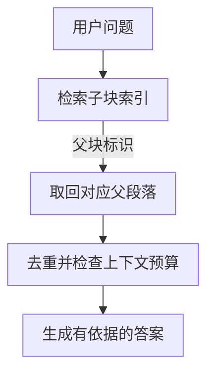

---
{
  "id": "Q-0171",
  "title": "RAG 文档有哪些切分策略，如何确定块大小？",
  "category": "rag",
  "topic": "文档切分与元数据",
  "type": "方案设计",
  "level": "进阶",
  "priority": "按岗位选读",
  "focus": "切片完整性与检索成本。按段落、标题或语义边界切分，设块大小基线后以带证据的问题集比较召回完整性、噪声和 token 成本。",
  "answerStatus": "ready",
  "updatedAt": "2026-10-17"
}
---

> 在面栈阅读：[RAG 文档有哪些切分策略，如何确定块大小？](https://mianstack.com/question/q-0171)

## 核心回答

**RAG 文档切分要在“检索能定位”和“片段足以回答”之间取舍。** 常见策略有四类：

1. **固定长度切分**：按字符数或 Token 数分块，适合快速建立基线。
2. **递归切分**：优先按段落、句子等边界切分，超长部分再继续细分。
3. **结构化切分**：依据标题、条款、函数或表格等文档结构组织片段。
4. **语义切分**：根据相邻内容的语义变化确定边界，同时限制块的最小和最大长度。

确定块大小时，先明确长度单位与 Embedding 输入上限，再看问题需要多大的证据单元。块太小，容易拆开前提和结论；块太大，会混入多个主题，增加检索噪声与生成成本。通常先保留自然边界，超长部分递归细分，再用同一批业务问题比较块大小和重叠量，检查证据召回、答案质量、延迟与成本。

例如运维手册中的适用版本、触发条件和恢复步骤应能一起取回。需要“小块定位、大段阅读”时，可以用父子块，把写入索引的子块与交给模型阅读的父段落分开。

## 几种策略怎样取舍

- **固定长度切分**：按字符数或 Token 数截断，可配滑动窗口重叠。实现简单、便于建立基线，但边界可能落在句子、条件或列表中间。
- **递归切分**：按优先级尝试段落、换行、句子等分隔符，遇到超长单元再继续细分。适合结构不完全规范的通用文本；中文要考虑句号、逗号等边界，不能只依赖空格。
- **结构化切分**：`Markdown` 按标题，法规按条款，代码按函数或类。表格应保留表头与数据行的对应关系；超大表格需要分组或拆行时，也要给每块补足列名和必要说明。结构边界仍要受长度预算约束。
- **语义切分**：根据相邻句子或段落的语义变化确定边界，适合主题切换明显、结构较弱的文本。它增加了离线计算与维护成本，还需要约束过小块和过大块，是否优于结构化切分要实测。

切分后还要保留来源、章节路径、页码、版本和父块标识。标题中有“`Redis` 超时处理”，正文却只写“上述配置”时，可以把必要标题加入块内容；仅存入元数据而没有参与编码，不会自动改变该块的向量。

## 怎样确定块大小和重叠

**先明确长度单位，再确定预算。** `chunk_size=500` 不一定表示 500 Token，例如按 `len` 计长的分割器统计的是字符。应按目标 Embedding 模型的分词方式检查实际输入，把参与编码的标题、指令和正文一起计入，避免超限报错或被静默截断。生成阶段还要为系统提示、问题、对话历史和输出预留空间，不能让召回片段占满上下文窗口。

**再看问题需要多大证据单元。** 运维知识库中，查一个配置项可以用较小块；解释故障的触发条件和恢复步骤，就需要连同前提一起保留。可以依据真实段落长度选择几组候选大小，抽查条件句、列表、跨页段落和表格是否被拆坏。

重叠主要用于缓解边界断裂，不必固定为某个比例。重叠过多会增加向量数量，还可能让多个近似重复块占满 `Top-K`。评测时既看答案依据是否找全，也看去重后保留了多少有效信息。

若小块容易命中、但不足以回答，可以按下图取回父段落：

父子块可以同时保留定位精度与上下文，但父段落仍可能过长，也有额外存储与读取成本。

**最后做受控评测。** 固定语料、问题集、Embedding、检索参数和生成配置，比较切分方案。问题集应标注所需证据，并覆盖事实问答、流程、多段条件和无答案问题。检索侧看证据覆盖与相关性，生成侧看正确性、引用和证据支持，同时记录上下文 Token、索引规模与延迟。切分方案变化后，重新生成受影响块的向量，并记录切分和索引版本，才能回放差异。

## 追问

**增大 `Top-K` 能代替合理切分吗？**

不一定。它可能补回相邻信息，也会带来更多重复和噪声。应先检查缺的是哪条证据，再选择邻块扩展、父子块或调整边界，而不是把更多候选直接拼进 Prompt。

**Embedding 支持长输入，还需要切分吗？**

通常仍值得切分。输入长度上限说明模型能接收多长文本，并不保证整篇文档形成的单个向量能精确定位每个知识点；是否使用整篇、章节或子块，仍需按查询粒度评测。

## 对应教程

教程先讲清切块与重叠的基本用法；本文进一步比较结构、语义和父子块的取舍，并补充评测方法。

- [第 19 章 RAG 检索增强生成：2.3 文本分割器](https://github.com/didilili/ai-agents-from-zero/blob/main/19-RAG%E6%A3%80%E7%B4%A2%E5%A2%9E%E5%BC%BA%E7%94%9F%E6%88%90.md)：回看切分策略、长度单位及重叠参数。

## 参考资料

- 国内：[JavaGuide：RAG 文档处理与切分策略](https://github.com/Snailclimb/JavaGuide/blob/50f02a5984c062fe7221629d0a6a40ec15c26fd7/docs/ai/rag/rag-document-processing.md)：参考结构化切分、语义切分与父子块的讲解，比较不同策略如何保留条件、控制检索粒度。
- 国内：[Hello-Agents：第八章记忆与检索，8.3.4](https://github.com/datawhalechina/hello-agents/blob/36f583c233ea5cee4537ef93455702b55053af18/docs/chapter8/%E7%AC%AC%E5%85%AB%E7%AB%A0%20%E8%AE%B0%E5%BF%86%E4%B8%8E%E6%A3%80%E7%B4%A2.md)：结合标题路径与分块代码，说明切分后的片段为什么还需要保留章节位置等信息。
- 国内：[阿里云百炼：知识库](https://www.alibabacloud.com/help/zh/model-studio/rag-knowledge-base)：参考表头拼装、切片标题与元数据的设置方式，说明表格和章节信息怎样随片段一起保留。
- 国内：[JavaGuide：RAG 优化](https://github.com/Snailclimb/JavaGuide/blob/50f02a5984c062fe7221629d0a6a40ec15c26fd7/docs/ai/rag/rag-optimization.md)：借鉴切分方案的对照评测与版本记录，说明如何根据检索和回答效果选择块大小。
- 国外：[LangChain：Splitting recursively](https://docs.langchain.com/oss/python/integrations/splitters/recursive_text_splitter)：依据分割器的参数说明，区分字符数与 Token 数，并补充中文标点和重叠边界的处理。
- 国外：[Unstructured：Chunking](https://docs.unstructured.io/open-source/core-functionality/chunking)：参考先识别文档结构单元、再按长度组合或细分的做法，解释结构完整性与块大小约束怎样配合。
