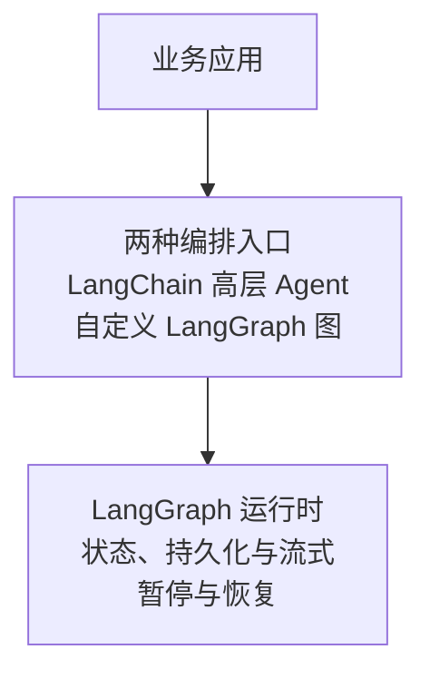

---
{
  "id": "Q-0215",
  "title": "LangChain 和 LangGraph 分别是什么，有什么区别，适合哪些需求？",
  "category": "agent",
  "topic": "Agent 框架与 Harness",
  "type": "比较选型",
  "level": "进阶",
  "priority": "进阶补充",
  "focus": "组件复用与显式状态编排。LangChain 提供模型、工具和检索组件与高层 Agent，LangGraph 显式编排状态和转移；按控制与恢复需求组合使用。",
  "answerStatus": "ready",
  "updatedAt": "2026-10-17"
}
---

> 在面栈阅读：[LangChain 和 LangGraph 分别是什么，有什么区别，适合哪些需求？](https://mianstack.com/question/q-0215)

## 核心回答

**LangChain 侧重用组件和高层 Agent 架构构建应用，LangGraph 侧重显式控制有状态流程的执行。** 两者可以一起使用，不能简单理解为“LangChain 只能顺序执行，LangGraph 才能做 Agent”。

- **LangChain** 提供模型、消息、工具和检索等集成，以及可通过中间件定制的 Agent 封装，适合快速连接模型与业务能力、构建常见工具调用 Agent。
- **LangGraph** 是较底层的编排框架与运行时。开发者定义状态、节点及流转规则，组织分支、循环、并行和暂停恢复，适合需要精细控制执行路径与状态生命周期的任务。
- **当前 LangChain 的 Agent 建立在 LangGraph 之上**，也能使用持久化、流式输出和人工介入等能力；直接写 LangGraph，主要是为了进一步掌控流程结构，而不是获得前者完全没有的功能。

例如普通知识问答，可以先用模型、检索器和提示词组成清楚的处理流程；标准工具调用助手，可以从 LangChain Agent 开始。若问数系统要显式安排检索、SQL 生成、校验、有限纠错和人工处理分支，直接用 LangGraph 更容易表达这些控制规则，节点里仍可复用 LangChain 组件。

## 区别主要在控制粒度

LangChain 帮助解决“模型和应用能力怎样接起来”。统一的模型与消息接口减少不同供应商接入方式的差异，工具接口把业务函数交给 Agent 使用，检索组件用于获取外部资料。高层 Agent 则提供模型与工具反复交互的常见执行结构，并通过中间件定制模型调用、工具处理等行为。

LangGraph 帮助解决“任务运行到哪一步、接下来怎样走、状态怎样延续”。以 Graph API 为例：

- **State** 保存流程需要的数据，例如用户问题、候选资料、SQL、校验结果和纠错次数。
- **Node** 执行某项操作，读取必要状态并返回更新，可以是普通代码、模型调用、检索器或一个完整 Agent。
- **Edge 与路由规则**决定下一步执行哪些节点，既可以按固定顺序，也可以根据状态选择分支或回到前一步。
- **运行时**负责调度这些步骤，并提供状态持久化、流式事件和中断恢复等基础能力；具体保存哪些信息、何时结束，仍由应用设计。

下图按层次概括两种构建入口及其共同运行基础，箭头表示依赖关系。应用也可以组合使用两种入口，节点内仍能复用模型和工具组件。

因此，使用 LangGraph 后仍然可以需要 LangChain 的组件；也可以在节点中直接调用供应商 SDK 或普通函数，LangGraph 不要求应用一定采用 LangChain 的高层接口。

## 根据流程复杂度选择

**单次调用或少量固定步骤**，先考虑普通函数或轻量组件组合。例如检索后生成答案，流程和错误处理都很简单时，显式建图可能增加状态和节点维护工作。LCEL 等组件组合也不只支持顺序执行，不能把一段 `prompt | model | parser` 示例当作 LangChain 的全部能力。

**标准模型—工具循环**，LangChain 的高层 Agent 通常是合适起点。需要换模型、增加工具、设置工具策略、接入会话状态或人工审核时，先判断现有配置与中间件能否满足，而不是因为出现“循环”或“持久化”就立即重写整张图。

**业务自己决定关键流转**，更适合直接使用 LangGraph。例如问数流程要求先准备元数据，再生成 SQL；校验失败只允许在预算内纠错；某类异常转人工；多个召回分支需要汇合后继续。这时显式状态和边让约束的位置更清楚，也便于单独检查某个节点或分支。

**固定步骤与自主决策混合**，可以把两者组合起来：外层用 LangGraph 安排查询、核验和提交，某个资料调研节点内部调用 LangChain Agent，由模型自行选择搜索工具。这样把模型的灵活性限制在需要它的环节，不必让所有步骤都由模型决定。

## 采用 LangGraph 后，还要自己设计什么？

图结构让流程更容易控制，但不能自动保证每个节点的业务结果正确。还需定义状态字段与更新规则、异常分支、循环次数和停止条件，并通过任务验收检查结果。并行节点写同一字段时，也要安排合并语义，避免互相覆盖或产生更新冲突。

要支持故障后继续执行，还需接入合适的持久化后端，正确划分会话或任务标识，并考虑节点恢复时可能重新执行。创建订单等外部动作需要幂等或状态核对，保存检查点本身不等于外部操作绝不会重复。

这些额外设计是控制力的代价。选型时可以说明具体收益：哪些分支原来难以维护，哪些任务需要等待人工后继续，哪些中间结果需要恢复。仅以“LangGraph 更先进”或“多 Agent 就要用图”作为理由，解释不了为什么它适合当前需求。

## 追问：有了 LangGraph，可以完全不用 LangChain 吗？

可以。LangGraph 可以独立编排普通函数和模型 SDK；如果已有统一模型、工具和检索封装，不一定需要再引入一层组件。但两者经常搭配，是因为 LangChain 提供集成与高层 Agent，LangGraph 提供更细的状态和控制流。决定是否保留某个组件，应看它是否减少实现和维护成本，而不是根据两个框架的名称做互斥选择。

## 对应教程

- [第 22 章：LangGraph 概述与快速入门](https://github.com/didilili/ai-agents-from-zero/blob/main/22-LangGraph%E6%A6%82%E8%BF%B0%E4%B8%8E%E5%BF%AB%E9%80%9F%E5%85%A5%E9%97%A8.md)：§1.1～§1.5 讲解图、状态、与 LangChain 的关系及适用场景；§1.3 已说明当前高层 Agent 与 LangGraph 的关系。
- [第 25 章：LangGraph 高级特性](https://github.com/didilili/ai-agents-from-zero/blob/main/25-LangGraph%E9%AB%98%E7%BA%A7%E7%89%B9%E6%80%A7.md)：流式、检查点和人工中断部分，帮助把“需要更细控制”落到具体运行需求，并理解恢复执行的条件。

## 参考资料

- 国内：[zero2Agent：LangChain：最流行的 LLM 框架](https://github.com/ranxi2001/zero2Agent/blob/0c0eb7693105d281b146bb98f3a7f30da6f1ceea/learn-agent-survey/09-langchain/index.md)：借鉴组件组合、并行调用与 RAG 的实现，说明正文中 LangChain 的集成职责及其不局限于顺序执行；文中旧 Agent API 与当前官方接口分别看待。
- 国内：[JavaGuide：AI 工作流中的 Workflow、Graph 与 Loop](https://github.com/Snailclimb/JavaGuide/blob/50f02a5984c062fe7221629d0a6a40ec15c26fd7/docs/ai/agent/workflow-graph-loop.md)：依据 Node、Edge、State 与循环终止条件，解释正文中如何把业务流程组织成可检查的执行结构；Java 框架接口与 LangGraph 接口分别对应各自实现。
- 国内：[Datawhale：第六章 框架开发实践](https://github.com/datawhalechina/hello-agents/blob/36f583c233ea5cee4537ef93455702b55053af18/docs/chapter6/%E7%AC%AC%E5%85%AD%E7%AB%A0%20%E6%A1%86%E6%9E%B6%E5%BC%80%E5%8F%91%E5%AE%9E%E8%B7%B5.md)：借鉴 §6.5 对状态、节点、条件边及实现代价的说明，解释正文中显式编排的工作方式和简单任务增加这层结构的成本。
- 国外：[LangChain：LangChain overview](https://docs.langchain.com/oss/python/langchain/overview)：当前 Agent 封装、模型接口和“Built on top of LangGraph”部分，说明 LangChain 的高层职责及其与底层运行时的关系。
- 国外：[LangChain：LangGraph overview](https://docs.langchain.com/oss/python/langgraph/overview)：依据低层编排、固定逻辑与模型决策混合及独立运行能力，说明正文中直接使用 LangGraph 获得的控制粒度。
