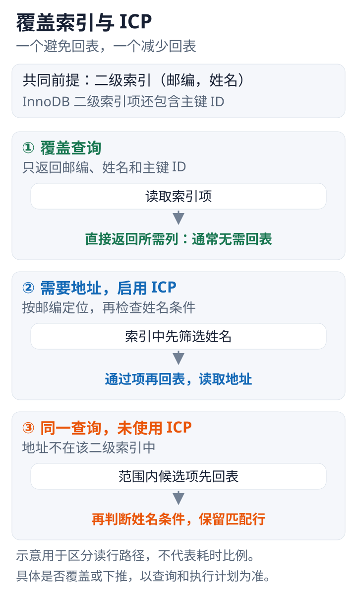

---
{
  "id": "Q-0244",
  "title": "索引下推与覆盖索引是什么？",
  "category": "software",
  "topic": "数据库与 SQL",
  "type": "原理机制",
  "level": "基础",
  "priority": "按岗位选读",
  "focus": "回表消除与索引层过滤。覆盖索引让所需列都在索引中而免回表；ICP 在回表前用索引已有列过滤，减少回表次数。",
  "answerStatus": "ready",
  "updatedAt": "2026-10-19"
}
---

> 在面栈阅读：[索引下推与覆盖索引是什么？](https://mianstack.com/question/q-0244)

## 核心回答

**覆盖索引解决“是否需要回表取数据”**：若查询需要的列都能从所用索引获得，就可以直接从索引返回，减少访问完整行。**索引下推（ICP）解决“回表前能否先过滤”**：存储引擎用索引里已有的列先判断可下推条件，只为通过筛选的记录读取完整行。

所以覆盖索引争取不回表，ICP争取少回表；它们不是同一个概念，也不是仅仅给索引换一个名字。

## 用同一索引理解区别

假设二级索引包含邮编和姓名。查询某邮编下、姓名中含某片段的用户，邮编可定位索引范围；姓名条件可能无法进一步缩小连续定位范围，但可在索引记录上筛选。若还要读取地址详情，ICP能先排除不匹配姓名的项，再对剩余项回表。

如果只返回索引中已有的邮编、姓名和主键ID，可能形成覆盖查询，通常无需为取得这些列再去聚簇索引读取完整记录。InnoDB二级索引包含主键，因此“返回列没有显式出现在索引定义里”也不一定需要回表。

沿着索引项到完整记录的访问路径，对照两种优化发生的位置：

这里沿用正文的邮编、姓名二级索引和地址字段。覆盖取决于本次查询所需列，ICP取决于可下推条件；图不表示固定性能倍率。

## 怎样检查

执行计划中的Using index通常提示覆盖读取，Using index condition提示ICP。二者应结合所选索引、访问方式和返回列理解，不能看到Extra里出现index就认定整条查询高效。

MySQL8.4的ICP对InnoDB主要用于需要读取完整行的二级索引访问，并非所有表达式都能下推。若条件涉及索引没有的列，就不能仅靠该索引项判断；覆盖查询本身已避免相应的完整行读取，也不是再叠加一次ICP才更好。

## 追问

范围条件后的联合索引列不一定“完全失效”：它们可能不再帮助缩小定位范围，却仍可能用于ICP筛选或覆盖返回。应区分索引定位、索引过滤和结果覆盖这三种用途。

## 参考资料

- 国内：[JavaGuide / Snailclimb：MySQL 索引详解](https://github.com/Snailclimb/JavaGuide/blob/50f02a5984c062fe7221629d0a6a40ec15c26fd7/docs/database/mysql/mysql-index.md)：覆盖索引与索引下推两个章节分别解释直接从索引返回所需列，以及先在索引中筛选再回表的不同路径。
- 国内：[JavaGuide / Snailclimb：MySQL 执行计划分析](https://github.com/Snailclimb/JavaGuide/blob/50f02a5984c062fe7221629d0a6a40ec15c26fd7/docs/database/mysql/mysql-query-execution-plan.md)：参考 Extra 中 Using index 与 Using index condition 的含义，解释正文中如何从执行计划区分覆盖读取和 ICP。
- 国内：[听风 / JavaGuide收录：MySQL 高性能优化规范建议](https://github.com/Snailclimb/JavaGuide/blob/50f02a5984c062fe7221629d0a6a40ec15c26fd7/docs/database/mysql/mysql-high-performance-optimization-specification-recommendations.md)：借鉴覆盖索引与显式列清单的说明，解释正文中所需列如何决定能否覆盖，以及覆盖为何取决于本次查询。
- 国外：[MySQL / Oracle：Index Condition Pushdown Optimization](https://dev.mysql.com/doc/refman/8.4/en/index-condition-pushdown-optimization.html)：存储引擎先判断索引条件再读完整行的过程说明ICP减少的是哪些访问。
- 国外：[MySQL / Oracle：How MySQL Uses Indexes](https://dev.mysql.com/doc/refman/8.4/en/mysql-indexes.html)：官方列出的索引用途说明为何索引是否有效取决于具体访问方式和成本。
