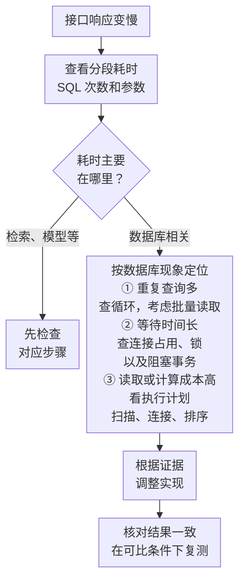

---
{
  "id": "Q-0250",
  "title": "如何发现、定位并优化慢 SQL？",
  "category": "software",
  "topic": "数据库与 SQL",
  "type": "故障排查",
  "level": "进阶",
  "priority": "按岗位选读",
  "focus": "慢查询分类与优化验证。从慢日志取 SQL 与参数，区分锁等待、扫描、回表和排序，再改索引或查询并比较实际耗时与扫描量。",
  "aliases": ["Q-2729"],
  "answerStatus": "ready",
  "updatedAt": "2026-10-17"
}
---

> 在面栈阅读：[如何发现、定位并优化慢 SQL？](https://mianstack.com/question/q-0250)

## 核心回答

慢 SQL 排查应结合接口表现与数据库证据，按**发现问题、定位原因、针对性优化、验证结果**四步进行：

1. **发现问题**：结合接口监控、慢查询日志和语句统计，记录具体 SQL、参数、调用频率及影响范围。先区分单条查询耗时高，还是一次请求中重复查询过多。
2. **定位原因**：区分连接等待、锁等待与执行成本。连接问题检查连接池和释放情况，锁问题检查阻塞事务；执行成本则通过执行计划分析扫描、连接和排序等环节。
3. **针对性优化**：根据证据减少重复查询、改写条件或调整索引，而不是统一采用“加索引、加缓存”。
4. **验证结果**：先确认结果一致，再在可比的数据、缓存和并发条件下对比扫描量与延迟；新增索引时同时评估写入和存储代价。

例如，已有 `(tenant_id, created_at)` 联合索引时，查询某租户一天的订单，若对时间列使用 `DATE()`，仍可能扫描该租户的大量历史记录。可尝试改为当天零点至次日零点的范围条件，再核对执行计划、扫描量和结果。

## 先判断该查哪个环节

从接口慢进入排查时，先看同一次请求的分段耗时和数据库调用记录。下图中的几类原因可以同时存在，应该沿着实际耗时继续查，不能只凭症状选一个结论。



慢查询日志有助于找出耗时较长的语句，但不会替你判断接口的全部耗时。例如大量短查询累积变慢，就还要看调用次数；下面先展开单条查询扫描过多的情况。

## 用一条订单查询说明怎么排查

下面以 MySQL 8.4 为例。假设问数接口要查“租户 42 在 9 月 1 日的订单”，`created_at` 是按约定业务时间保存的 `DATETIME`，已有普通 B-tree 联合索引 `(tenant_id, created_at)`，SQL 是：

```sql
SELECT id, created_at
FROM orders
WHERE tenant_id = 42
  AND DATE(created_at) = '2026-09-01';
```

### 先确认慢在数据库的哪一段

问数请求还包含检索、模型生成 SQL、校验和返回结果。先看各段计时：如果模型生成占了大部分时间，修改数据库索引无法解决这个瓶颈。如果迟迟拿不到连接，要检查连接池是否满了、连接是否及时归还，以及是否有长事务一直占用连接。

确认数据库执行相关耗时偏高后，按出问题的时间和参数找慢查询记录，同时检查扫描行数、返回行数和调用频次。单次耗时长会影响用户等待；单次不算慢但调用极频繁，也可能消耗大量数据库资源。慢日志受采集配置限制，因此还需要结合接口监控和语句统计，不能把“没记进慢日志”当成没有问题。[1]

安排优化优先级时，在同一统计时间范围内按 SQL 模板聚合执行次数与耗时。例如一类查询平均 20 毫秒、执行 10,000 次，累计执行耗时约 200 秒；另一类每次 2 秒、执行 2 次，累计约 4 秒。前者虽然单次快，也值得优先调查。这里的累计耗时可能包含等待和并发重叠，不能当作 CPU 时间或某个用户的等待时间；还要结合关键接口延迟和业务影响决定先改哪条。[7]

如果现场存在锁等待，要进一步找出谁阻塞了谁、阻塞事务为何迟迟不结束。只有查清等待原因，才能决定是缩短事务、调整访问顺序，还是处理异常连接。不要仅凭一条慢日志里的锁时间字段就排除所有锁等待。

### 用执行计划检验“扫描范围太大”这个猜测

这个联合索引先按租户排列，同一个租户内再按时间排列。`tenant_id = 42` 可以缩小租户范围，但普通索引存的是原始时间值；`DATE(created_at)` 对每条时间取日期，通常无法直接把第二列变成一天的索引查找区间。因此，原查询可能用到了这个索引，却仍要读取该租户的大量记录，再判断日期是否满足条件。[3][5]

检查时，把原查询放在 `EXPLAIN FORMAT=TREE` 后面，观察访问节点写的是租户条件，还是同时包含了日期起止范围。如果习惯表格输出，可以用 `EXPLAIN FORMAT=TRADITIONAL`，重点看实际选择的索引 `key`、访问方式 `type`、预计读取行数 `rows`，以及是否还有额外过滤。关键是弄清哪些条件用于定位范围、哪些条件是在读到记录后才判断，不能只看索引名。[2][4]

普通 `EXPLAIN` 给的是估计。如果需要观察各节点的真实耗时、输出行数和循环次数，可以在有代表性数据的可控环境使用 `EXPLAIN ANALYZE FORMAT=TREE`。节点输出行数不等于整条 SQL 的总扫描行数：过滤节点可能只输出少量记录，下层访问节点却读了很多；应结合上下层节点、循环次数和语句统计中的扫描量判断，不能把各节点的行数直接相加。它会真正执行查询，也会占用数据库资源；不能当成只看计划的无成本操作。[4]

### 改写条件，让现有索引能够定位时间范围

在上述时间含义不变的前提下，可以改成：

```sql
SELECT id, created_at
FROM orders
WHERE tenant_id = 42
  AND created_at >= '2026-09-01 00:00:00'
  AND created_at <  '2026-09-02 00:00:00';
```

这样，第一列固定租户，第二列直接给出时间上下界，具备了用联合索引定位这一天记录的条件。[5] 使用“包含当天零点、不包含次日零点”的区间，还能覆盖 `23:59:59.999999` 这样的值；如果列支持小数秒，写成 `<= '23:59:59'` 就可能漏数据。

这里已经有合适索引，所以先改写条件，不重复建一个相同索引。如果没有这个索引，再结合查询频率、时间范围和数据分布评估是否新增。索引需要空间，写入和修改索引列时也要维护，不能只看读取收益。[1]

### 先对结果，再比较性能

先在同一份数据上核对两种写法返回的记录集合。没有 `ORDER BY` 的查询不保证返回顺序，所以不能仅凭行的排列不同判断结果变了。至少覆盖以下边界：

| 租户与时间                                        | 两种写法应有的结果 |
| ------------------------------------------------- | ------------------ |
| 租户 42，当天 `00:00:00`                          | 包含               |
| 租户 42，当天 `23:59:59.999999`（列支持小数秒时） | 包含               |
| 租户 42，次日 `00:00:00`                          | 排除               |
| 其他租户，当天任意时刻                            | 排除               |
| 租户 42，时间为 `NULL`（列允许时）                | 排除               |

再对比改写前后的执行计划、实际扫描量和延迟，覆盖订单量不同的租户，并保持缓存预热、并发和测试数据尽量一致。否则第二次查询恰好读到了内存中的数据，也会看起来更快。

如果扫描量没有减少，回看优化器是否采用了预期范围，以及它为何选择其他访问方式；如果扫描量减少了但整体耗时仍高，就继续检查等待、返回数据量或其他执行步骤。估计行数与实际行数差得很大时，再检查数据倾斜和统计信息，评估是否更新统计后重看计划，而不是默认 `ANALYZE TABLE` 能解决问题。[4]

## 常见追问

**单条 SQL 都很快，接口为什么还会慢？**

可能是调用次数太多。例如，假设先查出 100 条订单，再在循环里为每条订单单独查一次客户信息，总共就会发起 101 次查询。即使每次查询都没达到慢日志阈值，串行累积起来也可能明显拖慢接口。

先从同一次请求的调用记录确认有没有这种重复查询，再考虑一次批量取出所需客户信息，或者用合适的关联查询，避免逐条访问数据库。改完还要核对每条订单是否关联到正确客户、客户缺失时怎样处理，以及一次取出的数据量；不能把“合成一条 SQL”本身当成优化目标。[6]

**全表扫描一定比索引扫描差吗？**

不一定。表很小，或者查询本来就要返回大部分数据，全表扫描可能更划算。反过来，即使用了索引，如果需要读取大量记录、频繁回表，整体仍可能很慢。访问方式是线索，要结合读取量和实际成本判断。[1][2]

**已经用了索引，还能怎么优化？**

先看它到底节省了哪部分工作。本例只按租户定位，和同时按租户、日期定位，虽然可能显示同一个索引名，读取量却可能不同。其他查询还可能把时间花在回表、大规模连接或排序上。此时应针对实际成本减少读取的行和列、调整索引或查询结构，再验证收益，不能把“加索引”当作统一答案。

**EXPLAIN ANALYZE 的时间能直接相加吗？**

不能。节点耗时包含子节点耗时，多次循环时显示的是每轮平均时间。应结合实际行数和循环次数判断重复处理的成本；把父子节点时间直接相加会重复计算。[4]

**字段换成 TIMESTAMP，或者已有函数索引呢？**

要重新核对。`TIMESTAMP` 要考虑会话时区和业务所说的“一天”；上下界必须对应同一个时间口径。已有与表达式匹配的函数索引时，函数条件也可能被索引利用。这里的改写分析建立在 `DATETIME` 和普通联合索引的假设上，不能据此断言所有日期函数都会导致全表扫描。[1][3]

## 对应教程

- [电商问数第 6 章 §2.4.2–2.4.4](https://didilili.github.io/ai-agents-from-zero/#/实战项目-电商问数/6-MySQL、Embedding与日志管理)：回看 Engine、Session 与连接池的分工，理解查询执行前也可能存在连接等待。
- [电商问数第 14 章 §4–4.2](https://didilili.github.io/ai-agents-from-zero/#/实战项目-电商问数/14-SQL生成与执行闭环)：回看 SQL 生成与执行闭环。教程中的 `EXPLAIN` 用于 SQL 解析检查；本文进一步展开执行计划分析与慢 SQL 优化。

## 参考资料

1. 国内：[JavaGuide：常见 SQL 优化手段总结](https://javaguide.cn/high-performance/sql-optimization.html)：借鉴慢 SQL 的排查与优化思路，组织问题发现、优先级判断和复测，并补充索引的维护代价。
2. 国内：[JavaGuide：MySQL 执行计划分析](https://javaguide.cn/database/mysql/mysql-query-execution-plan.html)：结合执行计划示例，说明怎样阅读索引、访问方式和估计行数，并区分估计信息与实际执行表现。
3. 国内：[小林 coding：索引失效有哪些？](https://xiaolincoding.com/mysql/index/index_lose.html)：参考普通索引、函数条件和联合索引的分析，解释示例中的索引利用情况，并补充函数索引等适用条件。
4. 国外：[MySQL 8.4：EXPLAIN Statement](https://dev.mysql.com/doc/refman/8.4/en/explain.html)：依据官方文档说明执行计划的输出含义，以及 `EXPLAIN ANALYZE` 会实际执行语句、节点时间应如何理解。
5. 国外：[MySQL 8.4：Range Optimization](https://dev.mysql.com/doc/refman/8.4/en/range-optimization.html)：依据范围优化规则，解释等值前导列与后续范围条件如何共同限定联合索引的扫描区间。
6. 国外：[SQLAlchemy 2.0：Relationship Loading Techniques](https://docs.sqlalchemy.org/en/20/orm/queryguide/relationships.html#preventing-unwanted-lazy-loads-using-raiseload)：通过 N+1 查询与关联预加载的说明，补充重复查询的排查方向；正文用显式循环作例子，具体 ORM 行为仍取决于加载策略。

7. 国内：[阿里云 DAS：SQL 洞察](https://help.aliyun.com/zh/das/user-guide/sql-explorer)：参考 SQL 洞察中的统计项，说明如何结合执行次数、平均耗时和累计耗时，判断同一时间区间内哪些 SQL 更值得优先优化。
