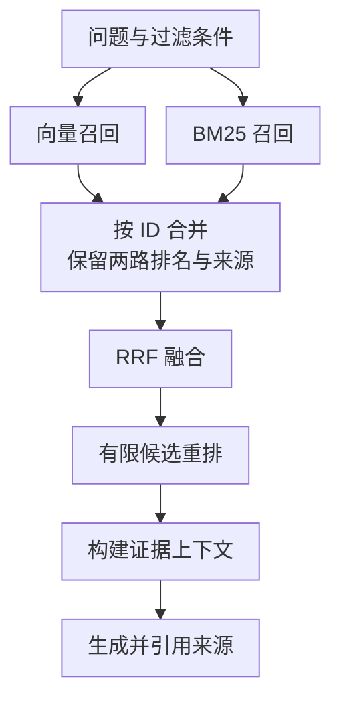

---
{
  "id": "Q-0251",
  "title": "向量检索、BM25、重排在混合 RAG 中如何配合？",
  "category": "rag",
  "topic": "混合检索与重排序",
  "type": "方案设计",
  "level": "进阶",
  "priority": "按岗位选读",
  "focus": "多路召回、融合与重排。向量召回覆盖语义，BM25 抓精确词，两路合并去重或融合后重排；先统一权限过滤，再按预算组装上下文。",
  "answerStatus": "ready",
  "updatedAt": "2026-10-17"
}
---

## 核心回答

**向量检索与 BM25 负责从不同角度召回候选，融合负责合并两路排序，重排负责进一步判断问题与候选片段的相关性。** 它们通常按以下流程协作：

1. 确定租户、权限和版本等检索范围，让两路召回都遵守这些条件。
2. 并行执行向量召回和 BM25 召回：前者覆盖语义改写，后者保留错误码、型号等词项信号。
3. 按片段 ID 合并候选，保留各路排名与来源，再用 RRF 等方法融合。
4. 对有上限的候选集合执行 Rerank，选取更相关的片段；最后去冗余、补充必要上下文并保留引用，交给大模型生成答案。

例如，问“E1042 导致频繁退出怎么办”，BM25 有助于找准错误码，向量检索补充不同表述的排障资料，重排再区分“只提到故障”和“给出适用处理步骤”的候选。**候选里没有正确证据时，重排无法把它补回来。**

## 从召回到上下文，怎样接起来？

下面展示在线检索部分。权限和业务范围应进入两路检索条件，不能等资料进入模型上下文后才处理。



图中把融合和模型重排分成了两步：前者利用已有检索名次，后者重新阅读问题与候选文本。

### 先保住候选，再统一排序

向量召回按模型学到的语义表示找相近片段；BM25 根据词项频次、稀有程度及长度等信号排序。假设某篇“E1042 处理手册”只在 BM25 通道命中，取两路候选的并集就能保留它，避免直接取交集造成漏召回。

同一片段可能被两路同时命中。合并时用稳定的片段 ID 关联结果，并保留它在两个列表中的名次，不能去重后只剩一个分数。文档版本不同的片段也不应仅因文字相近而混成同一证据。过滤发生在 ANN 前、搜索过程中还是搜索后，要核对具体引擎；严格过滤导致结果不足时，还需要检查候选规模与过滤后的有效召回。

### 融合不直接相加异构原始分数

BM25 分数与向量相似度通常没有统一量纲和取值范围，直接相加可能让某一路支配结果。RRF 使用名次规避这一步校准，其等权形式为：

```text
RRF(d) = Σ 1 / (c + rank_i(d))
```

其中 `rank_i` 从 1 开始，只对片段实际出现的列表求和；没有命中的一路贡献为 0。`c` 是平滑常数，与每路召回多少条的 Top-K 不同。设 `c=60`，A 在两路都排第 2，则得分约为 `0.03226`；B 只在一路排第 1，则得分约为 `0.01639`，因此 A 会排在 B 前面。这个推演说明多路一致命中如何影响排名，并不表示 A 的内容一定更正确。[Azure RRF 文档](https://learn.microsoft.com/en-us/azure/search/hybrid-search-ranking)解释了融合过程及其与后续语义重排的关系。

RRF 会舍弃原始分数之间的距离信息。若要采用加权分数融合，应先定义并验证归一化与权重；RRF 的平滑常数本身也不等于通道权重。

### 重排之后，仍要构建证据上下文

常见 Cross-Encoder 将“问题—候选片段”一起输入模型，让两段文本直接交互，比独立向量比较更细致；代价是每个候选都需要额外推理。因此，召回量、送入重排的数量、最终上下文大小应分别设置，结合延迟和成本调优。

排在前面的片段还要经过证据组织：删除高度重复内容，必要时补回相邻条款，保留产品、版本、否定条件和来源位置，再按 Token 预算组装上下文。重排分数衡量相关性，不负责验证手册是否过时、处理步骤是否真实有效。

## 常见追问

**怎样验证混合检索确实有收益？** 固定知识库、切块、过滤条件、查询集和生成配置，对比 BM25、向量、混合、混合加重排四组。分别检查候选证据的 Recall@K、排序质量、最终答案与引用，以及延迟、成本；再按错误码和自然语言改写等查询类型看变化。评测方法可参考[如何设计 RAG 评估方案和指标](/question/q-0543/)。

**答案仍然不准，先调哪一层？** 正确片段未召回，先查数据、查询和召回；已经召回却被排掉，查融合、候选截断与重排；进入上下文后仍答错，再查证据组织与生成。这样才能把改动与具体失败关联起来。

**混合检索一定要加模型重排吗？** 不一定。RRF 可以直接融合两路排名；如果融合结果已经满足质量与延迟要求，可以先保留这条基线。增加模型重排后，再比较排序质量、答案效果和额外成本，决定是否采用。

## 对应教程

- [向量数据库与 Embedding 实战](https://github.com/didilili/ai-agents-from-zero/blob/main/18-%E5%90%91%E9%87%8F%E6%95%B0%E6%8D%AE%E5%BA%93%E4%B8%8EEmbedding%E5%AE%9E%E6%88%98.md)：6.4 节区分过滤、混合检索与重排的职责。
- [RAG 检索增强生成](https://github.com/didilili/ai-agents-from-zero/blob/main/19-RAG%E6%A3%80%E7%B4%A2%E5%A2%9E%E5%BC%BA%E7%94%9F%E6%88%90.md)：2.4 节介绍混合、重排与评测方向。
- [电商问数：召回信息合并与上下文构建](https://github.com/didilili/ai-agents-from-zero/blob/main/%E5%AE%9E%E6%88%98%E9%A1%B9%E7%9B%AE-%E7%94%B5%E5%95%86%E9%97%AE%E6%95%B0/12-%E5%8F%AC%E5%9B%9E%E4%BF%A1%E6%81%AF%E5%90%88%E5%B9%B6%E4%B8%8E%E4%B8%8A%E4%B8%8B%E6%96%87%E6%9E%84%E5%BB%BA.md)：第 2、5 节展示召回信息如何合并为上下文；BM25、RRF 与 Cross-Encoder 的组合见本文的通用流程。

## 参考资料

- 国内：[JavaGuide：RAG 优化——从召回、重排到上下文工程](https://github.com/Snailclimb/JavaGuide/blob/50f02a5984c062fe7221629d0a6a40ec15c26fd7/docs/ai/rag/rag-optimization.md)：参考候选预算、重排与上下文组织的工程讨论，把多路召回接成可评测的完整流程。
- 国内：[JavaGuide：RAG 场景下的向量数据库](https://github.com/Snailclimb/JavaGuide/blob/50f02a5984c062fe7221629d0a6a40ec15c26fd7/docs/ai/rag/rag-vector-store.md)：结合近似检索与过滤的交互，解释为什么过滤后可能不足量，以及应该检查哪个环节。
- 国内：[Hello-Agents：第八章记忆与检索](https://github.com/datawhalechina/hello-agents/blob/36f583c233ea5cee4537ef93455702b55053af18/docs/chapter8/%E7%AC%AC%E5%85%AB%E7%AB%A0%20%E8%AE%B0%E5%BF%86%E4%B8%8E%E6%A3%80%E7%B4%A2.md)：借鉴候选合并与按 ID 去重的实现，说明怎样整理多路结果；文中的多查询扩展与本文的 BM25 混合召回属于不同策略。
- 国内：[zero2Agent：RAG 与检索](https://github.com/ranxi2001/zero2Agent/blob/0c0eb7693105d281b146bb98f3a7f30da6f1ceea/learn-agent-interview/09-rag-retrieval/index.md)：参考混合检索的适用条件和 Cross-Encoder 的两阶段分工，说明候选覆盖、排序精度与推理成本如何取舍。
- 国内：[BAAI：BGE-M3 模型文档](https://huggingface.co/BAAI/bge-m3)：参考混合召回后接模型重排的组合，说明正文中候选检索与精排的分工；所参考的模型稀疏检索与本文 BM25 通道属于不同词法实现。
- 国外：[Elastic：BM25 Similarity](https://www.elastic.co/docs/reference/elasticsearch/index-settings/similarity)：依据 BM25 的词频饱和与长度归一化机制，说明关键词通道的排序依据。
- 国外：[Microsoft：Hybrid Search Scoring with RRF](https://learn.microsoft.com/en-us/azure/search/hybrid-search-ranking)：依据 RRF 的排名融合方法，解释融合分数怎样计算，以及它与后续模型重排有什么区别。
- 国外：[Sentence Transformers：Retrieve & Re-Rank](https://sbert.net/examples/sentence_transformer/applications/retrieve_rerank/README.html)：参考 Bi-Encoder 召回与 Cross-Encoder 重排的计算方式，说明为何先缩小候选集，再逐对判断相关性。
