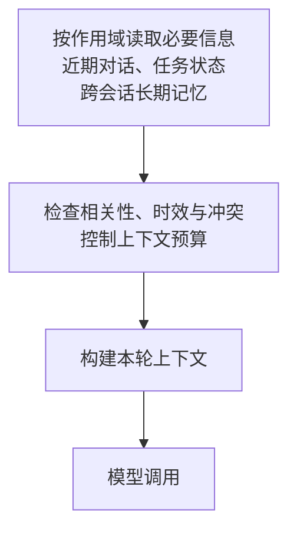

---
{
  "id": "Q-0266",
  "title": "Agent 如何设计分层记忆，实现短期与长期信息的保存和使用？",
  "category": "agent",
  "topic": "记忆系统",
  "type": "方案设计",
  "level": "进阶",
  "priority": "进阶补充",
  "focus": "记忆分层与相关信息召回。近期原文保指代，任务状态保目标和进度，长期记忆保可复用事实；检索相关项注入当前窗口并处理过期冲突。",
  "answerStatus": "ready",
  "updatedAt": "2026-10-17"
}
---

> 在面栈阅读：[Agent 如何设计分层记忆，实现短期与长期信息的保存和使用？](https://mianstack.com/question/q-0266)

## 核心回答

Agent 的分层记忆，应按**信息服务什么范围、保留多久、何时读写**来设计，再从存储中选出本轮模型需要的内容。一种实用组织方式是：

1. **近期对话**：保留当前会话最近的原始消息，延续指代、追问和用户更正；较早过程可以摘要或按需回查。
2. **当前任务状态与摘要**：明确保存目标、约束、已确认参数、进度和待办，避免模型每轮从聊天中重新猜测。关键事实用结构化字段，摘要补充经过与背景。它与近期对话都服务当前任务，通常属于短期信息。
3. **跨会话长期记忆**：保存后续仍有用的偏好、项目事实、历史决策和经过验证的经验，按用户、组织和项目限定作用域，需要时再检索。

这不是统一的“三层标准”，也不要求三套数据库。重点是把**保存的信息**与**本轮上下文**分开：Redis 或检查点负责保存，读取、筛选和注入才让模型实际用到。写入前判断价值与依据，读取时检查权限、有效期和相关性，并控制预算；发生更正、过期或删除时同步维护。

例如长期默认是“华北、按周”，本次用户要求“华南、按月”，当前任务采用新参数，长期默认暂时不变；只有用户明确改变默认，才更新相应的长期条目。

## 各层保存什么，怎样协作

继续用问数场景：最近几轮对话保留“这次改查华南”和时间范围的澄清；任务状态记录地区、时间粒度、指标口径、SQL 校验结果与当前进度；长期记忆保存该用户在这个项目下常用的查询偏好。

短期与长期的区别主要是**使用范围**，并不由保存天数决定。一个暂停数天后继续的任务，仍可恢复同一会话的短期状态；另开会话也要用到的默认口径，则属于跨会话信息。任务状态也不等于全部聊天历史：已经确认的参数和已完成步骤，应该能被程序直接读取和检查。

原始对话或工具结果可以留作回查材料，但不必每轮全部发送。摘要是有损的任务视图，不能替代需要精确核对的原文、数值或执行记录。长表格、网页和查询结果可以外置，状态里保存可访问的位置及必要说明。

下图只画读取侧：三类信息按需读取后，经过筛选和组织进入本轮上下文。分层描述的是逻辑职责，存储可以按业务需要共用或拆分。

上下文构建还要检查时效、冲突与 token 预算。即使某条信息已经存入记忆，也只有被正确取回并进入当前输入或后续工具交互，才会影响本次回答。

## 写入：先选择，再合并与更新

短期记录随交互和步骤推进更新：用户消息、必要的工具调用与返回、任务字段和步骤结果，都有各自的保存位置。执行状态应依据实际操作结果更新，不能只因为模型回复“已完成”就把任务设为成功。

长期写入要选择有持续价值的信息。例如用户明确要求记住项目默认口径，或者一项已经核实、后续可能复用的项目决定；临时查询参数、未经确认的推测、一次性工具输出，则不应直接变成稳定偏好或当前事实。

每条长期记忆可以携带内容、来源、所属用户与项目、形成时间、有效范围、版本和当前状态。写入时与已有条目去重，判断是补充、纠正还是一次局部例外。模型可以辅助抽取候选，但来源不明或语义含糊时，先保留为待确认信息，而不是自动覆盖已有结论。

写入可以在请求过程中同步完成，也可以交给后台任务。同步便于下一轮马上读取，但增加响应耗时；异步减少当前等待，却可能造成短暂的新旧不一致。用户刚要求修改默认值时，应明确何时更新已生效。后台抽取或重试还需防止重复写入；多会话同时更新同一偏好时，可用版本校验等方式处理冲突。

## 读取：先限定范围，再考虑相关与预算

会话历史按当前任务标识读取；长期记忆按可信身份和应用授权限定用户、组织、项目等范围。标识和过滤条件应由应用的数据访问层管理，不能只让模型自行填写后就直接访问。缓存和检索索引也要遵守同一边界，否则主库隔离了，缓存仍可能串到别人的记录。

检索方式由内容决定：默认语言、项目配置等明确字段可直接按键读取；历史事件和经验适合按关键词、语义或时间检索。长期记忆不要求全部向量化，语义相似也不等于当前可用。先排除无权限、失效或已撤销记录，再结合相关性、来源和适用时间筛选，最后去重并放入有限上下文。

冲突要看作用域和证据，而不只是“新记录分数更高”。本次“华南、按月”覆盖本次查询的历史默认，但不代表用户以后都改变习惯；若用户说“这个项目以后都按月”，才更新对应项目默认。其他项目的偏好也不应一起被覆盖。记忆内容是业务资料，不能替应用授予权限或改变系统约束。

输入过长时，先保留当前目标、有效约束、近期更正和必需证据，再缩小历史窗口、摘要或召回内容，为输出预留空间。消息裁剪还要保留必要的工具请求与结果关系。详细压缩取舍可继续看[多轮对话变长时，如何控制上下文长度并选择压缩策略？](/question/q-0051/)。

## 更正、过期、删除与恢复

用户纠正一个事实时，除更新当前有效条目，也要检查基于旧条目生成的摘要、索引和缓存。可保留必要的版本与来源便于追溯，但已失效的版本不应继续参与正常召回。一次性状态和稳定偏好的保留时间可以不同，具体按业务用途设定；不能因为是“长期记忆”就永久相信。

用户删除或撤销记忆时，读取链路应立即排除对应内容，并按保留策略处理主记录、向量索引、摘要和缓存。后续从旧历史重新抽取记忆时，也要识别删除或撤销标记，避免已经清除的内容又被后台任务写回。

在 LangChain/LangGraph 的当前主线中，**checkpointer** 保存同一线程的执行状态，**store** 支持跨线程长期信息。两者保存的内容都需要应用组织和读取；内存后端也不等于进程重启后仍可恢复。Redis、关系数据库、文件或向量库是可选择的存储手段，不能仅凭使用某种数据库就认定实现了记忆。

任务恢复时，除了加载检查点，还要核对状态版本、当前权限和工具结果是否仍有效，再构建本轮上下文。对已经产生的外部动作要查执行记录或使用幂等机制，避免恢复时重复执行。历史库存、订单状态等会变化的数据，也不能只凭旧记忆当作实时结果。

## 追问：怎样知道分层记忆确实有效？

用多轮与跨会话任务检查：能否接住近期指代，任务暂停后是否保留进度，新会话能否取回项目偏好，本次例外是否污染长期默认，更正和删除后旧记录是否仍被召回，以及不同用户、项目是否相互隔离。再观察无关记忆的注入量、token 与检索代价。

如果库里有正确记忆但回答没有使用，沿“限定范围、召回候选、有效性过滤、上下文构建、模型使用”逐步检查；如果一开始就写错了，需要修写入选择与纠错，而不是只增加召回数量。衡量目标是任务延续与结果质量，记忆条数更多不直接代表效果更好。

## 对应教程

- [第 16 章：记忆与对话历史（含 Redis 基础）](https://github.com/didilili/ai-agents-from-zero/blob/main/16-%E8%AE%B0%E5%BF%86%E4%B8%8E%E5%AF%B9%E8%AF%9D%E5%8E%86%E5%8F%B2%EF%BC%88%E5%90%ABRedis%E5%9F%BA%E7%A1%80%EF%BC%89.md)：§1、§3、§5 讲清读历史、注入提示、调用模型与写回，以及会话标识和 Redis 的存储职责；该章主要讲会话历史。
- [第 25 章：LangGraph 高级特性](https://github.com/didilili/ai-agents-from-zero/blob/main/25-LangGraph%E9%AB%98%E7%BA%A7%E7%89%B9%E6%80%A7.md)：§2.6、§2.7 区分线程内检查点与跨线程 Store；本文进一步展开长期写入选择、作用域、纠错和删除维护。

## 参考资料

- 国内：[JavaGuide：AI Agent 记忆系统](https://github.com/Snailclimb/JavaGuide/blob/50f02a5984c062fe7221629d0a6a40ec15c26fd7/docs/ai/agent/agent-memory.md)：依据记忆读写生命周期与元数据过滤，说明正文中长期写入的筛选条件，以及召回时范围、时效和来源校验的作用。
- 国内：[zero2Agent：记忆与上下文](https://github.com/ranxi2001/zero2Agent/blob/0c0eb7693105d281b146bb98f3a7f30da6f1ceea/learn-agent-interview/04-memory-context/index.md)：采用 State、Memory 与 Context 的区分及写入纠错机制，说明正文中任务事实、跨会话信息与本轮输入的差别，以及临时例外为何不等于长期更新。
- 国内：[Datawhale：第八章 记忆与检索](https://github.com/datawhalechina/hello-agents/blob/36f583c233ea5cee4537ef93455702b55053af18/docs/chapter8/%E7%AC%AC%E5%85%AB%E7%AB%A0%20%E8%AE%B0%E5%BF%86%E4%B8%8E%E6%A3%80%E7%B4%A2.md)：借鉴 §8.1.3 与 §8.2.1 对记忆管理、存储、检索和遗忘的职责划分，解释正文中记忆分层为何不只是更换数据库名称；四类记忆是该框架的具体设计。
- 国外：[LangChain：Short-term memory](https://docs.langchain.com/oss/python/langchain/short-term-memory)：依据 Overview、Usage 与 Common patterns 中线程状态、检查点及消息裁剪摘要的机制，区分正文中的状态持久化和模型输入管理。
- 国外：[LangChain：Long-term memory](https://docs.langchain.com/oss/python/langchain/long-term-memory)：依据 Usage、Memory storage 与读写工具示例，解释正文中跨线程 Store、namespace 和 key 的组织及显式取回；命名空间仍需应用授权。
