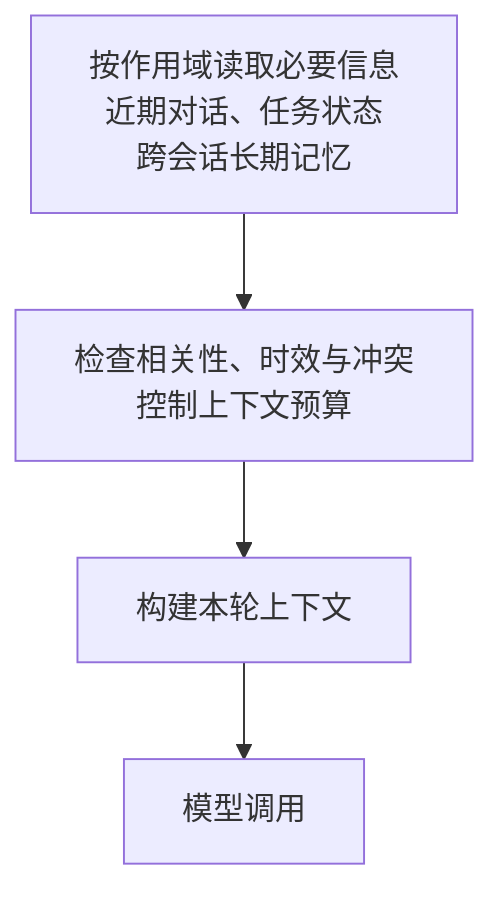

---
{
  "id": "Q-0266",
  "title": "Agent 如何设计分层记忆，实现短期与长期信息的保存和使用？",
  "category": "agent",
  "topic": "记忆系统",
  "type": "方案设计",
  "level": "进阶",
  "priority": "进阶补充",
  "focus": "记忆分层与相关信息召回。近期原文保指代，任务状态保目标和进度，长期记忆保可复用事实；检索相关项注入当前窗口并处理过期冲突。",
  "answerStatus": "ready",
  "updatedAt": "2026-11-04"
}
---

> 在面栈阅读：[Agent 如何设计分层记忆，实现短期与长期信息的保存和使用？](https://mianstack.com/question/q-0266)

## 核心回答

Agent 的分层记忆，应按**信息服务什么范围、何时读写、如何保持有效**来设计。一种实用组织方式是：

1. **近期对话**：保留当前会话最近的原始消息，延续指代、追问和用户更正；较早过程可以摘要或按需回查。
2. **当前任务状态与摘要**：保存目标、约束、已确认参数、进度和待办。关键事实用结构化字段，摘要补充经过与背景，避免每轮从聊天中重新猜测。它与近期对话都服务当前任务，通常属于短期信息。
3. **跨会话长期记忆**：保存后续仍有用的偏好、项目事实、历史决策和经过验证的经验，按用户、组织和项目限定作用域。

这不是统一的“三层标准”，也不要求三套数据库。一次调用先恢复当前任务，读取适用的长期默认与相关经验，检查时效和冲突，再组织成本轮上下文；执行后更新消息与任务状态，只有具备持续价值和可靠依据的信息才进入长期记忆。**存下来了，还要能在需要时正确取回，才会影响模型的回答。**

例如长期默认是“华北、按周”，本次用户要求“华南、按月”，当前任务采用新参数，长期默认保持原值；只有用户明确改变默认，才更新对应的长期条目。更正或删除后，还要让旧摘要、索引和缓存停止提供失效信息。

## 用一次问数任务串起读写过程

假设某用户在电商项目中的默认查询口径是“华北、按周”。下面是设计示例，重点看同一条信息怎样在不同阶段生效。

**第一步，开始任务时读取必要背景。** 应用根据已认证用户和当前项目，读出该项目的默认口径；有未完成任务时，另按任务标识恢复进度。用户新发来“这次改查华南，按月统计”，近期消息保留这句原文，任务状态更新为“地区：华南；粒度：月”，并记录这两个值来自本轮明确要求。长期默认只在用户未指定参数时补缺，不覆盖本轮要求。

**第二步，执行中按需要补读。** 用户接着说“再和去年对比”，近期原文帮助识别“再”的指代，任务状态提供已经确认的地区与粒度；指标口径和用于同比的时间范围若未确认，应先补齐。此时只补充对比所需的条件或历史依据；如果要算实际销售额，应查询业务数据源，旧记忆不能代替本次查询结果。任务开始时加载少量常用背景，执行到缺少历史依据的步骤再通过工具检索，避免每轮翻完整个记忆库。

**第三步，按实际结果更新短期状态。** 工具完成查询后，保存必要的结果、校验结论和下一步；长表格或完整返回可以外置，状态保留可回查位置。只有收到执行结果，才把对应步骤设为完成。任务暂停后仍可恢复这些状态，因此“短期”并不等于只能保存几分钟，也不等于关闭窗口就必须删除。

**第四步，判断是否更新长期记忆。** 这次查询完成，并不能推出用户以后都改用华南和月粒度。若用户明确说“这个项目以后默认查华南、按月”，才把该项目的默认口径更新为新版本，保留来源与生效时间，旧版本退出正常召回。另一个项目的默认口径不受影响。用户直接提出的默认变更应及时写入；从任务中归纳经验则可以后台处理，并先核对适用条件与依据。

**第五步，新会话重新读取有效版本。** 下次用户没有另提地区与粒度时，才使用更新后的项目默认；若用户再次指定“本次按周”，只覆盖本次任务。这样既能跨会话复用，也不会让一次临时例外污染以后所有任务。

原始对话、工具结果和摘要承担不同职责。摘要是有损的任务视图，精确数值、原话或执行记录仍应能回到原始材料核对。

## 长期写入：保存多大一条，怎样避免写错

长期记忆的粒度可以是**一个有完整条件的事实，或一次可复用的关键事件**。不要把整场聊天不加选择地存成一条，也不要把一句话拆成失去条件的碎片。例如“此项目默认华北、按周”应连同项目范围保存；一次排障经验则应包含问题、环境、采用方法和已验证结果，而不只留下“重试成功”四个字。

条目除内容外，可以携带来源消息或证据位置、所属用户与项目、形成时间、生效范围、版本和当前状态。来源时间与有效时间也要区分：“今天提到去年采用过的配置”不代表该配置今天仍然有效。结构化的默认值可以按键保存，较长的事件和经验再按需要建立关键词或语义索引；长期记忆不要求全部向量化。

写入前先查同一范围内已有条目，判断是新增、重复补充、纠正旧事实，还是一次局部例外。模型可以抽取候选，但一次性参数、未经确认的推测和来源不明的内容，不直接成为稳定偏好。遇到范围或意图含糊的冲突，先保留待确认信息；不能只因新条目更近或向量分数更高就覆盖旧条目。

同步写入便于下一轮马上读取，但增加当前耗时；后台抽取减少等待，却可能暂时读到旧版本。对已明确要求修改的默认值，要让应用知道何时更新生效。重试可按源消息与抽取批次等稳定标识去重，多会话同时修改同一默认时，用版本校验等方式发现覆盖冲突。

## 读取：先限定范围，再筛选相关信息

会话历史按当前任务标识读取；长期记忆由应用的数据访问层限定可信的用户、组织和项目范围，缓存与检索索引遵守同一边界。不能让模型随意填写一个用户标识，就直接读取该用户的记忆。

读取可分两条路径：默认语言、项目配置等明确字段直接按键读取；历史事件和经验按关键词、语义、时间等条件检索。候选还要检查是否有效、是否适用于当前问题，再去重、排序并控制预算。语义相似只说明“可能相关”，不能证明该事实仍然正确，也不能替代访问授权。

下图只画读取侧。三类信息按需读取后，经过筛选和组织进入本轮上下文；分层描述的是逻辑职责，存储可以按业务需要共用或拆分。

冲突要结合来源与适用范围处理：本次“华南、按月”覆盖本次查询的默认值，但不自动修改长期偏好；同一项目明确改变默认，才替换该项目的有效版本。记忆内容是业务资料，不能替应用授予权限或改变系统约束。

输入过长时，优先保留当前目标、有效约束、近期更正和必需证据，再缩小历史窗口、摘要或召回内容，为输出预留空间。裁剪时还要保留必要的工具请求与结果关系。详细压缩取舍可继续看[多轮对话变长时，如何控制上下文长度并选择压缩策略？](/question/q-0051/)。

## 更正、过期、删除与恢复

用户纠正一个事实时，除更新当前有效条目，还要检查基于旧条目生成的摘要、索引和缓存。例如默认口径已经改成月粒度，旧摘要中的“用户一向按周查询”也应失效，不能在下次检索时把旧默认重新带回来。需要追溯时可保留历史版本与来源，但失效版本退出正常召回；不同信息按实际用途设保留期限，长期记忆也要重新核实。

删除或撤销时，读取链路先排除对应内容，再按保留策略处理主记录及衍生的索引、摘要和缓存。后台重新扫描旧对话时，还要识别撤销记录，防止又把已经删掉的偏好抽取回来。仅从向量库删掉一条向量，并不代表所有读取入口都已清除。

在 LangChain / LangGraph 的当前主线中，`checkpointer` 按 `thread_id` 保存线程内执行状态，`store` 保存跨线程的应用数据。长期条目由 `namespace` 和 `key` 组织：`get` 适合按键读取，`put` 写入或覆盖，`search` 查找候选，`delete` 删除条目。搜索可按命名空间前缀覆盖子范围，应用应控制允许搜索的范围；这些接口本身也不会替应用判断“用户是在改默认，还是提一次例外”。

内存后端不等于进程重启后仍可恢复，后端耐久性需要另外配置。深度研搜里的 `StoreBackend` 则把文件工具的读写映射到 Store，并不会把普通聊天自动沉淀成长期记忆。

恢复任务时，除加载检查点，还要核对当前权限、状态版本和工具结果是否仍有效；对已经产生的外部动作查执行记录或使用幂等机制，避免重复执行。历史库存、订单状态等会变化的数据，也不能只凭旧记忆当作实时结果。

## 追问：怎样知道分层记忆确实有效？

围绕不同用户、组织、项目和多个会话做检查，观察系统是否产生预期状态变化：

- 本次指定“华南、按月”后，本轮用新参数，下次新任务仍沿用原默认。
- 明确说“以后默认华南、按月”后，该项目的新会话取到新版本，其他项目保持自己的默认。
- 不同用户或组织不能互读；同一用户的两个项目按各自范围读取，检索与缓存也不混用。
- 暂停后恢复，已完成步骤和待办仍在，并且不会重复产生外部动作。
- 更正、过期或删除后，旧记录及其摘要、缓存不再进入正常召回；后台处理也不会重新写回已撤销内容。

同时观察相关记忆召回、无关内容注入、读取代价与最终任务结果。库里有正确记忆而回答没用上，就沿“范围限定、召回、有效性筛选、上下文构建、模型使用”逐段检查；一开始写错了，则修写入选择与纠错机制。增加记忆条数或召回数量，不能直接证明效果变好。

## 对应教程

- [第 16 章：记忆与对话历史（含 Redis 基础）](https://github.com/didilili/ai-agents-from-zero/blob/main/16-%E8%AE%B0%E5%BF%86%E4%B8%8E%E5%AF%B9%E8%AF%9D%E5%8E%86%E5%8F%B2%EF%BC%88%E5%90%ABRedis%E5%9F%BA%E7%A1%80%EF%BC%89.md)：§1、§3、§5 讲清读历史、注入提示、调用模型与写回，以及会话标识和 Redis 的存储职责；该章主要讲会话历史。
- [第 25 章：LangGraph 高级特性](https://github.com/didilili/ai-agents-from-zero/blob/main/25-LangGraph%E9%AB%98%E7%BA%A7%E7%89%B9%E6%80%A7.md)：§2.6、§2.7 区分线程内检查点与跨线程 Store。
- [深度研搜第 6 章：长期记忆与 Backend 存储](https://github.com/didilili/ai-agents-from-zero/blob/main/%E5%AE%9E%E6%88%98%E9%A1%B9%E7%9B%AE-%E6%B7%B1%E5%BA%A6%E7%A0%94%E6%90%9C/6-%E9%95%BF%E6%9C%9F%E8%AE%B0%E5%BF%86%E4%B8%8EBackend%E5%AD%98%E5%82%A8.md)：§1、§2、§4 展示文件工具经 Backend 落到 Store，以及跨线程读取；本文进一步展开长期写入选择、作用域、纠错和删除维护。

## 参考资料

- 国内：[小林面试笔记：记忆机制与模块设计](https://xiaolinnote.com/ai/agent/8_memory.html)：借鉴“存什么、怎么存、什么时候取”的拆解，说明任务开始时预载必要背景、执行中再按需检索，以及结构化字段和自由文本采用不同读取方式。
- 国内：[小林面试笔记：长短期记忆的存储、粒度和使用](https://xiaolinnote.com/ai/agent/9_memory_storage.html)：参考结构化工作记忆与关键事件粒度，展开当前参数如何随澄清更新，以及长期条目怎样保留完整条件而非零散词句。
- 国内：[JavaGuide：AI Agent 记忆系统](https://github.com/Snailclimb/JavaGuide/blob/50f02a5984c062fe7221629d0a6a40ec15c26fd7/docs/ai/agent/agent-memory.md)：依据记忆读写生命周期、写入幂等和元数据过滤，解释写入筛选、并发版本冲突，以及召回时范围、时效和来源校验的作用。
- 国内：[王二讲 Agent：Memory 系统与上下文工程](https://javabetter.cn/sidebar/itwanger/paicli/paicli-interview-memory-context.html)：参考 §01、§03 中会话记录、长期条目、项目作用域和更正入口的分工，说明磁盘记录需要显式读取才能进入上下文，以及临时参数不应污染其他项目。
- 国内：[zero2Agent：记忆与上下文](https://github.com/ranxi2001/zero2Agent/blob/0c0eb7693105d281b146bb98f3a7f30da6f1ceea/learn-agent-interview/04-memory-context/index.md)：借鉴其中对任务状态、记忆准入和版本纠错的解释，说明当前任务事实与跨会话信息的差别，以及未经确认的推测为何不能直接当作稳定事实。
- 国内：[Datawhale：第八章 记忆与检索](https://github.com/datawhalechina/hello-agents/blob/36f583c233ea5cee4537ef93455702b55053af18/docs/chapter8/%E7%AC%AC%E5%85%AB%E7%AB%A0%20%E8%AE%B0%E5%BF%86%E4%B8%8E%E6%A3%80%E7%B4%A2.md)：借鉴 §8.1.3、§8.2.1、§8.2.3 中管理器、存储、检索、更新和遗忘的职责，解释分层需要可维护的读写过程；四类记忆是该框架的具体设计。
- 国外：[LangChain：Short-term memory](https://docs.langchain.com/oss/python/langchain/short-term-memory)：依据线程状态、检查点和自定义状态字段，区分任务持久化与本轮输入管理，并说明暂停数天后恢复的状态仍可属于短期记忆。
- 国外：[LangChain：Long-term memory](https://docs.langchain.com/oss/python/langchain/long-term-memory)及 [Stores](https://docs.langchain.com/oss/python/langgraph/stores)：依据跨线程 Store、命名空间和读写接口，解释长期条目的显式保存、取回与范围控制，以及内存实现不保证进程重启后的数据保留。
