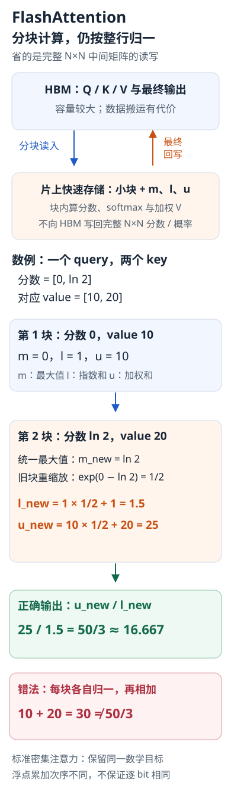

---
{
  "id": "Q-0277",
  "title": "FlashAttention 为什么能节省显存并提速，是否改变注意力结果？",
  "category": "llm",
  "topic": "推理优化与模型压缩",
  "type": "原理机制",
  "level": "进阶",
  "priority": "按岗位选读",
  "focus": "IO 优化与注意力等价性。分块融合 softmax 与乘 V，减少大注意力矩阵的 HBM 读写；保持密集注意力数学目标，浮点误差仍可能不同。",
  "answerStatus": "ready",
  "updatedAt": "2026-10-19"
}
---

## 核心回答

FlashAttention通过分块与算子融合，在片上快速存储中完成注意力分数、softmax和乘V的计算，避免把完整N×N分数及概率矩阵反复写入、读出HBM。它主要减少显存占用和数据搬运，因此即使反向包含重算，也可能比朴素实现更快。

标准密集FlashAttention保留同一个注意力数学目标，不靠删掉token连接近似结果，计算量通常仍为O(N²d)。浮点累加次序、精度、dropout及内核实现不同会产生数值差异，所以“精确”指算法语义，不代表逐bit完全相同。

先用仓库和小工作台的类比，理解为什么减少中间结果搬运会带来收益：


仓库类比 HBM，工作台类比容量较小的片上快速存储。所有分块仍参与完整注意力计算；下文继续解释分块 softmax 怎样保持全行归一。

## 难点在于分块后softmax如何归一

softmax一行的分母依赖全部key。不能把每块单独softmax，再把块输出简单相加，否则每块权重各自归一到1，破坏全行权重。

对一行维护当前最大分数m、指数和l和未归一化输出u。读入新块，其最大值为m_b、以m_b为基准的指数和为l_b、加权值和为u_b，则：

```text
m_new = max(m, m_b)
l_new = exp(m-m_new) × l + exp(m_b-m_new) × l_b
u_new = exp(m-m_new) × u + exp(m_b-m_new) × u_b
最终输出 = u_new / l_new
```

旧块与新块统一到同一个最大值后才能合并，既保持数值稳定，又不必保存整行分数。

## 一个可复算的例子

单个query对两个key的分数为[0,ln2]，对应标量value为[10,20]。完整softmax权重为[1/3,2/3]，输出50/3，约16.667。

若每块只含一个key，第一块m=0、l=1、u=10；第二块m_b=ln2、l_b=1、u_b=20。合并时m_new=ln2，旧项缩放为1/2，于是l_new=1.5、u_new=25，输出仍为25/1.5。直接把两块各自输出相加则得到30，明显错误。

把上面的两个分块代入同一组统计量，检查合并前后的归一化：



两个单元素分块只是可复算的标量例子。旧统计按新的最大值一起缩放，最后统一相除；不能把各块已经归一的输出直接相加。

## 反向为什么能省显存却更快

反向需要的分数或概率，可由保存的输入、输出和归一化统计按块重算，而不保存全部N×N中间张量。这增加部分算术，却减少昂贵的HBM访问。节省的是注意力中间激活，不等于模型权重、优化器状态或解码KV缓存都消失。

实际收益取决于GPU、头维度、长度、批量、mask和内核版本。短序列、已有高效后端或非注意力瓶颈下，端到端改善可能有限；应在相同配置下比较耗时、峰值显存和误差。

## 参考资料

- 国内：[wdndev：Attention：FlashAttention](https://github.com/wdndev/llm_interview_note/blob/581d54dd9a72e1d0a4eb28ae50859db83901b783/02.大语言模型架构/1.attention/1.attention.md)：参考文中对分块、online softmax 和反向重算的讲解，说明正文中减少中间张量保存与 HBM 访问的机制。
- 国内：[WeThinkIn：模型架构与工作原理](https://github.com/WeThinkIn/AIGC-Interview-Book/blob/275fdf1eeb65e3b233081d3b8e74ff5d8eeb2e03/大模型基础/02_模型架构与工作原理.md)：借鉴文中对注意力优化方式的比较，说明 FlashAttention 的访存优化与稀疏注意力的区别，以及它为何不降低密集注意力的理论计算量。
- 国内：[Datawhale：第三章 大语言模型基础](https://github.com/datawhalechina/hello-agents/blob/36f583c233ea5cee4537ef93455702b55053af18/docs/chapter3/第三章%20大语言模型基础.md)：参考标准注意力中 QKᵀ、softmax 和乘 V 的计算过程，交代正文分块计算所保留的原始注意力目标。
- 国外：[Dao等 / Stanford等：FlashAttention](https://arxiv.org/html/2205.14135v2)：依据论文中的分块归一化算法，解释最大值变化时如何重缩放累积量，以及反向重算为何仍能保留原有注意力的数学结果。
- 国外：[Tri Dao / Stanford CRFM：FlashAttention: Fast Transformer Training with Long Sequences](https://crfm.stanford.edu/2023/01/13/flashattention.html)：借鉴文章对工作划分与 GPU 并行度的分析，补充正文中实际提速受批量和序列长度等条件影响的说明。
