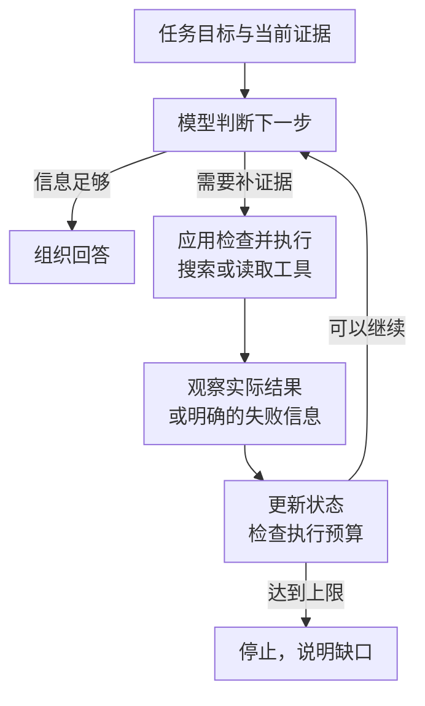

---
{
  "id": "Q-0284",
  "title": "ReAct 如何组织推理和行动，项目是否采用？",
  "category": "agent",
  "topic": "规划、推理与任务执行",
  "type": "原理机制",
  "level": "进阶",
  "priority": "进阶补充",
  "focus": "推理、行动与观察循环。ReAct 交替判断、调用工具与读取真实观察，下一步由反馈决定；用一次项目任务指出是否采用这种循环。",
  "answerStatus": "ready",
  "updatedAt": "2026-10-17"
}
---

## 核心回答

ReAct 是把推理与行动交替组织起来的一种 Agent 工作方式：模型结合当前目标和已有信息判断下一步，应用执行工具取得真实反馈，模型再根据反馈继续判断，直到完成任务或触发停止条件。经典表达是 **Reasoning → Action → Observation**，关键在于观察结果会影响后续行动。

例如研搜任务中，第一次搜索发现资料缺少发布日期，下一步就可以调整关键词或打开原始页面补证据，而不是照着最初的步骤一直生成。现代 Tool Calling Agent 可以用结构化工具调用实现这种循环，不要求把模型完整的内部思考展示出来。以深度研搜项目为例，信息获取采用这种反馈循环，整体还结合任务规划与子 Agent 分工。

## 一轮循环里，三部分怎样配合？

**Reasoning 负责判断。** 模型根据目标、已经取得的证据和当前缺口，决定直接回答、调用哪个工具或请求补充信息。这个阶段可以形成简短的行动计划，但一段计划文字本身不会改变外部环境。

**Action 负责作用于环境。** 模型提出工具调用后，由应用检查参数和可访问范围，再实际执行搜索、读取文件或查询数据库。模型输出“已经搜索”，不能代替搜索接口的实际执行。

**Observation 提供下一轮的依据。** 工具返回的正文、记录或失败信息进入当前任务状态。模型据此决定补查、修正参数、换一条路径，或收束回答。应用同时检查次数和时间预算，防止循环无休止地继续。

下面用“搜索资料后是否需要补查”表示这个反馈过程：

这张图根据经典循环重新组织。判断是否完成应看证据能否支持目标，而不是只看模型是否写出了“任务完成”。

## 项目中怎样说明采用了 ReAct？

项目回答可以结合实际负责的模块，围绕以下执行过程展开：

> 项目在信息获取过程中采用了 ReAct 式的反馈循环。主 Agent 负责研搜任务调度，通过子 Agent 获取网络、数据库和知识库资料，再使用文件工具形成交付物。工具结果会成为后续决策的上下文：资料充分就继续整理报告，存在缺口时再安排信息获取。
>
> 实现上用 DeepAgents 组装模型、工具和子 Agent，并按 `thread_id` 保存同一会话的执行状态。应用消费执行流，把工具调用和结果进度反馈给前端。整体上还包含任务规划与分工，不能只用一套经典的 `Thought/Action/Observation` 文本模板概括全部架构。

说明实现时，最好落到一个具体分支。例如“找到的文章只有二手转述，继续读取原始材料”，要能解释第一次获得了什么、缺了什么、下一次动作如何变化，以及最后依据什么停止。

当前项目示例使用 `InMemorySaver` 保存进程内的会话状态。它不能单独保证服务重启后恢复任务，也不等于跨会话长期记忆；这与是否采用 ReAct 是两个问题。

## 追问

**ReAct 与 Function Calling 有什么关系？**

Function Calling 解决模型怎样表达“调用哪个工具、传什么参数”；ReAct 说明多轮任务怎样依据行动反馈继续决策。一次 Function Calling 不一定构成多步 Agent；它可以作为 ReAct 循环中的行动接口，参见 [Function Calling 的完整流程](/question/q-0359/)。

**固定工作流也有重试，为什么还要区分？**

预设流程可以包含条件分支和重试。ReAct 式 Agent 的特点是模型结合当前反馈选择下一步动作；仅有“失败重试三次”的代码，不能证明采用了 ReAct。步骤明确、变化少的任务可以用固定流程；需要动态补证据的节点再引入模型决策。

**日志里必须记录完整 Thought 吗？**

不必。可观察记录重点包括模型输入范围、工具名与参数、实际结果、状态变化和结束原因。经典论文中的推理轨迹有助于理解方法，但现代实现不要求暴露模型隐藏的内部推理。

## 对应教程

- [Agent 智能体：1.2 ReAct](https://didilili.github.io/ai-agents-from-zero/#/21-Agent智能体)：经典循环与现代 Tool Calling 实现的关系。
- [深度研搜：主 Agent 组装与执行代码](https://github.com/didilili/deepsearch-agents/blob/main/app/agent/main_agent.py)：模型、工具、子 Agent、会话状态及执行流的项目示例。

## 参考资料

- 国内：[JavaGuide：Agent 核心范式中的 ReAct](https://javaguide.cn/ai/agent/agent-basis.html)：借鉴根据中间证据调整下一步的中文讲解，说明 ReAct 中观察结果为何会改变后续行动。
- 国内：[Hello-Agents：第四章 智能体经典范式构建](https://github.com/datawhalechina/hello-agents/blob/main/docs/chapter4/第四章%20智能体经典范式构建.md)：通过行动、观察与循环控制的教学实现，解释 ReAct 如何把多次推理和工具调用串起来。
- 国内：[AgentScope：创建 ReAct 智能体](https://doc.agentscope.io/zh_CN/tutorial/quickstart_agent.html)：结合模型、工具、记忆和最大迭代次数的配置，说明 ReAct 智能体在框架中如何组装和停止。
- 国外：[ReAct 原论文](https://arxiv.org/html/2210.03629v3)：依据原论文说明推理与行动交替的设计，以及如何利用环境反馈推进任务。
- 国外：[Anthropic：Building effective agents](https://www.anthropic.com/engineering/building-effective-agents)：参考动态决策与环境反馈的工程讨论，补充 ReAct 类循环的停止条件和适用场景。
