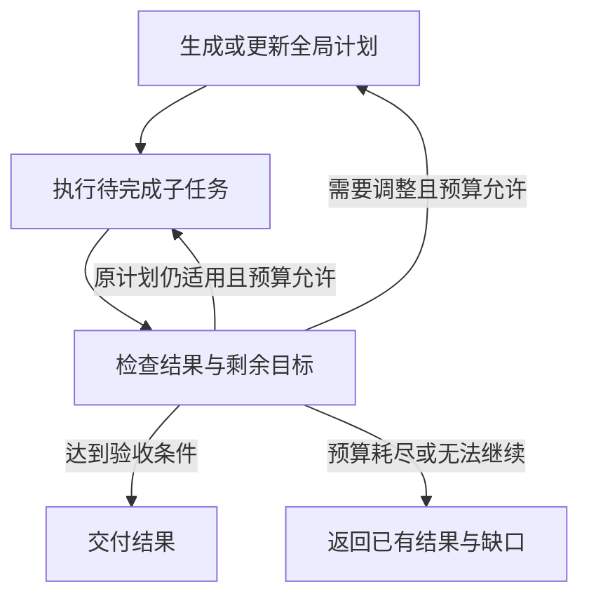

---
{
  "id": "Q-0288",
  "title": "ReAct、Plan and Execute 等 Agent 模式如何选择？",
  "category": "agent",
  "topic": "规划、推理与任务执行",
  "type": "比较选型",
  "level": "进阶",
  "priority": "进阶补充",
  "focus": "观察依赖与全局计划维护。路径依赖新观察用 ReAct；目标可拆且需维护全局进度用 Plan-and-Execute，并在执行反馈变化时重规划。",
  "answerStatus": "ready",
  "updatedAt": "2026-10-17"
}
---

> 在面栈阅读：[ReAct、Plan and Execute 等 Agent 模式如何选择？](https://mianstack.com/question/q-0288)

## 核心回答

我主要看**下一步有多依赖新观察、任务是否需要显式维护全局计划，以及延迟和费用预算**来选择。

- **ReAct** 把推理、行动和观察交替起来：根据当前信息选择工具，执行后读反馈，再决定下一步。它适合搜索、排障这类路径难以预先确定的任务，优点是能及时适应新信息；代价是多轮模型与工具往返，长任务也容易重复探索或遗漏整体目标。
- **Plan and Execute** 先生成可检查的多步骤计划，再由执行器完成子任务，并根据结果判断继续、结束或重规划。它适合目标能拆解、依赖关系较清楚、需要跟踪多项交付的长任务；代价是规划与计划维护本身有开销，初始假设错误时也需要及时调整。

两者可以组合：例如产业调研先规划研究维度和报告交付项，每个维度内部用 ReAct 搜索、读取和补查，再根据执行结果更新计划。**显式规划有助于管理全局目标，但不会自动保证更正确、更快或更便宜**。如果步骤已经固定，用普通工作流就能完成，也不一定需要再让模型规划。

## 展开说明

### 1. ReAct 的关键是让新观察进入下一次决策

一个研搜 Agent 搜到某家企业的新产品后，可能发现问题真正需要比较的是产品发布时间、技术路线或应用场景。它可以据此修改搜索词，再调用工具取证。后一步动作受前一步返回的信息影响，这种反馈循环正是 ReAct 的价值。

ReAct 也可以分解目标、维护计划和跟踪进度；它并不意味着“完全不规划”。与显式 Plan and Execute 的区别，主要在于是否把全局计划作为单独的执行对象来维护，以及规划和执行的职责怎样分配。

工程中，工具执行器要真正调用外部工具，把结果或错误返回给模型；模型自己生成一段“工具已经成功”的文字不算观察。现代 Tool Calling Agent 可以用工具调用消息和工具结果消息实现这个循环，也不要求把完整的内部思考过程展示出来。

### 2. Plan and Execute 要交付能执行、能验收的计划

一份计划应能回答：子目标是什么，依赖哪些结果，要用哪些输入，预期交付什么，以及怎样才算完成。例如“查最新政策”过于宽泛，可以改成“查找指定行业最近一年的官方政策，输出发布机构、日期、适用对象和原文链接”。

执行器接收当前步骤和必要背景，调用工具或运行一个 Agent，并返回结果、状态、产物和缺失信息。规划器或评估逻辑再判断剩余步骤是否仍然适用。重规划可以在关键步骤后、发现新约束时或执行失败时触发，不必每次工具调用后都重新生成整份计划。

下面是一种带反馈的设计。执行器内部可以使用 ReAct，具体的重规划时机由任务需要决定：

计划负责组织目标，执行反馈负责检验假设。若实际资料证明某项比较没有可靠数据，系统应更新后续任务或说明证据缺口，而不是按原清单继续生成看似完整的内容。

### 3. 用同一个研搜任务判断取舍

假设用户要求“比较机器人产业近期的技术路线和典型应用，并形成一份报告”。

任务开始时，如果连有哪些路线、哪些资料可信都不清楚，可以先用 ReAct 做少量探索，确认范围和信息来源。范围明确以后，再生成研究维度、取证要求和报告结构，让显式计划防止遗漏。各维度中又可能需要边搜边判断，因此局部执行仍可采用 ReAct。

如果用户只要求查询一项已知指标，工具和参数已经确定，直接查询通常更合适；额外调用规划器只会增加步骤。如果是每周固定统计、校验和输出报表，主要依赖已定义的业务规则，固定工作流更容易控制。

并行能力也应按依赖判断。两个研究方向独立时可以并行；必须先获取企业名单再查各企业产品时就有先后顺序。选择 ReAct 或 Plan and Execute 本身，不决定系统必然串行或并行。

### 4. 选型要用运行结果验证

对同一批任务保留用户目标、工具条件和可比预算，分别观察是否完成要求、事实与引用是否准确、是否重复调用工具，以及总耗时、模型调用数和 Token 费用。对长任务，还要看漏掉多少子目标、重规划是否纠正了错误方向。

Plan and Execute 可能减少大模型反复做全局决策的次数，也可能因计划过细、执行质量不足和反复重规划而更慢。ReAct 可以较早得到局部结果，也可能因搜索无进展持续消耗预算。效果应由任务集验证，不能只按模式名称推断。

两种方式都需要明确的完成条件、最大步数和全局预算。工具参数校验、实际权限和外部操作的幂等由执行层落实；计划可读、轨迹可追踪，有助于发现问题，但不是正确性或安全性的充分保证。

## 常见追问

### Plan and Execute 与 Plan-and-Solve 是一回事吗？

二者都强调先分解再解决，但讨论层次不同。Plan-and-Solve Prompting 通常指在推理中先制定计划再解答，并不天然包含外部工具、执行状态和重规划器。Plan and Execute 更强调显式计划与实际执行过程的分工。读资料时应看具体机制，不能只凭相似名称混用结论。

### 计划与现实不一致时，应该整体重做吗？

先定位哪项假设失效，以及它影响哪些后续步骤。已完成且依据仍有效的结果可以保留，只重新规划受影响的部分；若用户改变目标或关键前提失效，再扩大调整范围。重规划应带上执行回执和缺失项，否则只是再生成一份未经检验的清单。

### 短任务用 ReAct、长任务用 Plan and Execute，可以这样分吗？

长度只能作为线索。一个很长但步骤固定的任务适合工作流；一个不长但必须根据环境反馈改变动作的任务可能适合 ReAct。显式规划更有价值的条件是多项子目标、依赖或交付需要持续管理，而不是单纯文字多或耗时长。

## 对应教程

- [Agent 智能体](https://github.com/didilili/ai-agents-from-zero/blob/c05fb5979cf0aa3b6b4ed8c29f450f640fb9c18f/21-Agent%E6%99%BA%E8%83%BD%E4%BD%93.md)：查看 ReAct 的工具反馈循环，以及现代消息形式如何表达工具调用和结果回传。
- [LangGraph API：节点、边与进阶](https://github.com/didilili/ai-agents-from-zero/blob/c05fb5979cf0aa3b6b4ed8c29f450f640fb9c18f/24-LangGraphAPI%EF%BC%9A%E8%8A%82%E7%82%B9%E3%80%81%E8%BE%B9%E4%B8%8E%E8%BF%9B%E9%98%B6.md)：查看条件边如何形成继续调用工具或结束的循环，以及运行步数限制的作用。
- [DeepAgents 基础与核心概念](https://github.com/didilili/ai-agents-from-zero/blob/c05fb5979cf0aa3b6b4ed8c29f450f640fb9c18f/%E5%AE%9E%E6%88%98%E9%A1%B9%E7%9B%AE-%E6%B7%B1%E5%BA%A6%E7%A0%94%E6%90%9C/1-DeepAgents%E5%9F%BA%E7%A1%80%E4%B8%8E%E6%A0%B8%E5%BF%83%E6%A6%82%E5%BF%B5.md)：对照固定工作流、自主执行和研搜任务中的计划更新；本文进一步比较显式计划、局部 ReAct 和重规划的选择条件。

## 参考资料

- 国内：[zero2Agent：架构选型：ReAct、Plan-and-Execute 与 ToT 怎么选](https://github.com/ranxi2001/zero2Agent/blob/0c0eb7693105d281b146bb98f3a7f30da6f1ceea/learn-agent-interview/01-architecture-design/index.md)：参考 ReAct 与显式规划的任务条件，以及规划器、执行器之间传递步骤和结果的方式；效果仍需结合具体约束判断。
- 国内：[WeThinkIn：Agent 设计模式与工作流编排高频考点](https://github.com/WeThinkIn/AIGC-Interview-Book/blob/275fdf1eeb65e3b233081d3b8e74ff5d8eeb2e03/AI%20Agent%E5%9F%BA%E7%A1%80/03_Agent%E8%AE%BE%E8%AE%A1%E6%A8%A1%E5%BC%8F%E4%B8%8E%E5%B7%A5%E4%BD%9C%E6%B5%81%E7%BC%96%E6%8E%92%E9%AB%98%E9%A2%91%E8%80%83%E7%82%B9.md)：借鉴任务分解、计划维护与执行反馈的设计，说明正文中全局计划如何结合局部 ReAct，并依据执行回执重规划。
- 国内：[Datawhale：第四章 智能体经典范式构建](https://github.com/datawhalechina/hello-agents/blob/36f583c233ea5cee4537ef93455702b55053af18/docs/chapter4/%E7%AC%AC%E5%9B%9B%E7%AB%A0%20%E6%99%BA%E8%83%BD%E4%BD%93%E7%BB%8F%E5%85%B8%E8%8C%83%E5%BC%8F%E6%9E%84%E5%BB%BA.md)：依据 ReAct 与 Plan-and-Solve 的教学实现，说明正文中的反馈循环与先分解再求解，并区分提示方法和工具执行架构。
- 国外：[Yao 等：ReAct: Synergizing Reasoning and Acting in Language Models](https://arxiv.org/html/2210.03629v3)：采用推理与行动交替的原始机制，说明正文中观察结果如何影响后续行动、计划调整和异常处理。
- 国外：[LangChain：Plan-and-Execute Agents](https://www.langchain.com/blog/planning-agents)：依据 Planner、Executor 与重规划的分工，解释正文中显式计划如何衔接工具执行，以及减少大模型调用可能降低费用的条件。
