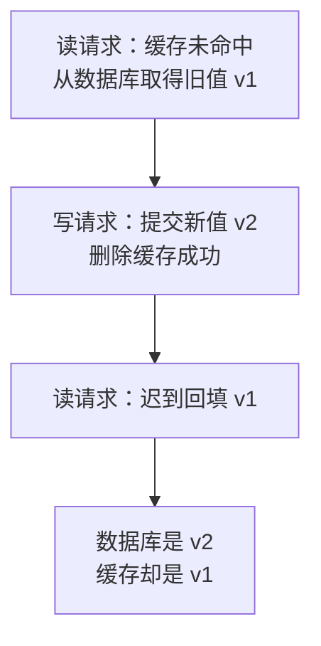

---
{
  "id": "Q-0308",
  "title": "如何保证 Redis 和 MySQL 的数据一致性？",
  "category": "software",
  "topic": "Redis 与缓存",
  "type": "方案设计",
  "level": "进阶",
  "priority": "按岗位选读",
  "focus": "缓存失效与最终一致性。读缓存未命中查库回填，写先提交库再删缓存；失效失败可靠重试并设 TTL，接受并监测短暂旧读。",
  "answerStatus": "ready",
  "updatedAt": "2026-10-17"
}
---

> 在面栈阅读：[如何保证 Redis 和 MySQL 的数据一致性？](https://mianstack.com/question/q-0308)

## 核心回答

**常见做法是以 `MySQL` 为权威数据源，采用 `Cache Aside`：读时先查 `Redis`，未命中再查数据库并回填；写时先提交数据库事务，再删除对应缓存。** 配合可靠失效重试和 `TTL`，目标是最终一致，不能保证所有时刻都没有旧读。

需要分别处理三个问题：

1. **提交后、删除前的窗口**：这段时间仍可能命中旧缓存。把删除放在事务提交之后，避免因提前失效而让并发请求在提交前回源旧数据；业务必须明确能否接受这个窗口。
2. **删除失败或进程退出**：不能只在内存里重试。可以把失效事件与业务更新写入同一个数据库事务的 `Outbox` 表，再异步投递和重试；也可以通过 `CDC` 订阅已提交的变更触发删除。
3. **并发旧值回填**：读请求可能先读到旧值，等写请求提交并删完缓存后，才把旧值写回。删除重试和 `TTL` 只能缓解，要求更高时还需设计覆盖读写路径的版本校验或互斥协议。

对于余额、库存校验等不能依赖陈旧值的关键判断，应走权威数据库的事务读写路径，明确隔离与读写语义，不能仅靠缓存双删来保证。

## 为什么通常先提交数据库，再删缓存？

先删缓存、再写数据库，会主动制造一个缓存未命中窗口：并发读请求可能在数据库更新前读到旧值、回填缓存，随后写请求提交，旧缓存却留下了。

先提交数据库、再删除缓存，能让删除之后发起的回源有机会读到新值，也避免数据库回滚后缓存提前失效。这里的“先写数据库”包括**事务提交成功**，不是在事务方法里执行完一条更新语句就立刻删缓存。

选择删除而非直接更新，是因为缓存可能由多表数据聚合而来，按需重建可以少做无用计算；并发写请求直接更新缓存时，还可能因到达顺序不同，让旧版本覆盖新版本。但删除并没有消除所有并发窗口。

## 删除成功了，为什么还会出现旧数据？

关键是读请求取得数据和回填缓存之间也有时间差。下面按发生顺序展示一次交错执行：写请求的操作都成功，缓存仍被迟到的读请求写旧。

因此，不能仅凭“数据库写得慢、`Redis` 写得快”就忽略旧值回填；慢查询、网络延迟或线程暂停都可能改变时序。回源若走延迟副本，也可能再次取得旧值。

延迟再删一次，可以清理一部分迟到回填，但固定延迟覆盖不了任意长的暂停，第二次删除本身也可能失败。需要更严格控制时，可让相关读写使用同一协调协议，或根据独立维护的版本水位拒绝旧版本回填。只给写请求加锁，或者只在已被删除的缓存值里保存版本号，都不足以挡住所有迟到回填。

## 怎样让失效事件不因故障丢失？

“数据库提交成功后发一条消息”仍有缺口：进程可能在提交后、发消息前退出。提交后的回调解决了执行顺序，不能单独解决事件丢失。

**事务消息表（`Outbox`）**的做法是在一个 `MySQL` 事务中同时更新业务数据、记录待处理失效事件。事务提交后，后台任务把事件投递出去，消费者删除对应缓存；失败继续重试，并对积压和最终失败告警。删除成功后再确认处理进度，重复删除通常不会把数据改旧，但可能带来额外未命中。

**`CDC`**则从数据库变更日志获取已提交的变化，映射出受影响的缓存键，再执行删除。它能覆盖不经过当前应用的写入，但要维护订阅位点、延迟、重放和表到缓存键的映射；聚合缓存还要识别一条变更影响哪些结果。

这两种方式可靠衔接了数据库变更与缓存失效任务，仍然是异步链路。它们不能把 `MySQL` 提交与 `Redis` 删除变成一个原子操作，也不能自动解决已经执行完删除之后才发生的旧值回填。

## TTL 能保证多快一致吗？

`TTL` 是兜底：未能主动失效的条目最终过期，下次读取再从数据库重建。选择时要同时考虑业务可接受的陈旧时间和回源压力，不能不断给命中的旧值续期。

`TTL` 限制的是某次写入缓存后的存活时间，并不等于“从数据库更新起最多旧这么久”。迟到回填会重新开始计时；如果回源仍读到旧副本，旧值还可能再次进入缓存。因此应同时监控失效事件延迟、重试积压和陈旧读，而不是只检查是否配置了 `TTL`。

## 常见追问

**给更新操作加 `Redis` 锁，能做到强一致吗？** 不能自动做到。读请求若不参与同一协议，仍可能读旧或回填旧值；锁的租约、故障切换和进程暂停也要处理。`Redis` 内部的原子操作同样不能覆盖 `MySQL` 的事务。

**点赞用户放 `Redis`、计数放 `MySQL`，也是这套方案吗？** 先看哪份数据是权威。如果 `Redis` 是可重建的查询副本，可以按失效与重建处理；如果点赞只先写 `Redis`、之后异步落库，就要另外设计可靠事件、幂等消费与对账，不能把它当成普通查询缓存。

## 参考资料

- 国内：[JavaGuide：3 种常用的缓存读写策略详解](https://javaguide.cn/database/redis/3-commonly-used-cache-read-and-write-strategies.html)：借鉴 Cache Aside 对提交顺序、并发回填、删除失败与 TTL 的分析，解释正文中不同不一致窗口及对应补偿办法。
- 国内：[advanced-java：缓存与数据库一致性问题](https://github.com/doocs/advanced-java/blob/main/docs/high-concurrency/redis-consistence.md)：聚合缓存的懒加载和读写串行化讨论，说明为什么常选择删除缓存，以及协调读写会带来哪些排队与路由成本。
- 国内：[小林 coding：数据库和缓存如何保证一致性？](https://www.xiaolincoding.com/redis/architecture/mysql_redis_consistency.html)：采用并发更新、旧值回填和删除失败的时序案例，解释正文中不一致的形成过程；并借鉴消息重试与 binlog 订阅说明异步失效的实现思路。
- 国外：[Microsoft：Cache-Aside pattern](https://learn.microsoft.com/en-us/azure/architecture/patterns/cache-aside)：读写顺序和 Consistency 部分说明旁路缓存不承诺缓存与数据库始终一致，以及过期时间需要匹配业务访问方式。
- 国外：[AWS：Transactional outbox pattern](https://docs.aws.amazon.com/prescriptive-guidance/latest/cloud-design-patterns/transactional-outbox.html)：关系型数据库 Outbox 部分说明如何将业务更新与事件记录放进同一事务，并处理提交后漏发、重复投递和异步消费。
