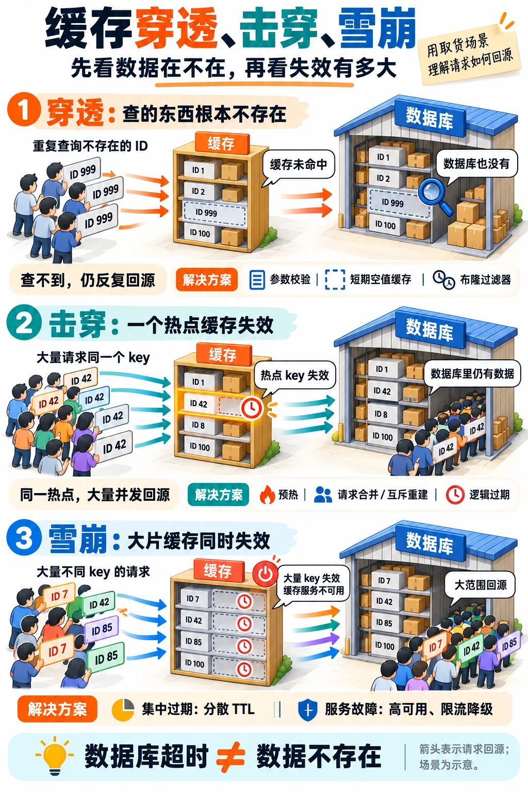

---
{
  "id": "Q-0342",
  "title": "缓存穿透、击穿和雪崩分别是什么，如何治理？",
  "category": "software",
  "topic": "Redis 与缓存",
  "type": "故障排查",
  "level": "进阶",
  "priority": "按岗位选读",
  "focus": "缓存故障类型与回源保护。穿透查不存在数据，用校验/空值/布隆过滤；击穿是热点过期，用互斥回源；雪崩是大批失效，用错峰和限流。",
  "aliases": ["Q-2281"],
  "answerStatus": "ready",
  "updatedAt": "2026-10-18"
}
---

> 在面栈阅读：[缓存穿透、击穿和雪崩分别是什么，如何治理？](https://mianstack.com/question/q-0342)

## 核心回答

**三者都会让过多请求绕过缓存、增加数据库压力，区别在于数据是否存在，以及失效集中在一个热点还是大片缓存。**

- **缓存穿透**：请求的数据在缓存和数据库中都不存在，反复查询仍无法填充正常缓存。先校验参数、限制异常请求，再对查无结果设置短期空值缓存；不存在的 ID 很分散时，可用布隆过滤器提前过滤。
- **缓存击穿**：数据库中有数据，但某个热点 key 过期、被淘汰或尚未建立，大量请求同时回源重建。可以提前预热、合并同一 key 的重建请求，或用互斥锁限制重建；允许短暂旧数据时，可采用逻辑过期、异步刷新。
- **缓存雪崩**：大量 key 集中失效，或者缓存服务整体不可用，导致大范围回源。集中过期用随机 `TTL`、分批预热来打散；服务故障则依靠高可用、快速超时、限流和降级。无论哪种情况，都要限制回源总量，避免把缓存故障扩大成数据库故障。

下面用取货场景对比三种故障：货架表示缓存，仓库表示数据库。看请求的编号、两处是否有对应数据，以及回源范围，就能区分穿透、击穿和雪崩；每幅场景下方列出常见处理方法。

## 穿透：空值缓存和布隆过滤器如何配合？

以查询商品为例，数据库确认商品不存在后，缓存一个明确的“无此商品”标记，并设置较短 `TTL`。后续相同 ID 可直接返回不存在，程序要能区分这个标记与“缓存未命中”。`TTL` 太长会延迟新商品被读到，因此创建数据后还应删除或更新对应空值缓存。

空值缓存适合重复查询相同不存在 ID 的情况。若请求不断更换 ID，它既挡不住第一次回源，还会占用缓存空间。这时可用布隆过滤器记录有效 ID：**有效 ID 已完整加入过滤器时，返回“不存在”的请求可以拦截；返回“可能存在”仍需继续查询。** 它可能误放行不存在的 ID，不能保证数据库完全没有穿透流量。

“没有假阴性”针对已经加入且未被破坏的过滤器集合。新增商品若尚未同步到过滤器，直接据此拒绝就会误拦真实数据；因此要处理增量同步、重建切换和过滤器不可用时的策略。普通过滤器也不适合直接清除某个元素对应的位，因为这些位可能被其他元素共享。

数据库超时与查无结果也要区分。超时只能说明本次查询失败，不能把它缓存成“商品不存在”。

## 击穿：互斥重建和逻辑过期怎样选？

**互斥重建**适合希望拿到新数据、能够接受短暂等待的场景。缓存未命中后，只有获得该 key 重建资格的请求回源；拿到锁后再查一次缓存，避免重复重建。其他请求有限等待后重新读缓存，或按业务返回旧值、降级结果，不能抢锁失败就全部转向数据库。

本地锁只能合并当前进程内的请求，多实例部署时每个实例仍可能各自重建。若要跨实例合并，需要分布式协调。采用 `Redis` 锁时，应原子地设置锁与租约，使用独立持有者标识并按标识原子释放；锁租约过期、任务超时和故障切换仍可能带来并发重建，需要配合超时、续租或版本检查。这里的目标是控制回源量，不能只加一把锁就假定所有故障下都只重建一次。

**逻辑过期**把刷新时间放在缓存值中，数据到期后仍可读取，由一个受控后台任务刷新，其他请求暂时使用旧数据。它减少等待，但允许短暂不一致，适合商品介绍、榜单等可容忍陈旧的内容；库存扣减、权限校验等关键决策不适合直接依赖过期值。还要设置可接受的最大陈旧时间，处理刷新失败，以及缓存被淘汰或首次没有旧值时的受控回源。

## 雪崩：集中过期与缓存故障要分别处理

大量 key 集中过期时，可以在满足业务时效要求的范围内给 `TTL` 加随机偏移，分散预热和刷新批次，同时限制重建并发。每个 key 只重建一次，也可能有成千上万个 key 一起重建，因此还需要数据库层面的总回源预算。

`Redis` 故障时，随机 `TTL` 无法发挥作用。应用应快速识别超时或连接失败，避免请求长时间占住线程和连接；通过熔断减少持续失败的调用，再结合本地旧缓存、受控回源或明确降级维持必要功能。高可用部署能缩短故障影响，但切换仍可能有窗口，不能按“缓存永远可用”设计。恢复时分批预热、逐步放开流量，避免冷缓存再次冲击数据库。

排查可先看缓存错误率和延迟，再看未命中是否集中在少数热点、是否出现大量不同的不存在 ID，以及过期量、淘汰量和数据库回源 QPS 的变化。对应修复后，还应检查回源并发、数据库延迟和接口成功率是否恢复。

## 常见追问

**热点 key 永不过期就能解决击穿吗？** 只能避免 `TTL` 到期这一个原因。数据仍可能被淘汰、误删除或随缓存故障丢失；数据更新也需要刷新机制。应保留预热、重建与回源保护。

**逻辑过期一定比互斥锁一致性更好吗？** 不一定。逻辑过期主动允许读取旧值，优势在于减少等待；互斥重建、后台刷新也可以结合使用。选型依据是业务允许多旧的数据、能等多久，以及回源成本。

## 参考资料

- 国内：[JavaGuide：Redis 常见面试题总结（下）](https://javaguide.cn/database/redis/redis-questions-02.html)：生产问题部分按数据是否存在、热点是否失效区分三类异常，并介绍空值缓存、预热和分场景治理。
- 国内：[advanced-java：缓存雪崩、穿透和击穿](https://github.com/doocs/advanced-java/blob/main/docs/high-concurrency/redis-caching-avalanche-and-caching-penetration.md)：借鉴缓存故障导致流量转移的案例，说明正文中高可用、限流降级和故障恢复怎样共同保护数据库。
- 国内：[小林 coding：什么是缓存雪崩、击穿、穿透？](https://xiaolincoding.com/redis/cluster/cache_problem.html)：分别分析集中过期与 Redis 宕机，并说明互斥重建、后台刷新以及无过期时间的数据仍可能被淘汰。
- 国内：[JavaGuide：布隆过滤器详解](https://javaguide.cn/cs-basics/data-structure/bloom-filter.html)：位数组与哈希函数部分解释“可能存在”的来源，以及为什么不能随意清除某个元素对应的位。
- 国外：[Redis：Bloom filter](https://redis.io/docs/latest/develop/data-types/probabilistic/bloom-filter/)：依据集合存在性判断、误判率和容量的官方约定，解释正文中布隆过滤器的“可能存在”及其不能完全消除穿透的原因。
- 国外：[Redis：Distributed Locks with Redis](https://redis.io/docs/latest/develop/clients/patterns/distributed-locks/)：单实例实现与故障切换部分说明锁租约、持有者标识和安全释放的条件，避免把重建锁视为无条件互斥保证。
- 国外：[AWS：Caching challenges and strategies](https://builder.aws.com/content/3K9TeXp6strMiJ4vhakpRD7BQWO/caching-challenges-and-strategies)：软硬 TTL、请求合并与缓存不可用部分说明如何利用旧值缓冲刷新，以及为什么回源必须设上限。
