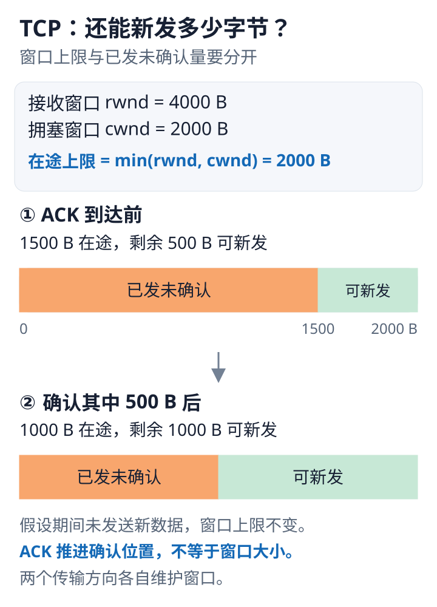

---
{
  "id": "Q-0344",
  "title": "TCP 滑动窗口如何工作，双方如何交换和动态调整窗口大小？",
  "category": "software",
  "topic": "网络与浏览器",
  "type": "原理机制",
  "level": "进阶",
  "priority": "按岗位选读",
  "focus": "流量控制与发送窗口。接收方在 ACK 中通告 rwnd，发送窗口还受拥塞窗口限制；确认前移释放发送额度，窗口随接收缓冲变化。",
  "answerStatus": "ready",
  "updatedAt": "2026-10-19"
}
---

> 在面栈阅读：[TCP 滑动窗口如何工作，双方如何交换和动态调整窗口大小？](https://mianstack.com/question/q-0344)

## 核心回答

TCP滑动窗口允许发送端在未逐个等待ACK的情况下连续发送一段字节，提高链路利用率。发送端记录已确认、已发未确认和允许继续发送的范围；收到有效累积ACK后，左边界前移，新的字节才有机会进入发送范围。

接收方通过TCP首部Window字段通告接收窗口rwnd，反映当前还能接纳的数据量；发送方还受自身拥塞窗口cwnd约束，通常用两者较小值限制在途数据，并扣除已发未确认量。双方全双工通信，因此两个方向分别维护窗口，并不存在一个共享窗口。

## 窗口怎样动态变化

接收缓冲被数据占用，通告窗口可减小；应用读取后腾出空间，后续报文可通告更大的窗口。Window表示能力，ACK表示累计收到了哪里，两者配合更新发送状态，不能把“已确认字节数”当作窗口大小。

例如通告允许4000字节在途，目前已有1500字节未确认，在忽略其他约束的简化情形下，还可发送2500字节；若cwnd只允许2000字节在途，则新增空间只剩500字节。这是机制数例，不是抓包实测。

把正文数例画成两次窗口状态，可以直接看到已发未确认量如何占用额度：

这是在窗口上限不变、期间没有新发数据的简化数例。图条表示在途额度的占用，并非抓包中的绝对序列号。

## 关键边界

接收方通告零窗口时，发送方暂停普通新数据发送，并通过零窗口探测避免窗口更新丢失造成永久等待。窗口扩大不保证吞吐必然增加，还受往返时延、丢包、拥塞控制和应用处理速度影响。

首部Window字段只有16位。Window Scale选项在SYN阶段协商后，普通报文按该方向的扩展因子解释窗口；扩展因子固定，不是每次窗口变化都重新握手协商，SYN报文自身的窗口字段也不按该因子缩放。

## 参考资料

- 国内：[JavaGuide / Snailclimb：TCP 如何保证可靠传输](https://github.com/Snailclimb/JavaGuide/blob/50f02a5984c062fe7221629d0a6a40ec15c26fd7/docs/cs-basics/network/tcp-reliability-guarantee.md)：参考累积确认与接收、拥塞窗口的解释，区分正文中确认推进窗口和限制发送容量的机制。
- 国内：[小林 coding：TCP重传、滑动窗口、流量控制、拥塞控制](https://xiaolincoding.com/network/3_tcp/tcp_feature.html)：借鉴发送、接收窗口的变化过程，解释正文中应用读取缓冲区后怎样恢复可接收容量。
- 国内：[JavaGuide / Snailclimb：TCP三次握手和四次挥手](https://github.com/Snailclimb/JavaGuide/blob/50f02a5984c062fe7221629d0a6a40ec15c26fd7/docs/cs-basics/network/tcp-connection-and-disconnection.md)：借鉴双向初始化序号和确认过程，说明正文中连接的两个方向各自维护数据流与窗口。
- 国外：[IETF：RFC9293 TCP](https://www.rfc-editor.org/rfc/rfc9293.html)：可用窗口减去已发未确认量的定义说明通告窗口不等于本次还能新发的全部数据量。
- 国外：[IETF：RFC7323 TCP Extensions for High Performance](https://www.rfc-editor.org/rfc/rfc7323.html)：窗口扩展在握手时协商的规则说明扩大窗口怎样表示，以及扩展因子为何不是每次动态协商。
