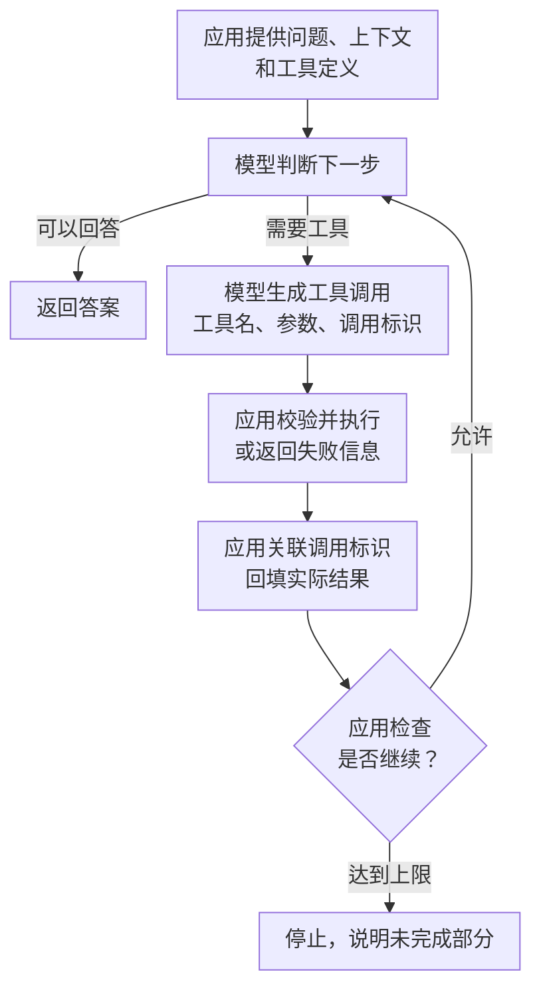

---
{
  "id": "Q-0359",
  "title": "Function Calling 的完整流程是什么？",
  "category": "agent",
  "topic": "工具调用与 Function Calling",
  "type": "原理机制",
  "level": "进阶",
  "priority": "进阶补充",
  "focus": "调用生成、执行与结果回填。提供工具定义，模型生成调用，应用校验执行，按调用 ID 回填真实结果，再由模型继续或回答。",
  "answerStatus": "ready",
  "updatedAt": "2026-10-17"
}
---

## 核心回答

Function Calling 是模型根据用户问题和工具定义，生成工具名称及结构化参数，再由应用执行工具、把结果交回模型的过程。完整流程可以分成五步：**提供工具定义、模型生成调用、应用校验并执行、按调用标识回填结果、模型继续判断或回答**。

例如用户问北京天气，应用把天气工具的用途和城市参数说明发给模型。模型提出查询北京的调用，应用实际请求天气服务，再把查询结果关联到这次调用交回模型，模型才据此组织回答。工具定义不代表函数已经执行；一次任务也可能不调用工具，或者连续调用多轮。

## 从工具定义到最终回答

这里以应用执行自定义工具的常见方式为例，模型供应商托管的工具可以由其服务端完成执行。

**第一步，应用准备工具定义和对话上下文。** 工具定义通常包括名称、用途描述和参数 Schema。名称用于分发，描述帮助模型判断何时使用，Schema 说明参数类型、必填项等约束。例如 `get_weather` 需要 `city`，可以让温度单位使用有限的枚举。应用把本次问题、必要历史和可用工具一起发送给模型；在框架里，`bind_tools` 主要完成工具定义的绑定，执行仍需工具执行器或 Agent 运行时。

**第二步，模型决定直接回答，还是提出工具调用。** 如果需要外部数据，模型返回结构化的工具名和参数，常见协议还会附带调用 ID。应用应解析接口提供的调用字段，不能仅凭回答中出现“我要查天气”就认为有一次有效调用。

**第三步，应用检查调用并执行。** 应用确认工具存在、参数符合要求，并结合登录用户等可信上下文检查可访问范围，再调用对应函数或接口。结构合法只说明参数满足格式约束，不能证明城市识别正确、资源属于当前用户或操作符合业务条件。

**第四步，把实际执行结果关联到原调用。** 保留模型提出调用的消息，并按照所用 API 的格式回传工具结果。例如 LangChain 的 `ToolMessage` 用 `tool_call_id` 对应原调用；不同供应商的消息字段可能不同。并行查询多座城市时，结果也要各自对应，不能按返回先后猜测归属。查询失败时返回明确的失败信息，不能把模型预想的数据当成工具结果。

**第五步，让模型根据结果继续。** 信息足够时生成最终回答；还缺信息时可以提出新的工具调用，或向用户询问。应用负责设置调用次数、总时长等停止条件。因此，简单查询常见两次模型请求，但“两次”不是整个机制的固定要求。

下图重点看职责：模型提出调用，应用执行并回填，结果再进入下一次判断。



图中的循环由应用或框架驱动。模型给出一次调用意图后，不会自行跳进业务进程执行函数。

## 怎样判断这条链路接对了？

可以先检查一段最小消息轨迹。下面是机制示意，天气数据为假设值，不是某家 API 的完整请求格式：

```text
用户：北京现在多少摄氏度？
模型：调用 call_1，工具 get_weather，参数 {"city":"北京","unit":"celsius"}
应用：执行天气查询，得到 {"city":"北京","temperature":26,"unit":"celsius"}
应用：回填 call_1 对应的工具结果
模型：根据查询结果，北京当前为 26°C。
```

排查时沿着“是否产生调用 → 参数是否正确 → 工具是否实际执行 → 结果是否对应并回填 → 模型是否使用结果”检查。只有拿到了 `tool_calls`，还不能说明外部系统已经执行成功。

## 追问

**多个工具调用能一起执行吗？**

没有数据依赖的查询可以在模型、接口和运行时支持时并行执行；后一步需要前一步返回的订单号等数据时，应先取得结果。并行不改变调用与结果的一一对应要求，也不能越过业务约束。

**工具调用成功，任务就成功了吗？**

还要检查是否查对对象、结果是否完整、最终回答是否准确使用了结果。超时、重试和重复执行等问题，可结合[如何提高工具调用可靠性](/question/q-0050/)继续展开。

## 对应教程

- [Tools 工具调用：2.2～2.4](https://didilili.github.io/ai-agents-from-zero/#/17-Tools工具调用)：工具调用链路、绑定与执行的分工，以及工具结果消息。
- [Agent 智能体：1.2～1.3](https://didilili.github.io/ai-agents-from-zero/#/21-Agent智能体)：工具调用怎样进入 Agent 运行循环。

## 参考资料

- 国内：[JavaGuide：大模型结构化输出——Function Calling 到底调用了什么](https://javaguide.cn/ai/llm-basis/structured-output-function-calling.html)：参考模型表达调用意图、应用执行工具的职责划分，说明业务参数为什么仍需由应用校验。
- 国内：[阿里云：Function Calling](https://help.aliyun.com/zh/model-studio/qwen-function-calling)：参考完整的调用交互过程，串起模型生成调用、应用执行、结果回传与后续多轮调用。
- 国内：[AgentScope：工具](https://doc.agentscope.io/zh_CN/tutorial/task_tool.html)：结合工具定义的用法，解释函数怎样转成模型可见的 Schema，以及应用执行上下文为何要与模型生成的参数区分。
- 国外：[Claude：Define tools](https://platform.claude.com/docs/en/agents-and-tools/tool-use/define-tools)：依据工具定义和调用字段的说明，解释模型需要看到哪些信息，以及调用请求怎样表达。
- 国外：[LangChain：Tools](https://docs.langchain.com/oss/python/langchain/tools)：参考工具定义、执行与结果返回的用法，把 Function Calling 的各步骤对应到框架中的实现。
