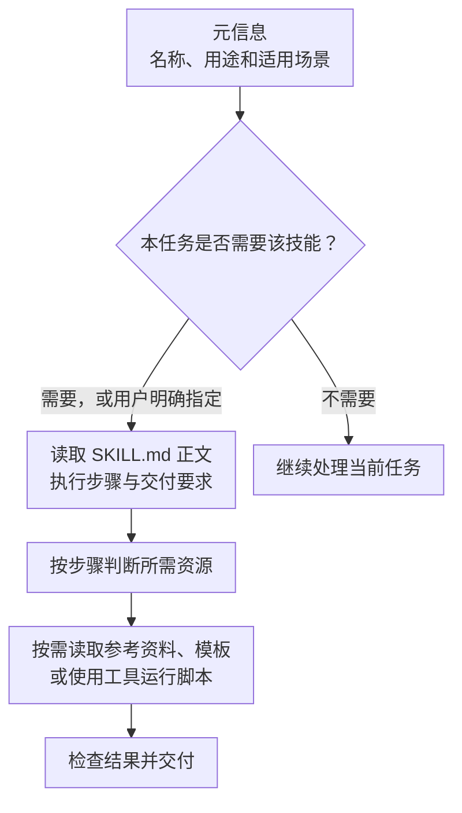

---
{
  "id": "Q-0378",
  "title": "如何理解 Agent Skill？",
  "category": "agent",
  "topic": "Skills 能力系统",
  "type": "原理机制",
  "level": "基础",
  "priority": "进阶补充",
  "focus": "解释可复用能力的内容组织和触发方式。",
  "answerStatus": "ready",
  "updatedAt": "2026-10-17"
}
---

## 核心回答

Agent Skill 是把一类任务的执行方法整理成可复用的技能包，通常包括任务说明、操作步骤和输出要求，还可以附带脚本、参考资料与模板。Agent 在遇到相关任务时加载这些内容，再使用已有工具完成工作。

以常见的 Agent Skills 格式为例，技能目录的入口是 `SKILL.md`：元信息描述名称和适用场景，正文说明怎样执行。系统可以先提供少量元信息，匹配任务后加载正文，需要时再读取资源或运行脚本。这种按需展开的方式，让一套较完整的工作方法可以复用，同时减少每次都塞入全部资料的开销。

例如“面试题答案编写”Skill 可以规定怎样查证资料、组织核心回答、处理图示和检查来源；真正的检索、读文件和生成内容，由 Agent 结合工具执行。

## 一个技能包里包含什么？

`SKILL.md` 一般有两部分：前面的 YAML 元信息提供 `name`、`description` 等字段；后面的 Markdown 正文写适用条件、步骤、必要约束和交付要求。描述应帮助系统判断何时使用，正文应给出足够具体的方法，而不是只有“高质量完成任务”。

辅助目录按需要设置，不要求全部存在：

- `references/` 保存较长的领域资料、接口说明或检查规则，正文指出何时查阅。
- `scripts/` 放适合交给程序完成的重复或确定性操作，例如提取文档结构、检查文件格式。
- `assets/` 放模板、样例或交付所需资源。

按照开放格式，最小技能可以只有一个 `SKILL.md`。具体产品支持的额外配置、目录约定和触发方式可能不同，需要以运行环境为准。

## 为什么采用渐进式加载？

如果每次都把所有技能、长篇手册和脚本全文放进提示词，会占据上下文，并增加模型选择相关规则的难度。因此常见实现分三层：先发现技能，再加载执行方法，最后取用本任务所需的材料。

图中最后一层不是“所有文件再读一遍”。例如格式校验脚本可以由运行环境直接执行，模型主要处理执行结果；需要排错时也可能读取脚本源码。加载正文会消耗上下文，脚本输出也可能很长，所以渐进式加载并不意味着没有 token 成本。

## Skill 怎样转化成实际能力？

仍以答案编写为例：用户提出一道题，Agent 识别到适用的技能，读取规定的研究和写作方法；需要资料时调用搜索或文件工具；按模板写出答案；再根据规则核对事实、来源与图示。可复用的是任务方法和配套资源，执行质量仍取决于模型、工具、资料及规则本身。

因此，Skill 文件里写“查询数据库”，不会自动安装数据库工具、配置账号或授予访问权限。运行环境要提供相应能力并控制执行范围；缺少能力时，应处理这个实际缺口。单纯的写作技能，也可以主要使用模型和参考文件完成任务，不必附带可执行脚本。

## 追问

**Skill 与 Tool、MCP 有什么区别？**

Tool 封装一个具体操作，例如查询订单；Skill 记录怎样完成一类任务，可能安排多次工具调用；MCP 是连接工具和上下文的一种协议。一个 Skill 可以指导 Agent 使用 MCP 提供的工具，也可以使用普通函数或文件工具，没有必须依次经过的固定层级。

**Skill 与一段提示词有什么关系？**

技能正文包含提示与指令，但技能包还提供了发现入口、任务组织方式和可选资源，方便按需调用、维护和复用。它不直接更新模型权重。把长提示词原封不动搬成文件，如果没有清楚的适用条件、可执行步骤和验证方法，仍然难以稳定复用。

**怎样判断一个 Skill 写得好？**

选取应该触发、无需触发和缺少依赖的真实任务，检查是否选对技能、是否按需取用资料、能否完成关键步骤、交付物是否符合要求，以及失败时能否说明缺口。评估应关注任务结果与成本，不能只看文件多或描述长。

## 对应教程

- [Skills 技能与 AI 编程工具实践：1 Skill 概念、3 文件结构、4 渐进式加载](https://didilili.github.io/ai-agents-from-zero/#/27-Skills技能与AI编程工具实践)：可复用技能包、入口文件和三层加载方式。

## 参考资料

- [JavaGuide：Agent Skills](https://javaguide.cn/ai/agent/skills.html)：技能定位、内容组织，以及与工具和 MCP 的关系。
- [zero2Agent：Skill 的渐进式加载](https://github.com/ranxi2001/zero2Agent/blob/main/learn-claude-code/05-skill-loading/index.md)：按需展开的讲解思路；具体上下文生命周期取决于运行环境。
- [Hello-Agents：如何写出好的 Skill](https://github.com/datawhalechina/hello-agents/blob/main/Extra-Chapter/Extra08-如何写出好的Skill.md)：目录、适用描述和可执行步骤的示例。
- [Anthropic：Equipping agents for the real world with Agent Skills](https://www.anthropic.com/engineering/equipping-agents-for-the-real-world-with-agent-skills)：技能包、渐进式加载和配套代码资源的原始说明。
- [Agent Skills：开放格式规范](https://agentskills.io/specification)：`SKILL.md`、必需元信息和可选资源目录的格式依据。
