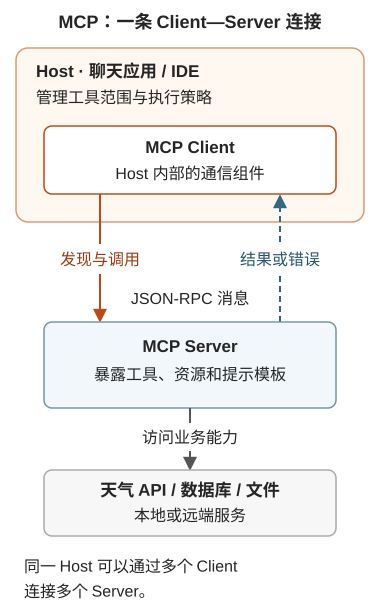

---
{
  "id": "Q-0416",
  "title": "MCP 的本质与作用是什么？",
  "category": "agent",
  "topic": "MCP、A2A 与工具协议",
  "type": "原理机制",
  "level": "基础",
  "priority": "进阶补充",
  "focus": "能力发现与标准化通信。MCP把工具、资源和提示的发现与调用标准化；Host协调Client连接Server，由Server接入实际工具或数据，再把结果交回应用和模型。",
  "aliases": ["Q-3359"],
  "answerStatus": "ready",
  "updatedAt": "2026-11-04"
}
---

> 在面栈阅读：[MCP 的本质与作用是什么？](https://mianstack.com/question/q-0416)

## 核心回答

`MCP`，全称 Model Context Protocol，是 **AI 应用接入外部工具和数据的开放通信协议**。它统一能力描述、发现、调用和结果返回，让同一套外部能力能够被不同 AI 应用复用，减少重复适配。

三者的职责分别是：**`Tool Calling`** 让模型表达“调用哪个工具、传什么参数”；**`MCP`** 规定应用怎样发现外部能力、发送请求并取得结果；**Agent** 根据任务目标和返回结果决定下一步。

例如把天气查询封装为 `MCP` Server 后，聊天应用和编程 IDE 都可以通过各自的 `MCP` Client 获取工具说明、发送城市参数并接收天气结果。模型再根据结果回答用户，或继续处理信息缺失的问题。

`MCP` 统一的是接入方式，不负责规划任务，也不保证调用正确。应用和服务端仍要检查参数、权限和执行结果；工具也可以由程序直接触发，不必每次都经过模型。

## 用天气服务说明它到底连接了什么

假设天气能力要同时提供给一个聊天应用和一个编程 IDE。直接集成时，两边可能各自维护工具说明、参数转换和调用代码；封装为 `MCP` Server 后，共同的发现和调用约定由协议承担，天气查询仍由服务端实现。

这里有三个角色：

- **Host：** 用户使用的聊天应用或 IDE，管理模型交互、工具可见范围和执行策略。
- **Client：** Host 内的通信组件，向某个 Server 请求能力列表、发送调用并接收结果。
- **Server：** 提供天气能力的程序，收到请求后执行查询或转交业务 API；可以运行在本机，也可以在远端。

下面把三者的位置与消息方向画出来：Client 在 Host 内，Server 后面才是实际业务能力。

[](../assets/questions/Q-0416/q-0416-f6c255b179b5.svg)

图示按[教程第 20 章 §5.1](https://didilili.github.io/ai-agents-from-zero/#/20-MCP模型上下文协议)的角色关系重绘。“发现与调用”概括两类交互，不表示每次调用都重新获取能力列表。

用户输入“查北京现在的天气”后，主要链路如下：

```text
Client 用 tools/list 获取工具名称、说明和 inputSchema
  → Host 把允许使用的工具适配给模型
  → 模型提出 get_weather 和城市参数
  → Host 检查请求，Client 用 tools/call 发给 Server
  → Server 校验输入和权限，执行天气查询
  → 结果返回 Host，模型据此回答或处理失败
```

这里要分清**服务发现**与**工具发现**。在本文采用的 `2026-07-28` 版本中，`server/discover` 返回服务支持的协议版本、能力类别与服务信息；`tools/list` 才返回具体工具名、说明和 `inputSchema`。知道服务支持 Tools，不等于已经拿到全部工具定义，也不等于这些工具都已向当前模型开放。Host 还要注册工具、适配模型接口，并按任务和权限筛选可见工具。

例如天气服务可复用于聊天应用和 IDE，但两边可以开放不同的工具集合；统一接入不要求它们采用相同的模型、提示词或界面。

`inputSchema` 是参数结构说明，例如城市字段的类型和必填要求。如果服务返回城市不明确，Agent 可以补问；如果凭证失效，就应处理配置问题。协议让反馈有统一的传递方式，具体选择仍由应用和模型完成。

Server 还可以暴露 **Resources** 和 **Prompts**。三者分别对应“执行动作”“提供可读取内容”“提供可复用提示模板”：天气查询适合作为 Tool，已有文档可作为 Resource，报告写作模板可作为 Prompt。资源如何进入上下文通常由应用组织，提示模板通常由用户选择，不是三类能力都自动交给模型执行。

Server 可以只提供其中一类能力，Host 也可能只支持部分能力。例如某宿主能调用天气 Tool，却未实现 Prompt 的选择界面，两者并不矛盾。接入时要核对双方支持的协议版本、传输和具体能力，不能把“支持 `MCP`”理解为所有功能都自动可用。

## 它通过什么方式通信？

`MCP` 使用 `JSON-RPC` 消息。标准传输包括 **`stdio`** 和 **`Streamable HTTP`**：`stdio` 常用于本地子进程，通过标准输入输出通信；`Streamable HTTP` 向 `MCP` 端点发 `HTTP` 请求，响应可以是 `JSON`，也可以是 `SSE` 流。

`SSE` 是一种传输流式消息的机制，收到进度事件也不等于收到了模型逐 token 生成的文本。教程中的 `transport="sse"` 是旧 `HTTP`+`SSE` 兼容示例，与 `Streamable HTTP` 使用 `SSE` 返回流是两回事。接入时应核对两端实际支持的协议。本文采用的 `2026-07-28` 版本已移除旧版 `initialize` / `initialized` 握手和 `Mcp-Session-Id`，请求通过版本与能力元数据自描述；Server 必须实现 `server/discover`，但 Client 不必每次先调用它，也可以直接发起支持的请求。课程 SDK 1.x 中的初始化与会话示例，应在其兼容版本下理解，不能套到所有连接上。

## 追问

**不用 `MCP`，能不能让模型调用天气 API？**

可以，应用直接把天气 API 封装成工具即可。一个应用只有几个固定内部接口时，直接集成可能更简单；多个宿主要复用相同能力，或要接入现有 `MCP` 生态时，标准协议更有价值。`MCP` Server 可以部署成适配层，但 `MCP` 本身是协议，不是某个现成中间件产品。

**接入标准协议后，为什么还可能不可靠？**

统一了请求格式，仍要检查城市是否正确、数据是否完整、调用者是否有权限。`HTTP` 接入有对应的认证授权规范，业务系统还要落实具体资源和操作的权限。Host 控制可用工具和必要确认，Server 做输入校验、访问控制与限流。返回内容也可能不可信，不能把工具结果里的文字直接升级成系统指令。

还要分清两类失败。调用了不存在的工具，或请求结构不符合协议，应返回 `JSON-RPC` 错误；天气查询本身执行失败、输入值不符合业务要求，则可在工具结果中用 `isError: true` 返回可修正的信息。因此收到 `result` 只说明拿到了调用结果，不能据此宣布天气查询成功。模型收到“城市有歧义”可以补问，收到“凭证无效”则应由应用处理配置；统一错误通道不会自动选择正确的恢复办法。

**`MCP` 和 Skills 可以互相替代吗？**

不能。`MCP` 解决怎么接入能力；Skills 把某类任务的方法、规则和配套资料组织起来，供宿主按需加载。例如研究报告 Skill 说明先核对来源再整理报告，执行时可以使用 `MCP` 提供的搜索工具，也可以使用本地工具。

## 对应教程

- [MCP 模型上下文协议：1.1～1.2、3.2、5.1～5.3](https://didilili.github.io/ai-agents-from-zero/#/20-MCP模型上下文协议)：接入痛点、角色、三类能力与传输。
- [Tools 工具调用：2.2～2.4](https://didilili.github.io/ai-agents-from-zero/#/17-Tools工具调用)：与模型侧调用意图和结果反馈对照。

## 参考资料

- 国内：[WeThinkIn：MCP 与 A2A 协议高频考点](https://github.com/WeThinkIn/AIGC-Interview-Book/blob/275fdf1eeb65e3b233081d3b8e74ff5d8eeb2e03/AI%20Agent%E5%9F%BA%E7%A1%80/04_MCP%E4%B8%8EA2A%E5%8D%8F%E8%AE%AE%E9%AB%98%E9%A2%91%E8%80%83%E7%82%B9.md#q-012)“Tools、Resources、Prompts 有什么区别？”——借鉴对 Tools、Resources、Prompts 的比较，说明它们的用途与宿主使用方式；发现过程以本文注明的协议版本为准。
- 国内：[JavaGuide：MCP 和 Function Calling、Agent 的关系](https://javaguide.cn/ai/agent/mcp.html)：参考接入复用与职责划分的讲解，解释 MCP 与 Function Calling、Agent 的关系；涉及握手的旧版描述需按实际协议版本区分。
- 国内：[王二讲 Agent：MCP 与工具调用](https://www.javabetter.cn/ai/video/#_273-mcp-%E6%98%AF%E4%BB%80%E4%B9%88-%E5%AE%83%E8%A7%A3%E5%86%B3%E4%BA%86%E4%BB%80%E4%B9%88%E9%97%AE%E9%A2%98)：参考 §273～277 中工具复用、模型调用意图与协议接入的分工，说明同一服务可供不同应用使用，而模型选择和工具执行仍各有职责。
- 国内：[AgentScope：MCP](https://doc.agentscope.io/zh_CN/tutorial/task_mcp.html)：借鉴客户端获取工具、注册工具集和发起调用的示例，说明正文中框架如何接入 MCP；框架会话管理与协议级会话分别处理。
- 国外：[MCP：Architecture overview](https://modelcontextprotocol.io/docs/2026-07-28/learn/architecture)：依据本文所用版本的架构文档，说明宿主、客户端与服务端的角色，以及能力、传输和发现机制如何配合。
- 国外：[MCP：Discovery](https://modelcontextprotocol.io/specification/2026-07-28/server/discover)：依据服务发现请求的返回字段与调用条件，区分协议能力发现、具体工具列表和模型可见工具，并说明新版发现不等同于旧版会话握手。
- 国外：[MCP：Tools](https://modelcontextprotocol.io/specification/2026-07-28/server/tools)：依据工具规范说明发现与调用流程，并补充参数约束、业务错误反馈和调用各方的安全职责。

协议版本：2026-07-28。
