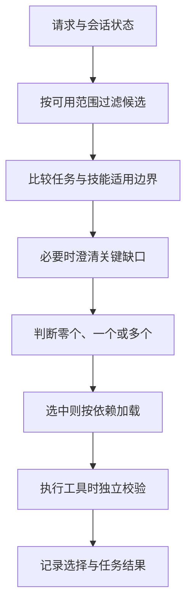

---
{
  "id": "Q-0422",
  "title": "Skill Router 的具体实现是什么？",
  "category": "agent",
  "topic": "Skills 能力系统",
  "type": "项目深挖",
  "level": "进阶",
  "priority": "进阶补充",
  "focus": "能力召回与适用范围判定。注册 Skill 名称、描述与位置，结合任务召回候选并校验适用边界，再加载正文；无匹配可不加载并记录误路由。",
  "contextTags": ["项目语境"],
  "answerStatus": "ready",
  "updatedAt": "2026-10-19"
}
---

> 在面栈阅读：[Skill Router 的具体实现是什么？](https://mianstack.com/question/q-0422)

## 核心回答

Skill Router负责把当前任务映射到**零个、一个或多个适用Skill**，然后交给加载器读取内容。具体可分为注册、候选选择、相关性判断、加载与执行反馈：注册表保存名称、描述、版本和资源位置；路由结合请求与会话状态选候选；校验适用边界后加载正文；Agent再按Skill调用工具完成任务。

Skill较少时，直接让模型依据清楚的描述选择即可。数量增加或混淆明显时，再引入关键词、向量召回与精排。不是所有项目都需要向量数据库，也不存在通用最优候选数量。

## 注册与候选选择怎样做

注册表记录`skill_id`、`name`、`description`、版本、入口、依赖和启用范围，自建系统可另外维护典型请求与反例索引。来源格式没有规定的字段，不应假定每个宿主都会读取。

先按用户可用范围、环境与依赖过滤；明确命名的调用优先解析到对应技能。普通请求用关键词处理专名，用语义检索补同义表达，再得到有限候选。路由器结合当前目标、已确认实体与任务阶段比较边界，而不是只取向量最高分。

## 如何处理歧义与组合

例如“查订单异常”可能命中日志诊断和订单分析，先判断任务对象与需要的证据，必要时组合；“帮我处理一下”没有足够信息时可以澄清或走通用路径。低匹配度应允许不选技能，两个候选接近时不要硬猜。

多技能不意味着全部并行。先诊断再生成修复方案有依赖，独立数据读取才适合并行。技能加载器核对版本与文件路径，正文指导工作方法，工具执行器仍负责参数与权限；选中了退款Skill也不等于已经授权退款。

路由可以拆成下面几个阶段，先判断适用性，再加载和执行：

零个适用技能时走通用路径，跳过技能加载；有多个技能时先确定依赖，只有独立步骤才并行。图中的“必要时澄清”并非每次都询问用户。

## 如何发现路由问题

记录请求、候选集、选择结果、技能版本和最终任务结果。正确Skill未进入候选集，改召回或注册描述；进入候选却选错，检查边界、反例与精排；选对后做错，检查加载内容、工具和执行。

评测包含单技能、相似技能、多技能、无需技能、缺信息和长尾表述。分别观察候选`Recall@K`、选择准确率、误触发、拒识和端到端完成，不能只优化热门技能的总体准确率。

## 常见追问

**能让模型读全部Skill全文再选吗？** 可以作为小规模对照，但通常成本高、干扰多；元数据用于发现，正文用于实施，先后分工更清楚。

## 对应教程

- [27-Skills技能与AI编程工具实践](https://github.com/didilili/ai-agents-from-zero/blob/c05fb5979cf0aa3b6b4ed8c29f450f640fb9c18f/27-Skills%E6%8A%80%E8%83%BD%E4%B8%8EAI%E7%BC%96%E7%A8%8B%E5%B7%A5%E5%85%B7%E5%AE%9E%E8%B7%B5.md)：回看description触发、按需加载与三类触发测试。

## 参考资料

- 国内：[JavaGuide：Skill路由实现](https://github.com/Snailclimb/JavaGuide/blob/50f02a5984c062fe7221629d0a6a40ec15c26fd7/docs/ai/agent/skills.md)：采用路由组件的职责划分，说明正文中候选打分、技能正文加载与上下文组装如何衔接。
- 国内：[zero2Agent：Skill路由评估](https://github.com/ranxi2001/zero2Agent/blob/0c0eb7693105d281b146bb98f3a7f30da6f1ceea/learn-agent-interview/05-eval-and-vision/index.md)：依据困难负例、拒识与多技能测试，说明正文中如何区分候选召回失败和后续决策失败。
- 国内：[WeThinkIn：编码Agent与技能资源](https://github.com/WeThinkIn/AIGC-Interview-Book/blob/275fdf1eeb65e3b233081d3b8e74ff5d8eeb2e03/AI%20Agent%E5%9F%BA%E7%A1%80/02_%E7%BC%96%E7%A0%81Agent%E4%B8%8EAgentOS%E5%B7%A5%E7%A8%8B%E9%AB%98%E9%A2%91%E8%80%83%E7%82%B9.md)：依据技能资源与权限边界，说明正文中选中 Skill 后如何取得执行材料，以及执行仍需遵守的权限约束。
- 国外：[Agent Skills：Specification](https://agentskills.io/specification)：依据名称、描述、正文与资源的开放约定，说明正文中技能发现和正文加载分别使用哪些信息。
- 国外：[Anthropic：Equipping agents with Agent Skills](https://www.anthropic.com/engineering/equipping-agents-for-the-real-world-with-agent-skills)：借鉴元数据触发与分层读取案例，解释正文中为何无需在选择前预读所有技能正文。
