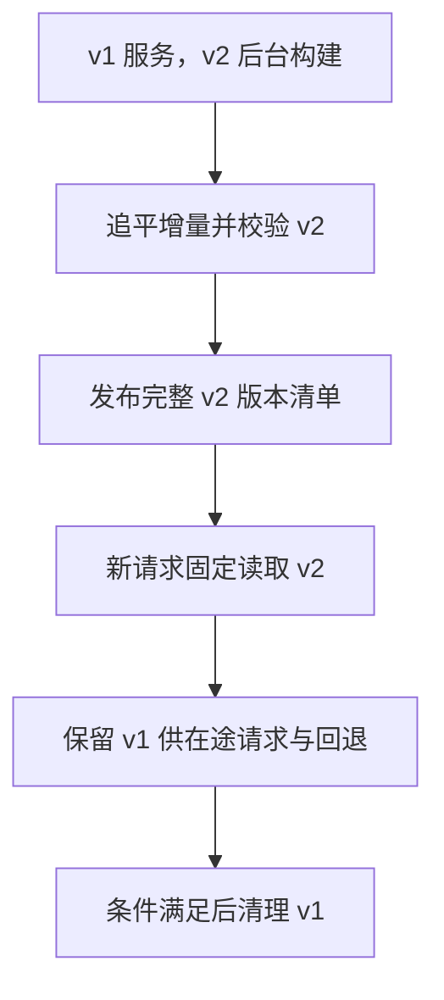

---
{
  "id": "Q-0540",
  "title": "RAG 如何动态且不停服地更新知识库？",
  "category": "rag",
  "topic": "知识更新、版本与权限",
  "type": "方案设计",
  "level": "进阶",
  "priority": "按岗位选读",
  "focus": "增量构建与索引版本切换。增量任务记录文档版本，后台构建并校验新索引，查询切到完整版本；删除和权限变更同步失效，保留回退。",
  "aliases": ["Q-0619"],
  "answerStatus": "ready",
  "updatedAt": "2026-10-19"
}
---

## 核心回答

把知识更新与在线查询解耦：**日常变更做增量处理，模型或切分迁移做后台重建，校验后切换可查询版本**。在线请求持续读取一个完整有效版本，不能先删空旧库，再等待新索引生成。

同时维护文档ID、版本、处理状态和派生片段关系，新增、修改、删除与权限变化都进入更新链路。服务不停不代表数据瞬时最新，应明确业务能接受的同步延迟和紧急撤回要求。

## 日常增量怎样处理

用事件通知、CDC或轮询发现变化，记录来源版本及处理水位，进入持久队列。处理器解析、清洗、切分、Embedding并更新索引，按文档ID和版本幂等；较旧任务迟到时不能覆盖新版本。

修改后新片段数量可能变化，需要识别并撤销旧版残留。删除通过文档到片段的映射覆盖全文、向量、摘要与缓存；不能只删原文件却让索引继续返回。处理失败保留可查询状态与重试记录，定期与源系统对账防漏更。

## 全量重建怎样不停服

从快照或确定水位建立新版本，旧版本继续服务；重建期间继续记录变更，并在切换前追平增量。用固定查询检查证据、权限、版本和成本，确认新索引能够正常读取，再切换统一入口。保留旧版本供回退，等在途请求结束后再清理。

Qdrant等系统支持原子切换集合别名，但这只保证相关别名操作，不会自动原子更新外部数据库、全文索引和缓存。多检索通道可以共同绑定一个发布版本清单，请求开始时固定版本；切换方案需覆盖全部消费者。

全量迁移可以按下面几个阶段推进，构建期间仍由旧版本持续服务：

图中 v1 和 v2 是完整检索版本。涉及新 Embedding 时，文档向量与查询编码器一起配套；别名原子切换的保证范围不自动覆盖外部索引或缓存。

## 更换Embedding有什么特殊点

新旧模型即使维度相同，也可能处于不同空间。为新模型重建文档向量，并让查询编码器随检索版本配套切换，不能把新query向量直接查旧库。灰度或双读对照时分别走各自完整链路，再比较结果。

## 权限与故障怎样控制

权限收紧或紧急撤回不能只等低优先级重建，可在查询访问层先做即时禁止，再清理索引与缓存；派生内容也继承限制。普通更新的旧版可用策略与敏感撤回要分开。

监控源变化到可检索的延迟、队列积压、失败与残留旧块，并在发布前后跑关键回归。更新崩溃、重复事件、乱序和回退都要测试，才能证明不停服同时没有静默丢知识。

## 参考资料

- 国内：[RAG文档处理与切分策略](https://github.com/Snailclimb/JavaGuide/blob/50f02a5984c062fe7221629d0a6a40ec15c26fd7/docs/ai/rag/rag-document-processing.md)：解析、切分与元数据说明文档更新后哪些片段和衍生信息需要重新处理。
- 国内：[RAG知识库更新与维护](https://github.com/Snailclimb/JavaGuide/blob/50f02a5984c062fe7221629d0a6a40ec15c26fd7/docs/ai/rag/rag-knowledge-update.md)：借鉴增量处理、后台重建与版本切换，组织正文中更新、追平增量、验证和回退的不中断服务流程。
- 国内：[Agent RAG与混合检索工程高频考点](https://github.com/WeThinkIn/AIGC-Interview-Book/blob/275fdf1eeb65e3b233081d3b8e74ff5d8eeb2e03/AI%20Agent%E5%9F%BA%E7%A1%80/10_Agent_RAG%E4%B8%8E%E6%B7%B7%E5%90%88%E6%A3%80%E7%B4%A2%E5%B7%A5%E7%A8%8B%E9%AB%98%E9%A2%91%E8%80%83%E7%82%B9.md)：版本、权限与检索工程说明知识变化不能只更新一个向量点，还需维护各路径一致性。
- 国外：[LlamaIndex：Document Management](https://developers.llamaindex.ai/python/framework/module_guides/indexing/document_management/)：依据文档 ID 与节点追踪、更新和删除的对应，说明正文中撤销旧片段及幂等处理的实现。
- 国外：[Qdrant：Collection Aliases](https://qdrant.tech/documentation/manage-data/collections/#collection-aliases)：后台构建新集合并原子切换别名的机制，为不停服迁移索引提供具体实现参照。
