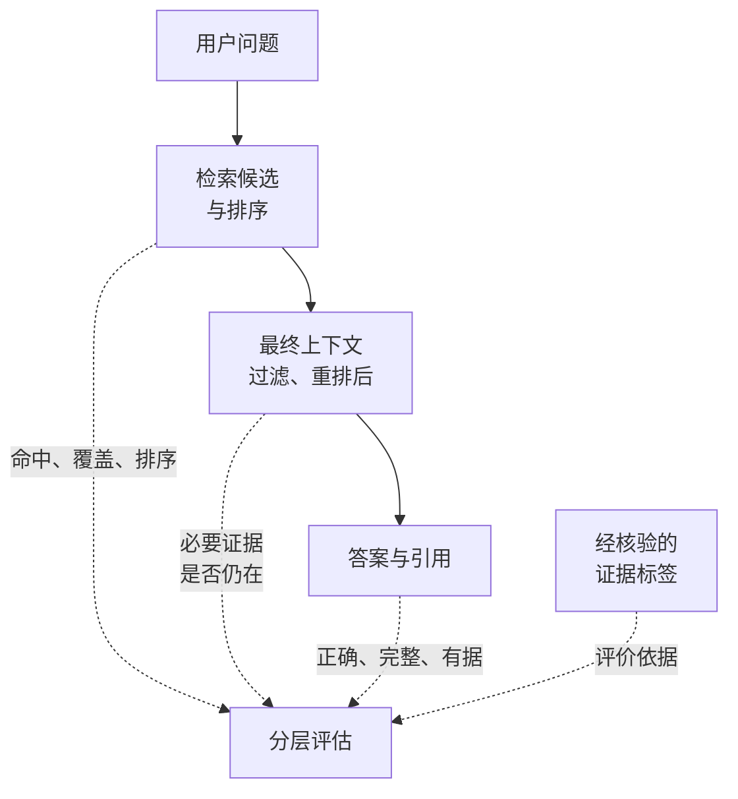

---
{
  "id": "Q-0543",
  "title": "如何设计 RAG 评估方案和指标？",
  "category": "rag",
  "topic": "RAG 评测与故障排查",
  "type": "效果评估",
  "level": "进阶",
  "priority": "按岗位选读",
  "focus": "检索、生成与端到端评估。带答案与证据的问题集分别测检索召回/排序、生成忠实与正确，再看端到端成功、延迟和成本。",
  "answerStatus": "ready",
  "updatedAt": "2026-10-17"
}
---

## 核心回答

RAG 评估应覆盖**检索质量、生成质量和端到端效果**。先建立有代表性的评估集，明确每题的答案要点和原文依据，并固定知识库、配置和评分规则，再分三层评价：

- **检索层**：评估证据的相关性、覆盖度和排序，分别保存候选结果和最终上下文。
- **生成层**：对照答案要点评估正确性与完整性，检查结论是否得到上下文支持（忠实性），以及引用是否准确。
- **端到端**：评估任务完成情况、延迟与成本，固定样本和评分规则比较优化前后。

例如问“出差住宿能报多少、需要什么凭证”，只找到限额而没找到凭证要求，属于证据覆盖不足；两项规定都进入上下文，答案却漏掉一项，则属于生成遗漏。分层评估有助于定位具体问题，并判断改动改善了哪个环节。

## 先把问题变成可判断的样本

一条样本至少包括：用户问题、适用的知识库版本和权限范围、答案要点、支持这些要点的原文位置，以及是否允许回答。标准答案不必只有一种固定句式，但关键事实、条件和必要覆盖点要明确；标签来自经核验的原文或业务判断，不能直接拿某次模型输出当真值。

下面用“00000 和 A0001 分别是什么意思”这个错误码问答展开，可以覆盖四类题：只问单个编码，一次问多个编码，容易混淆的近似编号，以及文档没有收录的编号。多编码题检查是否漏答；近似编号检查是否串义；无资料题检查能否说明缺少依据，而不是用相似编码硬凑答案。真实高频问题和低频高风险问题也要单独覆盖，平均分不能替代这些子集结果。

把用于反复调参的问题与最终测试问题分开，近乎相同的改写题不要分到两边。每轮比较固定问题集、知识库快照、模型/检索配置和评分规则，记录变更。资料会更新，评估集也要更新，但不能拿不同版本的数据直接声称一次优化有效。

## 分开保存召回、最终上下文和答案

检索器取回的候选，不一定全部交给模型：中间还可能经过重排、去重、过滤、压缩和截断。应分别保存候选列表与顺序、最后发给模型的片段与顺序，以及最终答案和引用。

下图要看的是两个不同的检查位置：候选中有证据，却没有进入最终输入，与证据已经齐全但模型答错，是两种问题。实线表示被测问答链路，虚线表示评价关系；经核验的证据标签用于评分，不交给检索器作为输入。

因此同一个召回指标可以在不同阶段计算，但要写清测的是“检索候选”还是“最终上下文”。否则裁剪掉必要证据，也可能被错算成检索器没找到，或被误归因成模型不会回答。若最终上下文经过摘要或改写，应映射回原文证据，或按答案要点判断覆盖，不能直接把新旧片段 ID 当成同一套标签。

## 检索评估：命中一条，不代表资料找全

先规定相关性的单位：文档、片段，还是答案要点。错误码问题可能一个片段就包含两种编码，不能机械地要求必须找回两个片段；反过来，找回两片也不代表覆盖了两个编码。

下面采用已标注相关证据的集合口径：相关集合记为 `R`，去重后的前 K 条结果记为 `S_K`。以下三个检索指标在**按当前版本和权限存在可用证据的问题子集（`R` 非空）**上逐题计算，再取平均，并报告该子集的题数。

- **Hit@K**：`R` 与 `S_K` 有交集记 1，没有记 0。它只回答“至少找到一条了吗”。
- **Recall@K**：`|R ∩ S_K| / |R|`，回答“已标注的相关证据找回了多少”。
- **Precision@K**：返回足 K 条时为 `|R ∩ S_K| / K`，回答“取回的候选里有多少是相关的”。

假设一题有 **4 条相关证据，前 5 条结果只命中其中 1 条**：Hit@5 = **1**，Recall@5 = **1/4 = 0.25**，Precision@5 = **1/5 = 0.2**。所以一次命中可以得到 Hit 满分，但仍缺少大部分已标注证据；多事实问题尤其不能只看 Hit。

排序质量可以在同一有证据子集上再看 **MRR**：对每题取第一条相关结果排名的倒数，再求平均，未命中记 0。它强调首条相关结果靠不靠前，不能反映后续证据是否找全。有不同相关等级时，可以用 **nDCG** 比较排序，把更有用的证据排到前面。

**没有可用证据的负例单独评估**：是否检回了无关内容、是否正确说明缺少依据。这些题不混入上述有证据子集的检索均值；尤其不能为 `R` 为空的 Recall 人为补一个正例分母，否则无资料题占比变化就可能被误当成检索效果变化。

计算前还要约定边界：返回不足 K 条时，精确率分母用 K 还是实际返回数；采用实际返回数时，空返回怎样处理也要事先规定。标签不完整时，Recall 只表示相对已知标签的覆盖。更换切片方式后，要重新映射原文证据，不能直接沿用旧片段 ID。相关性最好同时考虑版本、权限和问题条件，“主题相似”不足以算可用证据。

## 生成评估：答得有依据，也可能答错

仍以两个错误码为例，分别检查：

- **正确性与完整性**：对照经核验的答案要点，两个编码都解释了吗，是否写反含义、漏掉必要条件。
- **忠实度（Faithfulness）**：把回答拆成可判断的说法，检查每条是否得到本次上下文支持。若回答额外写“A0001 重试就能解决”，原文没有这个结论，就存在无依据内容。
- **回答相关性**：是否在解释用户问的两个编码，而不是展开一篇错误码设计常识。
- **引用质量**：引用片段是否真的支持旁边的结论，重要结论是否都有依据。附一个可打开的链接，只能证明链接存在，不能证明引用正确或覆盖充分。

正确性与忠实度的比较对象不同。模型照着过时文档回答，可以忠实却不正确；也可能碰巧答对，但当前上下文根本没有支持它，这次回答仍缺少可核验依据。因此既要与业务事实或参考答案比较，也要与本次上下文比较，不能让答案和自己的检索结果相互证明。

Ragas 等框架可以辅助评估，但要看具体指标的输入和含义。LLM 版 Context Recall 检查**参考答案的断言**有多少得到上下文支持；Faithfulness 检查**生成答案的断言**有多少得到支持。两者的分母不同，也不同于上面按证据 ID 计算的集合召回率。常见 LLM 版 Context Precision 还考虑相关片段排序，不能直接当作普通 Precision@K；Ragas 也有按 ID 集合计算的实现。是否需要参考答案、分母如何计算，都要看选用的实现。

## 怎样判断一次优化值得保留？

假设想把检索 K 调大，应在同一评估集和知识库快照上对照：多编码题的证据覆盖有没有增加，最终答案是否更完整，新增噪声是否导致引用错配或答错，同时检查输入 token、检索/重排/生成耗时与总成本。记录端到端延迟的中位数和高分位值，避免少量特别慢的请求被平均值掩盖；评估裁判本身的费用也应与应用运行成本分开。

按单编码、多编码、近似编号、无答案等子集看结果，同时报告样本量和波动。模型生成或评分存在随机性时，可重复运行；差异很小时，需要更多样本或进一步验证，不能凭一次小幅涨分就下结论。

如果用模型当裁判，要写清评分量表和输入，固定裁判版本，在人工核验的样本上检查误判，并保留可审阅的判断依据。特别是无答案、资料冲突和部分正确的题，不能只让裁判输出一个总分。上线后再看问题解决情况、错误回答、用户反馈和转人工，并回流新的失败样本。追问可能是正常深入交流，转人工也可能是合理处理高风险问题，不能单独当成失败。

上线标准由业务风险与已有基线确定，没有统一的“超过 0.8 就合格”。评估的作用是让质量变化可比较，并帮助缩小排查范围；单个指标低不能直接证明某个组件就是根因。

## 追问：没有标准答案，还能评估吗？

可以先检查答案相关性、忠实度、引用和运行代价，一些上下文精确率实现也不依赖参考答案。但这些只能说明答案是否切题、是否得到给定材料支持，不能充分证明业务正确或证据找全。可以从真实问题中逐步补充一批经核验的代表性样本，先建立可靠基线。

如果召回率上升、答案反而变差，先比较最终上下文：必要证据是否被后续裁剪删掉，新增片段是否引入冲突或噪声，再检查模型如何使用材料。相关题目：[Agent 效果不达预期时，如何分析 Bad Case 并确定优化方向？](/question/q-0059/)。

## 对应教程

配套教程介绍分开观察检索与生成，并建立“问题—期望片段或标准答案”回归集；本文进一步展开指标计算、样本划分和模型裁判校准。

- [第 19 章：RAG 检索增强生成](https://github.com/didilili/ai-agents-from-zero/blob/main/19-RAG%E6%A3%80%E7%B4%A2%E5%A2%9E%E5%BC%BA%E7%94%9F%E6%88%90.md)：§1.3.4、§2.4 的分层观测和回归集，以及 §3 的双错误码问答案例。
- [错误码问答源码](https://github.com/didilili/ai-agents-from-zero/blob/main/%E6%A1%88%E4%BE%8B%E4%B8%8E%E6%BA%90%E7%A0%81-2-LangChain%E6%A1%86%E6%9E%B6/10-rag/EmbeddingRagLLM.py)：`k=2` 与 `context + question` 的实际输入；固定取两条不保证覆盖两个编码。

## 参考资料

- [JavaGuide：AI 应用评测](https://github.com/Snailclimb/JavaGuide/blob/50f02a5984c062fe7221629d0a6a40ec15c26fd7/docs/ai/llm-basis/llm-evaluation.md)“LLM-as-Judge 怎么用才可靠？”与“RAG 应用怎么评测？”——对照检索与生成的分层，以及人工校准、裁判偏差和客观验证证据。
- [小林面试笔记：怎么量化你的 RAG 效果？](https://xiaolinnote.com/ai/rag/18_evaluation.html)：检索、生成与线上效果的中文分层解释。
- [LangSmith：Evaluate a RAG application](https://docs.langchain.com/langsmith/evaluate-rag-tutorial)：答案正确性、相关性、依据与检索相关性的比较对象。
- [Ragas：Context Recall](https://docs.ragas.io/en/stable/concepts/metrics/available_metrics/context_recall/)、[Context Precision](https://docs.ragas.io/en/stable/concepts/metrics/available_metrics/context_precision/)、[Faithfulness](https://docs.ragas.io/en/stable/concepts/metrics/available_metrics/faithfulness/)：断言支持、排序与各实现的输入要求。
- [阿里云：RAG 效果优化](https://help.aliyun.com/zh/model-studio/rag-optimization)：覆盖不同问题类型，用同一评估集和基线对照。
- [百度千帆：批量任务管理](https://ai.baidu.com/ai-doc/AppBuilder/3mayry9oa)：设置裁判输入、评分维度、量表和评分原因。
- [腾讯云：应用评测](https://intl.cloud.tencent.com/zh/document/product/1254/72510)：数据集、规则/代码/模型评分和配置对比。
