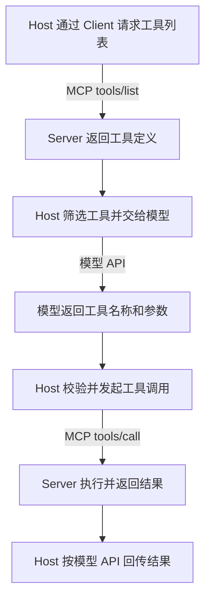

---
{
  "id": "Q-0545",
  "title": "Function Calling、MCP 与 Tool Use 有什么关系和区别？",
  "category": "agent",
  "topic": "MCP、A2A 与工具协议",
  "type": "比较选型",
  "level": "进阶",
  "priority": "进阶补充",
  "focus": "调用表达、连接协议与执行。Function Calling 表达工具名与参数，MCP 统一外部能力连接，Tool Use 泛指工具使用；真实执行仍由应用负责。",
  "aliases": ["Q-3467"],
  "answerStatus": "ready",
  "updatedAt": "2026-10-17"
}
---

## 核心回答

**Function Calling 通常指模型通过约定格式表达工具名称和参数的机制；MCP 是应用与外部能力提供方之间的标准连接协议；Tool Use 泛指使用工具，也常被厂商用作 Function Calling／Tool Calling 的接口名称。** 三者可以出现在同一条调用链里，不能机械地划成互斥的三种方案。

- **Function Calling／Tool Calling**：解决模型如何接收工具定义、提出调用请求，以及结果怎样关联回本次调用。实际执行由应用、工具服务或供应商运行时负责。
- **MCP**：解决宿主应用怎样发现和调用外部工具、读取资源或获取提示模板。工具部分有自己的定义、请求和结果契约。
- **Tool Use**：描述工具使用过程时范围较宽；在具体 API 文档里也可能就是结构化工具调用的名字。例如 Anthropic 明确把 tool use 与 function calling 并称。

例如“查北京天气”：模型生成天气工具调用后，应用可以直接调用本地函数或 HTTP API；也可以把请求交给 MCP Client，再由天气 MCP Server 执行。**没有 MCP 仍能做 Function Calling；接入 MCP 也不会自动让模型选对工具或填对参数。**

## 模型调用契约与 MCP 契约分别约束什么

模型侧的工具定义通常包含名称、用途和参数 Schema。模型返回调用请求后，执行层解析名称与参数，检查类型、权限和业务条件，执行操作，再按模型接口要求回传结果。调用标识用于把结果对应到正确的工具请求，尤其在多个工具并行时很重要。

MCP 则规定客户端与服务器之间的协议消息。按 **2026-07-28 规范**，客户端通过 `tools/list` 取得当前可用工具定义，其中包含 `inputSchema`；调用工具使用 `tools/call`，携带名称和参数。它还规定结果、错误、能力与相应的访问控制要求。

这两层格式不能直接画等号。宿主或适配器可能需要把 MCP 定义转换成模型接口支持的工具格式，把模型请求映射成 MCP 调用，再把 MCP 返回内容转换成模型需要的工具结果。模型 API 的调用 ID 与 MCP 的 JSON-RPC 请求 ID 属于不同契约，需要关联，不能假定是同一个字段。

MCP Server 内部仍可以访问普通 HTTP API、数据库或本地文件；底层业务接口并不会因为外面包了一层 MCP，就自动具有理解自然语言的能力。

## 用天气查询串起完整过程

以应用执行的自定义天气工具为例：

1. Host 内的 MCP Client 从天气 Server 发现工具，宿主按权限和当前任务筛选，再转换成模型可用的工具定义。
2. 用户询问北京天气，模型生成天气工具名称及地点参数。
3. 宿主检查调用并映射到对应 MCP Server，通过 `tools/call` 发起请求。
4. Server 执行天气查询，返回结果或错误。
5. 宿主把结果按模型接口要求关联回原工具调用，模型据此回答，或继续下一步。

图中 Host 与 Server 之间的发现、调用走 MCP；Host 与模型之间使用模型自己的工具调用格式。这里的模型没有直接生成或发送 MCP 网络请求。若不用 MCP，Host 可以把执行步骤换成本地函数或业务 HTTP 客户端，模型侧仍可以保持相同的工具使用方式。

## 为什么 Tool Use 不能总被定义成另一套独立机制

讨论 Agent 行为时，Tool Use 可以包括选工具、生成参数、执行、观察结果和继续行动；这比单次参数生成更宽。但具体供应商可能把整套工具调用接口也命名为 Tool Use。

例如 Claude 文档中，自定义客户端工具返回 `tool_use` 内容块，由应用执行后发送 `tool_result`；部分服务器工具则由 Anthropic 托管执行。执行位置不同，但都属于其 Tool Use 能力。因此，不能看到“模型 API 里提供了工具”就认定一定由自己的业务代码执行，也不能把厂商托管工具与 MCP Server 混为同一种服务。

实际交流中应先说明所采用的语境：是在说 Agent 使用工具的行为，还是某家模型接口的名称，再解释调用链中谁生成请求、谁执行、结果怎样返回。

## 什么时候直接接工具，什么时候接 MCP

如果只有少量内部函数、同一应用独占使用，直接定义模型工具并连接现有服务，通常更简单。团队仍可把工具封装成共享库或普通 API，不需要因为使用 Function Calling 就重复实现所有业务代码。

如果文件、数据库、搜索等能力要供多个宿主复用，或需要接入现有 MCP 生态，MCP 可以统一发现、描述与调用方式，减少重复连接工作。代价是维护客户端、服务器、版本兼容、认证、错误处理和运行状态。是否采用取决于复用需求及维护成本，不取决于“Agent 必须用 MCP”。

MCP 还包含 Resources、Prompts 等能力，不只服务于工具执行；是否开放以及怎样进入模型上下文，由宿主与具体能力契约决定。

## 两层都有契约，也都不能代替业务判断

参数符合 Schema，只能证明满足相应结构约束，不能证明订单归属、资源访问范围或动作时机正确。发现到工具也不等于获得执行授权，宿主与 Server 仍要按各自职责校验。

同样，MCP 请求传输成功不等于业务成功；应区分协议错误、工具执行错误和有效业务结果，再决定修正参数、重试、换路径或结束。模型看到结果后也可能表述错误，所以还要检查最终回答是否与工具证据一致。具体执行校验见[如何保证工具调用正确、安全地执行](/question/q-0050/)。

协议和模型 API 都会演进。实际实现应匹配协商的 MCP 版本和当前供应商契约，不能把旧 SSE 示例、某个 SDK 的自动适配能力或当前扩展字段当成所有环境默认支持。

## 追问：不支持原生 Function Calling 的模型能用 MCP 吗？

MCP Client 可以由用户界面、规则或普通程序直接发起工具请求，并不要求一定由模型选择。若希望模型参与决策，也可以解析它输出的受控动作格式，再由程序校验和执行，但格式稳定性、参数合法性和错误恢复需要额外处理。MCP 本身不会给模型补上原生工具调用能力，也不保证这条替代路径同样可靠。

## 对应教程

- [第 17 章：Tools 工具调用](https://github.com/didilili/ai-agents-from-zero/blob/main/17-Tools%E5%B7%A5%E5%85%B7%E8%B0%83%E7%94%A8.md)：§2.2–2.3 说明模型接收工具名称、描述和参数定义，以及调用意图与实际执行的分工；示例以应用执行工具为主。
- [第 20 章：MCP 模型上下文协议](https://github.com/didilili/ai-agents-from-zero/blob/main/20-MCP%E6%A8%A1%E5%9E%8B%E4%B8%8A%E4%B8%8B%E6%96%87%E5%8D%8F%E8%AE%AE.md)：§2.2、§3.2 与 §5.5 介绍 Tool／Function Calling 和 MCP 的不同职责、服务器能力及完整调用过程；具体协议行为仍应对照实际版本。

## 参考资料

- 国内：[JavaGuide：结构化输出与 Function Calling](https://github.com/Snailclimb/JavaGuide/blob/50f02a5984c062fe7221629d0a6a40ec15c26fd7/docs/ai/llm-basis/structured-output-function-calling.md)：依据工具调用链与 MCP／HTTP API 的关系，说明正文中模型请求、执行映射和结果回填如何协作，以及为何没有固定多层包装顺序。
- 国内：[Onefly / zero2Agent：Agent 核心概念中的 MCP 专题](https://github.com/ranxi2001/zero2Agent/blob/0c0eb7693105d281b146bb98f3a7f30da6f1ceea/learn-agent-interview/15-agent-concepts/index.md)：采用模型调用意图与工具连接标准的划分，区分正文中两者解决的问题；工具复用仍需宿主适配和权限条件。
- 国内：[Datawhale：第十章 智能体通信协议](https://github.com/datawhalechina/hello-agents/blob/36f583c233ea5cee4537ef93455702b55053af18/docs/chapter10/%E7%AC%AC%E5%8D%81%E7%AB%A0%20%E6%99%BA%E8%83%BD%E4%BD%93%E9%80%9A%E4%BF%A1%E5%8D%8F%E8%AE%AE.md)：借鉴 §10.2.1 中 GitHub、文件工具的直接调用与 MCP 接入示例，说明正文中同一任务的两种执行链路及 Host、Client、Server 的分工。
- 国外：[Anthropic：Tool use with Claude](https://platform.claude.com/docs/en/agents-and-tools/tool-use/overview)：依据工具使用定义与客户端、服务器工具交互，说明正文中 Tool Use 与 Function Calling 的命名关系，以及请求和结果的处理职责。
- 国外：[MCP：Tools，2026-07-28 规范](https://modelcontextprotocol.io/specification/2026-07-28/server/tools)：依据工具发现、调用、结果和安全约定，说明正文中 MCP 的实际消息契约及其与模型工具调用格式的区别。
