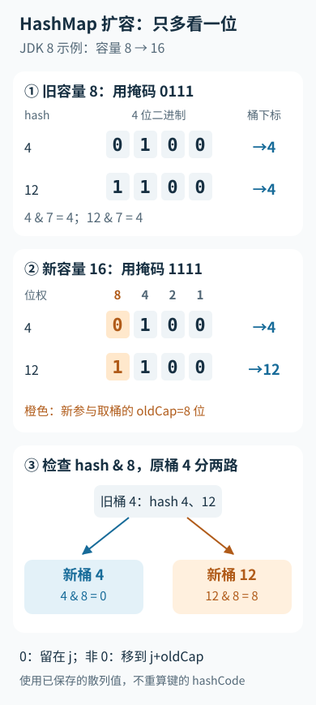

---
{
  "id": "Q-0550",
  "title": "HashMap 如何扩容？",
  "category": "software",
  "topic": "Java、Spring 与 JVM",
  "type": "原理机制",
  "level": "进阶",
  "priority": "按岗位选读",
  "focus": "扩容阈值与桶节点重分布。超过负载阈值后扩大桶数组并重分节点；以 JDK8 为例容量翻倍，节点按旧容量位留原桶或移到高位桶。",
  "answerStatus": "ready",
  "updatedAt": "2026-10-19"
}
---

> 在面栈阅读：[HashMap 如何扩容？](https://mianstack.com/question/q-0550)

## 核心回答

以 `JDK` 8 的 `HashMap` 实现为例，扩容通常是申请更大的桶数组，再把原有节点分配到新桶中。常见触发条件是新增映射后元素数量超过阈值，阈值通常为容量乘负载因子；正常扩容时容量变为原来的两倍。首次分配数组，以及数组较小时为缓解长链而触发的扩容，也会走相关逻辑。

默认容量为 16、负载因子为 0.75 时，数组分配后的阈值通常是 12；插入第 13 个不同键值映射会触发常规扩容。替换已有键的值不增加 `size`，不能把每次 `put` 都算作新增。

## 元素为什么只会留在原位或移动一个旧容量

桶位置按 `(n - 1) & hash` 计算，容量 `n` 是 2 的幂。容量翻倍后，参与取桶的掩码只多出一个有效位，也就是旧容量 `oldCap` 对应的位。

因此，`JDK` 8 迁移链表时检查 `(hash & oldCap)`：

- 结果为 0，节点仍放在旧下标 `j`。
- 结果非 0，节点放到 `j + oldCap`。

例如容量从 8 变 16，缓存散列值为 4 和 12 的节点原先都在下标 4；新数组中前者仍在 4，后者到 12。迁移使用节点保存的散列值，无须对每个键重新调用一次 `hashCode()`。这里的“`rehash`”是内部结构重建，不能理解为所有版本都必然重新执行键的哈希函数。

单节点直接定位，链表拆成低位和高位两条链；树桶有专门的拆分处理。`JDK` 8 链表拆分保留组内顺序，不应套用 `JDK` 7 头插迁移的过程。

把容量从 8 翻到 16 时新增的掩码位单独展开：

图中的 4、12 是节点已保存的散列值，容量 8 是便于演示的配置。新增位决定去向，迁移不需要重新调用键的 `hashCode()`。

## 扩容的代价与使用建议

一次迁移需要扫描旧桶和已有节点，存在时间与额外数组内存开销；普通插入的均摊成本较低，不代表单次插入没有延迟尖峰。已知元素规模时可以合理预估初始容量，并把负载因子算进去，但过大的空桶数组也会浪费空间并增加遍历成本。

`HashMap` 本身不支持无保护的并发结构修改。`JDK` 8 修改迁移算法并不使它成为线程安全容器；共享并发读写应使用合适的同步或并发容器。

## 常见追问

**为什么容量用 2 的幂？** 便于通过位与取桶，并支持扩容时按一个新增位拆分，代价是对散列质量有要求。

**链表长了就一定转红黑树吗？** 不一定。`JDK` 8 在数组容量不足相应门槛时会优先扩容；达到条件才考虑树化。具体阈值和实现应说明所依据的 `JDK` 版本。

## 参考资料

- 国内：[JavaGuide / Snailclimb：HashMap 源码分析](https://github.com/Snailclimb/JavaGuide/blob/50f02a5984c062fe7221629d0a6a40ec15c26fd7/docs/java/collection/hashmap-source-code.md)：借鉴源码对阈值触发、容量翻倍和高低位链拆分的展开，组织正文中的 JDK 8 扩容流程。
- 国内：[JavaGuide / Snailclimb：Java 集合常见问题（二）](https://github.com/Snailclimb/JavaGuide/blob/50f02a5984c062fe7221629d0a6a40ec15c26fd7/docs/java/collection/java-collection-questions-02.md)：参考容量与位运算的分析，解释正文中容量翻倍后为何只需检查 oldCap 对应的新增位。
- 国内：[沉默王二 / 二哥的 Java 进阶之路：HashMap 详解](https://javabetter.cn/collection/hashmap.html)：借鉴两个版本迁移方式的对照，区分正文中的 JDK 7 头插迁移与 JDK 8 高低链拆分；具体实现以 OpenJDK 源码为依据。
- 国外：[Oracle：HashMap API, Java SE 21](https://docs.oracle.com/en/java/javase/21/docs/api/java.base/java/util/HashMap.html)：官方性能契约说明初始容量、负载因子与重建成本的关系，并交代遍历成本及并发修改限制。
- 国外：[OpenJDK：OpenJDK 8u HashMap.java](https://github.com/openjdk/jdk8u/blob/master/jdk/src/share/classes/java/util/HashMap.java)：实际迁移代码用于核验 oldCap 位判断、组内顺序与数组较小时优先扩容的条件。
