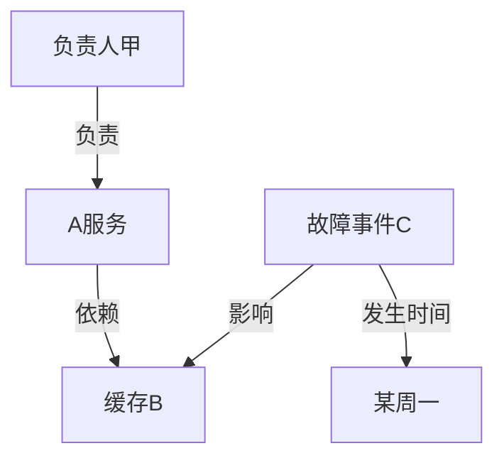

---
{
  "id": "Q-0578",
  "title": "知识图谱的基本结构和作用是什么？",
  "category": "rag",
  "topic": "知识图谱与 GraphRAG",
  "type": "原理机制",
  "level": "基础",
  "priority": "按岗位选读",
  "focus": "实体关系与多跳检索。实体/概念作节点，语义关系作边并附来源；如设备—发生—故障可连多份文档，支持实体对齐和多跳检索。",
  "answerStatus": "ready",
  "updatedAt": "2026-10-18"
}
---

> 在面栈阅读：[知识图谱的基本结构和作用是什么？](https://mianstack.com/question/q-0578)

## 核心回答

**知识图谱用实体或概念，以及它们之间有含义的关系，组织可查询的知识。** 常见表示包括“主体—关系—客体”三元组，或带标签、属性的节点与边；模式或本体定义有哪些类型、关系及约束，实例图记录具体对象与断言。

它的作用是把分散资料关联起来，支持实体统一、多跳查询、影响分析和检索增强。但知识图谱不是天然真实的知识库：关系可能来自业务记录、人工整理或模型抽取，需要保留来源、时间和适用条件。

## 基本结构分别是什么

- **实体与标识**：如系统、人员、设备和事件，用稳定ID区分对象。名称相同可能不是同一对象，别名不同也可能指向同一个实体。
- **关系与方向**：如系统依赖缓存、人员负责系统，关系有明确语义与起终点。“A依赖B”不能随意倒过来，“同时出现”也不能直接变成“导致”。
- **属性**：对象或关系的补充信息，如名称、版本、有效期和来源；哪些信息建成节点、哪些作为属性，取决于查询与建模需要。
- **模式或本体**：规定类型、关系、属性及允许的连接，例如“负责”可连接人员与系统。模式描述规则，具体“谁负责哪个系统”属于实例数据。

`RDF`以主体、谓词、客体表达断言，客体也可以是数值、日期等字面量；属性图则便于在节点和边上直接放属性。二者是常见建模路线，不应把某个图数据库的标签规则当成所有知识图谱的标准。

## 一个关系例子

下面是假设的运维知识，用来观察方向以及跨对象关联。每条关系都应有对应记录或文档支持。

从负责人找到服务，再找到依赖的缓存和影响该缓存的事件，可以形成待核对的风险线索。这里不能直接推出“A服务一定发生故障”，因为依赖方向与影响条件还要结合事件证据验证。

## 它从哪里来，能做什么

结构化业务表可以映射为实体与关系；文档、日志和报告可以通过规则、模型抽取或人工整理形成候选，再做消歧、校验和融合。实体ID、来源位置、更新时间与有效范围应一同维护。

查询可以从明确对象沿关系取邻居或路径，回答“某组件影响哪些业务”“某设备有哪些相关故障”。图算法还能辅助发现聚集或异常，但算法结果是分析信号，不能自动成为业务事实。

在RAG中，知识图谱提供实体和关系约束，文本检索提供原文段落，两者结合能帮助收集跨文档证据。是否改善回答，要按具体任务比较；普通局部问答未必需要图谱。

## 常见追问

知识图谱是知识组织方式，图数据库是存储和查询工具，RAG是利用检索证据生成答案的应用链路，三者不等同。逻辑规则可以推出在既定前提下成立的结果，但前提错误或知识缺失仍会影响结论。

技术亮点是**将对象身份、关系语义与来源条件显式化，使关联查询能够解释和核对**，而不是只展示一张节点很多的图。

## 对应教程

- [实战项目-电商小二/2-智能客服整体架构与核心模块](https://github.com/didilili/ai-agents-from-zero/blob/c05fb5979cf0aa3b6b4ed8c29f450f640fb9c18f/%E5%AE%9E%E6%88%98%E9%A1%B9%E7%9B%AE-%E7%94%B5%E5%95%86%E5%B0%8F%E4%BA%8C/2-%E6%99%BA%E8%83%BD%E5%AE%A2%E6%9C%8D%E6%95%B4%E4%BD%93%E6%9E%B6%E6%9E%84%E4%B8%8E%E6%A0%B8%E5%BF%83%E6%A8%A1%E5%9D%97.md)：该章说明图数据库可作为知识检索来源；本题补充图谱结构。

## 参考资料

- 国内：[JavaGuide：GraphRAG与知识图谱](https://github.com/Snailclimb/JavaGuide/blob/50f02a5984c062fe7221629d0a6a40ec15c26fd7/docs/ai/rag/graphrag.md)：借鉴实体关系、来源与多跳例子，说明正文中知识图谱为检索补充显式关联的作用。
- 国内：[TuGraph：图模型说明](https://tugraph-db.readthedocs.io/zh-cn/v4.3.0/2.introduction/4.schema.html)：依据属性图的节点、边、方向和模式约束，说明正文中图谱的基本数据结构。
- 国内：[阿里云：PolarDB GraphRAG](https://help.aliyun.com/zh/polardb/polardb-for-postgresql/graphrag)：参考从文档抽取到图谱与问答的产品流程，说明正文中图谱关系可以怎样从资料形成。
- 国外：[W3C：RDF 1.1 Concepts](https://www.w3.org/TR/rdf11-concepts/)：依据三元组、字面量与断言的定义，说明正文中 RDF 与属性图的表示差别。
- 国外：[Neo4j：Knowledge Graph Builder](https://neo4j.com/docs/neo4j-graphrag-python/current/user_guide_kg_builder.html)：依据模式、抽取与实体消歧的组件分工，组织正文中图谱候选关系到校验融合的形成过程。
