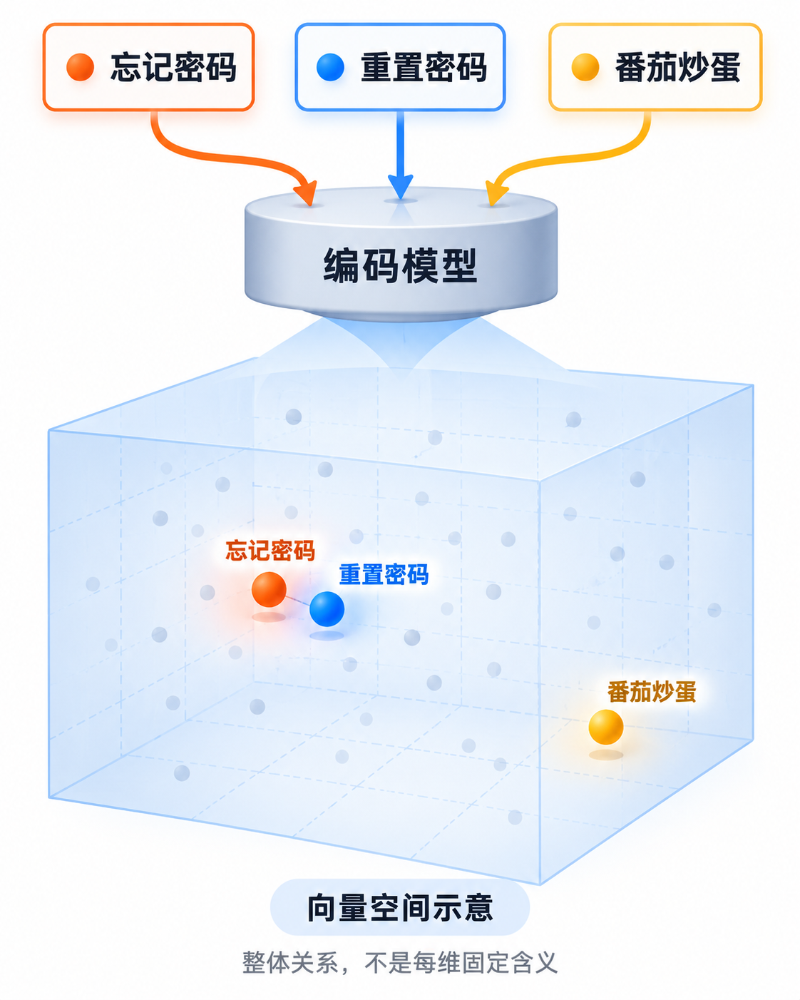
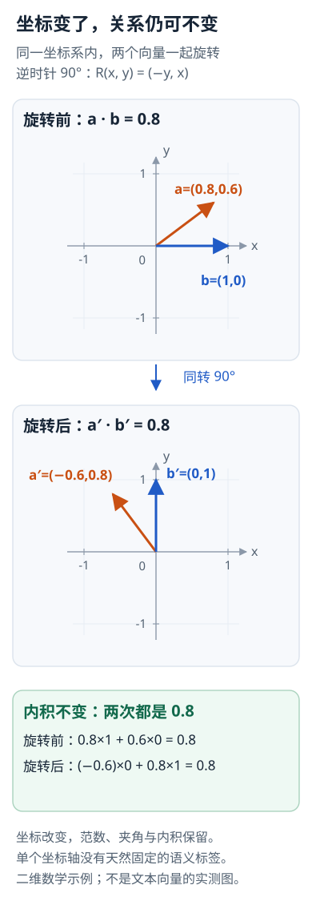

---
{
  "id": "Q-0586",
  "title": "Embedding 的本质是什么，各维度参数有什么含义？",
  "category": "rag",
  "topic": "Embedding 与向量表示",
  "type": "原理机制",
  "level": "进阶",
  "priority": "按岗位选读",
  "focus": "表示学习与向量几何关系。Embedding 把输入映为连续表示，相关对象按训练目标接近；单维通常无固定人类语义，整体几何关系才用于检索。",
  "answerStatus": "ready",
  "updatedAt": "2026-10-19"
}
---

> 在面栈阅读：[Embedding 的本质是什么，各维度参数有什么含义？](https://mianstack.com/question/q-0586)

## 核心回答

Embedding是把离散对象映射为连续向量，使任务中相关的对象在选定的几何或打分方式下更接近。文本Embedding通常由神经网络读取token，经过上下文编码、池化和可能的归一化得到，**向量是模型对输入计算出的表示，不是每篇文档各自训练的一组参数**。

向量的单个坐标通常没有固定、可直接命名的语义。信息往往分布在多个维度，相似度依赖整体表示与训练目标，不能说“第一维是年龄、第二维是情感”就适用于任意文本模型。

## 它是怎样学出语义关系的

训练可以让相关query和文档靠近，让不相关或易混淆的样本拉开；其他目标也可以学习表示。这里“接近”服务于具体任务：检索相关、语义等价和情感相似未必是同一种关系，训练分布改变后效果也可能变化。

文档编码可以预先完成，查询按配套模型编码后检索。`Qwen3 Embedding`、`BGE-M3`等使用不同骨干、池化和训练设计；同样维数不代表处在兼容空间。

用一个语义邻域示意，观察不同文本经过同一编码模型后形成的整体关系：

图中位置是假设的低维展示，用于解释相关表述可以形成邻域；不代表真实模型测量结果，也没有给单个坐标维度固定命名。

## 每个数和模型参数有什么不同

模型参数是编码函数内部学到的权重；一个文本得到的向量元素是该函数对这个输入的输出。改输入会改输出向量，更新模型也可能改变整个表示空间。

token Embedding表、某层token隐藏状态和最终检索句向量也不是同一个东西。文本检索常需要把整段内容聚合为表示；具体取`CLS`、`EOS`或均值池化，应以模型训练和接口约定为准，不能随意替换。

## 为什么不能给每维固定贴标签

仅按内积或欧氏距离比较时，给全部向量同时施加同一个正交旋转，可以保持这些关系，但每个坐标都会变化。例如a=(0.8,0.6)、b=(1,0)的内积是0.8；旋转90度后a=(-0.6,0.8)、b=(0,1)，内积仍为0.8。

这个例子说明整体几何关系不依赖某个坐标名字，不是说所有下游模型都能不作适配地任意旋转输入。可以用探针研究某些方向与属性的关系，但不应把观察到的相关性当作每维天然含义。

同一组向量旋转前后，坐标改变，而长度和内积仍然相同：

这是二维数学例子。它解释为什么不能给任意 Embedding 的每个坐标固定贴语义标签，不意味着任意下游网络都能直接接收旋转后的输入。

## 维度越多越好吗

更高维可能提供更大表示容量，也增加存储、距离计算和索引成本；效果取决于模型和训练，不只取决于维数。支持可变维表示的模型要按其规定截断或编码，并重新验证质量与归一化，不能任意删掉“看起来没用”的坐标。

最终按真实任务比较召回、排序、跨语言与领域表现；余弦高也不等于事实正确或用户有权读取。

## 对应教程

- [第18章：向量数据库与Embedding实战](https://github.com/didilili/ai-agents-from-zero/blob/c05fb5979cf0aa3b6b4ed8c29f450f640fb9c18f/18-向量数据库与Embedding实战.md)：回看编码、向量表示和检索距离，区分模型参数与输入生成的向量。

## 参考资料

- 国内：[Qwen3 Embedding](https://arxiv.org/html/2506.05176v1)：编码、池化与对比学习说明文本表示怎样从模型计算产生，以及相似关系由训练目标塑造。
- 国内：[BGE M3-Embedding](https://arxiv.org/html/2402.03216v1)：参考 BGE-M3 的表示与编码方式，说明正文中句向量、池化选择和模型参数并非同一对象。
- 国内：[JavaGuide：RAG向量存储与索引](https://github.com/Snailclimb/JavaGuide/blob/50f02a5984c062fe7221629d0a6a40ec15c26fd7/docs/ai/rag/rag-vector-store.md)：依据距离与归一化的整体几何关系，说明正文中旋转可保持相似关系却改变坐标、不能固定命名单维含义的例子。
- 国外：[Sentence-BERT](https://arxiv.org/pdf/1908.10084v1)：双编码器与句向量训练说明语义关系如何进入表示空间，文档可以预先编码。
- 国外：[Representation Learning with Contrastive Predictive Coding](https://arxiv.org/html/1807.03748v2)：依据区分正负样本的对比目标，说明正文中相似关系由任务和训练分布塑造的原因。
