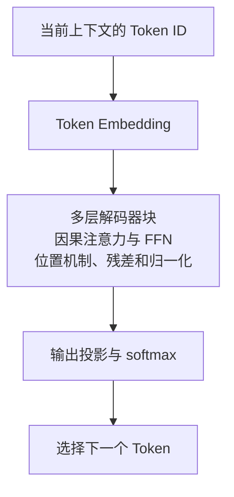

---
{
  "id": "Q-0625",
  "title": "Transformer 的整体原理是什么？",
  "category": "llm",
  "topic": "Transformer 与注意力",
  "type": "原理机制",
  "level": "进阶",
  "priority": "按岗位选读",
  "focus": "上下文交互与逐层表示变换。Token 加位置信息后经多层注意力交换上下文、前馈变换，残差和归一化稳定训练，输出头预测任务结果。",
  "answerStatus": "ready",
  "updatedAt": "2026-10-17"
}
---

## 核心回答

**Transformer 用注意力在序列位置之间交换信息，再用逐位置前馈网络变换特征，通过残差连接、归一化和多层堆叠形成上下文表示。** Token Embedding 提供内容表示，位置机制提供顺序信息；模型再按任务将最终表示映射为分类结果、向量或下一个 Token 的概率。

原始 Transformer 是 Encoder–Decoder：编码器理解输入，解码器对已有输出做因果自注意力，并通过交叉注意力读取编码器结果，逐步生成目标序列。现代生成式 LLM 常采用 Decoder-only，把提示词与已有输出放进同一序列，使用因果注意力预测下一个 Token，选出后继续生成。

因此，整体原理不能只停在 Q/K/V 公式：还要说明输入怎样变成表示、Block 怎样加工、输出怎样生成，以及训练时的并行计算为何不等于生成时一次得到全部 Token。

## 输入怎样进入模型

文本先经 Tokenizer 转成 Token ID，再通过 Embedding 查表得到向量。Token 不一定对应一个汉字或一个单词，具体划分由分词器决定。

模型还需要位置机制。原始论文把正余弦位置编码加到输入向量；现代模型也可能在注意力计算中引入位置关系，例如 RoPE。它们解决的是顺序和相对位置的表达，不应把所有位置机制都理解为“在词向量上加一个编号”。

## 一个 Transformer Block 做什么

**注意力负责跨位置读取信息。** Self-Attention 将同一序列的表示投影为 Q、K、V，用 Q 与 K 的匹配形成权重，再汇总 V；多头使用不同投影分别计算，拼接后映射回所需维度。因果 mask 限制每个位置只能读取自身及此前信息，padding mask 则处理填充位置。具体计算见[Attention 如何计算](/question/q-0036/)。

**FFN 负责逐位置的非线性变换。** 同一层对不同位置使用同一组前馈参数，不直接把位置之间混在一起；不同层通常有各自的参数。原始方案是两层线性变换加激活，现代模型也常采用门控结构。

**残差连接保留直接的信息与梯度通路，归一化帮助控制特征尺度与深层训练。** 原始论文在子层残差相加后做 LayerNorm，其他架构也可采用 Pre-Norm 等组织方式。归一化不会把任意输入变成标准正态分布，也不能单独保证模型一定训练成功。

多层堆叠让一个位置反复读取上下文并加工表示。层数、维度和头数是模型设计参数，不是所有 Transformer 都固定六层、八个头；模型能力还取决于训练数据和目标。

## 编码器与解码器如何协作

原始编码器的每层包含自注意力与 FFN，输入各位置可以读取整段输入中允许的位置。解码器除了因果自注意力和 FFN，还包含 Cross-Attention：Q 来自解码器当前表示，K、V 来自编码器输出，让生成端按需要读取输入。

例如机器翻译中，编码器先处理源句，解码器根据已生成译文与源句表示预测下一个译文 Token。源句编码结果可以复用，不需要每生成一个 Token 都重新编码源句。

Decoder-only 通常不保留这条独立的文本编码器交叉注意力链路，而将提示词和已生成内容串在同一序列中。Encoder-only 则更常用于双向表示和理解任务。这些是不同的输入输出与训练组织方式，并不意味着某一种架构完全没有理解或生成能力。

## 从表示到逐 Token 生成

下面简化展示常见 Decoder-only 语言模型的主线，位置机制、残差与归一化归入解码器块，未展开其具体先后顺序。

模型将用于预测下一 Token 的最终表示投影到词表，得到 logits，再经 softmax 形成概率分布。生成策略可以选择最大概率项，或按温度等设置采样；未遇到结束条件时，将新 Token 追加到序列，继续下一步。图示借鉴[配套教程的 Decoder-only 生成图](https://github.com/didilili/ai-agents-from-zero/blob/c05fb5979cf0aa3b6b4ed8c29f450f640fb9c18f/images/1-1/1-1-1-2-7.png)的纵向结构，补充位置、残差、归一化与 softmax 的职责后重绘。

推理可以缓存历史 K、V，减少后续步骤重复计算已知前缀的工作；缓存的是中间表示，并非词表权重或最终答案。新增 Token 仍需经过相应计算，KV Cache 没有消除自回归依赖。

## 训练为什么可以并行

标准下一 Token 预测训练已经拥有完整序列。把目标相对输入错开一位，各位置就都有自己的预测目标，可以在一次前向中并行计算，并用因果 mask 防止读取未来答案。按任务与掩码，对需要训练的位置计算损失，再反向传播更新参数。

生成时未来 Token 尚未确定，需要先选出下一个，再据此处理后续位置。长序列的普通稠密注意力还涉及大量位置两两匹配；高效算子可以降低中间存储与访存开销，但不能据此说所有注意力计算都变成线性复杂度。

## 常见追问

**有 Attention，为什么还需要 FFN？** Attention 侧重根据上下文聚合信息，FFN 提供逐位置的非线性变换容量。两者协作完成表示更新，模型知识也不是只存放在某一个组件中。

**PyTorch 的 Transformer 模块可以直接收文本吗？** `nn.Transformer` 是基础编码器–解码器结构的参考实现，输入通常已经是向量表示；Tokenizer、Token Embedding、位置机制和面向具体任务的输出处理，需要在完整应用中正确连接。也不能将它的默认配置当成现代所有 LLM 的实现。

## 对应教程

- [大模型认知与工程概览](https://github.com/didilili/ai-agents-from-zero/blob/c05fb5979cf0aa3b6b4ed8c29f450f640fb9c18f/1-1-大模型认知与工程概览.md)：§1.2.4～§1.2.5 介绍 Transformer 与三类架构、Decoder-only 的下一 Token 生成主线；本文进一步展开 Block 的分工和编码器–解码器信息流。

## 参考资料

- 国内：[Datawhale：第二章 Transformer 架构](https://github.com/datawhalechina/happy-llm/blob/main/docs/chapter2/第二章%20Transformer架构.md)：借鉴 §2.2～§2.3 对 FFN、残差、编码器和解码器的连接，组织正文完整结构，并区分原始归一化顺序与示例实现。
- 国内：[WeThinkIn：模型架构与工作原理](https://github.com/WeThinkIn/AIGC-Interview-Book/blob/275fdf1eeb65e3b233081d3b8e74ff5d8eeb2e03/大模型基础/02_模型架构与工作原理.md)：依据总体架构和 Block 的分工，说明正文中三类结构的信息组织，以及 Attention、FFN 和残差的不同职责。
- 国内：[puppylpg：从 Attention 到 KV Cache](https://puppylpg.github.io/posts/2026/06/12/transformer-inference-01-attention-kv-cache/)：依据 Q/K/V 与历史中间状态缓存的解释，说明正文中生成阶段可复用什么以及缓存为何不是答案。
- 国外：[Vaswani 等：Attention Is All You Need](https://arxiv.org/html/1706.03762v7)：依据原论文 §3 的编码器—解码器、注意力和前馈结构，说明正文中各组件的信息来源与输出概率形成过程。
- 国外：[PyTorch：Transformer](https://docs.pytorch.org/docs/2.14/generated/torch.nn.Transformer.html)：依据参考实现的向量输入、mask 与 norm_first 约定，说明正文中 PyTorch 模块与完整文本应用的区别及归一化位置的实现差异。
