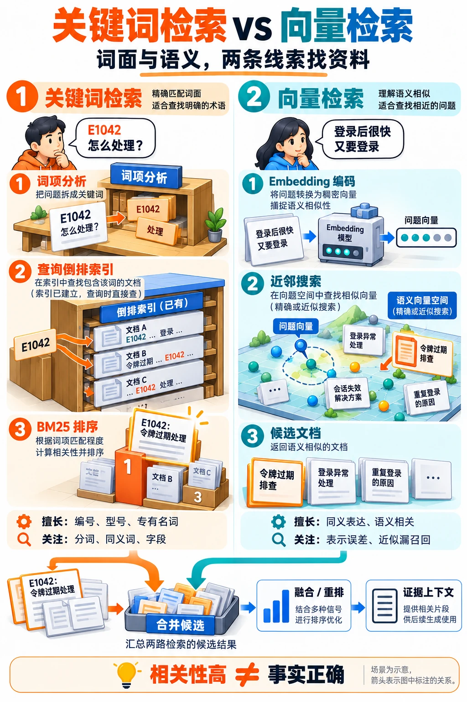

---
{
  "id": "Q-0642",
  "title": "向量检索与关键词检索有什么区别？",
  "category": "rag",
  "topic": "召回策略与检索",
  "type": "比较选型",
  "level": "基础",
  "priority": "按岗位选读",
  "focus": "精确标识与语义匹配。关键词擅精确词和错误码，向量擅同义与语义改写；两者都需权限过滤，混合后重排可弥补漏召回。",
  "answerStatus": "ready",
  "updatedAt": "2026-10-18"
}
---

> 在面栈阅读：[向量检索与关键词检索有什么区别？](https://mianstack.com/question/q-0642)

## 核心回答

**两者的主要区别是怎样判断相关：关键词检索以词项匹配为基础，向量检索以向量空间中的相似度为基础。** 在 RAG 中，向量检索通常指用 Embedding 模型生成稠密向量做语义召回。

- **关键词检索**：对文本进行分词等分析，通过倒排索引找到命中词项的文档，再用 BM25 等算法排序，适合错误码、产品型号和专有名词。
- **向量检索**：把问题和文档编码到兼容的向量空间，按余弦相似度、内积等度量找相近片段，适合用户换一种说法、文档却没有相同关键词的情况。

例如，“E1042 怎么处理”需要重视错误码命中；“刚登录不久就被迫退出”可能需要匹配“令牌过期排查”。两类信号可以互补，选择时要看查询特点、召回质量和成本；任何一种相关性分数都不能直接证明文档事实正确。

沿着两个查询往下看：错误码适合精确匹配词项，换一种说法的问题则可借助向量寻找语义相关内容。图中同时列出两条检索链路、各自容易遗漏的情况，以及候选合并的位置。

## 两类检索分别怎样工作？

### 关键词检索：匹配分析后的词项

建立索引时，系统把文本转成词项，并记录每个词项出现在哪些文档中，这就是倒排索引。查询也经过相应分析，再定位候选文档。BM25 结合词项在文档中的频次、在整个语料中的稀有程度以及文档长度计算相关性；同一个词反复出现，收益会逐渐饱和。

因此，**关键词检索不要求整句一字不差**。匹配多少词项、是否考虑词序，取决于查询类型与配置。分词、大小写归一化、同义词等也会改变匹配结果。例如配置“退钱、退款”为同义词后，两种说法可以建立联系。对于错误码，还要检查分析器是否把编号拆坏，必要时增加保留完整编码的字段或精确条件。[Elastic 的 Match 文档](https://www.elastic.co/docs/reference/query-languages/query-dsl/query-dsl-match-query)给出了词项组合和同义词扩展的具体行为。

这一路径的优势是命中原因容易检查，词项、字段与业务规则也便于控制。它的主要短板是：用户表达与文档用词差异较大、又没有相应扩展时，相关内容可能进不了候选池。

### 向量检索：匹配模型学到的表示

文档片段预先编码、建立向量索引；查询时只需生成问题向量，再寻找相近的文档向量。模型经过相关训练后，有机会把“退款规则”和“怎么退钱”映射到相近位置，减少对字面重合的依赖。这里的语义能力主要来自 Embedding 模型，向量库负责存储、索引和搜索。

这也带来两层误差：模型表示可能分不清相似主题中的关键条件；使用 HNSW 等近似索引时，还可能漏掉部分本应靠前的近邻。编码配置、距离度量、切块和索引参数都要一起检查。换一个向量库，通常不会自动修复模型把两个错误码混淆的问题。

## 用同一个运维问题看取舍

假设知识库里有“E1042：令牌过期处理”“E1402：签名校验失败”和“登录会话管理”三篇文档。

用户输入“E1042 怎么处理”时，词法通道能够保留这一关键标识；向量通道可能找到更多登录排障背景，也可能把相似编码对应的文档排在前面。用户只描述“登录后很快又要求重新登录”时，语义通道更有机会跨过措辞差异，但仍需要核对究竟是哪种故障。这个例子说明两类信号怎样互补；具体排序仍由模型、分析器和数据决定。

如果任务要求指定产品、版本或租户范围，应把这些条件交给元数据过滤或精确字段约束。选型时，在同一知识库上按错误码查询、自然语言改写等类别比较正确证据是否被召回、排名和延迟，再决定是否混合两路结果。检索后怎样使用原文，可结合[RAG 从知识入库到在线问答的完整流程](/question/q-0047/)理解。

两路结果怎样融合、何时加入重排，可继续看[向量检索、BM25、重排在混合 RAG 中如何配合](/question/q-0251/)。

## 常见追问

**稀疏向量就是 BM25 吗？** 不是。稀疏向量描述表示形式，BM25 是词项相关性算法；TF-IDF 和模型学习到的稀疏权重也可以形成稀疏表示。BGE-M3 同时提供稠密表示与稀疏词项权重，不能把它的稀疏检索直接称为 BM25。

**向量检索一定更慢、更贵吗？** 不能一概而论。它通常增加文档及查询编码的开销，但查询延迟还取决于索引、缓存、过滤和规模。应在相同数据、召回目标与并发条件下测量，而不是只按算法名称判断。

## 对应教程

- [向量数据库与 Embedding 实战](https://github.com/didilili/ai-agents-from-zero/blob/main/18-%E5%90%91%E9%87%8F%E6%95%B0%E6%8D%AE%E5%BA%93%E4%B8%8EEmbedding%E5%AE%9E%E6%88%98.md)：2.4 节区分表示类型，第 5 节解释相似度与索引，6.4 节介绍过滤和混合检索。
- [电商问数：关键词抽取与多路召回](https://github.com/didilili/ai-agents-from-zero/blob/main/%E5%AE%9E%E6%88%98%E9%A1%B9%E7%9B%AE-%E7%94%B5%E5%95%86%E9%97%AE%E6%95%B0/11-%E5%85%B3%E9%94%AE%E8%AF%8D%E6%8A%BD%E5%8F%96%E4%B8%8E%E5%A4%9A%E8%B7%AF%E5%8F%AC%E5%9B%9E.md)：第 2 节对照字段、指标的语义召回与真实字段取值的全文检索。

## 参考资料

- 国内：[JavaGuide：RAG 场景下的向量数据库](https://github.com/Snailclimb/JavaGuide/blob/50f02a5984c062fe7221629d0a6a40ec15c26fd7/docs/ai/rag/rag-vector-store.md)：参考模型表示、距离度量与近似索引的分工，区分语义表达错误和近似搜索漏召回。
- 国内：[JavaGuide：RAG 优化——从召回、重排到上下文工程](https://github.com/Snailclimb/JavaGuide/blob/50f02a5984c062fe7221629d0a6a40ec15c26fd7/docs/ai/rag/rag-optimization.md)：结合错误码等查询的互补召回与分层评测，说明什么情况下应同时保留词法和语义信号。
- 国内：[Hello-Agents：第八章记忆与检索](https://github.com/datawhalechina/hello-agents/blob/36f583c233ea5cee4537ef93455702b55053af18/docs/chapter8/%E7%AC%AC%E5%85%AB%E7%AB%A0%20%E8%AE%B0%E5%BF%86%E4%B8%8E%E6%A3%80%E7%B4%A2.md)：参考 TF-IDF 词项表示与稠密检索的对比，解释词面匹配与语义匹配的差别。
- 国内：[zero2Agent：RAG 与检索](https://github.com/ranxi2001/zero2Agent/blob/0c0eb7693105d281b146bb98f3a7f30da6f1ceea/learn-agent-interview/09-rag-retrieval/index.md)：借鉴混合检索的场景取舍，说明精确标识与自然语言改写为什么适合用不同信号补充。
- 国内：[BAAI：BGE-M3 模型文档](https://huggingface.co/BAAI/bge-m3)：依据模型文档区分稠密、稀疏和多向量检索，说明模型生成的稀疏词项权重为何不等于 BM25。
- 国外：[Elastic：BM25 Similarity](https://www.elastic.co/docs/reference/elasticsearch/index-settings/similarity)：依据 BM25 的参数定义，解释词频收益逐渐饱和，以及文档长度怎样影响相关性得分。
- 国外：[Elastic：Match Query](https://www.elastic.co/docs/reference/query-languages/query-dsl/query-dsl-match-query)：参考查询分析、词项组合和同义词扩展的行为，说明关键词检索为什么不要求整句完全相同。
- 国外：[Sentence Transformers：Retrieve & Re-Rank](https://sbert.net/examples/sentence_transformer/applications/retrieve_rerank/README.html)：依据文档与问题独立编码的召回方式，说明正文中向量近邻仍需核对具体故障对象、不能直接视为可回答证据的原因。
