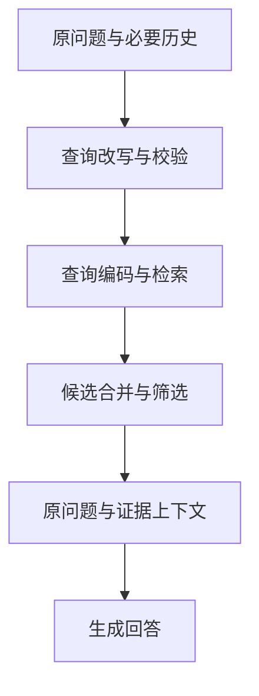

---
{
  "id": "Q-0713",
  "title": "Query Rewrite 解决什么问题，在 RAG 哪个位置执行？",
  "category": "rag",
  "topic": "查询理解与改写",
  "type": "原理机制",
  "level": "基础",
  "priority": "按岗位选读",
  "focus": "可检索表达与原始意图。检索前将口语、指代和复合问题改成可检索查询，保原意与硬约束；改写不直接充当答案证据。",
  "answerStatus": "ready",
  "updatedAt": "2026-10-17"
}
---

## 核心回答

Query Rewrite 把用户问题转换成**更适合检索、但保持原始意图的查询**，主要解决口语和文档用词不一致、多轮指代或省略、以及一个问题包含多个检索点等情况。

它通常位于 RAG 在线问答的**查询理解阶段、检索召回之前**。向量检索分支应先得到改写文本，再生成查询向量；关键词分支用相应的检索词执行查询。召回之后再进行结果合并、筛选或重排，组织证据并生成回答，不需要因此重新计算整库文档向量。

例如前一轮已经明确在讨论“产品 A 的企业版”，用户再问“它支持私有部署吗”，可以补成“产品 A 企业版是否支持私有化部署及部署条件”。如果产品或版本尚未确定，就应澄清，不能靠模型猜出来。改写通常保留原始问题作为对照，必要时让原 Query 和改写 Query 分别召回，减少改错意图造成的遗漏。

## 展开说明

### 1. 它改变的是检索入口

Query Rewrite 可以采用术语词典、规则、语言模型或组合方式。输入是当前问题和必要的已确认上下文，输出是一条或少量检索查询；需要时还可输出已识别的实体和条件，供程序校验。

常见处理包括：

- **补齐指代和省略**：把“它”“刚才那个版本”等替换为历史中已明确的对象，形成可独立检索的问题。
- **规范表达**：纠正拼写、展开有依据的缩写，或补充文档常用同义词，缩小用户问法与资料表达之间的差异。
- **拆开检索点**：比较两种产品的部署和计费时，可按产品、维度拆成子问题，再分别收集证据。

同义表达扩展仍围绕一个信息需求；子问题拆分则把复合问题分为需要分别回答的部分。两者都能放在查询处理阶段，但不能只因为生成了多条字符串，就认为已经完成合理拆解。

### 2. 在链路中怎样接入

下面只展示在线问答的主要顺序，改写结果先参与检索，检索结果随后才进入生成上下文。

向量查询需要使用与文档索引兼容的查询编码方式；BM25 等关键词检索则按各自接口处理查询文本。这里改的是查询侧输入，文档解析、切块和建索引属于离线资料准备。

多路召回时，可以将原问题与若干改写分别送入检索器，再按片段 ID 去重并融合结果；根据需要重排、裁剪，才决定最终提供哪些证据。生成阶段仍保留原始用户需求及必要的对话关系，避免模型只围绕改写词回答而漏掉用户真正的问题。

Query Rewrite 与 Rerank 的位置和作用不同：前者改变检索要查什么，后者在已有候选中判断哪些更相关。候选池中没有所需证据时，重排不能凭空补出证据；而候选已经合适时，也未必需要额外改写。

### 3. 怎样避免越改越偏

改写要保住实体、数字、否定、时间、版本和用户明确的范围。例如“旧版产品 A 不联网时能否部署”不能被改成“最新版产品 A 云端部署”。关键字段可以单独保存，生成后与原输入对照检查。

补全只能依据已确认信息；有多个可能对象时先澄清，不把猜测写成确定条件。权限、租户和可访问知识库范围由可信程序确定，也不能让改写模型通过修改自然语言绕过。

对于型号、错误码、订单号等精确标识，改写可能丢词或替换错，因此保留原查询的检索入口通常很有价值。若预算只允许一条查询，也可选择经过验证的独立改写，但需要检查它是否损害精确匹配。改写失败、超时或校验不通过时，可回退原 Query；必要信息确实缺失时则继续澄清。

### 4. 什么时候值得启用

问题已经清楚、术语精确时，可以直接检索。遇到多轮省略、口语化、缩写或复合问题，再启用相应的改写方式；不必对所有问题都生成很多查询。

验证时保留原问题、改写结果和各路候选，对照检查正确证据是否更容易被找到，实体和条件有没有漂移，以及最终回答是否改善。同时记录额外模型调用、检索耗时与上下文开销，不能用“改写更长、更流畅”判断有效。

## 常见追问

### 三个问题分别召回 Top-6，就把 18 段都交给模型吗？

不应直接这样做。18 是去重前的候选数量上界，多个查询可能命中相同片段，还可能混入无关内容。应合并去重、保留各子问题所需的证据，并按质量和 Token 预算选取最终上下文。候选池大小与最终提供给模型的数量是两个参数。

### 检索之后还能再改写吗？

可以。当首轮证据不足时，系统可以根据缺口生成新的查询并重新检索。因此改写可以出现在多轮检索循环中；但对于它所影响的那一轮召回，仍然发生在召回之前。需要限制重试次数和停止条件，避免不停换问法搜索。

### HyDE 算改写吗？会不会把编造内容带进答案？

HyDE 属于查询变换的一种方式：先生成假设性回答或文档，再用其表示寻找真实资料。假设内容只是检索线索，不能作为最终回答的证据；生成答案时仍要依据实际召回的文档，并检查是否找到了足够支持。

## 对应教程

- [RAG 检索增强生成](https://github.com/didilili/ai-agents-from-zero/blob/c05fb5979cf0aa3b6b4ed8c29f450f640fb9c18f/19-RAG%E6%A3%80%E7%B4%A2%E5%A2%9E%E5%BC%BA%E7%94%9F%E6%88%90.md)：阅读查询向量化、召回、上下文组装和生成的在线流程，以及进阶方向中的查询改写、多查询和 HyDE，明确改写作用于查询侧的位置。

## 参考资料

- 国内：[JavaGuide：RAG 优化中的 Query Rewrite](https://github.com/Snailclimb/JavaGuide/blob/50f02a5984c062fe7221629d0a6a40ec15c26fd7/docs/ai/rag/rag-optimization.md)：参考规范表达、多查询和拆分的适用场景，说明正文中改写如何缓解问法与文档用词差异。
- 国内：[zero2Agent：RAG 与检索](https://github.com/ranxi2001/zero2Agent/blob/0c0eb7693105d281b146bb98f3a7f30da6f1ceea/learn-agent-interview/09-rag-retrieval/index.md)：依据实体条件补全、缺槽澄清和时间版本约束，说明正文中改写只能采用已确认上下文并保持用户意图的要求。
- 国内：[Datawhale：Hello-Agents 第八章高级检索策略](https://github.com/DatawhaleChina/hello-agents/blob/36f583c233ea5cee4537ef93455702b55053af18/docs/chapter8/%E7%AC%AC%E5%85%AB%E7%AB%A0%20%E8%AE%B0%E5%BF%86%E4%B8%8E%E6%A3%80%E7%B4%A2.md)：借鉴多查询生成、失败回退与按 ID 合并的实现，说明正文中扩展查询后仍需去重和控制最终候选预算。
- 国外：[Microsoft：Rewrite queries with semantic ranker](https://learn.microsoft.com/en-us/azure/search/semantic-how-to-query-rewrite)：依据先改写再让原查询与改写查询召回的流程，说明正文中保留精确标识及失败回退原 Query 的边界。
- 国外：[LlamaIndex：Query Transform Cookbook](https://developers.llamaindex.ai/python/examples/query_transformations/query_transform_cookbook/)：借鉴改写、路由、子问题与 HyDE 的职责区分，说明正文中同义扩展、拆分与假设文档仅作为检索线索的不同用途。
