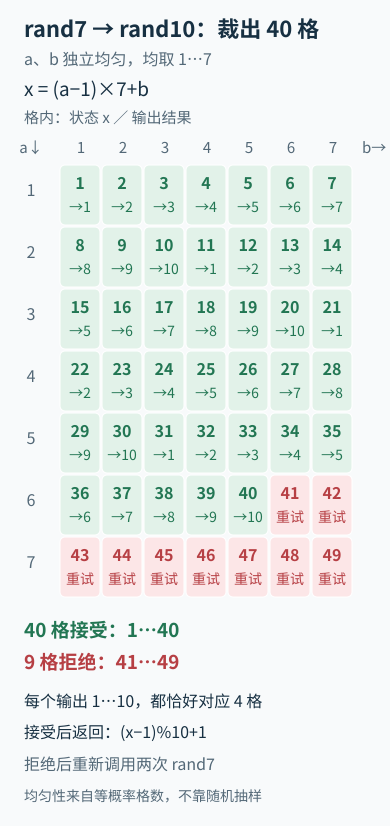

---
{
  "id": "Q-0738",
  "title": "使用 rand7 实现 rand10。",
  "category": "coding",
  "topic": "数组、字符串与哈希",
  "type": "代码题",
  "level": "进阶",
  "priority": "按岗位选读",
  "focus": "等概率映射与拒绝采样。两次 rand7 得1..49均匀值，只收1..40再模10映射，41..49重试；接受区间让每个输出恰对应4种状态。",
  "formatTags": ["现场编码"],
  "answerStatus": "ready",
  "updatedAt": "2026-10-19"
}
---

## 核心回答

两次独立调用rand7，组合成49个等概率状态：x=(a−1)×7+b，范围1至49。只接受1至40，再按余数映射到1至10；41至49拒绝后重试。接受区间长度是10的倍数，每个结果恰有4个对应状态，因此无偏。

前提是每次rand7独立且在1至7均匀。直接把两次结果相乘并不会生成均匀的1至49，例如1只有(1,1)，6有多种因子组合，有些数还根本不能产生。

## Python实现

通过参数传入题目提供的rand7，便于测试；在线判题时也可以直接调用全局rand7。

```python
def rand10(rand7):
    while True:
        a = rand7()
        b = rand7()
        x = (a - 1) * 7 + b
        if x <= 40:
            return (x - 1) % 10 + 1
```

这里没有调用其他随机源。若x=1返回1，x=40返回10；x=41及49都重新采样。不能对全部49个状态直接取模，因为有的结果对应5个状态，有的只有4个。

将两次调用分别放在行和列，49 个状态的接受与拒绝范围就很清楚：



格内数字是 x，颜色对应最终输出。只有两次调用独立且均匀，49 格才等概率；被拒绝时重新采样，不能直接给最后九格分配结果。

## 为什么拒绝重试仍然均匀

任意一个输出j，在单轮中有4个可接受状态，概率为4/49；拒绝一轮概率9/49。考虑可以先失败任意多轮：

```text
P(输出j) = (4/49) × [1 + 9/49 + (9/49)² + …]
         = (4/49) / (1 - 9/49)
         = 1/10
```

对每个j都相同，因此多次拒绝不改变最终分布。若随机源有偏或调用相关，这个证明就不成立，不能靠取模自动修复。

## 复杂度与调用次数

每轮2次rand7，成功概率40/49，期望轮数49/40，期望调用数为2×49/40=2.45。也可用递推E=2+(9/49)E得到相同结果。

期望时间O(1)、额外空间O(1)，但最坏重试次数没有有限上界；在独立均匀前提下，持续失败概率趋于0，几乎必然终止。若追问减少调用，可继续回收被拒绝状态中残余的随机性再扩展范围，但要重新证明每阶段的均匀性，不能直接把41至49随意映射。

## 如何检查实现

枚举全部49种输入对，确认映射一一覆盖1至49，接受的40种中每个输出出现4次；再用可控输入序列覆盖一次或多次拒绝后成功。大量随机抽样只能观察频率接近，不能代替上述等概率证明。

## 参考资料

- 国内：[Doocs：用Rand7实现Rand10](https://leetcode.doocs.org/lc/470/)：借鉴扩展到 49 个等概率状态并拒绝多余状态的方法，说明正文中 rand7 到 rand10 的构造。
- 国内：[OI Wiki：条件概率与独立性](https://oi-wiki.org/math/probability/conditional-probability/)：用条件概率解释接受集合内仍均匀，不把取模当自动无偏。
- 国内：[OI Wiki：随机变量的数字特征](https://oi-wiki.org/math/probability/exp-var/)：用期望与全期望递推计算调用次数。
- 国外：[LeetCode：Implement Rand10 Using Rand7](https://leetcode.com/problems/implement-rand10-using-rand7/description/)：依据原题均匀输出且只使用 rand7 的限制，确定正文随机源及拒绝重试的实现约定。
- 国外：[Python Software Foundation：random](https://docs.python.org/3.13/library/random.html)：依据随机整数映射的均匀性要求，解释正文中不能把全部 49 个状态直接取模的原因。
