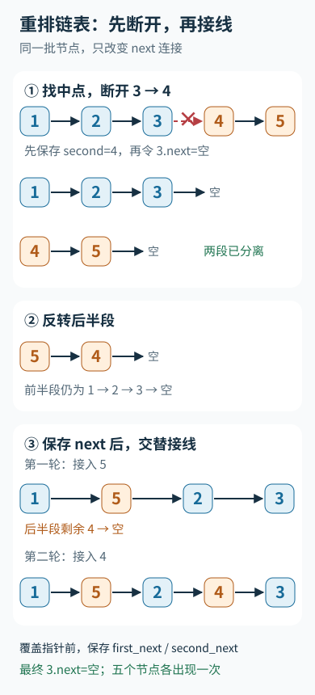

---
{
  "id": "Q-0750",
  "title": "重排链表。",
  "category": "coding",
  "topic": "链表、栈与队列",
  "type": "代码题",
  "level": "进阶",
  "priority": "按岗位选读",
  "focus": "链表分段与原地重连。快慢指针找中点，断开并反转后半段，再交替连接两段节点；保存后继指针，避免丢链或成环。",
  "formatTags": ["现场编码"],
  "answerStatus": "ready",
  "updatedAt": "2026-10-19"
}
---

## 核心回答

将单链表 `L0 → L1 → … → Ln` 重排为 `L0 → Ln → L1 → Ln-1 → …`，要求修改节点的连接，不能只交换节点值。可以用**快慢指针找中点、反转后半段、交替合并**，时间复杂度 O(n)，额外空间 O(1)。

## 三步怎样衔接

1. 快指针每次走两步，慢指针每次走一步。循环结束时，慢指针位于前半段的尾部；奇数长度时，中间节点归前半段。
2. 保存后半段头节点，再把前半段末尾的 `next` 设为 `None`。反转后半段，让尾部节点能依次被取出。
3. 每次从前半段、反转后的后半段各取一个节点，按“前、后、前、后”重新连接。前半段长度不少于后半段，所以以后半段耗尽作为终止条件。

例如 `1 → 2 → 3 → 4 → 5`：先拆成 `1 → 2 → 3` 和 `4 → 5`，后半段反转为 `5 → 4`，再合并为 `1 → 5 → 2 → 4 → 3`。

把五个节点的拆分、反转与交替接线连起来看：



图中箭头代表 next；拆分处先断开，合并后尾节点仍指向空，节点的值和身份都没有交换。

## Python 实现

```python
class ListNode:
    def __init__(self, val=0, next=None):
        self.val = val
        self.next = next


def reorder_list(head):
    if head is None or head.next is None:
        return

    slow = fast = head
    while fast.next is not None and fast.next.next is not None:
        slow = slow.next
        fast = fast.next.next

    second = slow.next
    slow.next = None

    prev = None
    while second is not None:
        nxt = second.next
        second.next = prev
        prev = second
        second = nxt

    first, second = head, prev
    while second is not None:
        first_next = first.next
        second_next = second.next
        first.next = second
        second.next = first_next
        first = first_next
        second = second_next
```

函数原地修改链表，不需要返回新的头节点。保存 `first_next`、`second_next` 后再接线，避免覆盖指针导致后续节点丢失。

## 为什么不会成环或丢节点

拆分后，两段链表没有共享节点，且各自以空指针结尾。反转只改变后半段的边；合并时，每轮都从两个尚未合并的链表头部各取一个节点，再接到结果中。每个节点恰好进入结果一次，最后保留前半段可能多出的中间节点。

最容易漏掉的是 `slow.next = None`。不断开原连接就合并，旧边可能与新边连成环。偶数长度、奇数长度、只有一个节点都要检查；实现额外兼容空链表。

## 常见追问

**能不能用数组？** 可以先保存所有节点引用，再按两端向中间重连，实现更直观，但要 O(n) 额外空间，最后仍必须把尾节点的 `next` 清空。

**为什么不递归找尾节点？** 反复扫描尾节点会退化为 O(n²)；递归拆解虽然能做到线性时间，也会占用调用栈。这里三次线性遍历仍然是 O(n)，且只使用固定数量的指针。

## 参考资料

- 国内：[Doocs：重排链表](https://leetcode.doocs.org/lc/143/)：借鉴找中点、反转与交替合并的三步解法，组织正文中原地重排链表的线性时间实现。
- 国内：[Hello算法：链表](https://www.hello-algo.com/chapter_array_and_linkedlist/linked_list/)：依据节点引用、next 修改与断链操作，解释正文中拆分后再重连为何能防止丢节点和形成环。
- 国内：[WeThinkIn：线性数据结构高频考点](https://github.com/WeThinkIn/AIGC-Interview-Book/blob/275fdf1eeb65e3b233081d3b8e74ff5d8eeb2e03/数据结构%26算法基础/02_线性数据结构高频考点.md)：依据单链表只能沿 next 顺序访问的性质，说明正文中先反转后半段以依次取出尾部节点的原因。
- 国外：[LeetCode：Reorder List](https://leetcode.com/problems/reorder-list/)：依据不能修改节点值及奇偶顺序的题意，说明正文中节点身份保持不变、中间节点归前半段的约定。
- 国外：[Python软件基金会：Assignment statements](https://docs.python.org/3/reference/simple_stmts.html#assignment-statements)：依据属性赋值改变对象链接的语义，说明正文中重连原节点与复制节点值的区别。
