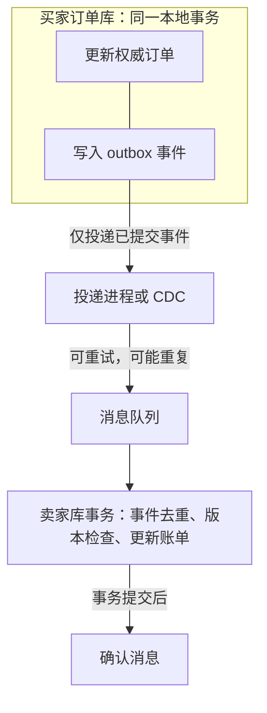

---
{
  "id": "Q-0836",
  "title": "为卖家账单建立镜像表时，如何保证买家表和卖家表双写一致？",
  "category": "software",
  "topic": "分布式系统与一致性",
  "type": "方案设计",
  "level": "深入",
  "priority": "按岗位选读",
  "focus": "可靠投影与双表收敛。权威事务写 outbox，可靠投影卖家表，按版本幂等更新并对账。",
  "answerStatus": "ready",
  "updatedAt": "2026-10-27"
}
---

> 在面栈阅读：[为卖家账单建立镜像表时，如何保证买家表和卖家表双写一致？](https://mianstack.com/question/q-0836)

## 核心回答

若卖家账单表是订单权威数据的查询投影，我会用“本地事务记录订单与待发送事件，可靠投递后幂等更新投影，再持续对账”的方案实现最终一致。只在业务代码里先写买家表、再写卖家表，两次独立提交之间总有一边成功、另一边失败的窗口。

若两表确实在同一数据库事务内，可直接用本地事务原子提交；跨库且要求立即强一致，则需要评估分布式事务及其延迟、可用性成本。不能把异步投影说成两表任何时刻都完全相同。

## Outbox 怎样补上可靠交接

1. 在买家订单所在数据库的同一个本地事务中，更新订单并写入 `outbox`，保存事件标识、订单标识、业务版本与变更内容。
2. 投递进程或 `CDC` 从已提交事件中发送消息，投递失败可重试；发送后标记也可能丢失，因此按至少一次交付设计消费者。
3. 卖家库在同一事务中完成去重记录和账单更新。使用事件唯一约束防重复，按订单业务版本阻止旧事件覆盖新状态，提交后再确认消息。
4. 监控投影延迟、失败与死信，并按订单版本或校验摘要对账修复。

图中的两个本地事务各自原子提交；消息传递期间允许投影暂时落后，失败后通过重试和对账收敛。

事件只包含增量时，不能随意跳过中间版本，否则可能漏算。若采用“只接受更高版本”的覆盖策略，事件应包含足以重建该行的完整状态，或检测版本缺口并回查权威数据。

## 订单查询还要考虑哪些边界

镜像表保留卖家查询需要的字段和索引，明确一次订单是否包含多个卖家、拆单后使用哪个业务标识。删除和撤销也要携带版本或保留墓碑，避免旧消息将已撤销记录重新创建。

首次构建需要一致的全量基线与增量衔接，再切换查询流量。投影落后时可以展示更新时间、稍后重试，或对少量关键记录回查权威订单；读取哪种结果是产品契约的一部分。

`MQ`、`CDC` 和重试都不能单独保证业务一致性。权威事务、可靠事件、投影幂等、乱序处理和对账共同形成完整链路。

## 参考资料

- 国内：[JavaGuide：分布式事务](https://github.com/Snailclimb/JavaGuide/blob/50f02a5984c062fe7221629d0a6a40ec15c26fd7/docs/distributed-system/distributed-transaction.md)：采用本地消息表、可靠交接与最终一致的职责划分。
- 国内：[阿里巴巴：Canal工作原理](https://github.com/alibaba/canal/blob/master/README.md)：核对通过数据库变更日志取得已提交变化的`CDC`链路；`CDC`不代替投影幂等和对账。
- 国内：[阿里云：消息幂等](https://help.aliyun.com/zh/document_detail/146983.html)：采用业务唯一标识处理重复发送与重复投递，区分消息标识和业务动作。
- 国内：[Leo（编程导航）：接口幂等性](https://github.com/liyupi/codefather/blob/24587506abdee3f4257a873fed8e18163d925670/%E7%9F%A5%E8%AF%86%E7%A2%8E%E7%89%87/%E4%BB%80%E4%B9%88%E6%98%AF%E6%8E%A5%E5%8F%A3%E7%9A%84%E5%B9%82%E7%AD%89%E6%80%A7%EF%BC%8C%E5%A6%82%E4%BD%95%E4%BF%9D%E8%AF%81%E6%8E%A5%E5%8F%A3%E7%9A%84%E5%B9%82%E7%AD%89%E6%80%A7%EF%BC%9F.md)：参考唯一索引识别重复写入的做法，说明投影消费者需要去重约束，并将去重记录与账单更新一起提交。
- 国外：[AWS：Transactional outbox pattern](https://docs.aws.amazon.com/prescriptive-guidance/latest/cloud-design-patterns/transactional-outbox.html)：采用权威数据与事件同事务提交，消除双写窗口，并考虑重复消息与顺序。
- 国外：[MySQL 8.4：事务提交与回滚](https://dev.mysql.com/doc/refman/8.4/en/commit.html)：核对单库事务的原子提交边界，说明跨库两次独立写入不在同一本地事务内。
