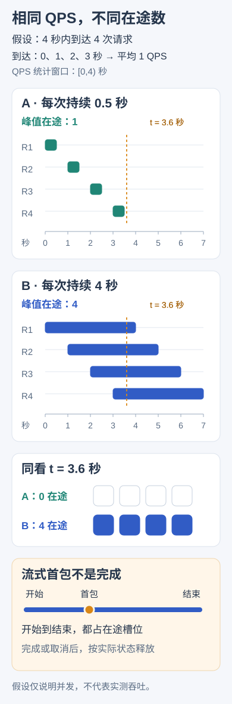

---
{
  "id": "Q-0887",
  "title": "如何对 Agent 接口限流，并按轻重模型和成本实施差异化限流？",
  "category": "ai_engineering",
  "topic": "性能、时延与成本",
  "type": "方案设计",
  "level": "进阶",
  "priority": "按岗位选读",
  "focus": "请求、并发与成本多维配额。同时限速率并发 token 金额，按租户模型配额，重模型更紧，降级有质量门槛。",
  "answerStatus": "ready",
  "updatedAt": "2026-10-19"
}
---

> 在面栈阅读：[如何对 Agent 接口限流，并按轻重模型和成本实施差异化限流？](https://mianstack.com/question/q-0887)

## 核心回答

Agent 接口应同时控制请求速率、在途并发、Token 用量和费用预算，并按租户、接口、模型或供应商分配配额。只按 `QPS` 限流不足以控成本：一个长上下文、多轮工具调用请求，可能比几十个简单请求更贵、占用资源更久。

轻重模型可以有不同的限额和调度优先级，但切换必须满足任务质量、上下文、工具能力和数据边界，不能只因为便宜就无条件降级。

同样的到达速率，处理时长不同会积累出不同的在途请求：

数例只用于区分速率与并发。流式请求返回首包后通常仍在运行，应在真正结束或取消清理后归还占用的容量。

## 如何组织限流

入口先限制租户或用户的请求量和并发，防止单个调用方占满系统；编排层再限制每次 Agent 的轮数、工具调用数、最大输出和总时间；模型调用层按实际供应商配额控制 `RPM`、`TPM` 或输入/输出 Token 等维度。多个实例共享配额时，需要集中计数或合理分配实例预算，避免每个实例各放一份全额。

速率可采用令牌桶等机制，并发用有界信号量控制，排队有长度和时间上限。流式输出虽然已返回首包，推理仍在占用在途容量，应在请求真正结束或取消清理后归还相应资源。

## 成本怎样估算和结算

请求进入时，可以按输入 Token、最大输出预算、模型单价和预计调用轮数预留费用；完成后按实际用量结算并释放剩余预算。取消或超时未必让供应商停止计费，重试和工具费用也需要计入。平台各模型的限流、缓存计量和价格口径会变化，应从当前配置读取，并记录计量版本。

对重模型设置较低并发和独立预算，给简单分类、改写等任务使用满足质量要求的轻模型；复杂推理或低置信任务可按规则升级，并设升级次数上限。模型切换后要重新核对工具调用、结构化输出和上下文长度，避免为了降本产生错误结果或循环重试。

## 过载与故障时怎么办

资源不足时，根据任务时效选择排队、稍后重试、异步处理、缓存结果或受控降级。遇到可恢复的限流，遵守供应商返回的等待建议并使用有限退避；预算耗尽等错误不能盲目重试。持续失败的模型通道可熔断，再小流量探测恢复。

最终按租户和模型观察成功任务成本、质量、`P95/P99`、排队、Token 与重试放大率。只有费用下降且可接受质量保持，才说明差异化策略达到目标。

## 参考资料

- 国内：[JavaGuide / Snailclimb：常见限流算法](https://github.com/Snailclimb/JavaGuide/blob/50f02a5984c062fe7221629d0a6a40ec15c26fd7/docs/high-availability/limit-request.md)：令牌桶、排队与集群限流的机制帮助设计入口配额，并区分速率上限和并发上限。
- 国内：[阿里云百炼：限流](https://help.aliyun.com/zh/model-studio/rate-limit)：模型独立配额与账号聚合规则帮助划分多实例、多租户和多模型的预算边界。
- 国内：[阿里云百炼：限流应对最佳实践](https://help.aliyun.com/zh/model-studio/rate-limiting-best-practices)：参考请求速率、Token 配额与并发的多维限制，解释正文中只按 QPS 无法控制长任务资源和成本的原因。
- 国外：[Anthropic：Rate limits](https://platform.claude.com/docs/en/api/rate-limits)：费用上限与速率限制的区分帮助设计独立预算，并说明不同平台的 Token 计量需按当前规则处理。
- 国外：[AWS Builders’ Library：Timeouts, retries, and backoff with jitter](https://aws.amazon.com/builders-library/timeouts-retries-and-backoff-with-jitter/)：超时、退避和抖动部分帮助避免模型限流后多层同步重试放大请求与费用。
