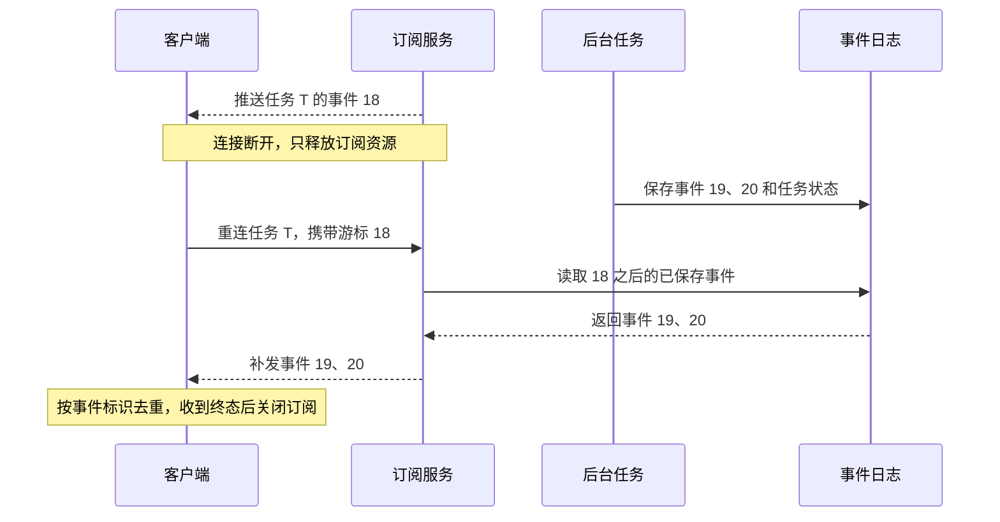

---
{
  "id": "Q-0946",
  "title": "SSE 如何处理断连并进行心跳保活？",
  "category": "software",
  "topic": "消息队列与实时通信",
  "type": "方案设计",
  "level": "进阶",
  "priority": "按岗位选读",
  "focus": "连接保活与任务状态解耦。服务端定期注释心跳并感知断开释放连接，代理禁缓冲/设合适超时；客户端退避重连而任务状态独立保留。",
  "answerStatus": "ready",
  "updatedAt": "2026-10-27"
}
---

> 在面栈阅读：[SSE 如何处理断连并进行心跳保活？](https://mianstack.com/question/q-0946)

## 核心回答

`SSE` 保活主要靠服务端周期性写入并刷新心跳，以及把代理的空闲超时设置得长于心跳间隔。心跳可以使用 `: ping\n\n` 这样的注释事件；具体间隔根据整个链路最短的空闲超时选择，不能只照抄一个固定秒数。

断连后，连接资源应释放，业务任务是否继续由任务模型决定。原生 `EventSource` 会自动尝试重连；基于 `Fetch` 的实现则要自行约定重试、退避和事件恢复。客户端重新订阅同一任务，不应重新创建一次任务。

## 服务端与客户端分别处理

- **服务端**：任务没有输出时仍发送心跳；感知连接关闭后停止写入，清理订阅、队列和相关协程。若任务需要后台继续，任务状态和结果独立保存，不能随连接一并销毁。
- **代理层**：关闭会延迟推送的响应缓冲，检查网关、负载均衡和服务容器的空闲与总时长限制。心跳只能缓解空闲超时，不能绕过明确的连接最大寿命。
- **客户端**：区分认证失败、限流、业务终态和瞬态网络错误；瞬态错误采用带抖动的退避并限制重试频率。收到任务终态后关闭订阅，不继续盲目重连。

## 如何补回断线期间的数据

服务端为可重放事件分配稳定递增序号并持久保存。重连时根据 `Last-Event-ID` 或显式游标补发后续事件；已过保留期则返回任务快照或明确的恢复方式。只有设置 `id` 而没有日志和重放逻辑，仍然无法补回丢失事件。

下面假设事件 18 已经被客户端处理，服务端仍保留后续恢复日志：

心跳不要推进业务恢复游标。慢客户端也需要有界缓冲和断开策略，避免一条长连接持续积压内存。网络切换、代理空闲关闭、服务重启、重复事件和主动取消，都应分别验证。

## 对应教程

- [电商问数第15章：API接口基础与FastAPI入门](https://didilili.github.io/ai-agents-from-zero/#/实战项目-电商问数/15-API接口基础与FastAPI入门)：回看流式响应与`SSE`消息格式。
- [电商问数第17章：前后端联调与日志追踪](https://didilili.github.io/ai-agents-from-zero/#/实战项目-电商问数/17-前后端联调与日志追踪)：回看`progress`、`result`、`error`的前后端约定。

## 参考资料

- 国内：[阿里云：传统 HTTP 模式与 SSE](https://help.aliyun.com/en/oss/user-guide/sse-mode-description)：采用事件标识与单向事件流的基础格式，说明恢复游标需要在同一任务内使用。
- 国内：[阿里云百炼：流式输出](https://help.aliyun.com/zh/model-studio/stream)：采用连接资源、客户端实时读取和代理缓冲的注意事项，解释保活要检查整条链路。
- 国内：[CloudWeGo：Hertz SSE](https://www.cloudwego.io/zh/docs/hertz/tutorials/basic-feature/sse/)：核对客户端断连感知与最后事件标识，说明断开后要释放流资源。
- 国内：[阿里云点金：Agent 事件数据模型](https://dianjin.fis.aliyuncs.com/docs/quickstart/data-model)：借鉴独立心跳不推进事件ID、业务终态单独表示的设计，区分连接活跃和任务进展。
- 国外：[WHATWG：Server-sent events](https://html.spec.whatwg.org/multipage/server-sent-events.html)：核对注释心跳、自动重连与`Last-Event-ID`，并区分游标传递和服务端重放。
- 国外：[Microsoft：Fetch Event Source](https://github.com/Azure/fetch-event-source)：核对`Fetch`客户端自定义退避和错误处理，说明它与原生`EventSource`自动重连的不同。
- 国外：[NGINX：ngx_http_proxy_module](https://nginx.org/en/docs/http/ngx_http_proxy_module.html#proxy_buffering)：核对响应缓冲、`X-Accel-Buffering`以及相邻两次读取之间的超时。
