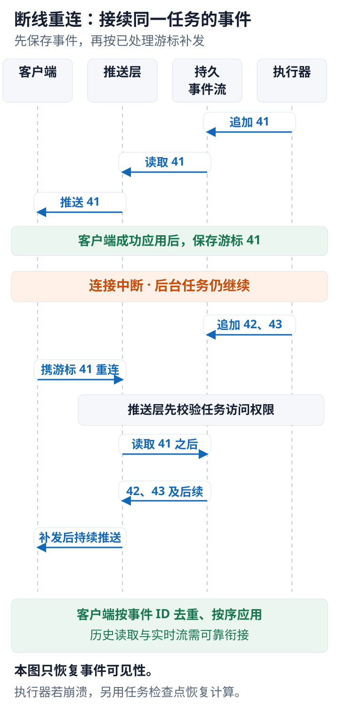

---
{
  "id": "Q-0947",
  "title": "客户端断网重连后如何断点续传，避免任务从头执行？",
  "category": "software",
  "topic": "消息队列与实时通信",
  "type": "方案设计",
  "level": "深入",
  "priority": "按岗位选读",
  "focus": "事件补发与执行检查点。稳定 task_id 与事件序号持久化，重连携最后位置补发；执行进程失败再从检查点恢复，不重做已完成副作用。",
  "answerStatus": "ready",
  "updatedAt": "2026-10-19"
}
---

> 在面栈阅读：[客户端断网重连后如何断点续传，避免任务从头执行？](https://mianstack.com/question/q-0947)

## 核心回答

把任务执行与客户端连接解耦：任务有稳定的 `task_id` 和持久状态，推送事件有可恢复的序号。客户端断网后，重新连接同一个任务并携带最后处理位置，服务端补发缺失事件；如果工作进程也失败，再由任务检查点决定从哪里恢复执行。

“续传已经产生的结果”和“继续未完成计算”是两件事。只重建 `SSE` 连接，无法自动恢复已经丢失的任务状态。

## 任务与事件如何保存

任务提交时持久记录请求标识、任务状态和必要输入，重复提交通过幂等键返回同一个任务。执行器持续产生带任务 ID、递增事件 ID、类型和内容的事件，并保存在可重放的存储中。事件保留期和最大积压需要有界。

重连时服务端先校验用户是否有权访问该任务，再按游标读取之后的事件，然后衔接实时流。历史补发到实时订阅的切换要避免间隙，例如先取得订阅或读取高水位，再补到对应位置；不能查询完历史后才开始监听，从而漏掉交界处事件。

`SSE` 原生 `EventSource` 可根据事件的 `id` 保存最后事件 ID，并在重连时使用 `Last-Event-ID`；如果采用 fetch 流式读取，则需要自行维护游标和重连。浏览器机制不会替服务端存储历史，也不提供端到端“恰好一次展示”。

下面用事件 41、42、43 说明：重连补的是事件，后台继续的是同一任务。

事件编号只作顺序示例。历史补发与实时订阅必须可靠衔接；若执行器也崩溃，计算恢复仍需另外读取任务检查点。

## 如何处理重复、过期与完成

客户端按事件 ID 去重并按序应用，重要游标在成功应用后保存；服务端可以允许重放重叠事件，避免网络不确定性造成漏传。任务完成后返回明确的终态与结果地址，重连应能查询已完成结果，而非再启动一次任务。

如果游标早于保留窗口，应返回可识别的恢复方式，例如获取完整结果快照后接后续事件，或说明任务已过期。慢客户端不能无限拖住执行器，应做背压、断开或快照同步。

## 计算过程怎样恢复

把阶段进度与中间产物写到可靠存储，执行器恢复后从最近有效检查点继续。检查点与外部副作用不一定原子，重跑节点仍需幂等或结果查询，特别是订单、扣费等动作。

[对应教程第 25 章](https://github.com/didilili/ai-agents-from-zero/blob/c05fb5979cf0aa3b6b4ed8c29f450f640fb9c18f/25-LangGraph高级特性.md)区分流式可见性与持久化恢复，可用于理解为什么 `SSE` 游标不能替代工作流检查点。

## 参考资料

- 国内：[JavaGuide / Snailclimb：Web 实时消息推送：SSE](https://github.com/Snailclimb/JavaGuide/blob/50f02a5984c062fe7221629d0a6a40ec15c26fd7/docs/system-design/web-real-time-message-push.md)：借鉴 SSE 的长响应与单向推送机制，说明正文中连接只负责传输，任务状态与可重放历史需由应用保存。
- 国内：[JavaGuide / Snailclimb：接口幂等性设计详解](https://github.com/Snailclimb/JavaGuide/blob/50f02a5984c062fe7221629d0a6a40ec15c26fd7/docs/high-availability/idempotency.md)：参考业务请求标识与去重的说明，解释正文中客户端重连或重复提交为何应回到同一个任务。
- 国内：[zero2Agent / ranxi2001：故障容错与安全控制](https://github.com/ranxi2001/zero2Agent/blob/0c0eb7693105d281b146bb98f3a7f30da6f1ceea/learn-agent-interview/03-fault-tolerance/index.md)：借鉴恢复路径与状态绑定的说明，区分正文中的连接恢复与计算检查点，并说明重跑副作用需要幂等。
- 国外：[WHATWG：HTML Standard: Server-sent events](https://html.spec.whatwg.org/multipage/server-sent-events.html)：事件 ID 与重连请求头的规范说明游标怎样随原生 EventSource 重连传递。
- 国外：[LangChain / LangGraph：Persistence](https://docs.langchain.com/oss/python/langgraph/persistence)：官方持久化职责解释恢复计算需要保存图状态，而非只重新建立推送连接。
